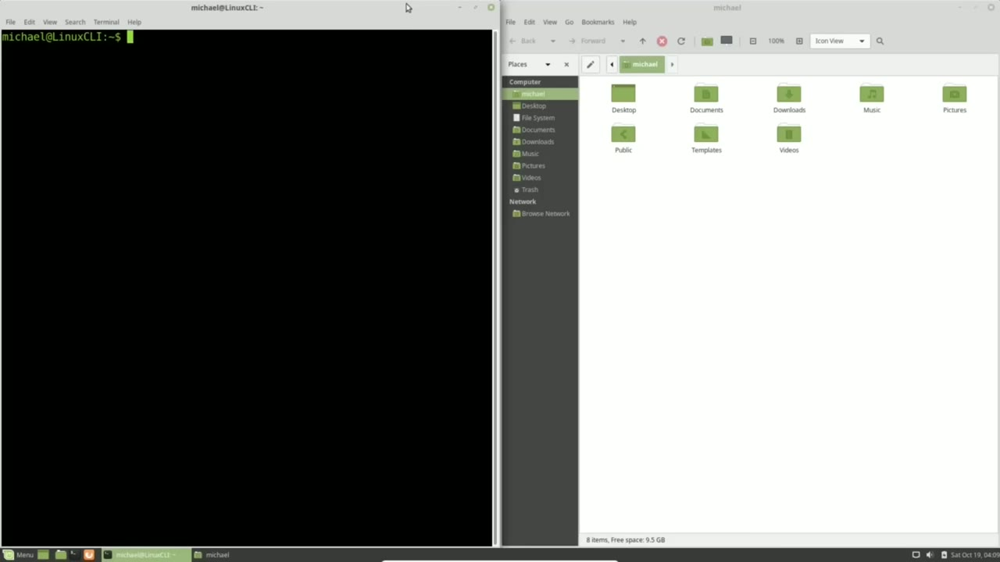
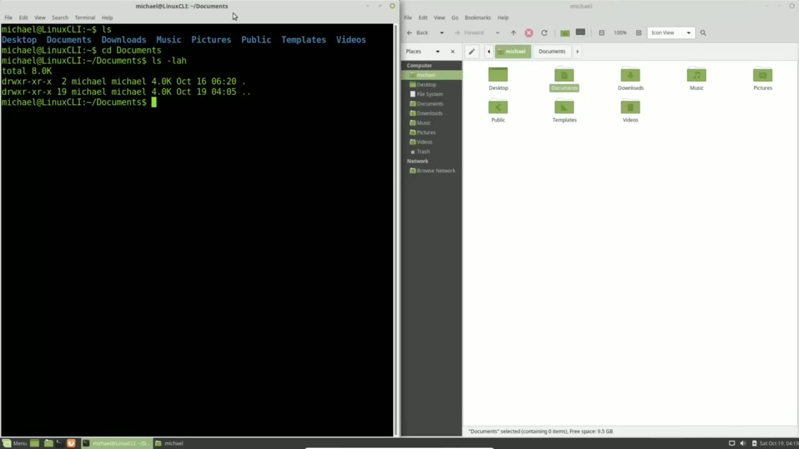
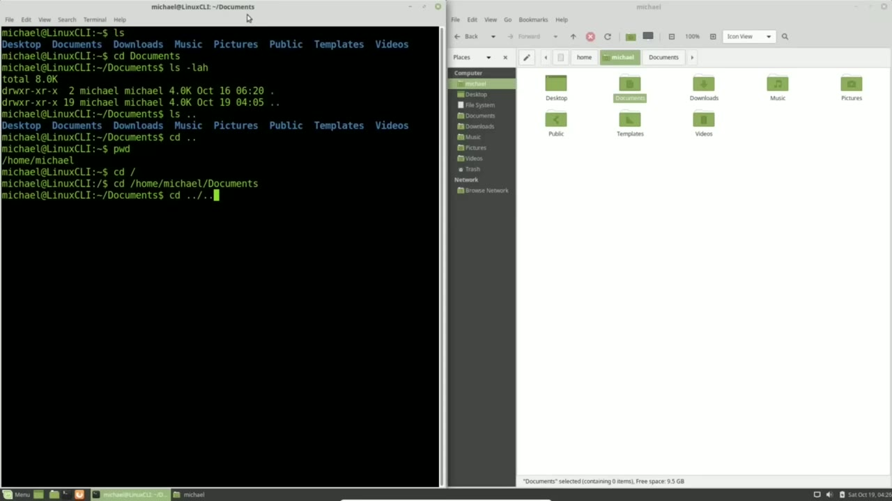

[← Course contents](../../01.md)

# 4. CD - Change Directory

**Course:** [Linux Command Line - Entire Tutorial Series](https://www.youtube.com/watch?v=avg65oY7sj4)  
**Transcript:** [`Linux Command Line - Entire Tutorial Series transcript`](../../../../course_videos/Linux%20Command%20Line%20-%20Entire%20Tutorial%20Series/Linux%20Command%20Line%20-%20Entire%20Tutorial%20Series.txt)  
**Video:** 00:22:00–00:31:28 ([open at this time](https://www.youtube.com/watch?v=avg65oY7sj4&t=1320s))

## Introduction

I've opened up the File Manager on the right and the terminal on the left as we did in the last video. In the last video we saw we are in the same directory in our terminal as we are in the File Manager and we did this by typing ls. To go into one of the folders in our file manager, we would double click on the folder we want to go into. I'm going into the Documents folder by double clicking on it.

## Detailed Explanation

<details>
  <summary>Step 1 — Run `ls`, `cd`</summary>

### Step 1 — Run `ls`, `cd`

- [x] **Use `ls`**
  - I've opened up the File Manager on the right and the terminal on the left as we did in the last video.
  - In the last video we saw we are in the same directory in our terminal as we are in the File Manager and we did this by typing `ls`.
  - To go into one of the folders in our file manager, we would double click on the folder we want to go into.

- [x] **I'm going into the Documents folder by double clicking on it**
  - I'm going into the Documents folder by double clicking on it.
  - So to go back into the Michael directory, I'm moving my mouse over the arrow up.
  - And when I hover over it, we see Open the Parent folder.

- [x] **And I'm clicking on this to go up one folder**
  - And I'm clicking on this to go up one folder.
  - Going over to the command line, we see the directories listed here.
  - Remember, we call them folders in the file manager, but when we're in the command line, we call them directories.

- [x] **Use `cd`**
  - To change from the director I'm in to the documents directory, I will type `cd` for change directory, and then the directory name that I want to go into.
  - In this case, it's the documents directory.
  - Pressing Enter takes us into the Documents Directory.

- [x] **Now on my screen, my command prompt, that's this part before the**
  - Now on my screen, my command prompt, that's this part before the dollar sign here.
  - Actually, it's including this dollar sign here.

```bash
ls
cd
```



</details>

<details>
  <summary>Step 2 — Run `ls dot`, `cd dot`, `pwd`</summary>

### Step 2 — Run `ls dot`, `cd dot`, `pwd`

- [x] **My command prompt shows me that I'm in the Documents directory**
  - My command prompt shows me that I'm in the Documents directory.
  - That it is possible for you to change the look of your command prompt.
  - Now we're going to focus on the fact that we're in the Documents Directory.

- [x] **And in this directory, I want to type that command that we saw in the**
  - And in this directory, I want to type that command that we saw in the last video.
  - Actually, there are two hidden directories, the dot or period, and the dot dot, or period, period.
  - We'll find these two hidden directories in every directory.

- [x] **Use `ls dot`**
  - The dot file is the current directory, and the dot dot file means the parent directory, the directory right above this directory.
  - For example, if I type `ls dot` dot dot, pressing Enter, shows us the list of content in the parent directory.
  - And we're still in the documents directory.

- [x] **Use `cd dot`**
  - To go up to the parent directory, I will type, `cd dot` dot.
  - We're just telling it to go up one directory.
  - Pressing Enter takes me back to the Michael directory.

- [x] **Use `pwd`**
  - In the file manager, we know which directory we're in because it's highlighted here, showing us we're in the Michael directory.
  - In the command line, to see which directory we are in, I will type `pwd`.
  - Now this stands for Print Working Directory.

- [x] **Some people might refer to it as present working directory, but the**
  - Some people might refer to it as present working directory, but the Man page shows this as Print Working Directory.
  - I'll press Enter, and it shows us that we are in the Home Michael directory.
  - Going back to this file manager, we don't see the Home Directory.

- [x] **But if I click this left pointing triangle button, We then see the**
  - But if I click this left pointing triangle button, We then see the Home folder and a picture of a hard drive showing us that we are at the beginning of our path.
  - The path is what we call this list of directories we're looking at.
  - Going back over to the terminal, we see our current working directory has a path of forward /home, forward slash Michael, which makes us think that home is the first directory, but that's not true. The first directory is actually just the forward slash by itself.

- [x] **cd forward slash. So now we're in the first directory. Only we don't**
  - cd forward slash. So now we're in the first directory. Only we don't call it the first directory. We call it the root directory. The idea behind calling it the root directory is to think of that forward slash directory as the root of a tree. And then all those directories and files
  - Being the branches and leaves growing out from the root directory. Now we can talk about absolute directories.
  - An absolute directory is when we give the whole path, starting from the root directory.

```bash
ls dot
cd dot
pwd
```



</details>

<details>
  <summary>Step 3 — Run `cd dot`</summary>

### Step 3 — Run `cd dot`

- [x] **For example, to go into the documents directory, I will type cd**
  - For example, to go into the documents directory, I will type cd space, and I will type the full path or the absolute path of forward /home forward slash Michael forward slash documents.
  - Because I started my path from the root directory.
  - Meaning it started with a forward slash.

- [x] **There's absolutely no question which directory I want to go to**
  - There's absolutely no question which directory I want to go to.
  - And pressing Enter takes me into that documents directory.
  - So now we're in the documents directory.

- [x] **Now the other option is the relative path that we saw earlier**
  - Now the other option is the relative path that we saw earlier.
  - Meaning we want to go to a place that is relative to where we are at the moment.
  - If you have problems remembering the difference, the relative path means the first thing you want to do is just go up to the parent directory or down to a child directory.

- [x] **Use `cd dot`**
  - Parents and children are related, so we are using the relative path.
  - When we start with a forward slash, it means go to the root directory first because we're going to give this the full path to where we want to go to.
  - We would type `cd dot` dot go up one directory.

- [x] **If we want to go up two directories, I would put a forward slash and**
  - If we want to go up two directories, I would put a forward slash and another dot dot.
  - Go up the parent directory of the parent directory.
  - And we can do this as many times as directories that we have.

- [x] **In this case, I want to go up one directory**
  - In this case, I want to go up one directory.
  - Then I want to go into the downloads directory.

```bash
cd dot
```


</details>

<details>
  <summary>Step 4 — Run `cd dot`, `cd till`, `last`</summary>

### Step 4 — Run `cd dot`, `cd till`, `last`

- [x] **Use `cd dot`**
  - I can do that by typing `cd dot` dot forward slash And then I'll start with d-o-w-n.
  - And I don't have to type out the whole directory name.
  - I can press the tab key and it will auto-complete the directory name that I have.

- [x] **Now, if there aren't enough letters to make this unique, let's say I**
  - Now, if there aren't enough letters to make this unique, let's say I have just forward slash do and I press the tab key, nothing happens.
  - I'll have to press the tab key a second time.
  - Now I see it asking me, do I mean the documents directory?

- [x] **Or the downloads directory. These both start with do**
  - Or the downloads directory. These both start with do.
  - And then it returns me to where I was with the cd.
  - So I can add enough letters to make this unique.

- [x] **That would be enough to make this unique**
  - That would be enough to make this unique.
  - Now takes me into the downloads directory.
  - If I want to jump back to the directory I was just in, which in this case was the Documents Directory.

- [x] **I can type cd space, hyphen, or -sign**
  - I can type cd space, hyphen, or -sign.
  - Pressing Enter takes me back to the documents directory.
  - And this works pretty well as long as I don't go to another directory in between there, because it takes me to the `last` directory I was in.

- [x] **Use `cd till`**
  - If I want to jump right to my home directory from no matter where I am on the system, I can type cd and enter.
  - And it takes me right to the home directory.
  - If I want to go to my downloads, directory I can type `cd till` day forward slash down auto complete and that till day takes us to our home directory first and then the downloads directory now this one is interesting because the till day is representing the forward

- [x] **/home forward slash Michael in this case if the user was named user 1**
  - /home forward slash Michael in this case if the user was named user 1 The tillday forward slash would then go to the home user 1 downloads directory.
  - And pressing enter shows us that we're in the downloads directory.
  - Now if you look a little closer at this command prompt, you'll see the till day right here.

- [x] **Use `last`**
  - This is telling us that we are in the user's home directory forward slash downloads.
  - Now the `last` thing I want to mention in this video is using the arrow up key.
  - The `last` command. And I can go back as many as we have on file.

- [x] **And arrow down takes me to the next. Now once we have our command**
  - And arrow down takes me to the next. Now once we have our command here, we can press enter and submit this command again, or I can back up and change this directory.
  - Maybe this time I want to go into the videos directory. I can change the command pressing enter. And now I'm in the videos directory. In the next video, we will continue the Linux command line. I still have my file manager open on the right and my command line

```bash
cd dot
cd till
last
```



</details>

<details>
  <summary>Questions and Answers</summary>

## Questions and Answers

### Question 1: What does `ls` do in this chapter?

<details>
<summary>Answer</summary>

- [x] In the last video we saw we are in the same directory in our terminal as we are in the File Manager and we did this by typing `ls`.

</details>

### Question 2: What does `cd` do in this chapter?

<details>
<summary>Answer</summary>

- [x] To change from the director I'm in to the documents directory, I will type `cd` for change directory, and then the directory name that I want to go into.

</details>

### Question 3: What does `ls dot` do in this chapter?

<details>
<summary>Answer</summary>

- [x] For example, if I type `ls dot` dot dot, pressing Enter, shows us the list of content in the parent directory.

</details>

### Question 4: What does `cd dot` do in this chapter?

<details>
<summary>Answer</summary>

- [x] To go up to the parent directory, I will type, `cd dot` dot.

</details>

### Question 5: What does `pwd` do in this chapter?

<details>
<summary>Answer</summary>

- [x] In the command line, to see which directory we are in, I will type `pwd`.

</details>

### Question 6: What does `cd till` do in this chapter?

<details>
<summary>Answer</summary>

- [x] If I want to go to my downloads, directory I can type `cd till` day forward slash down auto complete and that till day takes us to our home directory first and then the downloads directory now this one is interesting because the till day is representing the forward

</details>

### Question 7: What does `last` do in this chapter?

<details>
<summary>Answer</summary>

- [x] The `last` command. And I can go back as many as we have on file.

</details>

### Question 8: What does step 1 cover (Run ls, cd)?

<details>
<summary>Answer</summary>

- [x] I've opened up the File Manager on the right and the terminal on the left as we did in the last video.
- [x] In the last video we saw we are in the same directory in our terminal as we are in the File Manager and we did this by typing `ls`.
- [x] To go into one of the folders in our file manager, we would double click on the folder we want to go into.

</details>

### Question 9: What does step 2 cover (Run ls dot, cd dot, pwd)?

<details>
<summary>Answer</summary>

- [x] My command prompt shows me that I'm in the Documents directory.
- [x] That it is possible for you to change the look of your command prompt.
- [x] Now we're going to focus on the fact that we're in the Documents Directory.

</details>

### Question 10: What does step 3 cover (Run cd dot)?

<details>
<summary>Answer</summary>

- [x] For example, to go into the documents directory, I will type cd space, and I will type the full path or the absolute path of forward /home forward slash Michael forward slash documents.
- [x] Because I started my path from the root directory.
- [x] Meaning it started with a forward slash.

</details>

</details>

## Summary

This chapter, CD - Change Directory, walks through Run ls, cd; Run ls dot, cd dot, pwd; Run cd dot; Run cd dot, cd till, last. Commands from the transcript: `ls`, `cd`, `ls dot`, `cd dot`, `pwd`, `cd till`, `last`.

## References

- [Linux Command Line - Entire Tutorial Series (YouTube)](https://www.youtube.com/watch?v=avg65oY7sj4)
- [This chapter at 00:22:00](https://www.youtube.com/watch?v=avg65oY7sj4&t=1320s)
- [Local transcript](../../../../course_videos/Linux%20Command%20Line%20-%20Entire%20Tutorial%20Series/Linux%20Command%20Line%20-%20Entire%20Tutorial%20Series.txt)
