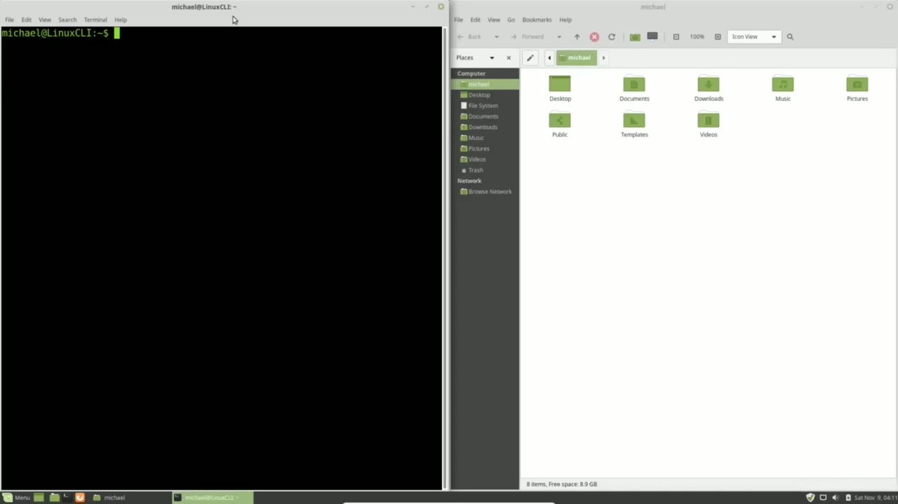
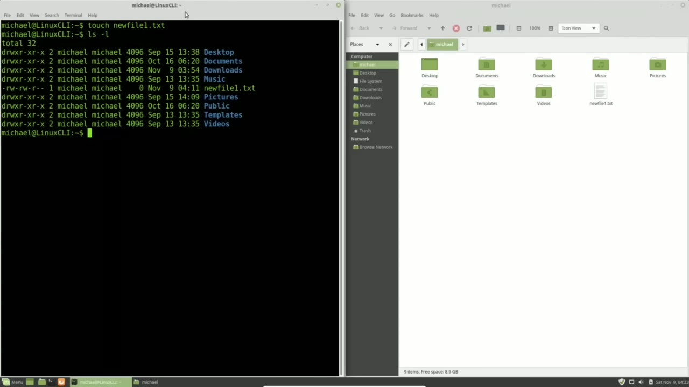
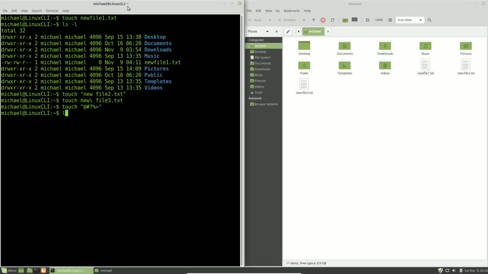
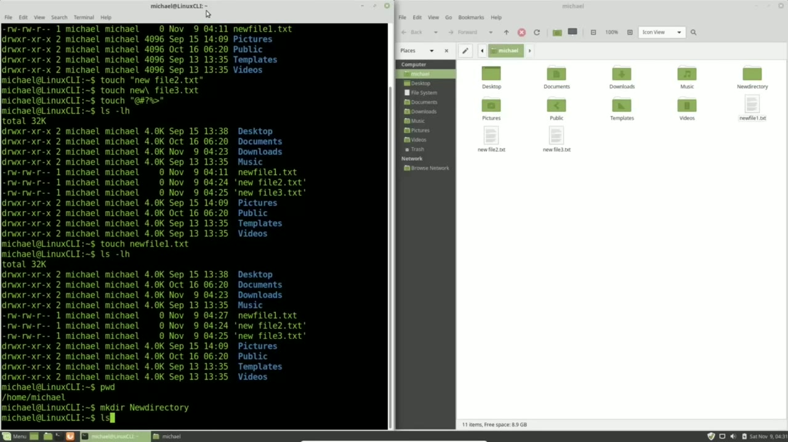

[← Course contents](../../01.md)

# 5. Touch and mkdir

**Course:** [Linux Command Line - Entire Tutorial Series](https://www.youtube.com/watch?v=avg65oY7sj4)  
**Transcript:** [`Linux Command Line - Entire Tutorial Series transcript`](../../../../course_videos/Linux%20Command%20Line%20-%20Entire%20Tutorial%20Series/Linux%20Command%20Line%20-%20Entire%20Tutorial%20Series.txt)  
**Video:** 00:31:28–00:40:54 ([open at this time](https://www.youtube.com/watch?v=avg65oY7sj4&t=1888s))

## Introduction

Terminal open on the left. I want to add a new file to my home directory from the command line and I'm going to do it using the touch command. How the touch command works is we type touch then the new file name we want to create. So I will type touch new file 1.txtee and pressing enter Shows us on the right in our file browser, we see that file show up right away. And we can see it in our terminal by typing ls and I'm going to add the -L option and then press enter.

## Detailed Explanation

<details>
  <summary>Step 1 — Run `touch`, `ls`</summary>

### Step 1 — Run `touch`, `ls`

- [x] **Use `touch`, `ls`**
  - Terminal open on the left. I want to add a new file to my home directory from the command line and I'm going to do it using the `touch` command. How the `touch` command works is we type `touch` then the new file name we want to create. So I will type `touch` new file 1.txtee and pressing enter
  - Shows us on the right in our file browser, we see that file show up right away.
  - And we can see it in our terminal by typing `ls` and I'm going to add the -L option and then press enter.

- [x] **In the terminal it shows the green text for the new file 1 and all**
  - In the terminal it shows the green text for the new file 1 and all the others are in bold blue text because they're directories and our new file 1.t.TXT is a file.
  - You may not have the text color settings turned on.
  - And won't be able to tell the difference between the files and directories by color.

- [x] **But we can tell which is a directory by looking in this first**
  - But we can tell which is a directory by looking in this first character in the long directory.
  - The D and the first characters are for directories and the dash is for a file.
  - So this one line with the dash is our file name and the rest are all directories.

- [x] **When creating files in Linux, The file name does have a file name**
  - When creating files in Linux, The file name does have a file name length limit of 255 characters.
  - Now that is an awful lot of characters so that should not be a problem for us.
  - There are a few special characters that Linux won't let you use, but other than that, you can name a file anything you like.

- [x] **Now just because you can name a file anything you like does not mean**
  - Now just because you can name a file anything you like does not mean that's always a good idea.
  - So Unix came up with some guidelines for naming your Unix file names. The general guidelines for naming Unix files is only use lowercase A to Z, 0 to 9, periods, underscores, and hyphens.

```bash
touch
ls
```



</details>

<details>
  <summary>Step 2 — Run `touch`</summary>

### Step 2 — Run `touch`

- [x] **The reason they suggest your file names be all lowercase is because**
  - The reason they suggest your file names be all lowercase is because Linux is case sensitive, meaning a file with the name My File Name.T and a file with My File Name.TXT and a file with My FileName.TXT with an uppercase M are actually two different files.
  - In Windows and Mac operating systems, this doesn't matter.
  - There can only be one file called My File Name.T If you try and copy over the two files, My FileName.T and My FileName.T with the uppercase M to a Windows or Mac operating system, it will either overwrite one of the files or give you a warning that that file name already exists.

- [x] **Also, when referring to files you've created, you don't have to stop**
  - Also, when referring to files you've created, you don't have to stop and think, did I use uppercase letters in that file name?
  - So that's the reasoning behind using all lowercase characters.
  - Only use lowercase A to Z, 0 to 9, periods, underscores, and hyphens.

- [x] **Mainly because other operating systems like Windows and Apple won't**
  - Mainly because other operating systems like Windows and Apple won't be able to read those file names and It's a good idea to be consistent with your file names on all the computers you use.
  - The computers you use today and the computers you may use in the future.
  - Always use extensions like.txty.bmp and.jp and.jp.

- [x] **Extensions like.txts and.bmp should be used with your file names to**
  - Extensions like.txts and.bmp should be used with your file names to help you out.
  - The computer doesn't care if you have extensions on your file names or not.
  - But you and other humans looking at that computer will be able to tell the difference between commands, file names and directory names just by looking at the file name.

- [x] **Don't start your file name with a hyphen. It could be mistaken for a**
  - Don't start your file name with a hyphen. It could be mistaken for a command option.
  - And we already talked about starting your file names with a period if you want that to be a hidden file.
  - That's it for the Unix Guidelines. In reality...

- [x] **Use `touch`**
  - People use uppercase characters and spaces all the time.
  - To include a space in your file name, you just need to put quotes around your file name.
  - And I'll do that with the `touch` command by typing `touch`, quote, new spacefile2.T quote and enter.

- [x] **And over in the file browser on the right we see new space file 2.t**
  - And over in the file browser on the right we see new space file 2.t.
  - And they don't have to be the double quotes.
  - And then the other option is to use the escape character, which is the backslash.

- [x] **Use `touch`**
  - `touch` new backslash.
  - Pressing Enter shows that that's created.
  - So that backslash or the escape character as it's called tells us that the space after new is part of the file name.

- [x] **Use `touch`**
  - And not the end of the file name. Now with Linux you can create a file name of special characters like `touch` quote at symbol hashtag question mark percent sign greater than quote pressing enter shows that that file is created but this is really a bad idea and I'm
  - Going to remove that right now by right click in our file browser and delete Now going back to the `touch` command, what `touch` will do is check to see if a file exists, and if that file does not exist, it will create it.
  - But if that file does exist, it will update the timestamp.

```bash
touch
```



</details>

<details>
  <summary>Step 3 — Run `ls -lh`, `touch`, `ls -lah`</summary>

### Step 3 — Run `ls -lh`, `touch`, `ls -lah`

- [x] **Use `ls -lh`, `touch`**
  - I'm going to type `ls -lh` and press enter.
  - And we see that our new file 1 was created at 411.
  - I'm going to `touch`.

- [x] **Use `ls -lah`**
  - And now I'm going to type that `ls -lah` one more time.
  - And I'm using my arrow up key to bring back that command.
  - Now we see the file was last updated at 427.

- [x] **So the last update time has changed from 411 to 427**
  - So the last update time has changed from 411 to 427.
  - Now there are other ways to create files and we'll talk about them later.
  - Right now, I want to look at how to create a directory.

- [x] **Actually, before we create a directory, I want to take a look at the**
  - Actually, before we create a directory, I want to take a look at the directory names in our home directory.
  - Do you notice that they do not follow the Unix standard of all lowercase?
  - All the directories in our home directory start with an uppercase or capital letter.

- [x] **Use `pwd`**
  - When I type `pwd`, notice the Home Directory and the Michael directory are all lowercase.
  - So it's only the directories in the Michael directory that start with the uppercase character.
  - I want to make a new directory and I'm going to keep the same standard that has been set with an uppercase letter for the first character.

- [x] **Use `mkdir`**
  - To make a new directory in the Linux command line, we would type `mkdir` for Make Directory, then a space and then the directory name that we want to create.
  - And when I press Enter, we see it right away in the file browser on the right.

```bash
ls -lh
touch
ls -lah
pwd
mkdir
```



</details>

<details>
  <summary>Step 4 — Run `ls`, `mkdir`, `touch`</summary>

### Step 4 — Run `ls`, `mkdir`, `touch`

- [x] **Use `ls`, `mkdir`**
  - And I'll type `ls`.
  - And there we see the new directory in the terminal as well.
  - If I want to create a new directory inside of that directory, I can type `mkdir` for Make Directory.

- [x] **And I want this to be in the new directory**
  - And I want this to be in the new directory.
  - And I'm using the tab to auto complete there.
  - I'll call this new directory, new directory.

- [x] **2. And if I want to create another directory inside there, let's say**
  - 2. And if I want to create another directory inside there, let's say we want to do new directory 3.
  - This will not work and I'll show this by pressing enter.
  - The problem is it needs to have new directory 2 created before it can create new directory 3.

- [x] **If I want to create both of those directories in a single command**
  - If I want to create both of those directories in a single command, I'm pressing arrow up to bring back my last command.
  - To go to the beginning of the command line, I'm going to press Control A.
  - And then Control E will take us to the end of the command line.

- [x] **So I'm pressing Control A to get to the beginning of the command line**
  - So I'm pressing Control A to get to the beginning of the command line.
  - And I need to give it the option -P for create all parent directories needed to create the directory we want at the end of the command.
  - Has created that directory but we don't see anything because in Linux no news is good news we would have to go over into our file browser double click and double click to show them or cd into them in our Linux command line and there's our directory 3 in the next tutorial

- [x] **Use `touch`**
  - We'll continue looking at the Linux command line in the last video we created files with the `touch` command

```bash
ls
mkdir
touch
```



</details>

<details>
  <summary>Questions and Answers</summary>

## Questions and Answers

### Question 1: What does `touch` do in this chapter?

<details>
<summary>Answer</summary>

- [x] Terminal open on the left. I want to add a new file to my home directory from the command line and I'm going to do it using the `touch` command. How the `touch` command works is we type `touch` then the new file name we want to create. So I will type `touch` new file 1.txtee and pressing enter

</details>

### Question 2: What does `ls` do in this chapter?

<details>
<summary>Answer</summary>

- [x] And we can see it in our terminal by typing `ls` and I'm going to add the -L option and then press enter.

</details>

### Question 3: What does `ls -lh` do in this chapter?

<details>
<summary>Answer</summary>

- [x] I'm going to type `ls -lh` and press enter.

</details>

### Question 4: What does `ls -lah` do in this chapter?

<details>
<summary>Answer</summary>

- [x] And now I'm going to type that `ls -lah` one more time.

</details>

### Question 5: What does `pwd` do in this chapter?

<details>
<summary>Answer</summary>

- [x] When I type `pwd`, notice the Home Directory and the Michael directory are all lowercase.

</details>

### Question 6: What does `mkdir` do in this chapter?

<details>
<summary>Answer</summary>

- [x] To make a new directory in the Linux command line, we would type `mkdir` for Make Directory, then a space and then the directory name that we want to create.

</details>

### Question 7: What does step 1 cover (Run touch, ls)?

<details>
<summary>Answer</summary>

- [x] Terminal open on the left. I want to add a new file to my home directory from the command line and I'm going to do it using the `touch` command. How the `touch` command works is we type `touch` then the new file name we want to create. So I will type `touch` new file 1.txtee and pressing enter
- [x] Shows us on the right in our file browser, we see that file show up right away.
- [x] And we can see it in our terminal by typing `ls` and I'm going to add the -L option and then press enter.

</details>

### Question 8: What does step 2 cover (Run touch)?

<details>
<summary>Answer</summary>

- [x] The reason they suggest your file names be all lowercase is because Linux is case sensitive, meaning a file with the name My File Name.T and a file with My File Name.TXT and a file with My FileName.TXT with an uppercase M are actually two different files.
- [x] In Windows and Mac operating systems, this doesn't matter.
- [x] There can only be one file called My File Name.T If you try and copy over the two files, My FileName.T and My FileName.T with the uppercase M to a Windows or Mac operating system, it will either overwrite one of the files or give you a warning that that file name already exists.

</details>

### Question 9: What does step 3 cover (Run ls -lh, touch, ls -lah)?

<details>
<summary>Answer</summary>

- [x] I'm going to type `ls -lh` and press enter.
- [x] And we see that our new file 1 was created at 411.
- [x] I'm going to `touch`.

</details>

### Question 10: What does step 4 cover (Run ls, mkdir, touch)?

<details>
<summary>Answer</summary>

- [x] And I'll type `ls`.
- [x] And there we see the new directory in the terminal as well.
- [x] If I want to create a new directory inside of that directory, I can type `mkdir` for Make Directory.

</details>

</details>

## Summary

This chapter, Touch and mkdir, walks through Run touch, ls; Run touch; Run ls -lh, touch, ls -lah; Run ls, mkdir, touch. Commands from the transcript: `touch`, `ls`, `ls -lh`, `ls -lah`, `pwd`, `mkdir`.

## References

- [Linux Command Line - Entire Tutorial Series (YouTube)](https://www.youtube.com/watch?v=avg65oY7sj4)
- [This chapter at 00:31:28](https://www.youtube.com/watch?v=avg65oY7sj4&t=1888s)
- [Local transcript](../../../../course_videos/Linux%20Command%20Line%20-%20Entire%20Tutorial%20Series/Linux%20Command%20Line%20-%20Entire%20Tutorial%20Series.txt)
