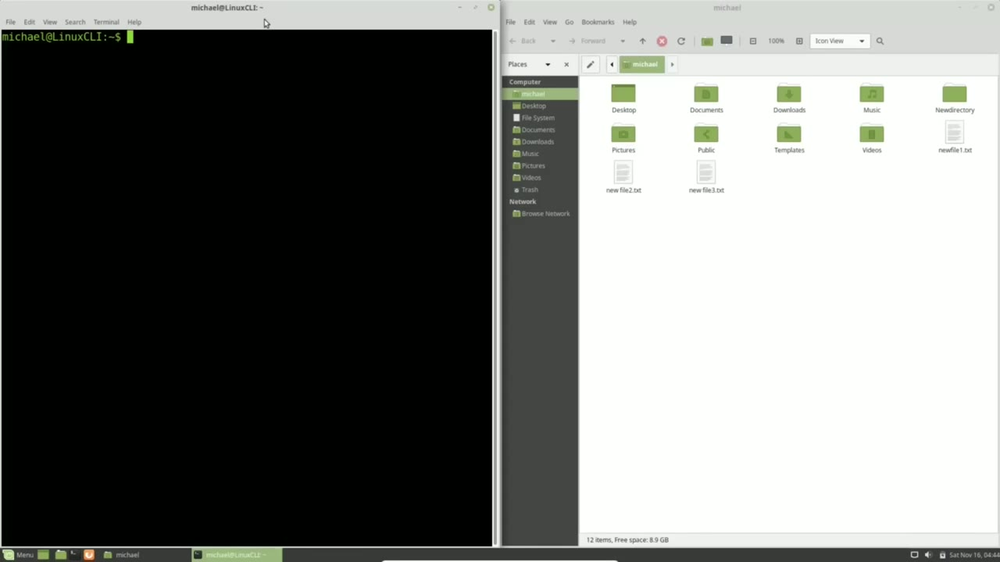
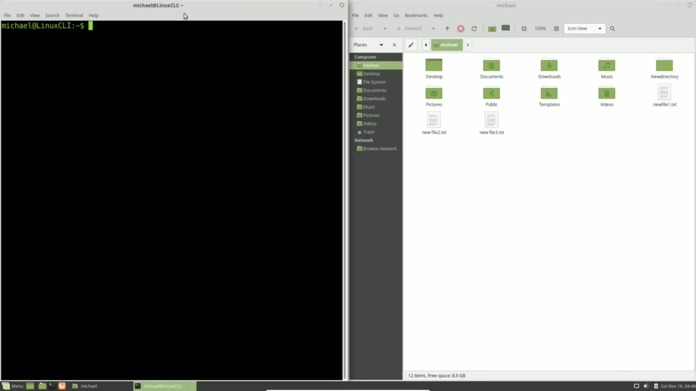
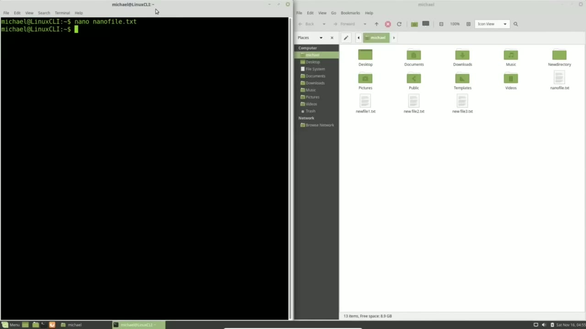
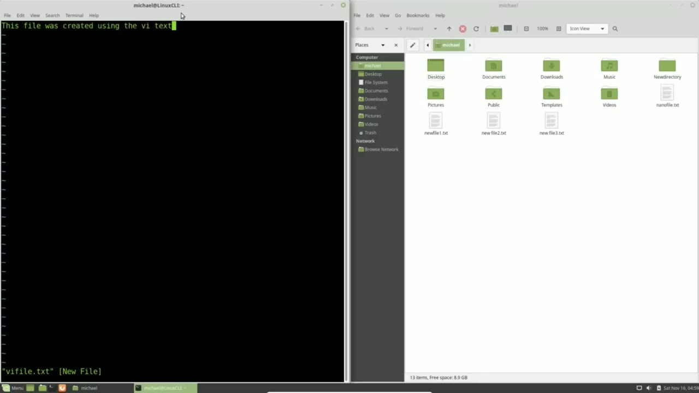

[← Course contents](../../01.md)

# 6. nano and vi

**Course:** [Linux Command Line - Entire Tutorial Series](https://www.youtube.com/watch?v=avg65oY7sj4)  
**Transcript:** [`Linux Command Line - Entire Tutorial Series transcript`](../../../../course_videos/Linux%20Command%20Line%20-%20Entire%20Tutorial%20Series/Linux%20Command%20Line%20-%20Entire%20Tutorial%20Series.txt)  
**Video:** 00:40:54–00:47:07 ([open at this time](https://www.youtube.com/watch?v=avg65oY7sj4&t=2454s))

## Introduction

But we did not put anything into those files. When adding or editing text to a Linux file, we will want to make sure that we use a text editor and not a Word processor. Microsoft Word and Libre Office Writer are Word processors and they will add extra information into the file for page formatting and the like. And we don't want any of that in our Linux text files.

## Detailed Explanation

<details>
  <summary>Step 1 — Run `nano`</summary>

### Step 1 — Run `nano`

- [x] **But we did not put anything into those files**
  - But we did not put anything into those files.
  - When adding or editing text to a Linux file, we will want to make sure that we use a text editor and not a Word processor.
  - Microsoft Word and Libre Office Writer are Word processors and they will add extra information into the file for page formatting and the like.

- [x] **And we don't want any of that in our Linux text files**
  - And we don't want any of that in our Linux text files.
  - It is okay to use the text editor from the main menu, but most likely You will want to use something like `nano` or vi to edit and create your Linux text files.
  - `nano` and vi are text editors that are already installed on most versions of Linux.

- [x] **Use `nano`**
  - In this video, we will take a quick look at how to use `nano` and Vi.
  - `nano` will probably be the easier text editor for people new to the Linux command line, so we'll start with that one.
  - To edit a file using `nano`, you just need to type `nano`.

- [x] **And press enter to take you into nano or if you want to edit a**
  - And press enter to take you into `nano` or if you want to edit a specific file or give a new file name we'll put a space and type in the file name. I will type in the file name `nano` file. txt. Pressing Enter takes us into `nano`.
  - And we'll notice over in the right in our file browser that this file is not yet created.
  - That's because it does not get created until we save the file and we haven't saved it yet.

- [x] **Use `nano`**
  - Editing text using `nano` works just like the word processors you might already be familiar with.
  - Now that we're done writing and editing our file, we want to save our changes.
  - Looking down at the bottom of the screen, we see a menu.

- [x] **And we see one of the options is write out**
  - And we see one of the options is write out.
  - To the left of it we see a highlighted carrot and the uppercase O.
  - And we see that carrot or hat symbol next to everything in that menu down there.

- [x] **That carrot or hat symbol just means we need to hold down the control**
  - That carrot or hat symbol just means we need to hold down the control key while we press the key next to it.
  - To write out we see carrot O, so I will hold down the control key and press the letter O.
  - And it doesn't matter if I press the upper or lowercase O.

- [x] **And now nano is asking me, do I want to write out this file**
  - And now `nano` is asking me, do I want to write out this file, nanotext.TXT. If I want to change that file name, I can change that name here.
  - Or I would have to type in the file name if I opened up `nano` without giving it a file name.
  - I'm happy with this file name, so I am going to press Enter.

- [x] **And now we see that we wrote out this file and we see it over in the**
  - And now we see that we wrote out this file and we see it over in the right in our file browser window.
  - Looking at the bottom, we see I'm to hold down Control and press X to exit.

```bash
nano
```





</details>

<details>
  <summary>Step 2 — Run `bash`, `vi`</summary>

### Step 2 — Run `bash`, `vi`

- [x] **Use `bash`**
  - And once again, it doesn't matter if it's upper lowercase X.
  - I pressed lowercase X and I'm back in the `bash` terminal.
  - Going back in, I'm going to press the arrow up and enter.

- [x] **I'm using my arrow keys to take me over to the right where I will**
  - I'm using my arrow keys to take me over to the right where I will insert the text t-e-x-t for I used Nano to create this Text file, nanofile.TxT.
  - And now I want to exit out, so I'll press Ctrl+X.
  - And now Nano is telling me that I have changes that I have not saved.

- [x] **And answering no will discard any changes**
  - And answering no will discard any changes.
  - I want to keep these changes, so I will press Y.
  - And we already saw this here to write the file name.

- [x] **Use `vi`**
  - I will press Enter and it writes the file and takes us out of Nano.
  - To edit or create a file using `vi`, we start off the same way as we did with Nano.
  - I'll type `vi` space and then the file name.

- [x] **And once again, looking over on the right, we do not see the file in**
  - And once again, looking over on the right, we do not see the file in the file browser window.
  - And we can do that by typing the lowercase i.

```bash
bash
vi
```



</details>

<details>
  <summary>Step 3 — This file was created using the vi Text Editor</summary>

### Step 3 — This file was created using the vi Text Editor

- [x] **This file was created using the vi Text Editor**
  - This file was created using the vi Text Editor.
  - To get out of insert mode, I will press the escape key.
  - We've edited our file but we haven't saved it yet.

- [x] **So we don't see it over on the right in our file browser window**
  - So we don't see it over on the right in our file browser window.
  - To save our file, we need to be out of insert mode, which I did by pressing the escape key.
  - And if you're not sure, you can always press the escape key a second time.

- [x] **And then we save the file by pressing colon, lowercase W**
  - And then we save the file by pressing colon, lowercase W.
  - To edit the file, I'm going to use the arrow keys to move my cursor where I want to add some text.
  - This text file was created using the vi Text Editor.

- [x] **Now I'm still in insert mode. I need to press escape to get out**
  - Now I'm still in insert mode. I need to press escape to get out.
  - And if I try and quit out of vi with colon Q, pressing Enter gives me a warning that I have changes that were not saved.
  - And I need to press the exclamation point to override.

- [x] **So I'll type in colon Q exclamation point**
  - So I'll type in colon Q exclamation point.
  - If I want to quit without saving these changes, But I want to save this change before quitting so I will type colon wq so it will write and then quit out.
  - It's good to be familiar with both text editors so we will be using both text editors in this tutorial series.

- [x] **In the next video we'll continue looking at the Linux command line**
  - In the next video we'll continue looking at the Linux command line.



</details>

<details>
  <summary>Questions and Answers</summary>

## Questions and Answers

### Question 1: What does `nano` do in this chapter?

<details>
<summary>Answer</summary>

- [x] In this video, we will take a quick look at how to use `nano` and Vi.

</details>

### Question 2: What does `bash` do in this chapter?

<details>
<summary>Answer</summary>

- [x] I pressed lowercase X and I'm back in the `bash` terminal.

</details>

### Question 3: What does `vi` do in this chapter?

<details>
<summary>Answer</summary>

- [x] To edit or create a file using `vi`, we start off the same way as we did with Nano.

</details>

### Question 4: What does step 1 cover (Run nano)?

<details>
<summary>Answer</summary>

- [x] But we did not put anything into those files.
- [x] When adding or editing text to a Linux file, we will want to make sure that we use a text editor and not a Word processor.
- [x] Microsoft Word and Libre Office Writer are Word processors and they will add extra information into the file for page formatting and the like.

</details>

### Question 5: What does step 2 cover (Run bash, vi)?

<details>
<summary>Answer</summary>

- [x] And once again, it doesn't matter if it's upper lowercase X.
- [x] I pressed lowercase X and I'm back in the `bash` terminal.
- [x] Going back in, I'm going to press the arrow up and enter.

</details>

### Question 6: What does step 3 cover (This file was created using the vi Text Editor)?

<details>
<summary>Answer</summary>

- [x] This file was created using the vi Text Editor.
- [x] To get out of insert mode, I will press the escape key.
- [x] We've edited our file but we haven't saved it yet.

</details>

</details>

## Summary

This chapter, nano and vi, walks through Run nano; Run bash, vi; This file was created using the vi Text Editor. Commands from the transcript: `nano`, `bash`, `vi`.

## References

- [Linux Command Line - Entire Tutorial Series (YouTube)](https://www.youtube.com/watch?v=avg65oY7sj4)
- [This chapter at 00:40:54](https://www.youtube.com/watch?v=avg65oY7sj4&t=2454s)
- [Local transcript](../../../../course_videos/Linux%20Command%20Line%20-%20Entire%20Tutorial%20Series/Linux%20Command%20Line%20-%20Entire%20Tutorial%20Series.txt)
