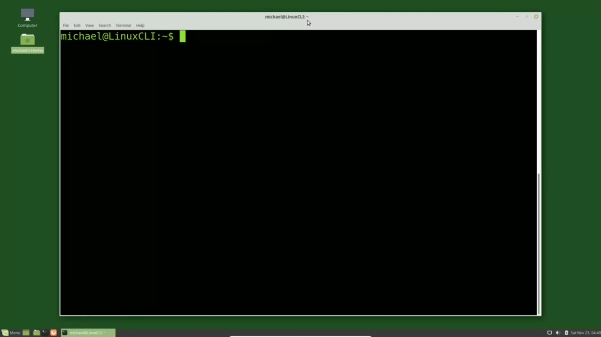
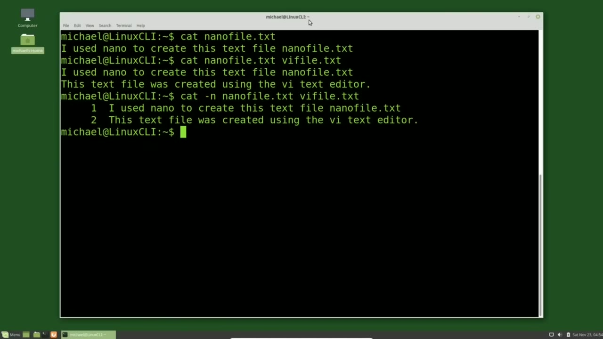
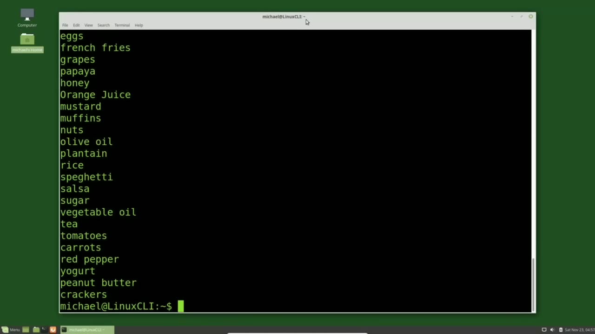
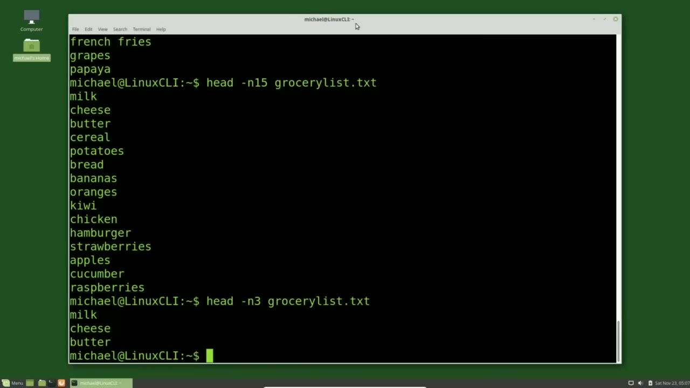

[← Course contents](../../01.md)

# 7. Viewing Files (cat, more, less, head, tail)

**Course:** [Linux Command Line - Entire Tutorial Series](https://www.youtube.com/watch?v=avg65oY7sj4)  
**Transcript:** [`Linux Command Line - Entire Tutorial Series transcript`](../../../../course_videos/Linux%20Command%20Line%20-%20Entire%20Tutorial%20Series/Linux%20Command%20Line%20-%20Entire%20Tutorial%20Series.txt)  
**Video:** 00:47:07–00:55:28 ([open at this time](https://www.youtube.com/watch?v=avg65oY7sj4&t=2827s))

## Introduction

In the past few videos we've created files and directories and put text into some of these files. Now we're going to look at how to read text files. And yes, you can use Nano in Vim to look at what's inside of a file, but there are times when you just want to take a quick look at what's inside a file. And that's what we're going to do in this video.

## Detailed Explanation

<details>
  <summary>Step 1 — Run `nano`, `cat`</summary>

### Step 1 — Run `nano`, `cat`

- [x] **Use `nano`**
  - In the past few videos we've created files and directories and put text into some of these files.
  - Now we're going to look at how to read text files.
  - And yes, you can use `nano` in Vim to look at what's inside of a file, but there are times when you just want to take a quick look at what's inside a file.

- [x] **Use `cat`**
  - And that's what we're going to do in this video.
  - The first thing we're going to do is `cat` out a file.
  - To `cat` out a file we type `cat` space and then the file name.

- [x] **I will cat out nano and I'm pressing the tab to auto complete**
  - I will `cat` out `nano` and I'm pressing the tab to auto complete.
  - Nanofile.txte that we created in the last video.
  - Pressing Enter shows us that line of text that we added into that file in the last video.

- [x] **cat is short for concatenate and concatenate means to join together**
  - `cat` is short for concatenate and concatenate means to join together.
  - So we can `cat` or join multiple files together and print out their content.
  - I'm going to press arrow up to bring back our `cat` nanofile.t.

```bash
nano
cat
```



</details>

<details>
  <summary>Step 2 — Run `cat -N`, `more`</summary>

### Step 2 — Run `cat -N`, `more`

- [x] **vi and I'm pressing tab to autocomplete, Vifile.TXT, pressing enter**
  - vi and I'm pressing tab to autocomplete, Vifile.TXT, pressing enter.
  - And we see it prints out the content of both of those files as if it were a single file.
  - One of the options for cat is -N for line numbers.

- [x] **Pressing the arrow up to bring back our last command and I'm using**
  - Pressing the arrow up to bring back our last command and I'm using Control A to take me to the beginning of the line.
  - And my arrow keys to go over to the right. I'm typing in -n to show us the line numbers when we cat out these two files.
  - Pressing Enter. We see the same output as before, but this time with line numbers.

- [x] **Use `cat -N`**
  - With only two lines, one for each file, this is not very impressive.
  - So I've created another file which I call Grocerylist.t.
  - And I'll put this out on my website so you can download it for free if you want to work along with me with the same file I'm using I'll also put a link in the video description now I want to cat out our grocery list file so I'll type `cat -N` gro and I'm using the tab to auto complete and pressing enter

- [x] **Use `more`**
  - And here we see we have `more` than one page of text with `more` than one page of text I want to look at that file again, but this time I'm going to use the `more` command.
  - To use the `more` command, I'll type `more`, and then the file name, gro tab to autocomplete, shows me the grocery list file name, and I'll press enter.
  - Here we see the output from our grocery list from the top line, and at the bottom left corner of the screen, we see `more`.

- [x] **That means that there is more than one page of text**
  - That means that there is `more` than one page of text.
  - And we also see why this is called `more`.

```bash
cat -N
more
```



</details>

<details>
  <summary>Step 3 — Run `more`, `less`, `head`</summary>

### Step 3 — Run `more`, `less`, `head`

- [x] **Use `more`**
  - And now we see the rest of the file and it takes me out of `more`.
  - Now `more` works pretty well for multiple pages of text, but the `more` command was improved upon and they call the improvements `less`.
  - And that led to jokes about `less` being greater than `more` or `less` being `more` than `more`.

- [x] **Use `less`**
  - And I think that the Apple operating system uses `less` in place of `more` so in that case `less` is `more` the advantage of using `less` over `more` is the improvements they made to it when using `less` it does not have to read in the entire file to show you a single page of text
  - And you're also able to page backwards `less` works the same way as `more` we just type `less` and then the file name gro tab to autocomplete and enter. From here I can use my page down and page up or I can use my arrow keys to go down just one line at a time and up one line at a time.
  - Then to quit out of `less` I'll press the Q key. If we add the uppercase M option to `less`, I'm pressing the arrow up, control A and then arrowing over to add in my -uppercase m When I press Enter, now at the bottom of the screen we see the file name, but we also see the number of lines in the file and what we're looking at.

- [x] **So we're looking at lines 1 through 23 of 44 lines**
  - So we're looking at lines 1 through 23 of 44 lines.
  - And it also gives us the percentage we are through the file, `which` is about 54%.
  - And again, I'm going to press Q to quit out of that file.

- [x] **Use `head`**
  - `less` is good for looking at the whole file.
  - But sometimes we just want to see the first few lines of a file or the headings of a file.
  - For that, we can type `head` and then the file name.

- [x] **Use `last`, `which`, `bash`**
  - If I want to see a different number of lines, I'll have to change the option.
  - Pressing the arrow up to bring back the `last` command, Control A to go to the beginning of the line.
  - Before I hit enter, I want to review what I said about a Linux command line command, `which` is really just a `bash` command.

- [x] **We said the Linux command line command consisted of a command, an**
  - We said the Linux command line command consisted of a command, an option, and an argument.
  - This is really just an argument for the option and a lot of people like to place them together.
  - By taking out the space. So that makes it a little `more` clear that that 25 is part of the option and not the argument itself.

- [x] **But you can leave the space in if you like. It works either way. I'm**
  - But you can leave the space in if you like. It works either way. I'm pressing enter and now we're seeing the first 25 lines.
  - Since that went over a page, I'm going to bring that down to about 15 lines.
  - Now it's a little `more` clear. And that number does not have to be greater than the default.

- [x] **Use `tail`**
  - 3 lines. And the `last` thing I want to talk about in this video is the `tail` command.

```bash
more
less
head
last
which
bash
tail
```



</details>

<details>
  <summary>Step 4 — Run `head`, `tail -F`</summary>

### Step 4 — Run `head`, `tail -F`

- [x] **Use `head`, `tail -F`**
  - And that is similar to the `head` command, but it shows us the last 10 lines of the file.
  - For example, when I type tail space grocery list, enter, we see the last 10 lines of the grocery list file.
  - The thing about tail is if we type `tail -F`, grocery list. txt, it will show us the last 10 lines of the file.

- [x] **But if a line is added to that file, it will show us that new line as**
  - But if a line is added to that file, it will show us that new line as well.
  - To see how this works, let's tail the grocery list file.
  - And I'm going to move this terminal over to the left and open a new one and move it over to the right.

- [x] **And I'm going to go into Nano and update our grocery list file**
  - And I'm going to go into Nano and update our grocery list file.
  - Using my arrow keys, I'm going down to the bottom, and I'm going to add in new item 1.
  - We don't see it on that list yet because I haven't saved it yet.

- [x] **The nano prompts us do you want to write Grocery List, which I do**
  - The nano prompts us do you want to write Grocery List, which I do.
  - Now when I press Enter, this is when we're going to see it updated on the left where we are tailing the Grocery List file.
  - And we see our new item 1 in the file we are tailing on the left.

- [x] **The real strength in tailing a file is when you have a problem and**
  - The real strength in tailing a file is when you have a problem and you need to tail a log file, then you can repeat the action and see what comes up in the log file while we are doing that action.
  - We're still following our Grocery List.t.file.
  - To get out of that, I'm going to press Ctrl+C.

- [x] **In the next video, we'll continue looking at the Linux command line**
  - In the next video, we'll continue looking at the Linux command line.

```bash
head
tail -F
```



</details>

<details>
  <summary>Questions and Answers</summary>

## Questions and Answers

### Question 1: What does `nano` do in this chapter?

<details>
<summary>Answer</summary>

- [x] And yes, you can use `nano` in Vim to look at what's inside of a file, but there are times when you just want to take a quick look at what's inside a file.

</details>

### Question 2: What does `cat` do in this chapter?

<details>
<summary>Answer</summary>

- [x] To `cat` out a file we type `cat` space and then the file name.

</details>

### Question 3: What does `cat -N` do in this chapter?

<details>
<summary>Answer</summary>

- [x] And I'll put this out on my website so you can download it for free if you want to work along with me with the same file I'm using I'll also put a link in the video description now I want to cat out our grocery list file so I'll type `cat -N` gro and I'm using the tab to auto complete and pressing enter

</details>

### Question 4: What does `more` do in this chapter?

<details>
<summary>Answer</summary>

- [x] And here we see we have `more` than one page of text with `more` than one page of text I want to look at that file again, but this time I'm going to use the `more` command.

</details>

### Question 5: What does `less` do in this chapter?

<details>
<summary>Answer</summary>

- [x] And I think that the Apple operating system uses `less` in place of more so in that case `less` is more the advantage of using `less` over more is the improvements they made to it when using `less` it does not have to read in the entire file to show you a single page of text

</details>

### Question 6: What does `head` do in this chapter?

<details>
<summary>Answer</summary>

- [x] For that, we can type `head` and then the file name.

</details>

### Question 7: What does `last` do in this chapter?

<details>
<summary>Answer</summary>

- [x] Pressing the arrow up to bring back the `last` command, Control A to go to the beginning of the line.

</details>

### Question 8: What does `which` do in this chapter?

<details>
<summary>Answer</summary>

- [x] Before I hit enter, I want to review what I said about a Linux command line command, `which` is really just a bash command.

</details>

### Question 9: What does `bash` do in this chapter?

<details>
<summary>Answer</summary>

- [x] Before I hit enter, I want to review what I said about a Linux command line command, which is really just a `bash` command.

</details>

### Question 10: What does `tail` do in this chapter?

<details>
<summary>Answer</summary>

- [x] 3 lines. And the last thing I want to talk about in this video is the `tail` command.

</details>

### Question 11: What does `tail -F` do in this chapter?

<details>
<summary>Answer</summary>

- [x] The thing about tail is if we type `tail -F`, grocery list. txt, it will show us the last 10 lines of the file.

</details>

</details>

## Summary

This chapter, Viewing Files (cat, more, less, head, tail), walks through Run nano, cat; Run cat -N, more; Run more, less, head; Run head, tail -F. Commands from the transcript: `nano`, `cat`, `cat -N`, `more`, `less`, `head`, `last`, `which`, `bash`, `tail`, `tail -F`.

## References

- [Linux Command Line - Entire Tutorial Series (YouTube)](https://www.youtube.com/watch?v=avg65oY7sj4)
- [This chapter at 00:47:07](https://www.youtube.com/watch?v=avg65oY7sj4&t=2827s)
- [Local transcript](../../../../course_videos/Linux%20Command%20Line%20-%20Entire%20Tutorial%20Series/Linux%20Command%20Line%20-%20Entire%20Tutorial%20Series.txt)
