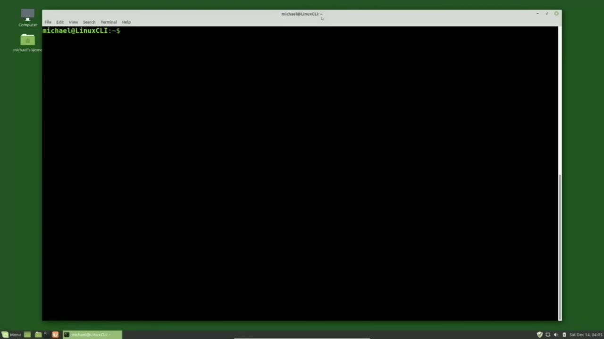
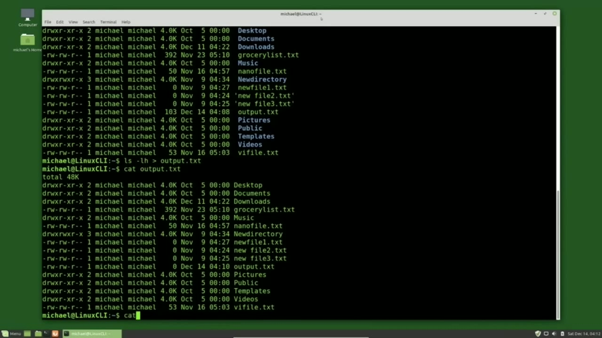
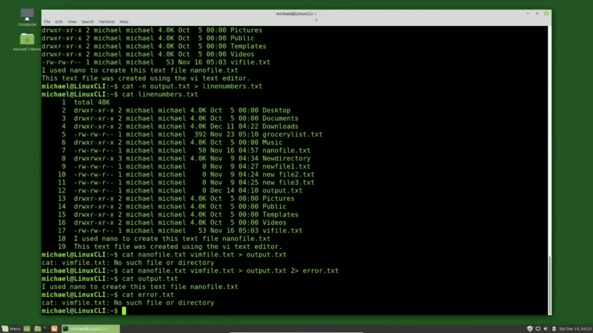
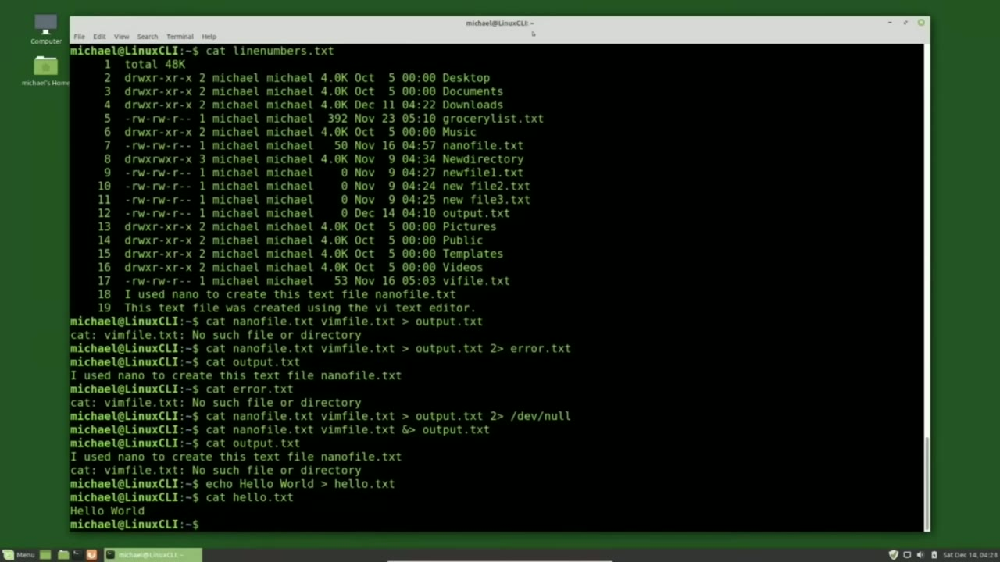

[← Course contents](../../01.md)

# 8. Output Redirection

**Course:** [Linux Command Line - Entire Tutorial Series](https://www.youtube.com/watch?v=avg65oY7sj4)  
**Transcript:** [`Linux Command Line - Entire Tutorial Series transcript`](../../../../course_videos/Linux%20Command%20Line%20-%20Entire%20Tutorial%20Series/Linux%20Command%20Line%20-%20Entire%20Tutorial%20Series.txt)  
**Video:** 00:55:28–01:05:13 ([open at this time](https://www.youtube.com/watch?v=avg65oY7sj4&t=3328s))

## Introduction

In the last video we saw how to create and add text to files using Nano and Vi. In this video we're going to look at how to create and add text to files using Output Redirection. When we type a command like cat and add the files, NanoFile.T and vi File.TXT, and I'm using the tab key to auto-complete those file names. The output from this command is going to what is called standard out.

## Detailed Explanation

<details>
  <summary>Step 1 — Run `nano`, `ls`, `ls -lh`</summary>

### Step 1 — Run `nano`, `ls`, `ls -lh`

- [x] **Use `nano`**
  - In the last video we saw how to create and add text to files using `nano` and Vi.
  - In this video we're going to look at how to create and add text to files using Output Redirection.
  - When we type a command like cat and add the files, NanoFile.T and vi File.TXT, and I'm using the tab key to auto-complete those file names.

- [x] **The output from this command is going to what is called standard out**
  - The output from this command is going to what is called standard out.
  - And in this case, standard out is pointing to the terminal.
  - We can direct that standard out output to a file using a greater than sign and a file name.

- [x] **I'll press the arrow up key to bring back that last command**
  - I'll press the arrow up key to bring back that last command.
  - And I'll add a greater than sign and a space and then a file name.
  - So with this command, I'm saying take the standard out output from the command and put it into a file called output.

- [x] **And if that output.tXT file does not exist, create it**
  - And if that output.tXT file does not exist, create it.
  - We don't see any output on our terminal at this time.
  - And that is expected because we just told it to put the standard out into a file called output.t.

- [x] **Use `ls`, `ls -lh`**
  - Pressing Enter, and we see the same two lines of text that we just saw in the terminal are now in the output.T file.
  - Let's try redirecting some output from the `ls` command. I'll first type `ls -lh`.
  - So we can see what we should expect in the output.T file.

- [x] **Pressing Enter, we see all the files and directories in the current**
  - Pressing Enter, we see all the files and directories in the current directory we're in.
  - Greater than sign and the file output.txte.
  - And again I'm using the tab key to auto complete the file name.

- [x] **Use `ls -lh`**
  - Pressing enter. Again we see no news is good news.
  - We see it now contains the results of the `ls -lh` command.
  - And because the output.tXT file is a plain text file, There's no formatting for the directory name so everything shows as plain text.

- [x] **Notice the two lines of text that were originally in the output.TXT**
  - Notice the two lines of text that were originally in the output.TXT file are now gone.
  - Redirecting the output with a single greater than sign will delete and recreate that file name and any data that was in that file is now gone.
  - We can keep the text that is in that file and append to it from the current command by adding a second greater than sign.

```bash
nano
ls
ls -lh
```



</details>

<details>
  <summary>Step 2 — Run `cat nano auto`, `vi`, `vim`</summary>

### Step 2 — Run `cat nano auto`, `vi`, `vim`

- [x] **Use `cat nano auto`**
  - I'll type `cat nano auto` Complete `vi` Auto Complete and now sending the output with two greater than signs to output.TXT.
  - Pressing Enter shows us nothing again. This is what we expect.
  - We see the text that was in the output.txt file and we just appended it with the `last` two lines there.

- [x] **That was the output from our cat nano file and vi file**
  - That was the output from our cat nano file and `vi` file.
  - Now every now and then you might want to add line numbers to a file.
  - To do that, I will cat out the file, the cat with a -N.

- [x] **Remember -N adds line numbers to the cat**
  - Remember -N adds line numbers to the cat.
  - And I will use the output.txt file as our input and I will send that to a file called line numbers.t. Now I could have called this output.txty and added the line numbers to that same file. The problem with that is that if something goes wrong you've just overwritten your input
  - File. So And even though this one's easy to reproduce, it's just a good practice to always keep your input file.

- [x] **Use `vi`, `vim`**
  - Pressing enter and then cat line numbers shows us that the line numbers. txt is the same as the output.T only with line numbers.
  - Now I'm going to cat out our nano and `vi` files again, but this time let's say I have a typo in one of the file names cat nano file that txt but this time instead of typing `vi` file. txt i type `vim` file dot txt and then we cat this out to output.t pressing enter we see the line cat vimfile. txt no such file or directory
  - And that error makes sense because there is no file called Vimfile.T.

- [x] **The question is, why do we see that error message at all?**
  - The question is, why do we see that error message at all?
  - We told it to redirect the standard out to the output file.
  - The problem is the error messages don't go to standard out.

- [x] **Use `last`**
  - It goes to standard error, which is still pointing to the terminal.
  - I'm going to capture the standard error output into a separate file.
  - I'm going to hit the arrow up to bring back the `last` command.

- [x] **And I'm going to redirect the standard error by putting a 2 greater**
  - And I'm going to redirect the standard error by putting a 2 greater than sign error.
  - So this first greater than sign is standard out.
  - And I can add a 1 here because 1 is standard out.

- [x] **If we don't put the 1, it just defaults to the 1 standard out**
  - If we don't put the 1, it just defaults to the 1 standard out.
  - So I don't need the one here, but I can add that if I like.
  - And I could have added it every time I was using the standard out.

- [x] **But it's not needed, so I've left it out**
  - But it's not needed, so I've left it out.
  - So we have the one is going to output.t.t.
  - We see the single line that successfully went into it.

- [x] **And cat error.txt shows us the error line that went to the standard**
  - And cat error.txt shows us the error line that went to the standard error.

```bash
cat nano auto
vi
vim
last
```



</details>

<details>
  <summary>Step 3 — Run `last`, `echo`</summary>

### Step 3 — Run `last`, `echo`

- [x] **Use `last`**
  - Now there may be times when you don't care about the error messages.
  - We don't want to see them on the screen and we don't want to write them to a file.
  - In those cases, I'm pressing arrow up to bring back the `last` command.

- [x] **We would change this error.txt file to slash**
  - We would change this error.txt file to slash...
  - Dev slash null. The path starts with a forward slash and this tells us that we have an absolute path and that we are going to send our output to device null, which is exactly that.
  - A null device, nothing. So we are sending our output to nothing and it is gone.

- [x] **Pressing enter shows us no news is good news. Our output.t.file will**
  - Pressing enter shows us no news is good news. Our output.t.file will have the single line.
  - And device null, we can't see that because our data is gone.
  - And this is not just for standard error. You could be testing something and want to send your standard out to slash dev slash null.

- [x] **That would work too and your standard output would go into nothing**
  - That would work too and your standard output would go into nothing.
  - There are other times when you may want to write your standard out file and your standard error file to the same output file.
  - For this, we just need to add the ampersand before the greater than sign.

- [x] **Nanophile.t, vimphile.t, and ampersand, both standard out and**
  - Nanophile.t, vimphile.t, and ampersand, both standard out and standard error should go to output.tt.
  - Pressing enter, shows us nothing, which is what we expect.
  - Cat output.t.tXT shows us both the output from the standard out and the output from the standard error.

- [x] **Use `echo`**
  - I have a couple more quick ways to use output redirection.
  - The first one is with the `echo` command.
  - We saw the `echo` command in video one.

- [x] **And I will output that to a file called hello.txte**
  - And I will output that to a file called hello.txte.
  - So if you need to create just a quick little file like that, that's one way to do it.

```bash
last
echo
```



</details>

<details>
  <summary>Step 4 — Run `printf`</summary>

### Step 4 — Run `printf`

- [x] **Use `printf`**
  - And there is also the `printf` command.
  - Now, with `printf`, we can do a little more formatting.
  - And then with this backslash n, we're adding a second line.

- [x] **And when we cat hello, we see the, oh, the second line**
  - And when we cat hello, we see the, oh, the second line.
  - We didn't add a line return after. So let's add that real quick.
  - At the end, backslash n. Now when I cat out hello, we see the first line and second line.

- [x] **So that's just a quick way to add a file with a line or two in it**
  - So that's just a quick way to add a file with a line or two in it.
  - In the next video, we'll continue looking at the Linux command line.

```bash
printf
```



</details>

<details>
  <summary>Questions and Answers</summary>

## Questions and Answers

### Question 1: What does `nano` do in this chapter?

<details>
<summary>Answer</summary>

- [x] In the last video we saw how to create and add text to files using `nano` and Vi.

</details>

### Question 2: What does `ls` do in this chapter?

<details>
<summary>Answer</summary>

- [x] Let's try redirecting some output from the `ls` command. I'll first type `ls` -lh.

</details>

### Question 3: What does `ls -lh` do in this chapter?

<details>
<summary>Answer</summary>

- [x] Let's try redirecting some output from the ls command. I'll first type `ls -lh`.

</details>

### Question 4: What does `cat nano auto` do in this chapter?

<details>
<summary>Answer</summary>

- [x] I'll type `cat nano auto` Complete vi Auto Complete and now sending the output with two greater than signs to output.TXT.

</details>

### Question 5: What does `vi` do in this chapter?

<details>
<summary>Answer</summary>

- [x] Now I'm going to cat out our nano and `vi` files again, but this time let's say I have a typo in one of the file names cat nano file that txt but this time instead of typing `vi` file. txt i type vim file dot txt and then we cat this out to output.t pressing enter we see the line cat vimfile. txt no such file or directory

</details>

### Question 6: What does `vim` do in this chapter?

<details>
<summary>Answer</summary>

- [x] Now I'm going to cat out our nano and vi files again, but this time let's say I have a typo in one of the file names cat nano file that txt but this time instead of typing vi file. txt i type `vim` file dot txt and then we cat this out to output.t pressing enter we see the line cat vimfile. txt no such file or directory

</details>

### Question 7: What does `last` do in this chapter?

<details>
<summary>Answer</summary>

- [x] I'm going to hit the arrow up to bring back the `last` command.

</details>

### Question 8: What does `echo` do in this chapter?

<details>
<summary>Answer</summary>

- [x] The first one is with the `echo` command.

</details>

### Question 9: What does `printf` do in this chapter?

<details>
<summary>Answer</summary>

- [x] And there is also the `printf` command.

</details>

</details>

## Summary

This chapter, Output Redirection, walks through Run nano, ls, ls -lh; Run cat nano auto, vi, vim; Run last, echo; Run printf. Commands from the transcript: `nano`, `ls`, `ls -lh`, `cat nano auto`, `vi`, `vim`, `last`, `echo`, `printf`.

## References

- [Linux Command Line - Entire Tutorial Series (YouTube)](https://www.youtube.com/watch?v=avg65oY7sj4)
- [This chapter at 00:55:28](https://www.youtube.com/watch?v=avg65oY7sj4&t=3328s)
- [Local transcript](../../../../course_videos/Linux%20Command%20Line%20-%20Entire%20Tutorial%20Series/Linux%20Command%20Line%20-%20Entire%20Tutorial%20Series.txt)
