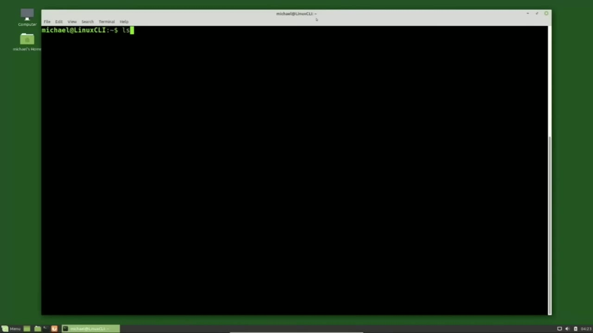
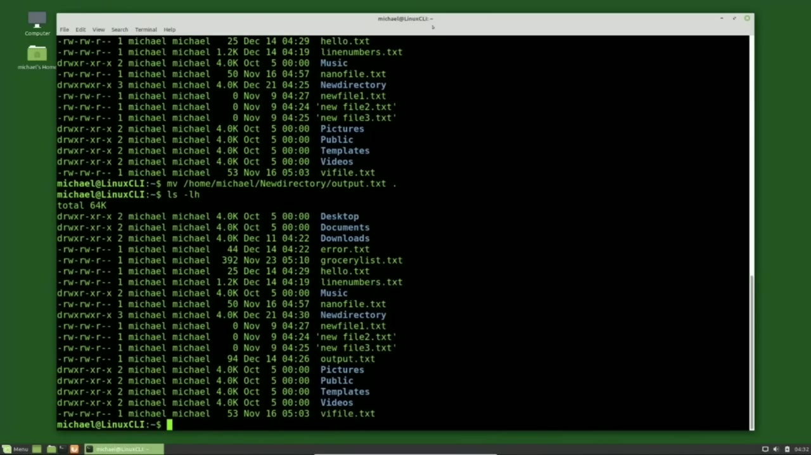
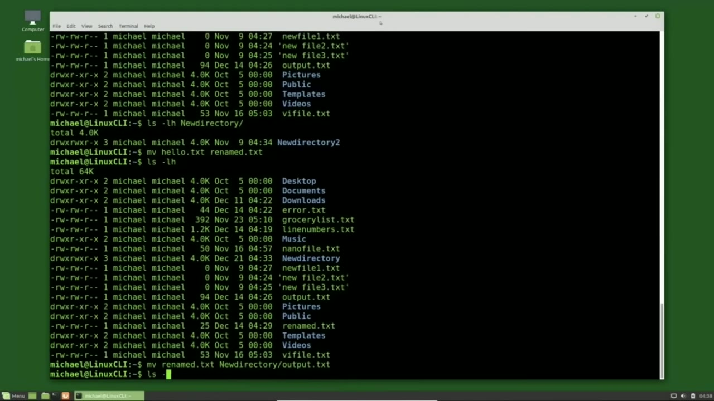
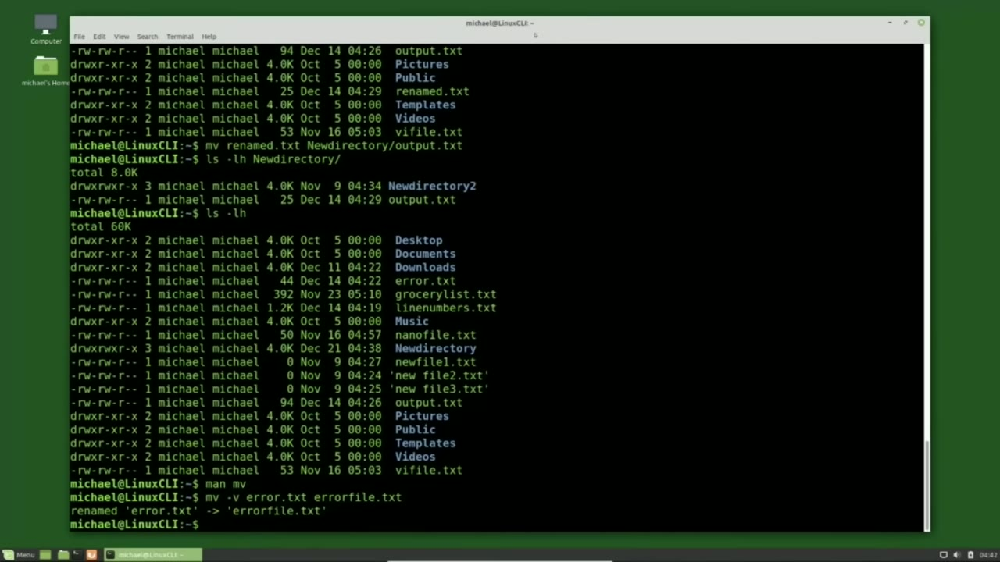

[← Course contents](../../01.md)

# 9. Moving and Renaming files and directories

**Course:** [Linux Command Line - Entire Tutorial Series](https://www.youtube.com/watch?v=avg65oY7sj4)  
**Transcript:** [`Linux Command Line - Entire Tutorial Series transcript`](../../../../course_videos/Linux%20Command%20Line%20-%20Entire%20Tutorial%20Series/Linux%20Command%20Line%20-%20Entire%20Tutorial%20Series.txt)  
**Video:** 01:05:13–01:15:18 ([open at this time](https://www.youtube.com/watch?v=avg65oY7sj4&t=3913s))

## Introduction

I'm going to type ls -lh. To see the files and directories I have in my current home directory. I want to move the output.TxT file to the new directory directory. To move a file, we use the mv command.

## Detailed Explanation

<details>
  <summary>Step 1 — Run `ls -lh`, `mv`</summary>

### Step 1 — Run `ls -lh`, `mv`

- [x] **Use `ls -lh`**
  - I'm going to type `ls -lh`.
  - To see the files and directories I have in my current home directory.
  - I want to move the output.TxT file to the new directory directory.

- [x] **Use `mv`**
  - To move a file, we use the `mv` command.
  - So I will type `mv` space and then the file that I want to move or the source file and then to where I want to move it to which is the destination.
  - The source and the destination can either be absolute paths or relative paths.

- [x] **In this case, I'll use the relative path for both**
  - In this case, I'll use the relative path for both.
  - So my source file is going to be the output.t.
  - And my destination file is the new directory directory.

- [x] **Use `ls -lh`, `mv`**
  - To see that it's moved, I'm going to type...
  - `ls -lh` new directory and this shows us in the new directory directory we have the new directory to directory and we have the output.txti file that we just move there.
  - And typing `ls -lh` to show the contents of the current file shows me that the output.T file is no longer there. To bring that file back, I will start with the `mv` command again.

- [x] **And this time I'm going to give the absolute path**
  - And this time I'm going to give the absolute path.
  - And I want to move it to the current directory, so I'll use the dot or period, meaning the current directory.
  - This is the method that I prefer to use when moving files with long path names.

- [x] **One reason is when using the dot I don't have to type out the long**
  - One reason is when using the dot I don't have to type out the long file name.
  - And the second reason is if I accidentally press enter while halfway through typing the file name, because the command is not yet complete, it won't do anything.
  - And having the long file name as the destination halfway through, if I press enter accidentally, I've just moved that file to somewhere where I did not intend to.

- [x] **Use `ls -lh`**
  - And I will show that by typing `ls -lh` and we see that our output.TXT file is back.
  - Moving directories works the same way as moving files.
  - We type the directory source and then the directory destination.

- [x] **We just saw that we have new directory 2 inside of the new directory**
  - We just saw that we have new directory 2 inside of the new directory.

```bash
ls -lh
mv
```



</details>

<details>
  <summary>Step 2 — Run `mv`, `ls -lh`</summary>

### Step 2 — Run `mv`, `ls -lh`

- [x] **Use `mv`, `ls -lh`**
  - So to move that to our current directory, I will type `mv` for move.
  - Directory directory and it is called new directory 2 and I want to move it to the current directory so I'll press the period key that says move it to my current directory pressing enter and then `ls -lh` shows us that we now have the new directory and the new directory to directory in our current home directory to move
  - That back I'll use the `mv` command New Directory 2 and I want to move it inside of the new directory directory.

- [x] **Use `ls -lh`**
  - Pressing Enter, then `ls -lh` to show that it's gone and to show that it's in the new directory directory, I will type `ls -lh` new directory and we see that it's there.
  - To rename a file, I'll type the mb command, just like I did before.
  - And this time it would be the same directory that I'm in.

- [x] **Use `mv`**
  - For example, let's rename the hello.txti file to rename.t.
  - I'll type `mv` space hello.txt and I want to rename it to a file called renamed.t.
  - Now earlier when we were moving the file to the destination we had a destination directory called new directory where we were moving our file to.

- [x] **Use `ls -lh`**
  - This time there's no directory called rename.tXT so it knows that we just want to rename the file.
  - Pressing Enter. Renames the file and I will type `ls -lh`.
  - And we no longer see a hello.tXT file, but we do see the...

- [x] **Renamed.T file. Now I want to rename my file and move it into a new**
  - Renamed.T file. Now I want to rename my file and move it into a new directory at the same time.
  - To do this, I will type the `mv` to move the file. My source name or the file I want to move to move is called rename.txte. And I want to move it into the new directory directory, but I also want to change the name and I want to call this one.

```bash
mv
ls -lh
```



</details>

<details>
  <summary>Step 3 — Run `ls -lh`, `man mv`</summary>

### Step 3 — Run `ls -lh`, `man mv`

- [x] **Use `ls -lh`, `man mv`**
  - Output.T Pressing Enter completes the command.
  - I'm going to type the `ls -lh` new directory to show us what's inside that directory and there we see our output.ttXT file and typing `ls -lh` shows us that the rename.tXT file is now moved.
  - When I type `man mv` We see that there are a lot of options there.

- [x] **There's only a couple that I really want to cover in this video**
  - There's only a couple that I really want to cover in this video.
  - One of them is the -F, force, the -I interactive, the -N, no clobber, and paging down to the next page, the -V verbose.
  - I'm pressing Q to get out of the man pages.

- [x] **So the first one I want to look at is the -V verbose**
  - So the first one I want to look at is the -V verbose.
  - To show this one, I'm going to move with mv space -v.
  - And I'm going to move the error.txt file to be errorfile. txt.

- [x] **What the verbose does is shows us more information about the command**
  - What the verbose does is shows us more information about the command.
  - And here it is telling us that it renamed error.tx2 to errorfile.t.
  - So using Verboise just gives us a little extra message that the file was renamed.

- [x] **Now I'm going to try and move the Output.T file to the new directory**
  - Now I'm going to try and move the Output.T file to the new directory slash output.tXT file, which already exists.
  - But I'm going to use the -N for No Clobber, so it should not overwrite that file.

```bash
ls -lh
man mv
```



</details>

<details>
  <summary>Step 4 — Run `mv`, `ls -lh`</summary>

### Step 4 — Run `mv`, `ls -lh`

- [x] **Use `mv`**
  - Let's test this out. I'm going to type `mv` for Move, -V for Verboise. I'm adding the N for no clobber.
  - Now I'm going to type the output.txt file, new directory, output.tXT file.
  - When I press Enter, we don't see anything.

- [x] **Use `ls -lh`**
  - And since we have the no clobber option active, as well as the verbose, we didn't get any message and checking the current directory with `ls -lh`.
  - So the no clobber option worked and did not move the file.
  - The move output.T to the new directory output.TXT and I'm going to take off that N, that no clobber option.

- [x] **This will use whatever the default option is and using the V for**
  - This will use whatever the default option is and using the V for verbose will give us a message if that output.
  - And we see from the verbose message that the file did get moved.
  - To New Directory output. txt, this command took the output.TXT file and overwrote the output.

- [x] **Now this tells us that the -F force overwrite is the default option**
  - Now this tells us that the -F force overwrite is the default option.
  - So you might want to keep that in mind when you are renaming files.
  - The last option I want to talk about is the -I option.

- [x] **And to test that one, I will need to create a new output.t.txt file**
  - And to test that one, I will need to create a new output.t.txt file.
  - Because we already moved the one that was in the current directory.
  - So I will create a new one with Echo, new test data for output.TXT.

- [x] **Use `ls -lh`**
  - Typing `ls -lh` shows us that the file output.TXT is there.
  - So now I'm going to try and move the output.TXT file to the new directory.
  - Output. txt with the I or interactive option.

- [x] **When I press enter, this time it tells us, hey, there's already a**
  - When I press enter, this time it tells us, hey, there's already a file called Output.t.TXT. Do you want to overwrite that? I'll type no.
  - And it cancels out the command, nothing got moved.
  - Pressing the arrow up to bring that command back, I'm going to press enter.

- [x] **Again, it's asking us, do we want to overwrite the output.ttXT file?**
  - Again, it's asking us, do we want to overwrite the output.ttXT file?
  - There we get the message that it renamed output.txt to new directory output.t.
  - And in this case, overriding the old file output.txte.

- [x] **In the next tutorial, we'll continue looking at the Linux command line**
  - In the next tutorial, we'll continue looking at the Linux command line.

```bash
mv
ls -lh
```



</details>

<details>
  <summary>Questions and Answers</summary>

## Questions and Answers

### Question 1: What does `ls -lh` do in this chapter?

<details>
<summary>Answer</summary>

- [x] I'm going to type `ls -lh`.

</details>

### Question 2: What does `mv` do in this chapter?

<details>
<summary>Answer</summary>

- [x] To move a file, we use the `mv` command.

</details>

### Question 3: What does `man mv` do in this chapter?

<details>
<summary>Answer</summary>

- [x] When I type `man mv` We see that there are a lot of options there.

</details>

### Question 4: What does step 1 cover (Run ls -lh, mv)?

<details>
<summary>Answer</summary>

- [x] I'm going to type `ls -lh`.
- [x] To see the files and directories I have in my current home directory.
- [x] I want to move the output.TxT file to the new directory directory.

</details>

### Question 5: What does step 2 cover (Run mv, ls -lh)?

<details>
<summary>Answer</summary>

- [x] So to move that to our current directory, I will type `mv` for move.
- [x] Directory directory and it is called new directory 2 and I want to move it to the current directory so I'll press the period key that says move it to my current directory pressing enter and then `ls -lh` shows us that we now have the new directory and the new directory to directory in our current home directory to move
- [x] That back I'll use the `mv` command New Directory 2 and I want to move it inside of the new directory directory.

</details>

### Question 6: What does step 3 cover (Run ls -lh, man mv)?

<details>
<summary>Answer</summary>

- [x] Output.T Pressing Enter completes the command.
- [x] I'm going to type the `ls -lh` new directory to show us what's inside that directory and there we see our output.ttXT file and typing `ls -lh` shows us that the rename.tXT file is now moved.
- [x] When I type `man mv` We see that there are a lot of options there.

</details>

### Question 7: What does step 4 cover (Run mv, ls -lh)?

<details>
<summary>Answer</summary>

- [x] Let's test this out. I'm going to type `mv` for Move, -V for Verboise. I'm adding the N for no clobber.
- [x] Now I'm going to type the output.txt file, new directory, output.tXT file.
- [x] When I press Enter, we don't see anything.

</details>

</details>

## Summary

This chapter, Moving and Renaming files and directories, walks through Run ls -lh, mv; Run mv, ls -lh; Run ls -lh, man mv; Run mv, ls -lh. Commands from the transcript: `ls -lh`, `mv`, `man mv`.

## References

- [Linux Command Line - Entire Tutorial Series (YouTube)](https://www.youtube.com/watch?v=avg65oY7sj4)
- [This chapter at 01:05:13](https://www.youtube.com/watch?v=avg65oY7sj4&t=3913s)
- [Local transcript](../../../../course_videos/Linux%20Command%20Line%20-%20Entire%20Tutorial%20Series/Linux%20Command%20Line%20-%20Entire%20Tutorial%20Series.txt)
