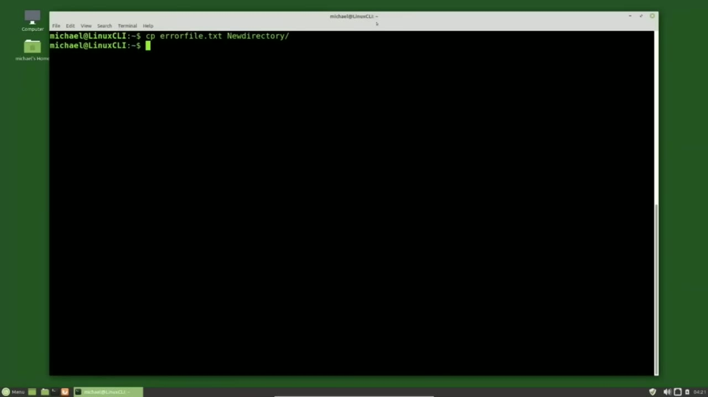
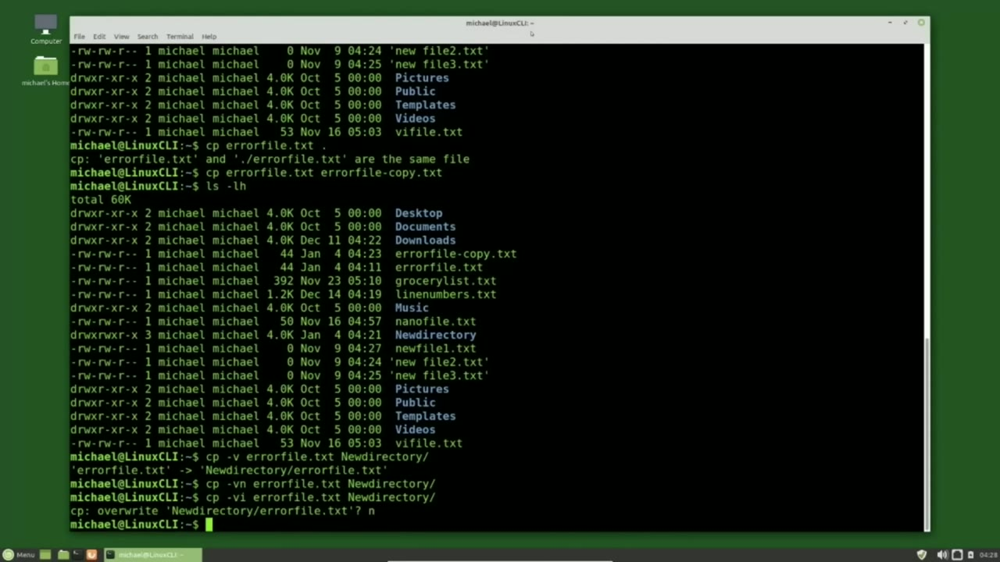
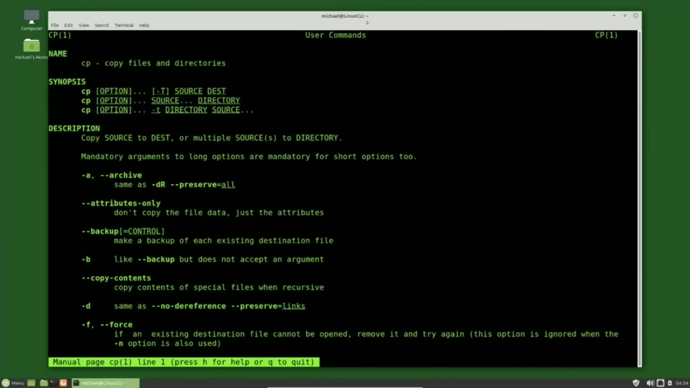
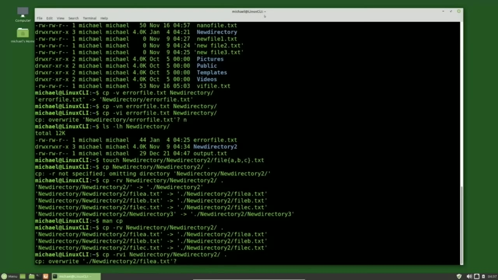

[← Course contents](../../01.md)

# 10. Copy Files and Directories

**Course:** [Linux Command Line - Entire Tutorial Series](https://www.youtube.com/watch?v=avg65oY7sj4)  
**Transcript:** [`Linux Command Line - Entire Tutorial Series transcript`](../../../../course_videos/Linux%20Command%20Line%20-%20Entire%20Tutorial%20Series/Linux%20Command%20Line%20-%20Entire%20Tutorial%20Series.txt)  
**Video:** 01:15:18–01:24:49 ([open at this time](https://www.youtube.com/watch?v=avg65oY7sj4&t=4518s))

## Introduction

The copy command works similar to the Move command that we saw in the last video. The word copy is shortened down to two letters, cp, and then we would type the source followed by the destination. Let's copy the error file.T that we created in a previous tutorial into the new directory directory that we also created in a previous tutorial. To do that, we'll start with the cp for copy, space, errorfile.T for our source, and then the new directory directory for the destination directory.

## Detailed Explanation

<details>
  <summary>Step 1 — Run `ls -lh`, `cp errorfile.txt`, `file -copy`</summary>

### Step 1 — Run `ls -lh`, `cp errorfile.txt`, `file -copy`

- [x] **The copy command works similar to the Move command that we saw in the**
  - The copy command works similar to the Move command that we saw in the last video.
  - The word copy is shortened down to two letters, cp, and then we would type the source followed by the destination.
  - Let's copy the error file.T that we created in a previous tutorial into the new directory directory that we also created in a previous tutorial.

- [x] **Use `ls -lh`**
  - To do that, we'll start with the cp for copy, space, errorfile.T for our source, and then the new directory directory for the destination directory.
  - Pressing Enter shows us no news is good news, and we will check just to confirm the copy worked as expected.
  - I will type `ls -lh` new directory and we see our error file. txt is there.

- [x] **Use `ls -lh`, `cp errorfile.txt`**
  - And typing `ls -lh` shows us that the error file. txt is in our current directory as well.
  - If we want to make a copy of the file in the same directory, we have to change the file name in some way.
  - When I say that, I mean we cannot just type `cp errorfile.txt` and dot for our source directory to be the current directory.

- [x] **Use `ls -lh`, `file -copy`**
  - We see that the error file.T and the destination error file.T.
  - So to make our copy, I'm pressing the arrow up to bring back that last command.
  - Now typing `ls -lh` shows us the error `file -copy` as well as the error file.

- [x] **The copy command is also similar to the move command with the options**
  - The copy command is also similar to the move command with the options we saw in the last video.
  - If I type Cp.
  - So we're copying with the verbose option, the error file.txt to the new directory, pressing Enter.

- [x] **Use `cp -vf force`**
  - The verbose option shows us that we copied the errorfile.T and replaced the error file.T.
  - That was already in the new directory directory, which is the same as typing cp -vf, force the overwrite option.
  - I'm going to change that force the override option to the N for no clobber.

- [x] **Because we're now using the verbose option and we don't see the**
  - Because we're now using the verbose option and we don't see the message that errorfile.T was copied.
  - The no clobber worked and the file was not overwritten.
  - We also have the option I for interactive, changing that N to an I, pressing enter.

- [x] **It now asks us, do we want to overwrite the new directory**
  - It now asks us, do we want to overwrite the new directory errorfile.tt with the source errorfile.txt.
  - And enter. Now this all works well as we see here for a single file.

```bash
ls -lh
cp errorfile.txt
file -copy
cp -vf force
```



</details>

<details>
  <summary>Step 2 — Run `ls -lh`, `touch`, `cp`</summary>

### Step 2 — Run `ls -lh`, `touch`, `cp`

- [x] **Use `ls -lh`, `touch`**
  - When we are copying directories, things change a little bit.
  - We still have the new directory to directory inside of our new directory and I'll show that with `ls -lh` new directory and there's our new directory 2 directory.
  - Before we copy that to the current directory, I want to add some files into the new To do that, I will type `touch`, new directory, new directory to file.

- [x] **And now I'm going to add a left curly brace, A comma B, comma C**
  - And now I'm going to add a left curly brace, A comma B, comma C, right curly brace.
  - Now the left and right curly brace or opening and closing curly braces are not part of the file name.
  - What we're actually saying by using those is create a file called File A dot txt, file b.txte, and file c.tt. So we'll create three separate files.

- [x] **Pressing Enter is creating those files. We'll see that in a moment**
  - Pressing Enter is creating those files. We'll see that in a moment when we copy this directory.
  - When moving a directory, we need to tell it to move the directory and everything in that directory.
  - So I will need to add the -R for recursively copy everything in that directory.

- [x] **Let's first try it without the -R and see what happens**
  - Let's first try it without the -R and see what happens.
  - I want to copy the source which is in the new directory directory, new directory 2 directory, and I want to copy that to our current directory.
  - Shows us the warning that we do not have the -R for recursively copy, so it's omitting the directory, new directory, new directory 2.

- [x] **And you will see that same message even if the directory is empty**
  - And you will see that same message even if the directory is empty.
  - I'll bring that command back with the arrow up and I'm using Control A to go to the beginning of the command and I'm going to add a -R for recursively copy.
  - I'm using the lowercase R it can be an uppercase R as well either one works. I'm also going to add the V option for verbose. Pressing Enter.

- [x] **Use `cp`**
  - This is now telling us that we are moving the new directory, new directory 2 to the current directory, new directory 2.
  - We're moving the three files we created, the file A, B, and C are getting moved, as well as the new directory 2, new directory 3, which is in the new directory 2 directory.
  - I want to look at the man page for the `cp` command.

- [x] **Use `man cp`**
  - I'm going to type man, `cp`.
  - And here we see the -a for archive. If you want to add a -a option, this will keep the permissions, ownership, and timestamp.
  - Sometimes you want to keep all that and the -a option will do that for you.

- [x] **Skipping down to F for force, which will copy over an existing file**
  - Skipping down to F for force, which will copy over an existing file or directory if it exists.
  - Note that you cannot copy a directory over a file, meaning if I had a file called new directory to in that current directory.

```bash
ls -lh
touch
cp
man cp
```



</details>

<details>
  <summary>Step 3 — Run `cp`</summary>

### Step 3 — Run `cp`

- [x] **Use `cp`**
  - When I tried to copy the new directory to directory with the `cp` command, it would have not copied and given me a warning that it cannot overwrite a non directory. So it will only overwrite a directory with a directory or a file with a file. Paging down.
  - We see the eye for interactive. We will look at that in a moment.
  - The next options are about links and symbolic links.

- [x] **Those haven't been covered yet and they are on the short list of**
  - Those haven't been covered yet and they are on the short list of things to talk about in this tutorial series.
  - And when I say the short list, I mean within the next five to ten videos.
  - I'm still working out the order of where things would go.

- [x] **At the bottom of the page, we see the R for recursive can be either**
  - At the bottom of the page, we see the R for recursive can be either upper or lowercase.
  - And going down a little further, we have U for update and V for verbose.
  - We're already looking at Verboise and we're going to look at the update as well before we end this video.

- [x] **Quitting out of the man page, I'm going to bring back our copy**
  - Quitting out of the man page, I'm going to bring back our copy command by pressing that arrow up key two times.
  - And I'm going to run that same command again.
  - This time notice it only copied over the three files.

- [x] **It did not copy the new directory 3 again because that directory**
  - It did not copy the new directory 3 again because that directory already exists.
  - I'm going to bring back that command again.

```bash
cp
```



</details>

<details>
  <summary>Step 4 — I'm going to add the I for interactive</summary>

### Step 4 — I'm going to add the I for interactive

- [x] **And I'm going to add the I for interactive**
  - And I'm going to add the I for interactive.
  - It now asks us, do we want to overwrite file A?
  - Now it's asking us if we want to overwrite file B.

- [x] **And then we get to C and I will type Y for yes again**
  - And then we get to C and I will type Y for yes again.
  - Now this works pretty well because we only have three files in there.
  - The -I interactive feature is nice, but it will ask me for every file.

- [x] **So if you're copying a directory with a lot of files in it, you might**
  - So if you're copying a directory with a lot of files in it, you might not want to use that -i interactive option.
  - Pressing arrow up to bring back our copy command again, I'm going to change that I to a U.
  - Now the U will only copy over files that have been updated.

- [x] **Pressing Enter, we don't see anything because nothing has been updated**
  - Pressing Enter, we don't see anything because nothing has been updated.
  - New Directory, new directory to FileB.TXT.
  - So when I bring back the copy with updated files only and press Enter, we see that it only copied over FileB.T because that was the only file that was updated.

- [x] **There are other ways to copy and archive files using the Linux**
  - There are other ways to copy and archive files using the Linux command line, and we will look at them in future tutorials, but this is going to wrap up what I want to say about the cp copy command.
  - In the next video, we will continue looking at the Linux command line.



</details>

<details>
  <summary>Questions and Answers</summary>

## Questions and Answers

### Question 1: What does `ls -lh` do in this chapter?

<details>
<summary>Answer</summary>

- [x] I will type `ls -lh` new directory and we see our error file. txt is there.

</details>

### Question 2: What does `cp errorfile.txt` do in this chapter?

<details>
<summary>Answer</summary>

- [x] When I say that, I mean we cannot just type `cp errorfile.txt` and dot for our source directory to be the current directory.

</details>

### Question 3: What does `file -copy` do in this chapter?

<details>
<summary>Answer</summary>

- [x] Now typing ls -lh shows us the error `file -copy` as well as the error file.

</details>

### Question 4: What does `cp` do in this chapter?

<details>
<summary>Answer</summary>

- [x] If I type `cp`.

</details>

### Question 5: What does `cp -vf force` do in this chapter?

<details>
<summary>Answer</summary>

- [x] That was already in the new directory directory, which is the same as typing cp -vf, force the overwrite option.

</details>

### Question 6: What does `touch` do in this chapter?

<details>
<summary>Answer</summary>

- [x] Before we copy that to the current directory, I want to add some files into the new To do that, I will type `touch`, new directory, new directory to file.

</details>

### Question 7: What does `man cp` do in this chapter?

<details>
<summary>Answer</summary>

- [x] I'm going to type man, cp.

</details>

### Question 8: What does step 1 cover (Run ls -lh, cp errorfile.txt, file -copy)?

<details>
<summary>Answer</summary>

- [x] The copy command works similar to the Move command that we saw in the last video.
- [x] The word copy is shortened down to two letters, cp, and then we would type the source followed by the destination.
- [x] Let's copy the error file.T that we created in a previous tutorial into the new directory directory that we also created in a previous tutorial.

</details>

### Question 9: What does step 2 cover (Run ls -lh, touch, cp)?

<details>
<summary>Answer</summary>

- [x] When we are copying directories, things change a little bit.
- [x] We still have the new directory to directory inside of our new directory and I'll show that with `ls -lh` new directory and there's our new directory 2 directory.
- [x] Before we copy that to the current directory, I want to add some files into the new To do that, I will type `touch`, new directory, new directory to file.

</details>

### Question 10: What does step 3 cover (Run cp)?

<details>
<summary>Answer</summary>

- [x] When I tried to copy the new directory to directory with the `cp` command, it would have not copied and given me a warning that it cannot overwrite a non directory. So it will only overwrite a directory with a directory or a file with a file. Paging down.
- [x] We see the eye for interactive. We will look at that in a moment.
- [x] The next options are about links and symbolic links.

</details>

</details>

## Summary

This chapter, Copy Files and Directories, walks through Run ls -lh, cp errorfile.txt, file -copy; Run ls -lh, touch, cp; Run cp; I'm going to add the I for interactive. Commands from the transcript: `ls -lh`, `cp errorfile.txt`, `file -copy`, `cp -vf force`, `touch`, `cp`, `man cp`.

## References

- [Linux Command Line - Entire Tutorial Series (YouTube)](https://www.youtube.com/watch?v=avg65oY7sj4)
- [This chapter at 01:15:18](https://www.youtube.com/watch?v=avg65oY7sj4&t=4518s)
- [Local transcript](../../../../course_videos/Linux%20Command%20Line%20-%20Entire%20Tutorial%20Series/Linux%20Command%20Line%20-%20Entire%20Tutorial%20Series.txt)
