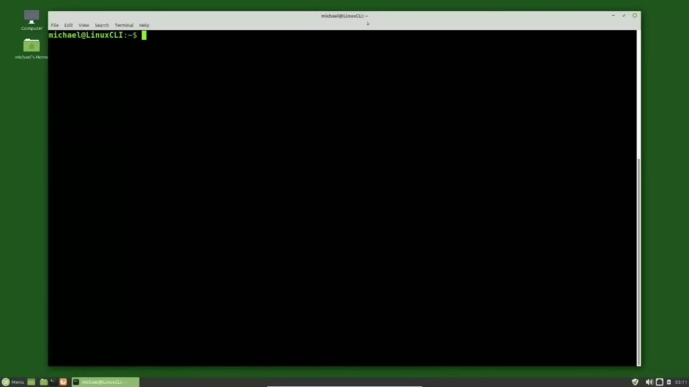
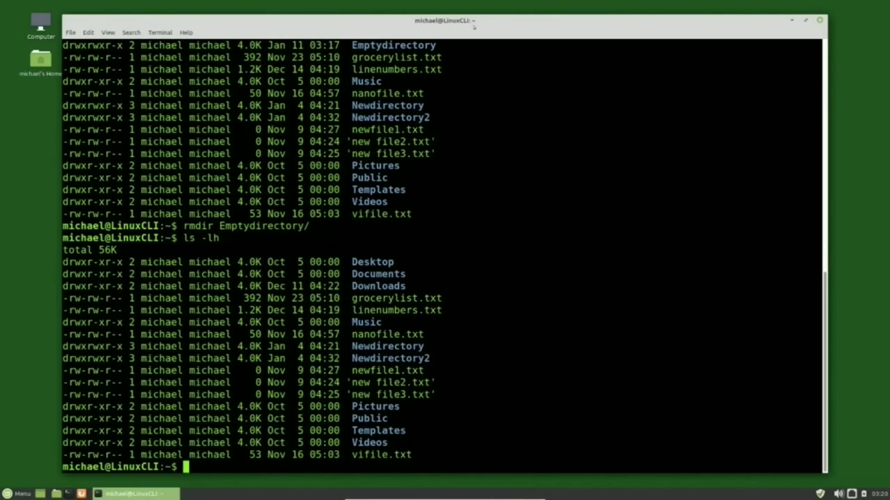
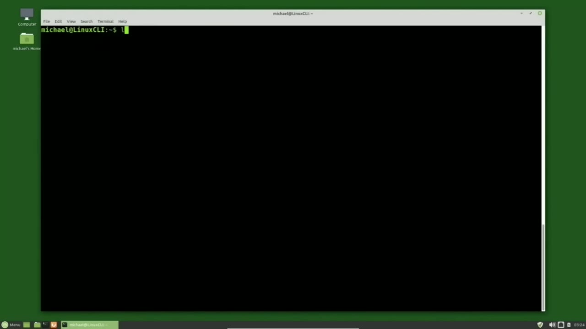
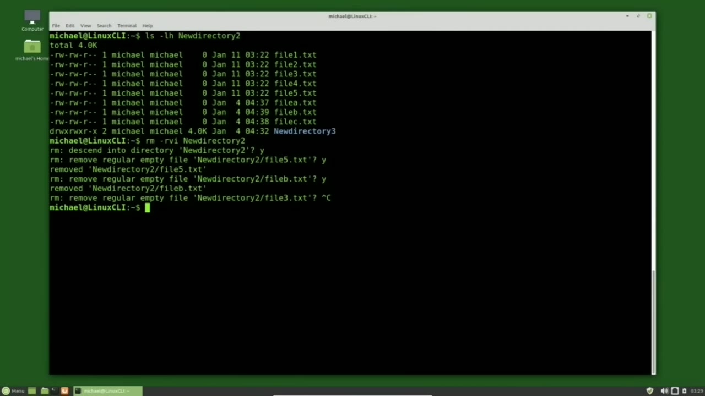

[← Course contents](../../01.md)

# 11. Delete Files and Directories

**Course:** [Linux Command Line - Entire Tutorial Series](https://www.youtube.com/watch?v=avg65oY7sj4)  
**Transcript:** [`Linux Command Line - Entire Tutorial Series transcript`](../../../../course_videos/Linux%20Command%20Line%20-%20Entire%20Tutorial%20Series/Linux%20Command%20Line%20-%20Entire%20Tutorial%20Series.txt)  
**Video:** 01:24:49–01:32:21 ([open at this time](https://www.youtube.com/watch?v=avg65oY7sj4&t=5089s))

## Introduction

In the last few videos, we've seen how to create, edit, copy, and move files and directories. In this video, we're going to look at how to delete them. I am typing ls -lh to show the files and directories in my current directory. To delete a file we will use the Remove command. The Remove command is shortened down to rm for Remove.

## Detailed Explanation

<details>
  <summary>Step 1 — Run `ls -lh`, `rm -vi`, `file -copy.tt`</summary>

### Step 1 — Run `ls -lh`, `rm -vi`, `file -copy.tt`

- [x] **Use `ls -lh`**
  - In the last few videos, we've seen how to create, edit, copy, and move files and directories.
  - In this video, we're going to look at how to delete them. I am typing `ls -lh` to show the files and directories in my current directory.
  - To delete a file we will use the Remove command.

- [x] **The Remove command is shortened down to rm for Remove**
  - The Remove command is shortened down to rm for Remove.
  - Then we put a space and the file name that we want to remove.
  - In the last few videos we also added the options V and I for verbose and interactive.

- [x] **Use `rm -vi`**
  - Those options are also available for Remove.
  - And I'll show them here by typing `rm -vi` and then we will delete the error file copy.txt.
  - Pressing Enter, we are asked, do we want to remove the regular file error file copy.t and for no, the file is not deleted. Pressing error up to bring back that same command, enter.

- [x] **Use `file -copy.tt`**
  - This time I'll press the Y and enter. And we get the message the error `file -copy.tt` file was removed. There is no trash file, so once it's deleted, it's gone. You may be able to recover it with some kind of file recovery software, but we don't have that here. So for us,
  - I'm going to first create an empty directory to remove.
  - Then I'll give it the name Empty Directory.

- [x] **Use `clear`, `ls -lh`**
  - I'm going to `clear` my screen by typing `clear`.
  - And you can also use Control L to `clear` the screen.
  - And I'll type `ls -lh`.

- [x] **Use `rm -d -ir`**
  - To show the empty directory that we just created.
  - To remove an empty directory, we can type `rm -d -ir`, which is short for Remove Directory.
  - Then we will give it the directory name that we want to remove, and that is Empty Directory.

- [x] **Use `ls -lh`**
  - Pressing Enter, we get no message, which in this case means it completed ok.
  - I'll type `ls -lh` again.
  - And we see the empty directory is no longer there.

```bash
ls -lh
rm -vi
file -copy.tt
clear
rm -d -ir
```



</details>

<details>
  <summary>Step 2 — Run `rmdir`, `touch`</summary>

### Step 2 — Run `rmdir`, `touch`

- [x] **Use `rmdir`, `touch`**
  - Before I try the `rmdir` on the New Directory 2 directory that we copied over in a previous video, I want to add some more files into that directory.
  - I'm going to type `touch` New Directory 2 forward slash file.
  - Then we're going to add that curly brace that we saw in the last video.

- [x] **We saw how the curly braces worked in the last video and building on**
  - We saw how the curly braces worked in the last video and building on that in this video we are creating a range of files.
  - The range being 1 through 5. So file 1.T. File 2.T.T.T.
  - All the way through 5. Pressing Enter. Just created those files.

- [x] **Use `rmdir`**
  - We get a message that the file was not removed because the directory was not empty.
  - Checking the man page for `rmdir`, we see right at the top in the name rmdr removes empty directories.
  - And there are times when we will want to do that, but this is not one of them.

- [x] **I'm going to press Q to get out of the man pages**
  - I'm going to press Q to get out of the man pages.
  - And I'm going to clear my screen again by pressing Control L.

```bash
rmdir
touch
```



</details>

<details>
  <summary>Step 3 — Run `ls -lh`</summary>

### Step 3 — Run `ls -lh`

- [x] **Use `ls -lh`**
  - And now I'm typing `ls -lh` new directory 2 and pressing enter shows us our files 1 through 5 the files A, B, and C that we created in the previous video as well as the new directory 3 that copied over when we moved the new directory 2 directory.
  - So this directory is definitely not empty.
  - The rm Remove command for a directory works similar to the mv move directory and the cp copy directory that we've already seen.

- [x] **Adding a -R, either upper or lowercase for recursive, will apply that**
  - Adding a -R, either upper or lowercase for recursive, will apply that command recursively for that directory.
  - And we can also use the -V for verbose and the -I for interactive.
  - So I will add that to our Remove command.

- [x] **New Directory 2. Pressing Enter, we're asked, do we want to descend**
  - New Directory 2. Pressing Enter, we're asked, do we want to descend into the directory, New Directory 2? If I press N here, it will not go any...
  - Further and cancel out of the command and nothing is changed.
  - Now it's asking us if we want to remove regular empty file, new directory 2 slash file 5.

- [x] **And that's kind of nice that it tells us that file 5.TXT is an empty**
  - And that's kind of nice that it tells us that file 5.TXT is an empty file.
  - The verbose action is letting us know that it was removed.
  - And then it's going down to the next one. Do we want to remove empty file, file b.txt, pressing Y. That file is now removed. But doing this for every file in that directory can get a little tedious. So I want to cancel out of this command. I'm pressing Ctrl+C to cancel out of that command. Ctrl+C is a common command for canceling out of things.

- [x] **And we also use the Q for quitting out of things like Les and the Man**
  - And we also use the Q for quitting out of things like Les and the Man pages.
  - Now we may have cancelled out of our command, but we still did delete New Directory to File 5.T file and the New Directory to File b.t file.

```bash
ls -lh
```



</details>

<details>
  <summary>Step 4 — Those were deleted before we cancelled out</summary>

### Step 4 — Those were deleted before we cancelled out

- [x] **Those were deleted before we cancelled out**
  - Those were deleted before we cancelled out.
  - But the New Directory 2 file 3.TXT file that is still there as well as all the other files and that New Directory 3 directory that's inside the New Directory 2 directory.
  - I want to delete out that new directory 2 directory and all the files in there.

- [x] **I want just a single confirmation prompt warning me before removing**
  - I want just a single confirmation prompt warning me before removing the entire directory.
  - To do that, I'm going to press arrow up.
  - To bring back that last command and move my cursor over to that i.

- [x] **I'm going to change that lowercase eye to an uppercase eye**
  - I'm going to change that lowercase eye to an uppercase eye.
  - We are now asked, do we want to remove argument 1 recursively?
  - And argument 1 is the new directory 2 directory.

- [x] **We want to do this so I will press Y and enter**
  - We want to do this so I will press Y and enter.
  - And because we've got the verbose on there we're seeing all the files that were deleted, that the new directory to new directory 3 directory was deleted as well as the new directory to directory itself. In the next video, we'll continue looking at the Linux command line.



</details>

<details>
  <summary>Questions and Answers</summary>

## Questions and Answers

### Question 1: What does `ls -lh` do in this chapter?

<details>
<summary>Answer</summary>

- [x] In this video, we're going to look at how to delete them. I am typing `ls -lh` to show the files and directories in my current directory.

</details>

### Question 2: What does `rm -vi` do in this chapter?

<details>
<summary>Answer</summary>

- [x] And I'll show them here by typing `rm -vi` and then we will delete the error file copy.txt.

</details>

### Question 3: What does `file -copy.tt` do in this chapter?

<details>
<summary>Answer</summary>

- [x] This time I'll press the Y and enter. And we get the message the error `file -copy.tt` file was removed. There is no trash file, so once it's deleted, it's gone. You may be able to recover it with some kind of file recovery software, but we don't have that here. So for us,

</details>

### Question 4: What does `clear` do in this chapter?

<details>
<summary>Answer</summary>

- [x] I'm going to `clear` my screen by typing `clear`.

</details>

### Question 5: What does `rm -d -ir` do in this chapter?

<details>
<summary>Answer</summary>

- [x] To remove an empty directory, we can type `rm -d -ir`, which is short for Remove Directory.

</details>

### Question 6: What does `rmdir` do in this chapter?

<details>
<summary>Answer</summary>

- [x] Before I try the `rmdir` on the New Directory 2 directory that we copied over in a previous video, I want to add some more files into that directory.

</details>

### Question 7: What does `touch` do in this chapter?

<details>
<summary>Answer</summary>

- [x] I'm going to type `touch` New Directory 2 forward slash file.

</details>

### Question 8: What does step 1 cover (Run ls -lh, rm -vi, file -copy.tt)?

<details>
<summary>Answer</summary>

- [x] In the last few videos, we've seen how to create, edit, copy, and move files and directories.
- [x] In this video, we're going to look at how to delete them. I am typing `ls -lh` to show the files and directories in my current directory.
- [x] To delete a file we will use the Remove command.

</details>

### Question 9: What does step 2 cover (Run rmdir, touch)?

<details>
<summary>Answer</summary>

- [x] Before I try the `rmdir` on the New Directory 2 directory that we copied over in a previous video, I want to add some more files into that directory.
- [x] I'm going to type `touch` New Directory 2 forward slash file.
- [x] Then we're going to add that curly brace that we saw in the last video.

</details>

### Question 10: What does step 3 cover (Run ls -lh)?

<details>
<summary>Answer</summary>

- [x] And now I'm typing `ls -lh` new directory 2 and pressing enter shows us our files 1 through 5 the files A, B, and C that we created in the previous video as well as the new directory 3 that copied over when we moved the new directory 2 directory.
- [x] So this directory is definitely not empty.
- [x] The rm Remove command for a directory works similar to the mv move directory and the cp copy directory that we've already seen.

</details>

</details>

## Summary

This chapter, Delete Files and Directories, walks through Run ls -lh, rm -vi, file -copy.tt; Run rmdir, touch; Run ls -lh; Those were deleted before we cancelled out. Commands from the transcript: `ls -lh`, `rm -vi`, `file -copy.tt`, `clear`, `rm -d -ir`, `rmdir`, `touch`.

## References

- [Linux Command Line - Entire Tutorial Series (YouTube)](https://www.youtube.com/watch?v=avg65oY7sj4)
- [This chapter at 01:24:49](https://www.youtube.com/watch?v=avg65oY7sj4&t=5089s)
- [Local transcript](../../../../course_videos/Linux%20Command%20Line%20-%20Entire%20Tutorial%20Series/Linux%20Command%20Line%20-%20Entire%20Tutorial%20Series.txt)
