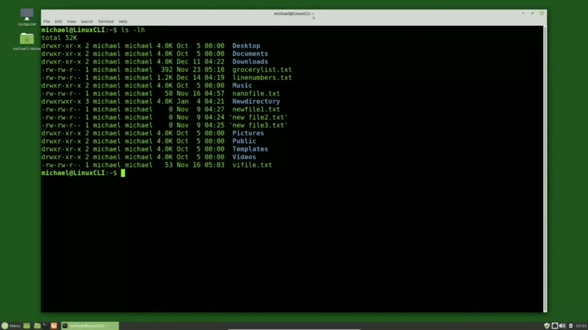
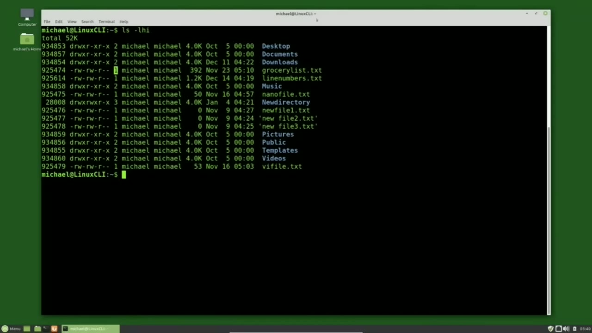
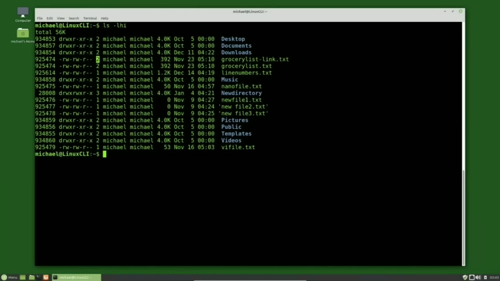
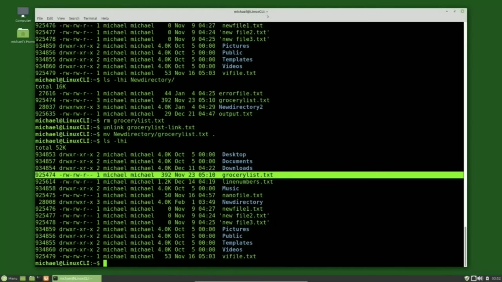

[← Course contents](../../01.md)

# 12. Linking Files and Directories

**Course:** [Linux Command Line - Entire Tutorial Series](https://www.youtube.com/watch?v=avg65oY7sj4)  
**Transcript:** [`Linux Command Line - Entire Tutorial Series transcript`](../../../../course_videos/Linux%20Command%20Line%20-%20Entire%20Tutorial%20Series/Linux%20Command%20Line%20-%20Entire%20Tutorial%20Series.txt)  
**Video:** 01:32:21–01:41:34 ([open at this time](https://www.youtube.com/watch?v=avg65oY7sj4&t=5541s))

## Introduction

Before we can talk about links, we need to understand how the Linux file system stores its files. Every file on a Linux system has an entry with a file name, and an i node. The i node stores all the information about the file, except the actual data, which is written on the disk and the file name that we see when we type l.s. And we see on the left we've got the permissions and then the owner and the group, the size, the date and time. And then on the far right, we've got the file name.

## Detailed Explanation

<details>
  <summary>Step 1 — Run `ls -lhi`</summary>

### Step 1 — Run `ls -lhi`

- [x] **Before we can talk about links, we need to understand how the Linux**
  - Before we can talk about links, we need to understand how the Linux file system stores its files.
  - Every file on a Linux system has an entry with a file name, and an i node. The i node stores all the information about the file, except the actual data, which is written on the disk and the file name that we see when we type l.s.
  - And we see on the left we've got the permissions and then the owner and the group, the size, the date and time.

- [x] **Use `ls -lhi`**
  - And then on the far right, we've got the file name.
  - To see the i node number, I'm going to clear the screen and type `ls -lhi`.
  - Now we've got the i node number on the far left.

- [x] **When a Linux file system is created, there are a specific number of i**
  - When a Linux file system is created, there are a specific number of i nodes created, and for the most part, that is more than enough for the number of files on that partition.
  - Occasionally, something will happen that will create a lot of very small files, I mean something happened that has gone way wrong to create that many small files.
  - But it is possible to use up all the iNodes.

- [x] **And then no more files can be created, including operating system**
  - And then no more files can be created, including operating system files.
  - What I'm getting at is it is possible to have a situation where there's plenty of usable disk space on your disk drive, but you cannot create any files because all the i nodes are used up.

```bash
ls -lhi
```



</details>

<details>
  <summary>Step 2 — Run `ln`, `source`, `ls -lh`</summary>

### Step 2 — Run `ln`, `source`, `ls -lh`

- [x] **Going back to our listing, I'm looking at the I node for our**
  - Going back to our listing, I'm looking at the I node for our GroceryList.TXT 925474.
  - Now looking at the third column, that is the number of links we have to that I node and the data on the disk.
  - I'm going to create a link to the GroceryList.T. File.

- [x] **Use `ln`**
  - And to do that, I'll type `ln` for link.
  - Then the name of the existing file that we want to link to.
  - GroceryList.T and then the new name will be Grocery List -link.t.

- [x] **Use `source`**
  - We see this command works similar to the commands we've already looked at so far.
  - We've got the command `source` file, then destination file, or the command then existing file and then new file.
  - I'm pressing Enter and our link is created. I'm going to clear the screen with Control L.

- [x] **Use `ls -lh`**
  - And type `ls -lh` I once again.
  - The first thing we notice is that our grocery list and our grocery list -link have the same I node numbers.
  - And notice in column 3 now instead of 1, we have 2.

- [x] **And that's because we have two links to the same data in I node**
  - And that's because we have two links to the same data in I node.
  - We can see that the permissions, size, date stamp, they're the same for both files because they're getting the data from the same iNode.

```bash
ln
source
ls -lh
```



</details>

<details>
  <summary>Step 3 — Run `cat grocery`, `ln grocerylist`, `ls -lhi`</summary>

### Step 3 — Run `cat grocery`, `ln grocerylist`, `ls -lhi`

- [x] **Use `cat grocery`**
  - To edit or view the data we can type in either name. I can type `cat grocery` list -link.t.
  - And `cat grocery` list.t.comst. txt. And it's the same file.
  - So you will not be able to edit both those file names at the same time for the same reason that you can't edit a single file into Windows at the same time.

- [x] **Use `ln grocerylist`, `ls -lhi`**
  - I can type `ln grocerylist`. txt, new directory, GroceryList. txt.
  - Typing `ls -lhi`.
  - Now we see a 3 for the number of links for our Grocery List link and the Grocery List file.

- [x] **Use `ls -l -hi`**
  - And when I type `ls -l -hi`, New Directory, we see in this new directory we still have the same I node number, the 925444.
  - We can remove any one of the three hard links and the data will remain intact.
  - Actually, we can remove any two of the three hard links and the file will still be there.

- [x] **Use `rm grocerylist.t`**
  - I will type rm, GroceryList.T, removing the original file.
  - And to remove the grocery list link, I can type rm or I can Unlink GroceryList -link.t.
  - Those two files are gone, but the data and the I note are still there because we still have the link in the new directory directory.

- [x] **Use `ls`**
  - And I will move Grocery List from the new directory directory to the current directory with move.
  - New directory, GroceryList.TXT, the dot, meaning the current directory, and typing `ls`.
  - -lhi shows us that we once again have our GroceryList.TXT file with the 925-474 iNode.

- [x] **Unlinking this last hard link or removing the hard link with the rm**
  - Unlinking this last hard link or removing the hard link with the rm command will remove the iNode, but the data will still be on the disk until it gets written over.
  - And that's one way that file recovery tools are able to restore a file after it's deleted.
  - There are some limitations to hard links.

- [x] **You can only hard link to a file in the same partition**
  - You can only hard link to a file in the same partition.
  - The reason for this is when you set up a partition, it sets up the I node numbers for that partition, and it's possible for another partition to have the same I node number.

```bash
cat grocery
ln grocerylist
ls -lhi
ls -l -hi
rm grocerylist.t
ls
```



</details>

<details>
  <summary>Step 4 — Run `ln`, `ls -lhi`, `cat grocery`</summary>

### Step 4 — Run `ln`, `ls -lhi`, `cat grocery`

- [x] **Use `ln`**
  - And the reason for that is because someone could create a hard link to its parent directory, creating a system loop.
  - If we want to link to a directory or a file or directory on another partition, we would want to use a soft link, which is also called a SIM link.
  - To create a SIM link, I will type `ln` for Link -S for Softlink or SIM link.

- [x] **Use `ls -lhi`**
  - Then the file name I want to link to in this case, GroceryList.T.
  - And then the new link that I want to create, which in this case will be Grocery List -simlink.t.
  - And type `ls -lhi`.

- [x] **There are a few differences we see between the SIM link and the file**
  - There are a few differences we see between the SIM link and the file we linked to.
  - First thing we notice is the I node number is different.
  - And that's because we did not link to the file itself, but the file name.

- [x] **In the next column with the permissions, we notice that first letter**
  - In the next column with the permissions, we notice that first letter is now an L for a link.
  - And then the other options we see are D for directory and a dash, which is a regular file.
  - We have one for the number of links because it's not linked to the iNode and the data.

- [x] **And we see that the stats are different because it is not linked to**
  - And we see that the stats are different because it is not linked to the iNode.
  - The size of this link notices 15. That is also the number of characters in our grocery list.t file name.
  - And then the most obvious difference between the two is after the name, we've got an arrow pointing telling us that it's linking to.

- [x] **Use `ls -lhi`, `cat grocery`**
  - Grocery list. txt. The thing about soft links or sim links is if I rename the file that it's linked to move grocery list.t to grocery list -renamed.t. Now when I do an `ls -lhi` we see the grocery list -simlink. txt shows up in red on my screen.
  - But I've seen them blink on systems and that all depends on the system settings.
  - What this is telling us is the link is broken and the SIM link can no longer get to the file it was linked to. If I type cat, grocery list simlink.t.

- [x] **We get the message that there's no such file or directory**
  - We get the message that there's no such file or directory.
  - To fix the SIM link, we just need to rename the file back to the way it was.
  - Now when I cat the file, it shows us the data that is inside the file it's linked to.

- [x] **Use `ls -lhi`**
  - To remove a SIM link, I prefer to use the unlink command and I'll unlink Grocery List -simlink. txt.
  - Typing `ls -lhi`, we see that our SIM link is now removed.
  - In the next video, we'll continue looking at the Linux command line.

```bash
ln
ls -lhi
cat grocery
```



</details>

<details>
  <summary>Questions and Answers</summary>

## Questions and Answers

### Question 1: What does `ls -lhi` do in this chapter?

<details>
<summary>Answer</summary>

- [x] To see the i node number, I'm going to clear the screen and type `ls -lhi`.

</details>

### Question 2: What does `ln` do in this chapter?

<details>
<summary>Answer</summary>

- [x] And to do that, I'll type `ln` for link.

</details>

### Question 3: What does `source` do in this chapter?

<details>
<summary>Answer</summary>

- [x] We've got the command `source` file, then destination file, or the command then existing file and then new file.

</details>

### Question 4: What does `ls -lh` do in this chapter?

<details>
<summary>Answer</summary>

- [x] And type `ls -lh` I once again.

</details>

### Question 5: What does `cat grocery` do in this chapter?

<details>
<summary>Answer</summary>

- [x] To edit or view the data we can type in either name. I can type `cat grocery` list -link.t.

</details>

### Question 6: What does `ln grocerylist` do in this chapter?

<details>
<summary>Answer</summary>

- [x] I can type `ln grocerylist`. txt, new directory, GroceryList. txt.

</details>

### Question 7: What does `ls -l -hi` do in this chapter?

<details>
<summary>Answer</summary>

- [x] And when I type `ls -l -hi`, New Directory, we see in this new directory we still have the same I node number, the 925444.

</details>

### Question 8: What does `rm grocerylist.t` do in this chapter?

<details>
<summary>Answer</summary>

- [x] I will type rm, GroceryList.T, removing the original file.

</details>

### Question 9: What does `rm` do in this chapter?

<details>
<summary>Answer</summary>

- [x] And to remove the grocery list link, I can type `rm` or I can Unlink GroceryList -link.t.

</details>

### Question 10: What does `ls` do in this chapter?

<details>
<summary>Answer</summary>

- [x] New directory, GroceryList.TXT, the dot, meaning the current directory, and typing `ls`.

</details>

</details>

## Summary

This chapter, Linking Files and Directories, walks through Run ls -lhi; Run ln, source, ls -lh; Run cat grocery, ln grocerylist, ls -lhi; Run ln, ls -lhi, cat grocery. Commands from the transcript: `ls -lhi`, `ln`, `source`, `ls -lh`, `cat grocery`, `ln grocerylist`, `ls -l -hi`, `rm grocerylist.t`, `ls`.

## References

- [Linux Command Line - Entire Tutorial Series (YouTube)](https://www.youtube.com/watch?v=avg65oY7sj4)
- [This chapter at 01:32:21](https://www.youtube.com/watch?v=avg65oY7sj4&t=5541s)
- [Local transcript](../../../../course_videos/Linux%20Command%20Line%20-%20Entire%20Tutorial%20Series/Linux%20Command%20Line%20-%20Entire%20Tutorial%20Series.txt)
