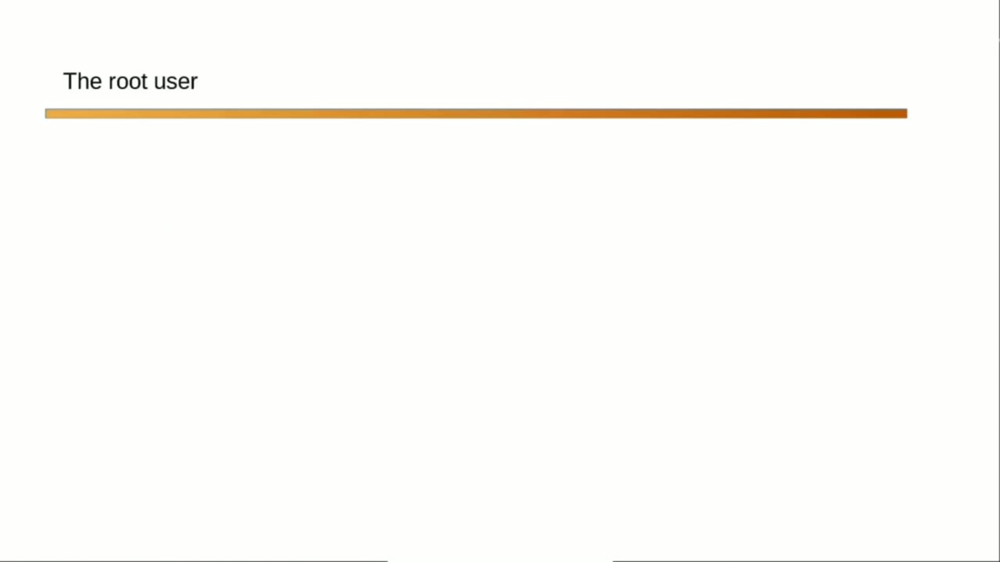
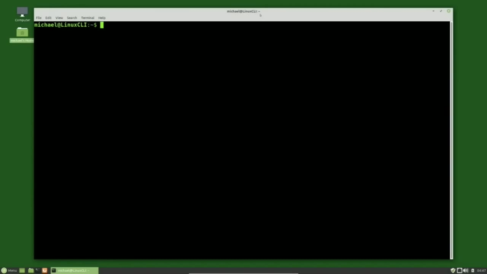
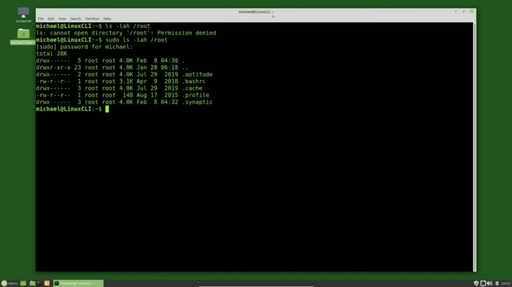
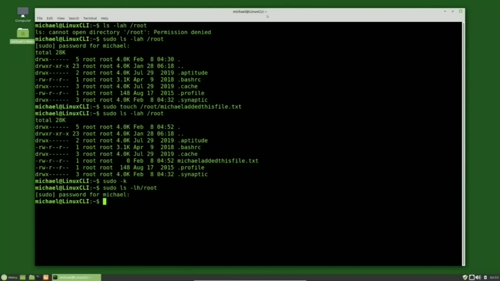

[← Course contents](../../01.md)

# 13. The Root User

**Course:** [Linux Command Line - Entire Tutorial Series](https://www.youtube.com/watch?v=avg65oY7sj4)  
**Transcript:** [`Linux Command Line - Entire Tutorial Series transcript`](../../../../course_videos/Linux%20Command%20Line%20-%20Entire%20Tutorial%20Series/Linux%20Command%20Line%20-%20Entire%20Tutorial%20Series.txt)  
**Video:** 01:41:34–01:50:07 ([open at this time](https://www.youtube.com/watch?v=avg65oY7sj4&t=6094s))

## Introduction

On Linux systems, there are two types of users, privileged users and unprivileged users. We can think of the root user as the super user or admin user. The root user can do anything to any file on the file system. The root user can change or edit any file on the file system.

## Detailed Explanation

<details>
  <summary>Step 1 — On Linux systems, there are two types of users, privileged users and</summary>

### Step 1 — On Linux systems, there are two types of users, privileged users and

- [x] **On Linux systems, there are two types of users, privileged users and**
  - On Linux systems, there are two types of users, privileged users and unprivileged users.
  - We can think of the root user as the super user or admin user.
  - The root user can do anything to any file on the file system.

- [x] **The root user can change or edit any file on the file system**
  - The root user can change or edit any file on the file system.
  - They can run or execute any program or file and they can change permissions and create and delete any accounts on the system.
  - A few videos back I mentioned that the forward slash was the root directory.

- [x] **We call that forward slash the root directory because all directories**
  - We call that forward slash the root directory because all directories and files for the entire file system are started from there and then get added on as paths grow out with the directories and branches like files and leaves on a tree.
  - Here we see a branch for the Home Directory and another branch for the Michael directory.
  - And then the files would be the leaves on those branches.

- [x] **The root user has admin or super user privileges to do everything in**
  - The root user has admin or super user privileges to do everything in this root directory.
  - So most likely that's where the term root user came from.
  - Root. It can either be the root user or the root directory. They are two different things.

- [x] **In the early days of Linux, people would sign in as the root user to**
  - In the early days of Linux, people would sign in as the root user to do their daily tasks because they may need to do some administrative tasks. They stopped doing this because the root user can edit, change, or delete any files on the file system and often ended up doing
  - Just that. Accidentally, editing, changing, and deleting important system files that they didn't intend to with unfortunate results.



</details>

<details>
  <summary>Step 2 — Run `sudo`, `ls -lah`, `sudo ls -l -ah`</summary>

### Step 2 — Run `sudo`, `ls -lah`, `sudo ls -l -ah`

- [x] **And when a browser is opened as root, now it has root privileges and**
  - And when a browser is opened as root, now it has root privileges and any malware or viruses on your system would then have root privileges as well. And that would be bad.
  - The version of Linux Mint I am using is based on Ubuntu.
  - And Ubuntu requires that a username is given when we install the operating system.

- [x] **After installing the operating system, Ubuntu makes the user account**
  - After installing the operating system, Ubuntu makes the user account just created a privileged user.
  - Being a privileged user means my user id can submit root user commands.
  - But a moment ago, didn't I just say it was a bad idea to log in every time as a root user?

- [x] **Use `sudo`**
  - My user id of Michael only has standard privileges.
  - When I need to submit a privileged root command, I will proceed that command with `sudo`.
  - And some people pronounce this `sudo`, including me at times, and some people call this `sudo`.

- [x] **Use `sudo`**
  - But it works the same way no matter how you pronounce it, so you'll hear me pronounce it both ways throughout this series.
  - Now some people say that `sudo` stands for super user do and other people will say it's switch user do.
  - Either way it allows the user to submit that single command with root user privileges.

- [x] **Use `ls -lah`**
  - To show you what I mean, I'm typing `ls -lah` forward /root.
  - Pressing Enter, we'll return to a message that we don't have permissions.
  - That is because at the moment I'm trying to read this directory with standard or unprivileged user permissions.

- [x] **Use `sudo ls -l -ah`**
  - I'm pressing arrow up and Control A to go to the beginning of the line and I'll type in `sudo ls -l -ah` forward /root.
  - Pressing Enter. Now Linux is asking me to enter my password and it's telling me that it's looking for the Michael.
  - Typing in the password and when I press enter, we see that there are just some hidden files there in the root directory.

- [x] **I'm going to add something into that directory**
  - I'm going to add something into that directory.

```bash
sudo
ls -lah
sudo ls -l -ah
```



</details>

<details>
  <summary>Step 3 — Run `sudo touch`, `sudo -lis -lah`, `sudo -k`</summary>

### Step 3 — Run `sudo touch`, `sudo -lis -lah`, `sudo -k`

- [x] **Use `sudo touch`, `sudo -lis -lah`**
  - And to do that, I will type `sudo`, touch, root.
  - And then what I'm going to add in there is a text file called the file called Michael added this text file. txt.
  - And then I will go back to the `sudo -lis -lah`.

- [x] **And notice that those last two commands, it did not ask me to type in**
  - And notice that those last two commands, it did not ask me to type in my password again.
  - That's because Linux keeps me as a privileged user for about 5 to 10 minutes after typing in my password for a privileged command.
  - The reason for this, like now, once we submit a privileged command, it is likely that we will want to type in a few more privileged commands.

- [x] **Use `sudo -k`, `sudo ls -lh /root`**
  - And it can be a hassle typing in your password for every privileged command you want to type in.
  - If I want to kill off my privileged user status and go back to being an unprivileged regular user once again, I can type `sudo -k`.
  - Now if I want to view the content of my root directory with `sudo ls -lh /root`.

- [x] **Use `sudo`**
  - I'm going to press Ctrl+C to cancel out of that.
  - The `sudo` command allows me to run a single command as root.
  - But what if I have several commands I want to run as root and I just want to switch over to be the root user for a little while and then switch back to my unprivileged user.

```bash
sudo touch
sudo -lis -lah
sudo -k
sudo ls -lh /root
sudo
```



</details>

<details>
  <summary>Step 4 — Run `sudo -i`, `sudo`, `ls -lh /root`</summary>

### Step 4 — Run `sudo -i`, `sudo`, `ls -lh /root`

- [x] **Use `sudo -i`**
  - I can switch to be the root user by typing `sudo -i`.
  - And why do we use the I to log in as root?
  - When I checked the man page, I saw that L was used by list and G was already used by group.

- [x] **So most likely they pick the I for log in**
  - So most likely they pick the I for log in.
  - When I press Enter, it's asking me for the password again.
  - To the left, instead of saying Michael, it says root.

- [x] **Use `sudo`, `ls -lh /root`**
  - And then to the far right, instead of having a dollar sign, it has the hashtag.
  - Those two things show that now I'm able to run commands as root, meaning I do not have to type in `sudo` before running a privileged command.
  - I can type `ls -lh /root`.

- [x] **Use `sudo`**
  - And there I see the text file that I just added a moment or two ago without needing to type `sudo`.
  - Now as root I would type in all the rest of the privileged commands I need to type in.
  - And we see that I'm logged out of root and my command line prompt is showing that I am Michael and it has the dollar sign once again.

- [x] **Use `ls -lh`, `sudo`**
  - Typing `ls -lh` forward /root now shows me I don't have permissions to read that file.
  - If you typed in a command like that and meant to type `sudo` but forgot, instead of hitting the arrow up and then control A to go to the beginning of the line and typing `sudo`, another thing you can do is type `sudo` exclamation point exclamation point.
  - And often people will refer to that exclamation point as a bang.

- [x] **Use `sudo`, `last`, `ls -lh`**
  - So `sudo`!! will add `sudo` to the `last` command.
  - And this works for other things besides `sudo`.
  - I'm going to type `ls -lh` to see what files I have in this directory.

- [x] **Use `tail`, `sudo`**
  - If I wanted to `tail` the grocery list, and let's say I forgot the word `tail`, I just typed grocery list.
  - So I will type `tail`.
  - To the command i just submitted so!! can be used for other other things besides `sudo`!! but most of the time it is used for `sudo`!! in the next video we'll look at how to add users using the

```bash
sudo -i
sudo
ls -lh /root
ls -lh
last
tail
```



</details>

<details>
  <summary>Questions and Answers</summary>

## Questions and Answers

### Question 1: What does `sudo` do in this chapter?

<details>
<summary>Answer</summary>

- [x] When I need to submit a privileged root command, I will proceed that command with `sudo`.

</details>

### Question 2: What does `ls -lah` do in this chapter?

<details>
<summary>Answer</summary>

- [x] To show you what I mean, I'm typing `ls -lah` forward /root.

</details>

### Question 3: What does `sudo ls -l -ah` do in this chapter?

<details>
<summary>Answer</summary>

- [x] I'm pressing arrow up and Control A to go to the beginning of the line and I'll type in `sudo ls -l -ah` forward /root.

</details>

### Question 4: What does `sudo touch` do in this chapter?

<details>
<summary>Answer</summary>

- [x] And to do that, I will type Sudo, touch, root.

</details>

### Question 5: What does `sudo -lis -lah` do in this chapter?

<details>
<summary>Answer</summary>

- [x] And then I will go back to the `sudo -lis -lah`.

</details>

### Question 6: What does `sudo -k` do in this chapter?

<details>
<summary>Answer</summary>

- [x] If I want to kill off my privileged user status and go back to being an unprivileged regular user once again, I can type `sudo -k`.

</details>

### Question 7: What does `sudo ls -lh /root` do in this chapter?

<details>
<summary>Answer</summary>

- [x] Now if I want to view the content of my root directory with `sudo ls -lh /root`.

</details>

### Question 8: What does `sudo -i` do in this chapter?

<details>
<summary>Answer</summary>

- [x] I can switch to be the root user by typing `sudo -i`.

</details>

### Question 9: What does `ls -lh /root` do in this chapter?

<details>
<summary>Answer</summary>

- [x] I can type `ls -lh /root`.

</details>

### Question 10: What does `ls -lh` do in this chapter?

<details>
<summary>Answer</summary>

- [x] Typing `ls -lh` forward /root now shows me I don't have permissions to read that file.

</details>

### Question 11: What does `last` do in this chapter?

<details>
<summary>Answer</summary>

- [x] So sudo!! will add sudo to the `last` command.

</details>

### Question 12: What does `tail` do in this chapter?

<details>
<summary>Answer</summary>

- [x] So I will type `tail`.

</details>

</details>

## Summary

This chapter, The Root User, walks through On Linux systems, there are two types of users, privileged users and; Run sudo, ls -lah, sudo ls -l -ah; Run sudo touch, sudo -lis -lah, sudo -k; Run sudo -i, sudo, ls -lh /root. Commands from the transcript: `sudo`, `ls -lah`, `sudo ls -l -ah`, `sudo touch`, `sudo -lis -lah`, `sudo -k`, `sudo ls -lh /root`, `sudo -i`, `ls -lh /root`, `ls -lh`, `last`, `tail`.

## References

- [Linux Command Line - Entire Tutorial Series (YouTube)](https://www.youtube.com/watch?v=avg65oY7sj4)
- [This chapter at 01:41:34](https://www.youtube.com/watch?v=avg65oY7sj4&t=6094s)
- [Local transcript](../../../../course_videos/Linux%20Command%20Line%20-%20Entire%20Tutorial%20Series/Linux%20Command%20Line%20-%20Entire%20Tutorial%20Series.txt)
