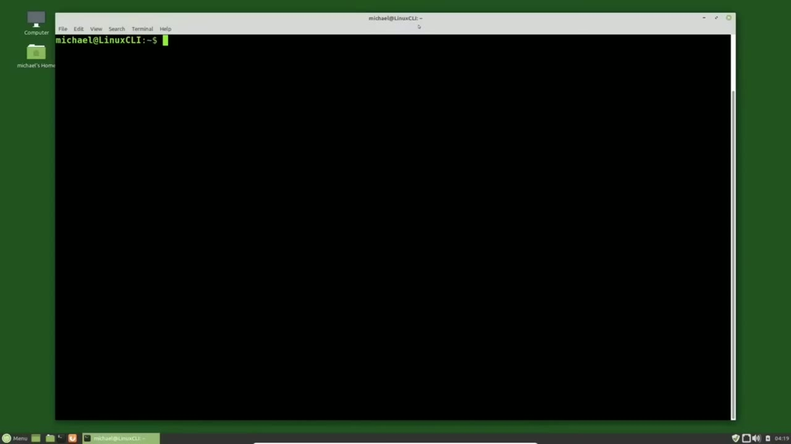
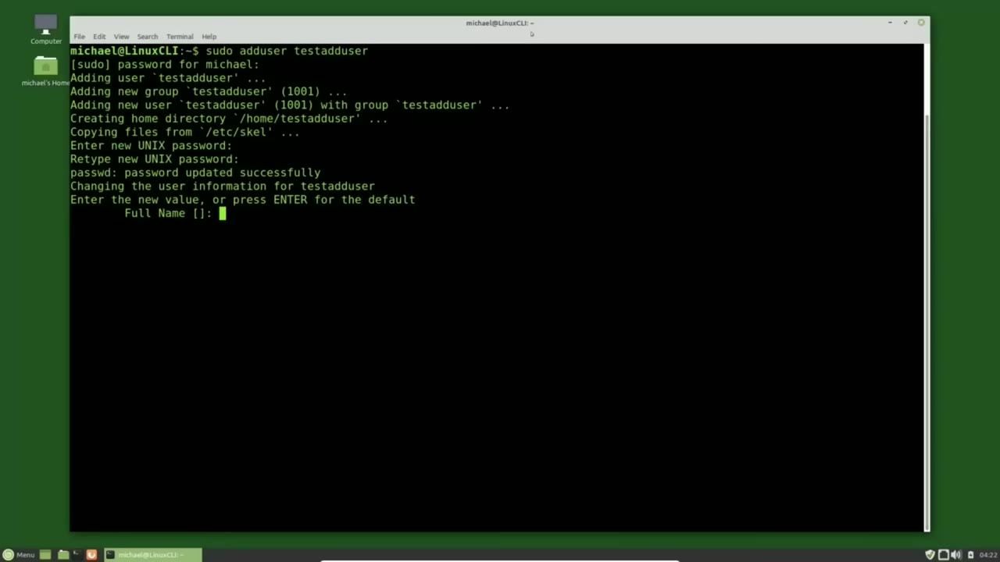
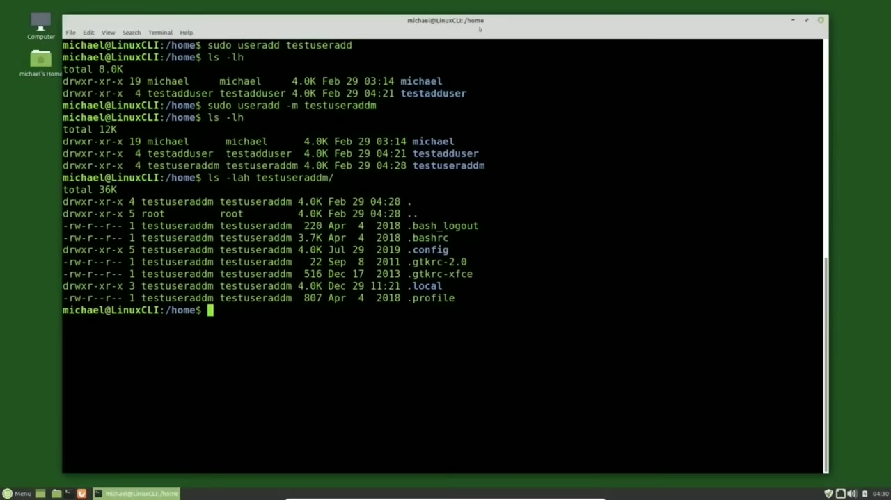
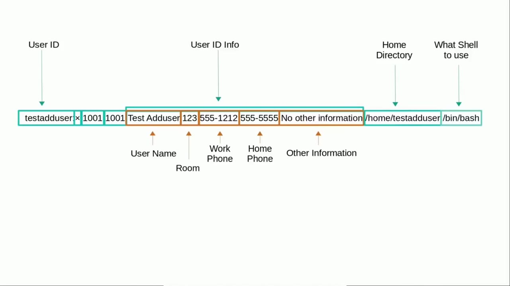

[← Course contents](../../01.md)

# 14. Adding New Users pt1

**Course:** [Linux Command Line - Entire Tutorial Series](https://www.youtube.com/watch?v=avg65oY7sj4)  
**Transcript:** [`Linux Command Line - Entire Tutorial Series transcript`](../../../../course_videos/Linux%20Command%20Line%20-%20Entire%20Tutorial%20Series/Linux%20Command%20Line%20-%20Entire%20Tutorial%20Series.txt)  
**Video:** 01:50:07–02:00:22 ([open at this time](https://www.youtube.com/watch?v=avg65oY7sj4&t=6607s))

## Introduction

Linux command line to add a new user from the command line on a Linux operating system you must be a privileged user we learned about privileged users in the previous video We're going to look at two commands to add a user account on our Ubuntu-based operating system. adduser and useradd. We'll start with the adduser since that one comes first alphabetically. To add a new user with the adduser command you would type Sudo because I'm not the root user and adduser is a privileged command.

## Detailed Explanation

<details>
  <summary>Step 1 — Run `adduser`, `useradd`, `sudo`</summary>

### Step 1 — Run `adduser`, `useradd`, `sudo`

- [x] **Use `adduser`, `useradd`**
  - Linux command line to add a new user from the command line on a Linux operating system you must be a privileged user we learned about privileged users in the previous video We're going to look at two commands to add a user account on our Ubuntu-based operating system.
  - `adduser` and `useradd`.
  - We'll start with the `adduser` since that one comes first alphabetically.

- [x] **Use `adduser`, `sudo`**
  - To add a new user with the `adduser` command you would type `sudo` because I'm not the root user and `adduser` is a privileged command.
  - Then the command itself which is `adduser` then a space, and then the username that we want to add.
  - In this case, it is Test, `adduser`.

- [x] **Pressing Enter, I am prompted for the password to submit a privileged**
  - Pressing Enter, I am prompted for the password to submit a privileged command.
  - I'll put in my password and press Enter.
  - Now we are prompted to enter a password for our new user, the Test User Ad User.

- [x] **I'll type in that new password, and I need to confirm that**
  - I'll type in that new password, and I need to confirm that.
  - Now it's asking me for the full name of the new user.
  - We can type this in if we like or just press Enter and leave it blank.

```bash
adduser
useradd
sudo
```



</details>

<details>
  <summary>Step 2 — Run `adduser`, `ls -lh`, `ls -lah`</summary>

### Step 2 — Run `adduser`, `ls -lh`, `ls -lah`

- [x] **Use `adduser`**
  - I'll put in the full name as test, `adduser`, pressing Enter.
  - We're now asked for some information about this new user.
  - Again, we can just press Enter and skip it, but I'm going to enter in some values.

- [x] **Use `ls -lh`**
  - Work phone 55512, Home phone will be 5555555555 And for other I will say no other information Pressing Enter Now it's asking me if this information is correct It is so I will press Y And like most Linux commands no news is good news So the new user Test Ad User was added.
  - I'm going to check the Home Directory to make sure the Home Directory for Test Ad User was created.
  - cd Home and `ls -lh` shows us the Home directories and there's the Test Ad User.

- [x] **Use `ls -lah`, `adduser`**
  - I also want to confirm that the configuration files were created when it created that new Test Ad User directory.
  - I can do that with `ls -lah`.
  - Now, if we really wanted to test out the test `adduser` user id, I would log out and log back in as test `adduser`.

- [x] **Use `useradd`, `sudo useradd`**
  - For the sake of time, we're going to skip that step and move right on to adding a user with the `useradd` command.
  - And add in the new user the same way `sudo useradd` test `useradd` pressing enter and right away we get the no news is good news response but it didn't prompt us for a password and it didn't ask us for any information about the new user checking the home directories we see that no home directory was created for our test
  - User ad user the reason no home directory was created was because when we add a new user with the `useradd` command and no options, this new user is added like a service account.

- [x] **Use `mysql`**
  - In short, a service account is just an account set up for a specific service like SSH, FTP or `mysql`.
  - Don't worry if you don't know what those services are right now.
  - A service account is an account for a specific service that is not the root user because we don't want to give this account root privileges.

- [x] **And it's not a user account of a person that might be promoted out of**
  - And it's not a user account of a person that might be promoted out of the department or maybe leave the company.
  - Often a service account does not need a login to the computer and that is why no password was asked for.
  - We'll see some examples of service accounts in just a minute or so.

- [x] **Use `sudo`, `useradd`**
  - Right now I want to create a standard user with the user ad command with a home directory.
  - To do that I will type `sudo` User Ad -M Test `useradd` M. And the -M option for the `useradd` command means create a Home Directory.
  - They did not use the -H option for Home Directory because the -H was already taken for the option for help.

- [x] **Use `ls -lh`, `ls -lah`, `useradd`**
  - Pressing Enter. We'll check for the Home Director with `ls -lh`.
  - And there's our Test User Ad M is created.
  - And checking for the configuration files with `ls -lah` test `useradd` M.

- [x] **We see the configuration files are also there**
  - We see the configuration files are also there.
  - Once our users are created, they're stored in the /etc password file.
  - And although I said password, it's actually spelled pass wd, so I will pronounce it both ways.

```bash
adduser
ls -lh
ls -lah
useradd
sudo useradd
mysql
sudo
```



</details>

<details>
  <summary>Step 3 — Run `cat /etc/passwd`, `adduser`, `bash`</summary>

### Step 3 — Run `cat /etc/passwd`, `adduser`, `bash`

- [x] **Use `cat /etc/passwd`**
  - Any user on the system can see the /etc password file by typing `cat /etc/passwd`.
  - This is all the users on the operating system at the moment.
  - And this can look a little intimidating as a whole, but let's take a look at a single record.

- [x] **Here we see the single record for the Test Ad User Logon id**
  - Here we see the single record for the Test Ad User Logon id.
  - Looking at that record by itself, it still looks a little confusing at the moment.
  - But notice there are some colon separators and some comma separators.

- [x] **Using the colon and comma separators to break things up makes it a**
  - Using the colon and comma separators to break things up makes it a little clearer to see what we're actually looking at.
  - We've got the user login id on the far left.
  - The comma separated text is the information we typed in about this user.

- [x] **Use `adduser`**
  - We've got the username, the room, the phone numbers, and the other information.
  - This will be the directory where the user, test `adduser`, will store personal files like spreadsheets, photos, and music.
  - We've been working in the Home Michael directory in this tutorial series, and that is the Home Directory for the Michael user that I log in as.

- [x] **Use `bash`**
  - On the far right we have what shell to use, and we see we are using /bin slash `bash`, meaning we are using the `bash` shell.
  - But that's not the only shell Linux has.
  - Other popular shells are the C shell, the corn shell, the Z shell, or Zed Shell, as our friends in the uk like to call it.

- [x] **Fish, also known as friendly interactive shell**
  - Fish, also known as friendly interactive shell.
  - We're not going to look at any of those shells in this tutorial series.

```bash
cat /etc/passwd
adduser
bash
```



</details>

<details>
  <summary>Step 4 — Run `bash`, `id`, `cd -rom 27 sudo`</summary>

### Step 4 — Run `bash`, `id`, `cd -rom 27 sudo`

- [x] **Use `bash`**
  - We're only going to look at `bash` commands.
  - So why didn't I just call this tutorial series the Linux `bash` shell?
  - And I did consider calling it that, but...

- [x] **It just didn't sound like as much fun to me**
  - It just didn't sound like as much fun to me.
  - And this tutorial series is designed for people new to Linux that want to learn about the Linux command line.
  - And one of the things we learned about is that there are different shells that can be used.

- [x] **Use `bash`**
  - But in this series we're only going to look at the `bash` shell commands.
  - We have three more fields to look at the password, the user `id`, and the group `id`.
  - And a group `id` assigned to them when the user `id` is created.

- [x] **Going back to the /etc/passwd file again, we see that the user id and**
  - Going back to the /etc/passwd file again, we see that the user `id` and the group `id` for the three users that we just created are the same, but the group `id` does not have to be the same as the user `id` and the group `id` does not have to be unique at all.
  - All three of our new users could have had the same group `id`, but the user `id` must be unique.
  - And a single user can belong to multiple groups.

- [x] **Use `id`, `cd -rom 27 sudo`**
  - To see what groups the Michael user `id` is a member of, I will type `id` Michael.
  - Here we see the user `id` of 1000, the group `id` of 1000, and then we see the other groups that Michael is a member of.
  - The 4 adm, 24 cd -rom, 27, sudo, and there's more there.

- [x] **Earlier in this video I was talking about service accounts and we can**
  - Earlier in this video I was talking about service accounts and we can see that most of the accounts on this operating system are service accounts.
  - The Pulse or Pulse Audio Damon, that is a service account for the sound and has a user `id` of 120 and a group `id` of 126.
  - Below that we've got the hplip service account which has a user `id` of 121 and a group `id` of 7.

- [x] **This is for my hp printer and lip is for Linux image and printing**
  - This is for my hp printer and lip is for Linux image and printing.
  - So the first 99 user IDs are reserved for service accounts.
  - The general user accounts start at 1000.

- [x] **The first general user id that was created when I installed the**
  - The first general user `id` that was created when I installed the operating system.
  - That's because the encrypted password is not stored in the password file.
  - It is possible to store your plain text password.

- [x] **In this file, in this field, but it's really a bad idea to store**
  - In this file, in this field, but it's really a bad idea to store unencrypted passwords in a file that everyone on the system has read access to.
  - So there is an X in the password field and the actual password is encrypted and stored in the shadow file.
  - And we'll talk about the shadow file in the next video.

```bash
bash
id
cd -rom 27 sudo
```



</details>

<details>
  <summary>Questions and Answers</summary>

## Questions and Answers

### Question 1: What does `adduser` do in this chapter?

<details>
<summary>Answer</summary>

- [x] `adduser` and useradd.

</details>

### Question 2: What does `useradd` do in this chapter?

<details>
<summary>Answer</summary>

- [x] adduser and `useradd`.

</details>

### Question 3: What does `sudo` do in this chapter?

<details>
<summary>Answer</summary>

- [x] To add a new user with the adduser command you would type `sudo` because I'm not the root user and adduser is a privileged command.

</details>

### Question 4: What does `ls -lh` do in this chapter?

<details>
<summary>Answer</summary>

- [x] cd Home and `ls -lh` shows us the Home directories and there's the Test Ad User.

</details>

### Question 5: What does `ls -lah` do in this chapter?

<details>
<summary>Answer</summary>

- [x] I can do that with `ls -lah`.

</details>

### Question 6: What does `sudo useradd` do in this chapter?

<details>
<summary>Answer</summary>

- [x] And add in the new user the same way `sudo useradd` test useradd pressing enter and right away we get the no news is good news response but it didn't prompt us for a password and it didn't ask us for any information about the new user checking the home directories we see that no home directory was created for our test

</details>

### Question 7: What does `mysql` do in this chapter?

<details>
<summary>Answer</summary>

- [x] In short, a service account is just an account set up for a specific service like SSH, FTP or `mysql`.

</details>

### Question 8: What does `cat /etc/passwd` do in this chapter?

<details>
<summary>Answer</summary>

- [x] Any user on the system can see the /etc password file by typing `cat /etc/passwd`.

</details>

### Question 9: What does `bash` do in this chapter?

<details>
<summary>Answer</summary>

- [x] On the far right we have what shell to use, and we see we are using /bin slash `bash`, meaning we are using the `bash` shell.

</details>

### Question 10: What does `id` do in this chapter?

<details>
<summary>Answer</summary>

- [x] To see what groups the Michael user `id` is a member of, I will type `id` Michael.

</details>

### Question 11: What does `cd -rom 27 sudo` do in this chapter?

<details>
<summary>Answer</summary>

- [x] The 4 adm, 24 cd -rom, 27, sudo, and there's more there.

</details>

</details>

## Summary

This chapter, Adding New Users pt1, walks through Run adduser, useradd, sudo; Run adduser, ls -lh, ls -lah; Run cat /etc/passwd, adduser, bash; Run bash, id, cd -rom 27 sudo. Commands from the transcript: `adduser`, `useradd`, `sudo`, `ls -lh`, `ls -lah`, `sudo useradd`, `mysql`, `cat /etc/passwd`, `bash`, `id`, `cd -rom 27 sudo`.

## References

- [Linux Command Line - Entire Tutorial Series (YouTube)](https://www.youtube.com/watch?v=avg65oY7sj4)
- [This chapter at 01:50:07](https://www.youtube.com/watch?v=avg65oY7sj4&t=6607s)
- [Local transcript](../../../../course_videos/Linux%20Command%20Line%20-%20Entire%20Tutorial%20Series/Linux%20Command%20Line%20-%20Entire%20Tutorial%20Series.txt)
