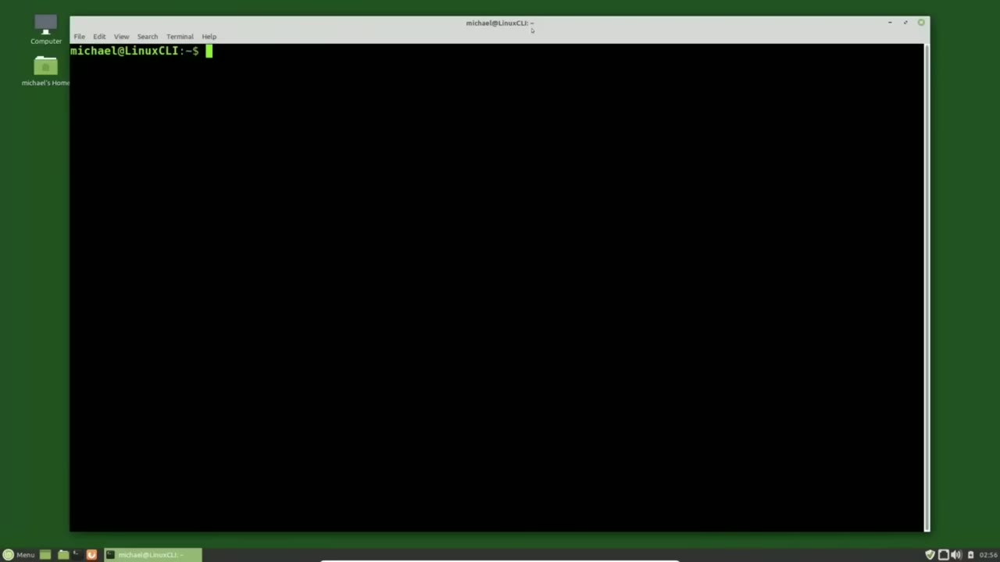
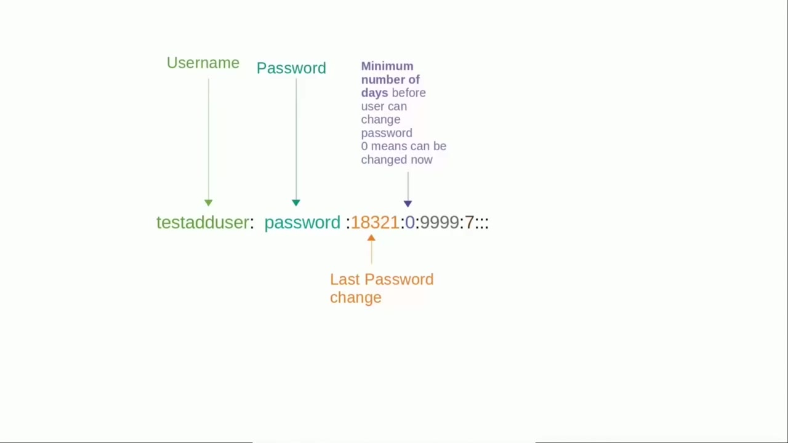
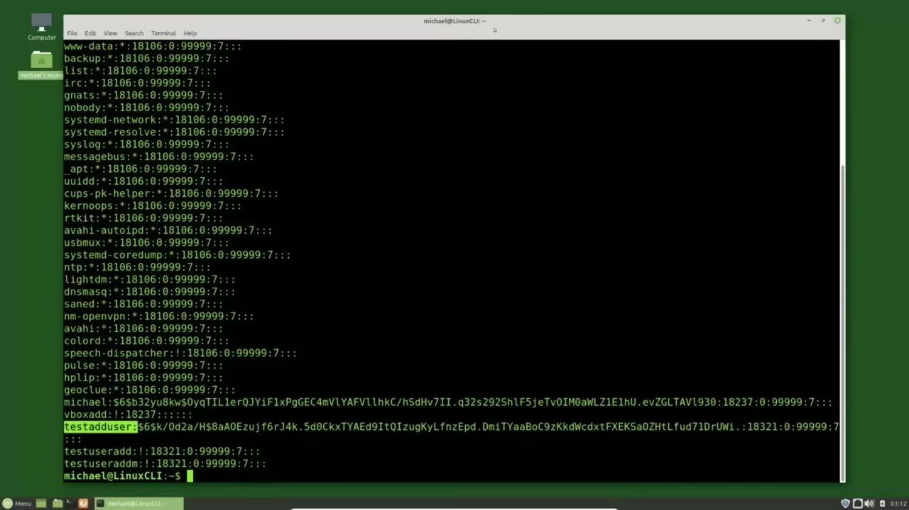
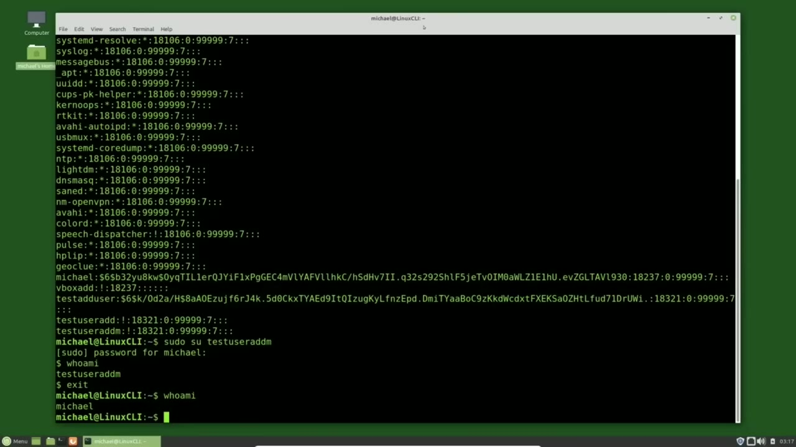

[← Course contents](../../01.md)

# 15. Adding New Users pt2

**Course:** [Linux Command Line - Entire Tutorial Series](https://www.youtube.com/watch?v=avg65oY7sj4)  
**Transcript:** [`Linux Command Line - Entire Tutorial Series transcript`](../../../../course_videos/Linux%20Command%20Line%20-%20Entire%20Tutorial%20Series/Linux%20Command%20Line%20-%20Entire%20Tutorial%20Series.txt)  
**Video:** 02:00:22–02:07:32 ([open at this time](https://www.youtube.com/watch?v=avg65oY7sj4&t=7222s))

## Introduction

In the last video we were looking at the /etc password file. And we saw every user id had an X where the password should be. And I said the actual encrypted password is stored in the /etc/shadow file. You must be a privileged user to view the /etc/shadow file.

## Detailed Explanation

<details>
  <summary>Step 1 — Run `sudo cat /etc`</summary>

### Step 1 — Run `sudo cat /etc`

- [x] **In the last video we were looking at the /etc password file**
  - In the last video we were looking at the /etc password file.
  - And we saw every user id had an X where the password should be.
  - And I said the actual encrypted password is stored in the /etc/shadow file.

- [x] **Use `sudo cat /etc`**
  - You must be a privileged user to view the /etc/shadow file.
  - I will view it by typing Sudo, Cat, /etc, Shadow.
  - And pressing Enter, it asks me for my password to submit a privileged user command.

- [x] **Just like the /etc password file, this one can also look a little**
  - Just like the /etc password file, this one can also look a little intimidating.
  - I'm highlighting the test ad user user id so we can see a single record.
  - Even by itself, a shadow file record can look a little intimidating.

- [x] **But notice there are some colon separators and some dollar sign**
  - But notice there are some colon separators and some dollar sign separators.
  - Like the past wd file, we have the user id on the far left.
  - Next to that we have the password information broken up into three parts separated by dollar signs.

- [x] **The first dollar sign tells us what hash algorithm is used**
  - The first dollar sign tells us what hash algorithm is used.
  - If we saw a 1 there, it would be using the md5 password encryption.
  - We see a 6 there telling us our password is encrypted using sha 512 password encryption.

- [x] **It's just some random data that is used to combine with the original**
  - It's just some random data that is used to combine with the original password.
  - Then the hashed version of the password and salt value is used as the encrypted password.
  - Then we have the long string of nonsense characters.

- [x] **The password is so big I'm going to replace it with the word password**
  - The password is so big I'm going to replace it with the word password.
  - So we can focus on the rest of the /etc/shadow File record.
  - The field after the password field is the last password changed field, which is the date the last time this password was changed.

- [x] **This doesn't look like a date because it's stored in the Unix Time**
  - This doesn't look like a date because it's stored in the Unix Time format or the days that have passed since 1970.
  - There have been 18,321 days that have passed since January 1, 1970.
  - That means the last time this password was changed was February 29, 2020.

- [x] **The next field is the minimum number of days a user must keep the**
  - The next field is the minimum number of days a user must keep the same password.

```bash
sudo cat /etc
```



</details>

<details>
  <summary>Step 2 — It's set at zero, so the user can change the password on the same day</summary>

### Step 2 — It's set at zero, so the user can change the password on the same day

- [x] **It's set at zero, so the user can change the password on the same day**
  - It's set at zero, so the user can change the password on the same day if they wish.
  - If it was set to 7, We would have to keep that same password for at least a week before we could change it.
  - The next field is the maximum days a user can have the same password before they are required to change their password.

- [x] **9999 means the password does not ever have to be changed**
  - 9999 means the password does not ever have to be changed.
  - The warning is a message that your password is about to expire.
  - If the password were set to expire, a message would start showing that number of days before it is set to expire.

- [x] **The inactive number of days is the number of days after the password**
  - The inactive number of days is the number of days after the password expiration date before the account will be disabled.
  - There is nothing in this field, so this user's account will never be disabled.
  - The last usable field is the account expiration date.

- [x] **There is no value in this field, so this account will never expire**
  - There is no value in this field, so this account will never expire.
  - But if it had a value, The account would expire on that date.
  - There is one more field and it's a reserved field, but that field is not used.



</details>

<details>
  <summary>Step 3 — Run `useradd`, `su`, `sudo`</summary>

### Step 3 — Run `useradd`, `su`, `sudo`

- [x] **Use `useradd`**
  - Going back to the /etc/shadow file, we see that the Test Ad User has a password, but looking below that, the Test User Ad and Test `useradd` M don't have any password.
  - Instead, we see an exclamation point, and if we look up at the service accounts, They have an asteris in the password field.
  - Thinking back when we set up these two accounts, Test User Ad and Test User Ad M, we did not set a password for either account.

- [x] **So the exclamation point in this field all by itself is showing us**
  - So the exclamation point in this field all by itself is showing us that this user id cannot log into the system and that there is no password set for this user.
  - And then the asteris for the service accounts means the same thing.
  - We cannot log into the system with that user id and there is no password.

- [x] **Use `su`**
  - I can still switch in to be that user, but we must be a privileged user.
  - And to do that, we use the `su` command and we saw the `su` switch user command when we were talking about the root user.
  - We would type `su` with nothing after it to switch to be the root user.

- [x] **Use `useradd`, `sudo`, `who`**
  - Here we will switch to the test `useradd` M user by typing `sudo` Test `useradd` M.
  - And it's asking me for my password to run a privileged user command.
  - When I type `who` Am I?

- [x] **Use `useradd`**
  - It shows us that I am now the test `useradd` user.
  - The next thing we want to do is set a password for test `useradd` M.
  - Setting a password and changing a password both use the same command.

```bash
useradd
su
sudo
who
```



</details>

<details>
  <summary>Step 4 — Run `passwd`, `useradd`, `sudo`</summary>

### Step 4 — Run `passwd`, `useradd`, `sudo`

- [x] **Use `passwd`, `useradd`, `sudo`**
  - `passwd`.
  - To change the password for Test `useradd` M, I will type `sudo`.
  - `passwd`, Test User, AddM.

- [x] **Use `useradd`, `sudo su`**
  - Now it's asking me for the new password for Test `useradd` M.
  - I will type that in and type it in again to confirm it.
  - And I'll switch to test `useradd` M with `sudo su`, test `useradd` M.

- [x] **Use `useradd`, `passwd`**
  - And the test `useradd` M can now change their own password just by typing the `passwd` command.
  - They first need to type in their current password, then they would type in their new password and confirm their new password.
  - Any user can change their own password with the pass wd command.

- [x] **Use `useradd`**
  - I'm exiting out of the test `useradd` M user and I will cat the /etc/shadow file again with Soudou cat /etc/shadow.
  - And here we see the test `useradd` M password is set with sha 512 encryption.
  - In the next video we'll look at how to change the values on the /etc/shadow file as well as the /etc/passwd file.

```bash
passwd
useradd
sudo
sudo su
```



</details>

<details>
  <summary>Questions and Answers</summary>

## Questions and Answers

### Question 1: What does `sudo cat /etc` do in this chapter?

<details>
<summary>Answer</summary>

- [x] I will view it by typing Sudo, Cat, /etc, Shadow.

</details>

### Question 2: What does `useradd` do in this chapter?

<details>
<summary>Answer</summary>

- [x] Going back to the /etc/shadow file, we see that the Test Ad User has a password, but looking below that, the Test User Ad and Test `useradd` M don't have any password.

</details>

### Question 3: What does `su` do in this chapter?

<details>
<summary>Answer</summary>

- [x] And to do that, we use the `su` command and we saw the `su` switch user command when we were talking about the root user.

</details>

### Question 4: What does `sudo` do in this chapter?

<details>
<summary>Answer</summary>

- [x] Here we will switch to the test useradd M user by typing `sudo` Test useradd M.

</details>

### Question 5: What does `who` do in this chapter?

<details>
<summary>Answer</summary>

- [x] When I type `who` Am I?

</details>

### Question 6: What does `passwd` do in this chapter?

<details>
<summary>Answer</summary>

- [x] `passwd`.

</details>

### Question 7: What does `sudo su` do in this chapter?

<details>
<summary>Answer</summary>

- [x] And I'll switch to test useradd M with `sudo su`, test useradd M.

</details>

### Question 8: What does step 1 cover (Run sudo cat /etc)?

<details>
<summary>Answer</summary>

- [x] In the last video we were looking at the /etc password file.
- [x] And we saw every user id had an X where the password should be.
- [x] And I said the actual encrypted password is stored in the /etc/shadow file.

</details>

### Question 9: What does step 2 cover (It's set at zero, so the user can change the password on the same day)?

<details>
<summary>Answer</summary>

- [x] It's set at zero, so the user can change the password on the same day if they wish.
- [x] If it was set to 7, We would have to keep that same password for at least a week before we could change it.
- [x] The next field is the maximum days a user can have the same password before they are required to change their password.

</details>

### Question 10: What does step 3 cover (Run useradd, su, sudo)?

<details>
<summary>Answer</summary>

- [x] Going back to the /etc/shadow file, we see that the Test Ad User has a password, but looking below that, the Test User Ad and Test `useradd` M don't have any password.
- [x] Instead, we see an exclamation point, and if we look up at the service accounts, They have an asteris in the password field.
- [x] Thinking back when we set up these two accounts, Test User Ad and Test User Ad M, we did not set a password for either account.

</details>

</details>

## Summary

This chapter, Adding New Users pt2, walks through Run sudo cat /etc; It's set at zero, so the user can change the password on the same day; Run useradd, su, sudo; Run passwd, useradd, sudo. Commands from the transcript: `sudo cat /etc`, `useradd`, `su`, `sudo`, `who`, `passwd`, `sudo su`.

## References

- [Linux Command Line - Entire Tutorial Series (YouTube)](https://www.youtube.com/watch?v=avg65oY7sj4)
- [This chapter at 02:00:22](https://www.youtube.com/watch?v=avg65oY7sj4&t=7222s)
- [Local transcript](../../../../course_videos/Linux%20Command%20Line%20-%20Entire%20Tutorial%20Series/Linux%20Command%20Line%20-%20Entire%20Tutorial%20Series.txt)
