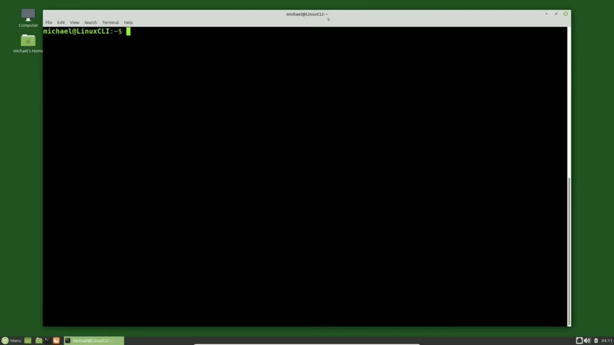
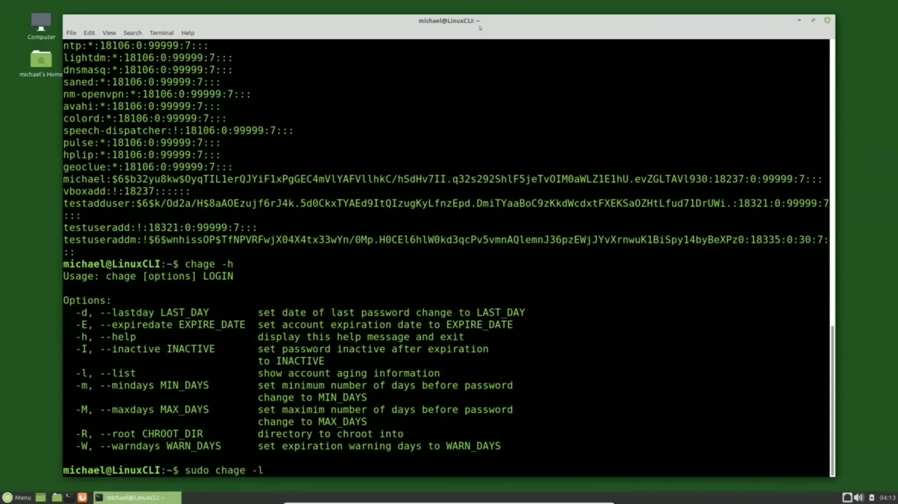
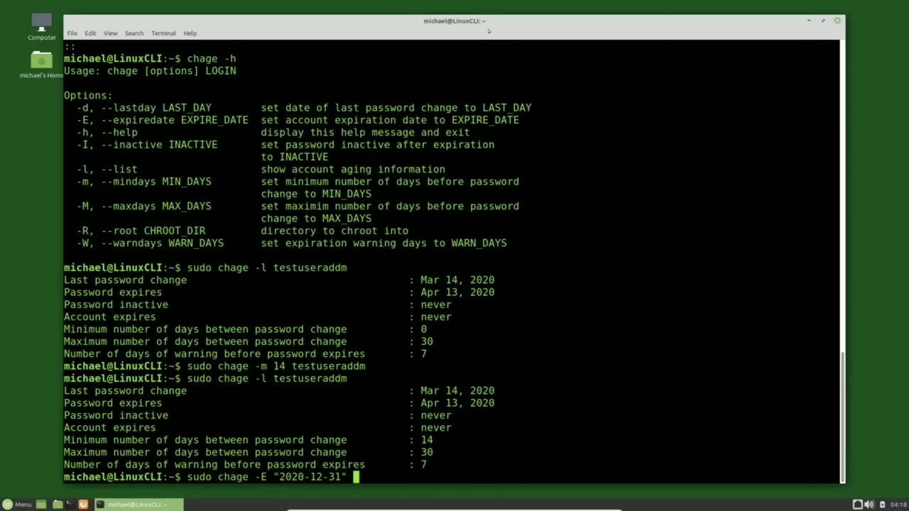
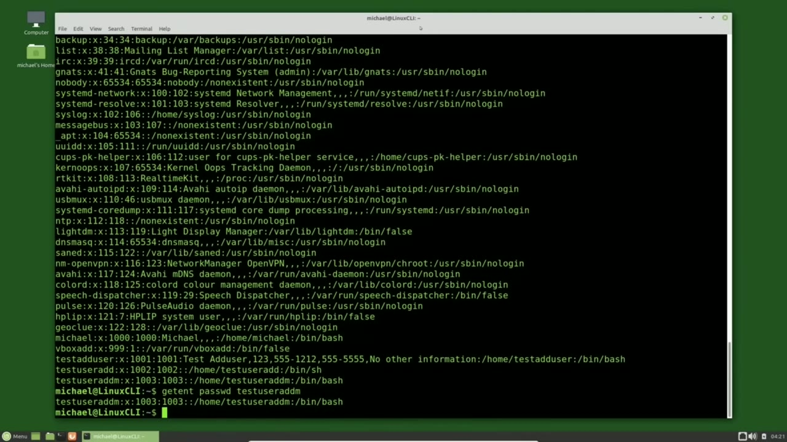
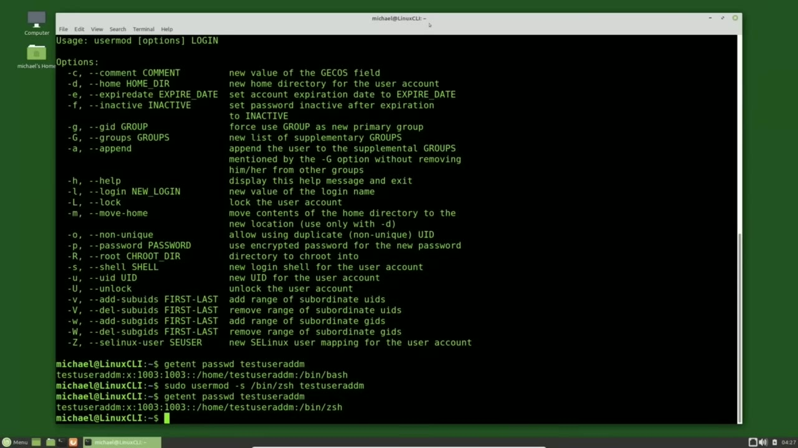

[← Course contents](../../01.md)

# 16. Editing Users pt1

**Course:** [Linux Command Line - Entire Tutorial Series](https://www.youtube.com/watch?v=avg65oY7sj4)  
**Transcript:** [`Linux Command Line - Entire Tutorial Series transcript`](../../../../course_videos/Linux%20Command%20Line%20-%20Entire%20Tutorial%20Series/Linux%20Command%20Line%20-%20Entire%20Tutorial%20Series.txt)  
**Video:** 02:07:32–02:15:11 ([open at this time](https://www.youtube.com/watch?v=avg65oY7sj4&t=7652s))

## Introduction

In the previous video we were looking at the /etc/shadow file. To view the /etc/shadow file, you must be a privileged user, and I will view that with the command SudoCat slash /etc/shadow. The easiest way to change the values in the /etc/shadow file are with the ch Age command. To see the options available for the ch Age command, I will type CH-Age-H.

## Detailed Explanation

<details>
  <summary>Step 1 — Run `useradd`, `sudo`</summary>

### Step 1 — Run `useradd`, `sudo`

- [x] **In the previous video we were looking at the /etc/shadow file**
  - In the previous video we were looking at the /etc/shadow file.
  - To view the /etc/shadow file, you must be a privileged user, and I will view that with the command SudoCat slash /etc/shadow.
  - The easiest way to change the values in the /etc/shadow file are with the ch Age command.

- [x] **To see the options available for the ch Age command, I will type**
  - To see the options available for the ch Age command, I will type CH-Age-H.
  - And here we see the list of options available.
  - To see the values for a specific user id on the /etc/shadow file, I will type Soudou because we need to be a privileged user to run the CH-Age command, then CH-Age--L, the option for list, which will show all the account aging information for a user.

- [x] **Use `useradd`**
  - And then I will add the user id of Test `useradd` M.
  - We see the values from the /etc/shadow file for Test `useradd` M all nicely formatted.
  - Let's change the minimum days before a password can be changed to 14.

- [x] **Use `sudo`, `useradd`**
  - For that I will type `sudo` ch age -lowercase M for the minimum days and I want that to be 14 and I want that to be for user test `useradd` m pressing enter we'll update the field and then and I'm pressing arrow up to go back a couple of commands and we see the minimum days test `useradd`
  - M must keep a new password is now 14 days the next thing I want to do is change the date the account expires for test `useradd` m I will change that to December 31st, 2020.
  - To do that, I will type `sudo`, c-h, then a -uppercase E for the expire date.

- [x] **And now I'm going to type in the date I want this account to expire**
  - And now I'm going to type in the date I want this account to expire.
  - And I will put that in double quotes, 2020-12-31.

```bash
useradd
sudo
```





</details>

<details>
  <summary>Step 2 — Run `useradd`, `cat /etc`, `passwd`</summary>

### Step 2 — Run `useradd`, `cat /etc`, `passwd`

- [x] **Use `useradd`**
  - I'm using the year month day format and then I will put in the user id I want this change to apply to and that is test `useradd` M.
  - Pressing Enter, that date is updated and I will show that by pressing the arrow up to bring back the chh -L.
  - And now we see that the account expires on December 31st, 2020.

- [x] **So that is the basics behind the ch age command**
  - So that is the basics behind the ch age command.
  - But that command won't help us change any fields in the /etc/passwd file.
  - The other file we looked at when adding a new user.

- [x] **Use `cat /etc`, `passwd`, `useradd`**
  - To remind us of what that file looks like, I will type cat, /etc, `passwd`.
  - To show the values from a single record off the /etc/passwd file, I'm going to use the Get Ent command.
  - Get Ent pass wd, Test `useradd` M.

- [x] **And Get Ent stands for Get Entry or Get Database entry**
  - And Get Ent stands for Get Entry or Get Database entry.

```bash
useradd
cat /etc
passwd
```



</details>

<details>
  <summary>Step 3 — Run `useradd`, `usermod`, `usermod -H`</summary>

### Step 3 — Run `useradd`, `usermod`, `usermod -H`

- [x] **Use `useradd`, `usermod`, `usermod -H`**
  - Pressing Enter shows us the single record for Test `useradd` M.
  - Off the /etc/passwd file. I'm going to clear the screen and the command I'm going to use to update the information in the pastWD file is the `usermod` command. And just like it sounds, the `usermod` command will help us modify user settings on both the /etc/passwd file
  - And the /etc/shadow file. To see what options are available for the `usermod` command, I will type `usermod -H`. And here we see a lot of things can be updated with the `usermod` command.

- [x] **Some of these like the -E expire date in the -F inactive can be done**
  - Some of these like the -E expire date in the -F inactive can be done with the ch command that we just looked at. So I'm going to skip those. The Gs and the append we will look at when we talk about groups. Notice there's a lowercase O that allows using duplicate UID.
  - In a previous video I said the UID had to be unique and in most cases they are.
  - But here we see that it is possible to have duplicate UIDs.

- [x] **Use `usermod`, `useradd`, `bash`**
  - I'm going to use the `usermod` command to change the shell of `useradd` M.
  - So let's bring back that record with get and pass wd test `useradd` M.
  - Here we see the shell is currently set to bin `bash`.

- [x] **Use `sudo usermod -s`**
  - We're going to change that to be for the Z shell as if we have installed the Z shell.
  - We have not installed the Z shell, but if we had, it would be in /bin slash ZsH.
  - So to update the user shell, I'll type `sudo `usermod` -s` for the user shell.

- [x] **Use `useradd`**
  - Test `useradd` M. Pressing Enter, updated the shell.
  - And to show that, I'll go back to the get end command.
  - And we see our shell is now set to bin ZsH.

```bash
useradd
usermod
usermod -H
bash
sudo usermod -s
```



</details>

<details>
  <summary>Step 4 — Run `useradd`, `sudo usermod -D`, `sudo usermod`</summary>

### Step 4 — Run `useradd`, `sudo usermod -D`, `sudo usermod`

- [x] **Use `useradd`, `sudo usermod -D`**
  - Now I want to change the home directory for test `useradd` M.
  - To do that, I will type `sudo usermod -D` for home directory.
  - And then I'll give it the new home directory name I wanted to use.

- [x] **Use `useradd`**
  - Forward slash users, forward slash test `useradd` M.
  - And that directory does not exist just like the Z shell does not exist.
  - So this won't really work, but it will update it.

- [x] **Use `useradd`**
  - And I want this home directory name change to apply to test `useradd` M.
  - Pressing enter, it is updated and to view the past wd record.
  - I'm going to get Ent, pass wd, test user at M.

- [x] **And here we see the user test user at M is the new home directory**
  - And here we see the user test user at M is the new home directory.
  - Now because those won't really work because the shell and that home directory don't exist.
  - And this time I'm going to do it in a single command.

- [x] **Use `sudo usermod`, `bash`**
  - So I'll start it off with `sudo usermod`.
  - And I want to set that back to bin `bash`.
  - And now I want to change the home directory with -D.

- [x] **Use `useradd`**
  - And we want that home directory to be /home slash test `useradd` M.
  - And we want to apply both of these two changes to the test `useradd` M user.
  - And I spelled test `useradd` M wrong.

- [x] **Use `useradd`, `passwd`, `bash`**
  - Test `useradd` M.
  - Pressing Enter and we can show that record with the Get Ent `passwd` Test User at M.
  - And now we see the Home directory is set back to Home slash Test User at M and the shell is in the /bin slash `bash` directory.

- [x] **In the next video, we will continue looking at editing user**
  - In the next video, we will continue looking at editing user information in the Linux command line.

```bash
useradd
sudo usermod -D
sudo usermod
bash
passwd
```



</details>

<details>
  <summary>Questions and Answers</summary>

## Questions and Answers

### Question 1: What does `useradd` do in this chapter?

<details>
<summary>Answer</summary>

- [x] And then I will add the user id of Test `useradd` M.

</details>

### Question 2: What does `sudo` do in this chapter?

<details>
<summary>Answer</summary>

- [x] For that I will type `sudo` ch age -lowercase M for the minimum days and I want that to be 14 and I want that to be for user test useradd m pressing enter we'll update the field and then and I'm pressing arrow up to go back a couple of commands and we see the minimum days test useradd

</details>

### Question 3: What does `cat /etc` do in this chapter?

<details>
<summary>Answer</summary>

- [x] To remind us of what that file looks like, I will type cat, /etc, PassWD.

</details>

### Question 4: What does `passwd` do in this chapter?

<details>
<summary>Answer</summary>

- [x] To remind us of what that file looks like, I will type cat, /etc, `passwd`.

</details>

### Question 5: What does `usermod` do in this chapter?

<details>
<summary>Answer</summary>

- [x] Off the /etc/passwd file. I'm going to clear the screen and the command I'm going to use to update the information in the pastWD file is the `usermod` command. And just like it sounds, the `usermod` command will help us modify user settings on both the /etc/passwd file

</details>

### Question 6: What does `usermod -H` do in this chapter?

<details>
<summary>Answer</summary>

- [x] And the /etc/shadow file. To see what options are available for the usermod command, I will type `usermod -H`. And here we see a lot of things can be updated with the usermod command.

</details>

### Question 7: What does `bash` do in this chapter?

<details>
<summary>Answer</summary>

- [x] Here we see the shell is currently set to bin `bash`.

</details>

### Question 8: What does `sudo usermod -s` do in this chapter?

<details>
<summary>Answer</summary>

- [x] So to update the user shell, I'll type `sudo usermod -s` for the user shell.

</details>

### Question 9: What does `sudo usermod -D` do in this chapter?

<details>
<summary>Answer</summary>

- [x] To do that, I will type `sudo usermod -D` for home directory.

</details>

### Question 10: What does `sudo usermod` do in this chapter?

<details>
<summary>Answer</summary>

- [x] So I'll start it off with `sudo usermod`.

</details>

</details>

## Summary

This chapter, Editing Users pt1, walks through Run useradd, sudo; Run useradd, cat /etc, passwd; Run useradd, usermod, usermod -H; Run useradd, sudo usermod -D, sudo usermod. Commands from the transcript: `useradd`, `sudo`, `cat /etc`, `passwd`, `usermod`, `usermod -H`, `bash`, `sudo usermod -s`, `sudo usermod -D`, `sudo usermod`.

## References

- [Linux Command Line - Entire Tutorial Series (YouTube)](https://www.youtube.com/watch?v=avg65oY7sj4)
- [This chapter at 02:07:32](https://www.youtube.com/watch?v=avg65oY7sj4&t=7652s)
- [Local transcript](../../../../course_videos/Linux%20Command%20Line%20-%20Entire%20Tutorial%20Series/Linux%20Command%20Line%20-%20Entire%20Tutorial%20Series.txt)
