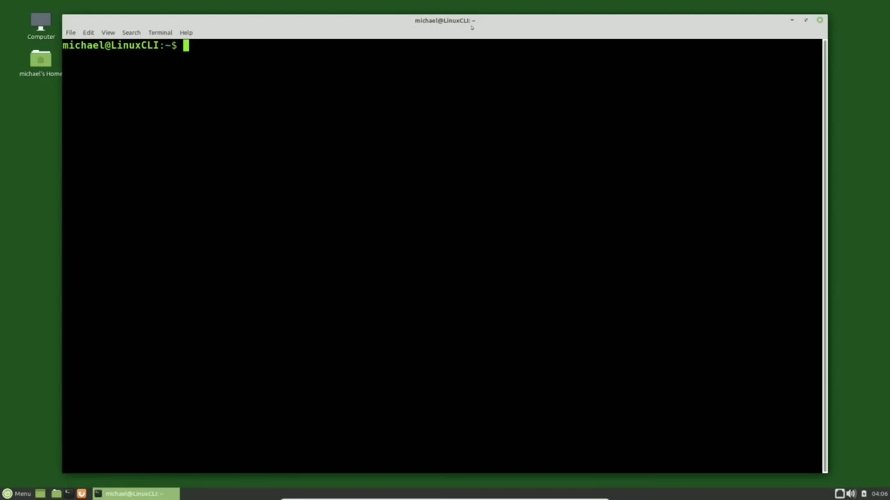
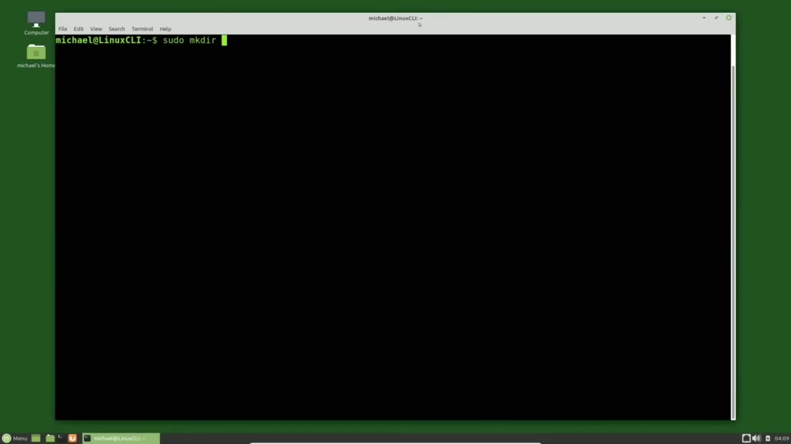
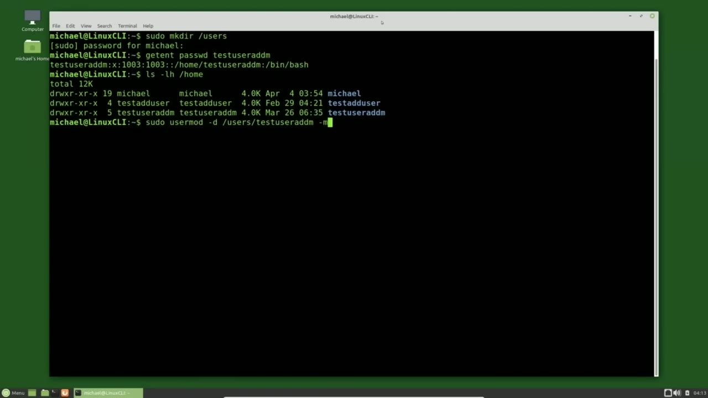
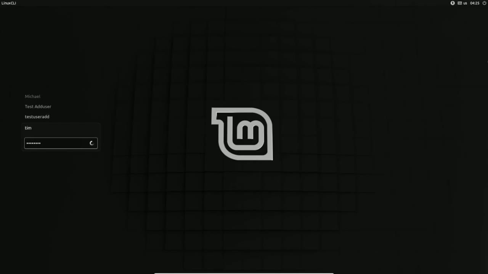

[← Course contents](../../01.md)

# 17. Editing Users pt2

**Course:** [Linux Command Line - Entire Tutorial Series](https://www.youtube.com/watch?v=avg65oY7sj4)  
**Transcript:** [`Linux Command Line - Entire Tutorial Series transcript`](../../../../course_videos/Linux%20Command%20Line%20-%20Entire%20Tutorial%20Series/Linux%20Command%20Line%20-%20Entire%20Tutorial%20Series.txt)  
**Video:** 02:15:11–02:21:32 ([open at this time](https://www.youtube.com/watch?v=avg65oY7sj4&t=8111s))

## Introduction

In the last video, we saw how to point a Home Directory to a new location. Now I want to point that home directory to a new location and move my home directory to that new location. Usually people move their home directories to a new partition or a different hard drive on that computer. One reason to move your home directory to a different partition is so you can remove the current version of Linux off your computer and reinstall it or upgrade it or switch to a different distribution of Linux and keep all of your personal files and directories that are in your home directory to use with the new version of Linux.

## Detailed Explanation

<details>
  <summary>Step 1 — Run `sudo`, `passwd`, `ls -lh /home`</summary>

### Step 1 — Run `sudo`, `passwd`, `ls -lh /home`

- [x] **In the last video, we saw how to point a Home Directory to a new**
  - In the last video, we saw how to point a Home Directory to a new location.
  - Now I want to point that home directory to a new location and move my home directory to that new location.
  - Usually people move their home directories to a new partition or a different hard drive on that computer.

- [x] **One reason to move your home directory to a different partition is so**
  - One reason to move your home directory to a different partition is so you can remove the current version of Linux off your computer and reinstall it or upgrade it or switch to a different distribution of Linux and keep all of your personal files and directories that are in your home directory to use with the new version of Linux.
  - One reason people move their home directory to a different drive is when their computer has two hard drives often there is a smaller quicker ssd drive that has the operating system on it to get that quick boot-up time Then the Home Directory is on the larger, slower, spinning hard drive with all your music, videos, and photos that would not fit on that smaller ssd drive.
  - Because we have not talked about partitions or multiple hard drives yet, I will create a new directory on this partition called Users.

- [x] **Use `sudo`, `passwd`**
  - `sudo`, make der slash users.
  - Before we move the directory, let's check the current settings with...
  - Get Ent, `passwd`, test user addm.

- [x] **Use `ls -lh /home`, `useradd`, `usermod`**
  - This shows us the settings in the pass wd file for test user addm, and the home directory is pointing to home test user addm.
  - And typing `ls -lh /home` shows us that test `useradd` M's home directory is in the /home directory.
  - We're going to use the `usermod` command that we started looking at in the last video.

- [x] **Use `sudo usermod`, `useradd`**
  - I'll type `sudo usermod` and I'm adding the -D to update the home directory just like we did in the last video and I will update the home directory to be slash users slash test `useradd` M.
  - Now to actually move the directory I'm going to add the -M option here.

```bash
sudo
passwd
ls -lh /home
useradd
usermod
sudo usermod
```





</details>

<details>
  <summary>Step 2 — Run `useradd`, `ls -lh`, `ls -lh /home`</summary>

### Step 2 — Run `useradd`, `ls -lh`, `ls -lh /home`

- [x] **Use `useradd`, `ls -lh`**
  - And then I'll type in the user id that we want to do all this action for, which is test `useradd` M.
  - Pressing enter, we see that no news is good news.
  - To show that home directory is moved, I'm going to type `ls -lh` slash users.

- [x] **Use `useradd`, `ls -lh /home`**
  - And there we see the test `useradd` M directory.
  - And I will also type `ls -lh /home`.
  - To show the home directory and we see the test `useradd` m directory is no longer there the last thing i'm going to show is the get ent pass wd test `useradd` m which shows the home directory was updated in the pass wd file now i'm going to change the login name of test `useradd` m to be

- [x] **Use `sudo usermod -L`, `useradd`**
  - Tim and i'll do that with `sudo usermod -L` for login name and then I'll give it the new login name I want it to be Tim and I will do this for Test `useradd` M and press enter to show the updated record. I'm going to type Get Ent pass wd and then the username which is now Tim
  - Pressing enter and now we see the user login name is now Tim but the home directory for is still users test `useradd` m. I'm going to log out and then log in as Tim.

```bash
useradd
ls -lh
ls -lh /home
sudo usermod -L
```



</details>

<details>
  <summary>Step 3 — Run `adduser`, `pwd`, `useradd`</summary>

### Step 3 — Run `adduser`, `pwd`, `useradd`

- [x] **Use `adduser`, `pwd`, `useradd`**
  - Now while we're here at the login screen notice the login name of test `adduser`.
  - We'll talk about this in the next video. I just want you to notice how it looks here as test `adduser` with two separate words. I'm going to log in as Tim. I'm opening up a terminal and typing `pwd` and we see that we are in the users test `useradd` m directory and everything seems to be working fine
  - I'm going to list the files with `ls -lh` and we see the file's owner is Tim, but the group is test `useradd` M.

- [x] **Use `touch test`, `useradd`, `id`**
  - I'm going to create a new file with `touch test` file. txt L S -lh.
  - And again, we've got the owner as Tim and the group `id` of test `useradd` M.
  - I'm going to type `id` Tim and we see Tim is using the user `id` of 1003 and the group is 1003, test `useradd` M.

- [x] **We're looking at this now just to get an idea about the UID, the user**
  - We're looking at this now just to get an idea about the UID, the user `id` and the GID, Group `id`.
  - In a couple of videos, we're going to look at how permissions work and this will make a lot more sense then.
  - For now, I just want you to make a note that the name on the account does not matter as much as the UID, user `id`, and the GID, the group `id`.

- [x] **Use `useradd`, `sudo usermod -L`**
  - I'm going to log out and log back in as Michael.
  - And I'm going to change the Tim account back to Test `useradd` M with `sudo usermod -L` for login name.
  - Then the login name I want it to be, which is Test `useradd` M.

- [x] **And I want to apply this for User id of Tim**
  - And I want to apply this for User `id` of Tim.
  - In the next video, we will finish our look at editing user information.

```bash
adduser
pwd
useradd
ls -lh
touch test
id
sudo usermod -L
```



</details>

<details>
  <summary>Questions and Answers</summary>

## Questions and Answers

### Question 1: What does `sudo` do in this chapter?

<details>
<summary>Answer</summary>

- [x] `sudo`, make der slash users.

</details>

### Question 2: What does `passwd` do in this chapter?

<details>
<summary>Answer</summary>

- [x] Get Ent, `passwd`, test user addm.

</details>

### Question 3: What does `ls -lh /home` do in this chapter?

<details>
<summary>Answer</summary>

- [x] And typing `ls -lh /home` shows us that test useradd M's home directory is in the /home directory.

</details>

### Question 4: What does `useradd` do in this chapter?

<details>
<summary>Answer</summary>

- [x] And typing ls -lh /home shows us that test `useradd` M's home directory is in the /home directory.

</details>

### Question 5: What does `usermod` do in this chapter?

<details>
<summary>Answer</summary>

- [x] We're going to use the `usermod` command that we started looking at in the last video.

</details>

### Question 6: What does `sudo usermod` do in this chapter?

<details>
<summary>Answer</summary>

- [x] I'll type `sudo usermod` and I'm adding the -D to update the home directory just like we did in the last video and I will update the home directory to be slash users slash test useradd M.

</details>

### Question 7: What does `ls -lh` do in this chapter?

<details>
<summary>Answer</summary>

- [x] To show that home directory is moved, I'm going to type `ls -lh` slash users.

</details>

### Question 8: What does `sudo usermod -L` do in this chapter?

<details>
<summary>Answer</summary>

- [x] Tim and i'll do that with `sudo usermod -L` for login name and then I'll give it the new login name I want it to be Tim and I will do this for Test useradd M and press enter to show the updated record. I'm going to type Get Ent pass wd and then the username which is now Tim

</details>

### Question 9: What does `adduser` do in this chapter?

<details>
<summary>Answer</summary>

- [x] Now while we're here at the login screen notice the login name of test `adduser`.

</details>

### Question 10: What does `pwd` do in this chapter?

<details>
<summary>Answer</summary>

- [x] We'll talk about this in the next video. I just want you to notice how it looks here as test adduser with two separate words. I'm going to log in as Tim. I'm opening up a terminal and typing `pwd` and we see that we are in the users test useradd m directory and everything seems to be working fine

</details>

### Question 11: What does `touch test` do in this chapter?

<details>
<summary>Answer</summary>

- [x] I'm going to create a new file with `touch test` file. txt L S -lh.

</details>

### Question 12: What does `id` do in this chapter?

<details>
<summary>Answer</summary>

- [x] I'm going to type `id` Tim and we see Tim is using the user `id` of 1003 and the group is 1003, test useradd M.

</details>

</details>

## Summary

This chapter, Editing Users pt2, walks through Run sudo, passwd, ls -lh /home; Run useradd, ls -lh, ls -lh /home; Run adduser, pwd, useradd. Commands from the transcript: `sudo`, `passwd`, `ls -lh /home`, `useradd`, `usermod`, `sudo usermod`, `ls -lh`, `sudo usermod -L`, `adduser`, `pwd`, `touch test`, `id`.

## References

- [Linux Command Line - Entire Tutorial Series (YouTube)](https://www.youtube.com/watch?v=avg65oY7sj4)
- [This chapter at 02:15:11](https://www.youtube.com/watch?v=avg65oY7sj4&t=8111s)
- [Local transcript](../../../../course_videos/Linux%20Command%20Line%20-%20Entire%20Tutorial%20Series/Linux%20Command%20Line%20-%20Entire%20Tutorial%20Series.txt)
