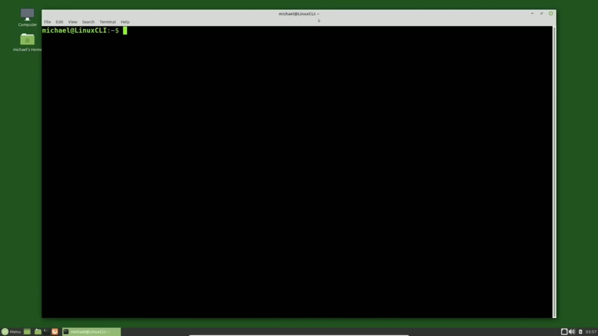
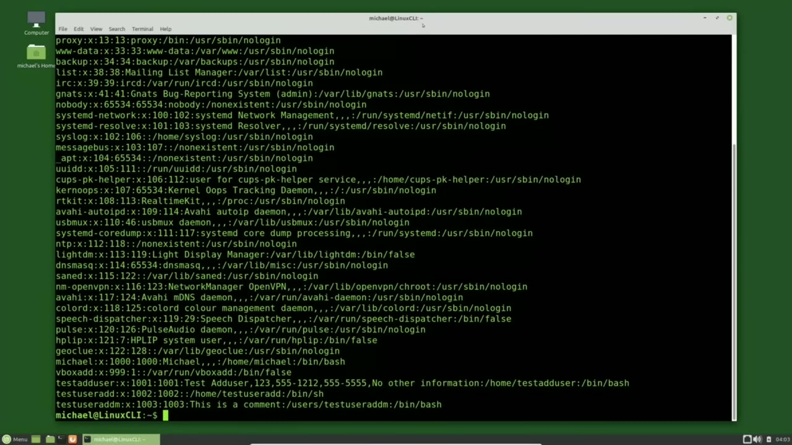
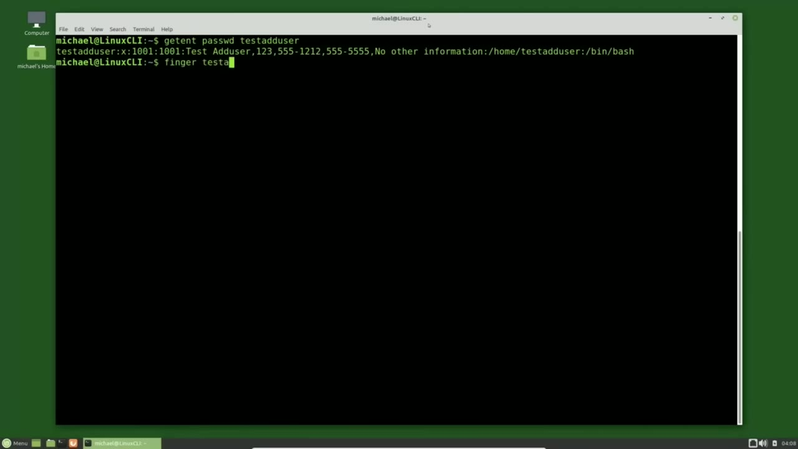
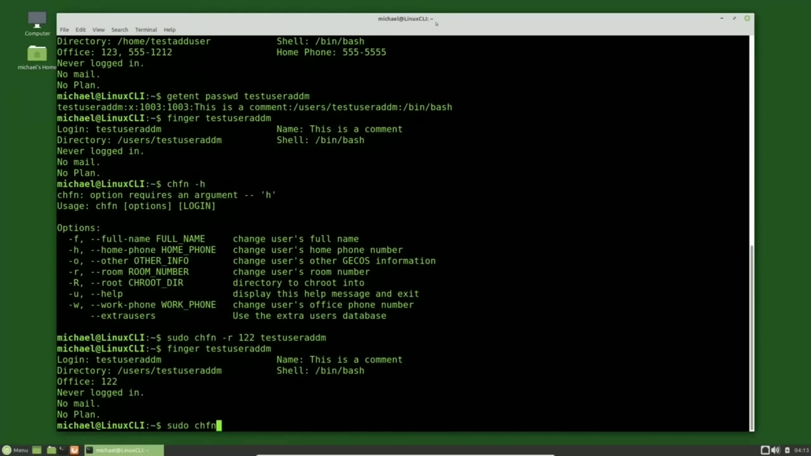

[← Course contents](../../01.md)

# 18. Editing Users pt3

**Course:** [Linux Command Line - Entire Tutorial Series](https://www.youtube.com/watch?v=avg65oY7sj4)  
**Transcript:** [`Linux Command Line - Entire Tutorial Series transcript`](../../../../course_videos/Linux%20Command%20Line%20-%20Entire%20Tutorial%20Series/Linux%20Command%20Line%20-%20Entire%20Tutorial%20Series.txt)  
**Video:** 02:21:32–02:28:38 ([open at this time](https://www.youtube.com/watch?v=avg65oY7sj4&t=8492s))

## Introduction

I'm picking up from where we left off in the last video. I'm going to update the comment for test useradd M with the usermod command. To do this I will type Sudo usermod -C and the C is for update a comment. Now I will put what I want the comment to be in double quotes.

## Detailed Explanation

<details>
  <summary>Step 1 — Run `useradd`, `usermod`, `sudo usermod -C`</summary>

### Step 1 — Run `useradd`, `usermod`, `sudo usermod -C`

- [x] **Use `useradd`, `usermod`, `sudo usermod -C`**
  - I'm picking up from where we left off in the last video.
  - I'm going to update the comment for test `useradd` M with the `usermod` command.
  - To do this I will type `sudo `usermod` -C` and the C is for update a comment.

- [x] **Use `useradd`**
  - Now I will put what I want the comment to be in double quotes.
  - Then we'll add the user id that we want to update.
  - which is test `useradd` m. I'll type in my password and pressing enter.

- [x] **Use `cat /etc`**
  - This shows us that no news is good news.
  - And to show the updated record, I will type `cat /etc` past wd.
  - I'm showing the whole file so we can compare what we have in the comment for the Test User Ad M user id to what we have in the comment for the Test Ad User User id.

- [x] **Use `adduser`**
  - Looking at the Test Ad User User id comment, we see it has a name of Test `adduser`.
  - Remember in the last video, we saw Test `adduser` as two words on the Linux Mint login screen.
  - So if there is a comment name, Linux Mint will display that name as a username on the Linux Mint login screen.

- [x] **That's why I asked you to make a note of it while we were there in**
  - That's why I asked you to make a note of it while we were there in the last video.
  - If the comment does not contain a username, the user id is shown on the Linux Mint login screen.

```bash
useradd
usermod
sudo usermod -C
cat /etc
adduser
```



</details>

<details>
  <summary>Step 2 — Run `useradd`, `adduser`, `chfn`</summary>

### Step 2 — Run `useradd`, `adduser`, `chfn`

- [x] **Use `useradd`, `adduser`**
  - Getting back to the past wd file, we see the Test `useradd` M login id has a comment.
  - This is a comment. But when we look at the comment for the Test `adduser` User id, we see the username, the phone numbers, and the other information we added when we created the user id.
  - To enter or update that same information for another user, we could create a comma separated comment That would work, but then we would have to know the order of everything to get it right.

- [x] **Use `chfn`, `finger`, `useradd`**
  - A way around that is to use the `chfn` command.
  - `chfn` is short for change `finger` information.
  - When I type `finger` test `useradd` M, we get the message command `finger` not found, but can be installed with `sudo apt install finger`. So I will copy this and paste it.

- [x] **Use `finger`, `adduser`**
  - And now we have the `finger` command installed.
  - I'm going to clear the screen and show the /etc password record for Test Ad User with Get Ent, pass wd, test `adduser`.
  - And now let's show that same data with the `finger` command.

```bash
useradd
adduser
chfn
finger
sudo apt install finger
```



</details>

<details>
  <summary>Step 3 — Run `adduser`, `chfn`, `useradd`</summary>

### Step 3 — Run `adduser`, `chfn`, `useradd`

- [x] **Use `adduser`, `chfn`**
  - Finger test `adduser`.
  - Now we can see the username, the office room and phone number, and the home phone.
  - The other information is not shown here, but it can be updated using the `chfn` change finger command.

- [x] **Use `useradd`**
  - Now let's look at the Test `useradd` M record with Get Ent, pass wd, test `useradd` M.
  - And then finger Test `useradd` M.
  - And we see that the name is this is a comment.

- [x] **Use `chfn -H`, `useradd`, `sudo`**
  - I'm going to type `chfn -H` to show all the options available for the change finger command. Let's update the room for test `useradd` M to be 122.
  - To do that, I would type `sudo` c-h-f-n-r for room, then the room number I want it to be, which is 122, then a space, and then the user id. In this case, we want it to be test user at M.
  - I'll go back to the finger, test `useradd` M, and we see that the office is now 122.

- [x] **Use `useradd`**
  - Now let's update some more fields for test `useradd` M all in a single command.
  - I'll start this off with Soudou, c-h-f-n for change finger.

```bash
adduser
chfn
useradd
chfn -H
sudo
```



</details>

<details>
  <summary>Step 4 — Run `useradd`, `finger`, `sudo`</summary>

### Step 4 — Run `useradd`, `finger`, `sudo`

- [x] **Use `useradd`**
  - I want to change the full name, so it's -F and we'll make the full name test `useradd` M.
  - Now let's change the home phone with -H.
  - And I'll make that phone number 555-1-1-1.

- [x] **Use `useradd`**
  - And one more thing will change is the other information with -O.
  - And we will call that other information.
  - We want all these changes to be for test `useradd` M.

- [x] **Use `useradd`, `finger`**
  - Pressing Enter and bringing back the `finger` command for test `useradd` M shows us the full name was updated and the home phone was updated.
  - We can see the other information by typing Get and pass wd test `useradd` M and there we see the other information was updated as well When a new user is created we have to assign a password to that id to give to the new user so they can log in It's common to ask the new user to change their password when they first log in to force a user to change their password on the next login
  - And this is not just for the first login, but anytime we want that user to update their password, we would type pass wd -dash expire and then the user id.

- [x] **Use `sudo`**
  - Or we can type `sudo` CH-Age -last-day, 1970-01-01, and then the user id.
  - Or we could type `sudo` C-H-Age -last day, zero, then the user id.
  - And then the next time the user id logs in, they will be asked to change their password.

- [x] **Use `sudo`, `nano`**
  - An example of this would be for test ad user. You'd type pass wd -dash expire test ad user or `sudo` ch -dash last day 1970.01.01 test ad user or `sudo` ch -dash last day.
  - And then the next time test ad user logs in, they would be asked to change their password.
  - One last note about updating the user information is you can use `nano` or vi to edit the /etc/passwd file or the /etc/shadow file.

- [x] **But any time you edit a file in that way, there is a potential of**
  - But any time you edit a file in that way, there is a potential of accidentally updating something you did not intend to update.
  - And with these files, an unintentional update could cause bigger problems, so that method will not be shown in this video.
  - In the next video, we will continue looking at the Linux command line.

```bash
useradd
finger
sudo
nano
```



</details>

<details>
  <summary>Questions and Answers</summary>

## Questions and Answers

### Question 1: What does `useradd` do in this chapter?

<details>
<summary>Answer</summary>

- [x] I'm going to update the comment for test `useradd` M with the usermod command.

</details>

### Question 2: What does `usermod` do in this chapter?

<details>
<summary>Answer</summary>

- [x] I'm going to update the comment for test useradd M with the `usermod` command.

</details>

### Question 3: What does `sudo usermod -C` do in this chapter?

<details>
<summary>Answer</summary>

- [x] To do this I will type `sudo usermod -C` and the C is for update a comment.

</details>

### Question 4: What does `cat /etc` do in this chapter?

<details>
<summary>Answer</summary>

- [x] And to show the updated record, I will type `cat /etc` past wd.

</details>

### Question 5: What does `adduser` do in this chapter?

<details>
<summary>Answer</summary>

- [x] Looking at the Test Ad User User id comment, we see it has a name of Test `adduser`.

</details>

### Question 6: What does `chfn` do in this chapter?

<details>
<summary>Answer</summary>

- [x] A way around that is to use the `chfn` command.

</details>

### Question 7: What does `finger` do in this chapter?

<details>
<summary>Answer</summary>

- [x] When I type `finger` test useradd M, we get the message command `finger` not found, but can be installed with sudo apt install `finger`. So I will copy this and paste it.

</details>

### Question 8: What does `sudo apt install finger` do in this chapter?

<details>
<summary>Answer</summary>

- [x] When I type finger test useradd M, we get the message command finger not found, but can be installed with `sudo apt install finger`. So I will copy this and paste it.

</details>

### Question 9: What does `chfn -H` do in this chapter?

<details>
<summary>Answer</summary>

- [x] I'm going to type `chfn -H` to show all the options available for the change finger command. Let's update the room for test useradd M to be 122.

</details>

### Question 10: What does `sudo` do in this chapter?

<details>
<summary>Answer</summary>

- [x] To do that, I would type `sudo` c-h-f-n-r for room, then the room number I want it to be, which is 122, then a space, and then the user id. In this case, we want it to be test user at M.

</details>

### Question 11: What does `nano` do in this chapter?

<details>
<summary>Answer</summary>

- [x] One last note about updating the user information is you can use `nano` or vi to edit the /etc/passwd file or the /etc/shadow file.

</details>

</details>

## Summary

This chapter, Editing Users pt3, walks through Run useradd, usermod, sudo usermod -C; Run useradd, adduser, chfn; Run adduser, chfn, useradd; Run useradd, finger, sudo. Commands from the transcript: `useradd`, `usermod`, `sudo usermod -C`, `cat /etc`, `adduser`, `chfn`, `finger`, `sudo apt install finger`, `chfn -H`, `sudo`, `nano`.

## References

- [Linux Command Line - Entire Tutorial Series (YouTube)](https://www.youtube.com/watch?v=avg65oY7sj4)
- [This chapter at 02:21:32](https://www.youtube.com/watch?v=avg65oY7sj4&t=8492s)
- [Local transcript](../../../../course_videos/Linux%20Command%20Line%20-%20Entire%20Tutorial%20Series/Linux%20Command%20Line%20-%20Entire%20Tutorial%20Series.txt)
