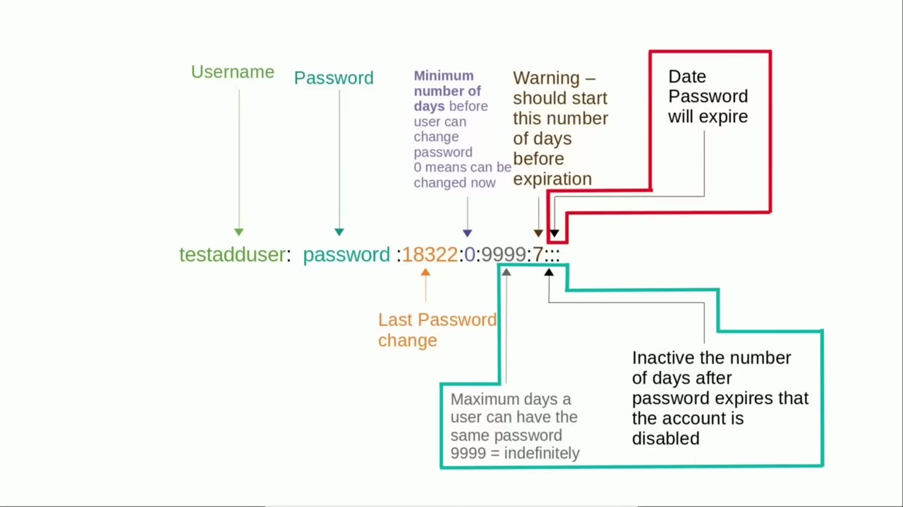
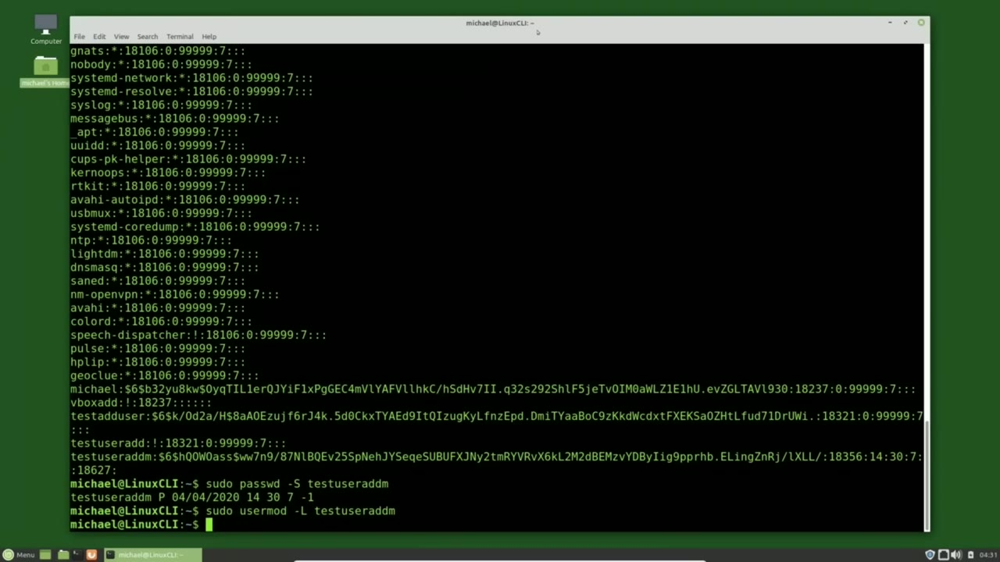
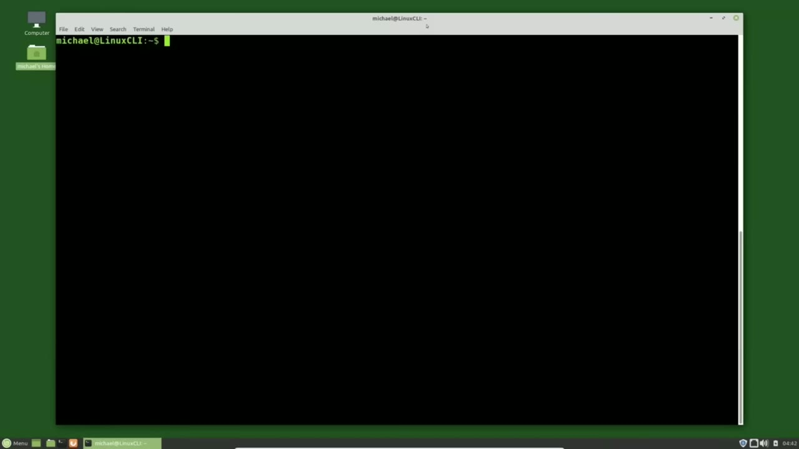
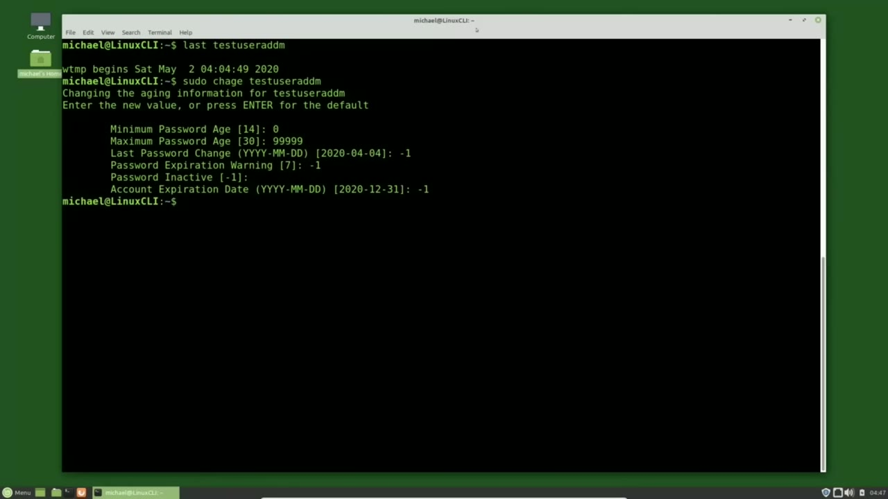
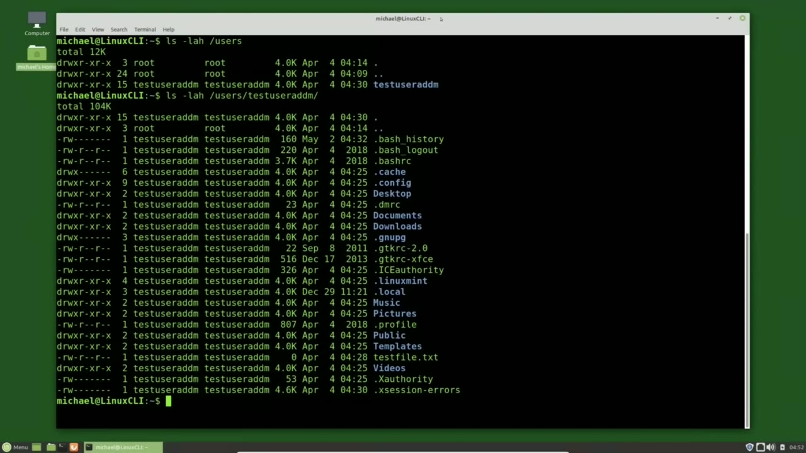

[← Course contents](../../01.md)

# 19. Disable/Remove UserIDs

**Course:** [Linux Command Line - Entire Tutorial Series](https://www.youtube.com/watch?v=avg65oY7sj4)  
**Transcript:** [`Linux Command Line - Entire Tutorial Series transcript`](../../../../course_videos/Linux%20Command%20Line%20-%20Entire%20Tutorial%20Series/Linux%20Command%20Line%20-%20Entire%20Tutorial%20Series.txt)  
**Video:** 02:28:38–02:40:57 ([open at this time](https://www.youtube.com/watch?v=avg65oY7sj4&t=8918s))

## Introduction

A few videos back we looked at the /etc/shadow file and saw that the user account can be locked when the current date is past the account expiration date or it is past the maximum days a user can have the same password and it is also past the inactive number of days the user had to change the password after it expired. I don't know if I made this clear in that video or not, but if either one of these two conditions is met, the user account is locked.

## Detailed Explanation

<details>
  <summary>Step 1 — Run `usermod -uppercase`, `passwd -lowercase`, `sudo cat /etc`</summary>

### Step 1 — Run `usermod -uppercase`, `passwd -lowercase`, `sudo cat /etc`

- [x] **A few videos back we looked at the /etc/shadow file and saw that the**
  - A few videos back we looked at the /etc/shadow file and saw that the user account can be locked when the current date is past the account expiration date or it is past the maximum days a user can have the same password and it is also past the inactive number of days the user had to change the password after it expired.
  - I don't know if I made this clear in that video or not, but if either one of these two conditions is met, the user account is locked.
  - Another option to lock the account like this is to set the account locked.

- [x] **Use `usermod -uppercase`, `passwd -lowercase`, `sudo cat /etc`**
  - To lock a user account we can use `usermod -uppercase` L than the user id or `passwd -lowercase` L and the user id.
  - Both commands do the same thing and that is they place an exclamation point in the beginning of the password in the /etc/shadow file to prevent the user id from logging in.
  - Let's look at the /etc/shadow file with the command, `sudo`, Cat, /etc, Shadow.

- [x] **Use `useradd`, `usermod`, `sudo usermod -uppercase`**
  - And looking at Test `useradd` M, we see that the user id has a 6 for the password encryption, meaning the sha 512 encryption.
  - Now I'm going to lock this account with the `usermod` command.
  - `sudo `usermod` -uppercase` L test `useradd` M and pressing enter now that user account is locked Let's take a look at that /etc/shadow file again and here we see the exclamation point in front of the password showing the account is locked.

- [x] **Use `sudo`**
  - We can also show that the account is locked by looking at the status for this user id.
  - `sudo` pass wd -uppercase S for status and then the user id that I want to check the status for which is test user at M and here we see the user id the uppercase L shows us that the account is locked then we also see the last time the password was changed the 14 is a minimum number of days before a password can be changed
  - The 30 is the maximum number of days before the password must change.

- [x] **The 7 is the number of days to start showing the warning message**
  - The 7 is the number of days to start showing the warning message before the password expires.
  - And the negative 1 shows the password is set to never expire.
  - When we unlock this account, the user will be able to log in again with the same password, as long as it has not expired.

- [x] **Use `sudo usermod`, `useradd`**
  - I will unlock this account with `sudo usermod`.
  - -uppercase u for unlock and then the user id that I want to unlock which is test `useradd` m and pressing enter that user account is now unlocked and we can see it's unlocked by looking at the shadow file we see the exclamation point is gone and checking the
  - Status and we see the L has changed to a P and the P stands for the password is set Now we have three different ways an account can be locked and they all lock the account in the same way.

- [x] **Use `useradd`, `sudo usermod -uppercase`**
  - Let's lock test `useradd` M again with `sudo `usermod` -uppercase` L test `useradd` M.
  - And locking the account with one of these three ways will prevent that user from logging in.
  - But they can still SSH in if they have their key in the system.

- [x] **And we haven't talked about SSH or private keys yet**
  - And we haven't talked about SSH or private keys yet.

```bash
usermod -uppercase
passwd -lowercase
sudo cat /etc
useradd
usermod
sudo usermod -uppercase
sudo
sudo usermod
```



</details>

<details>
  <summary>Step 2 — Run `sudo su`, `useradd`, `who`</summary>

### Step 2 — Run `sudo su`, `useradd`, `who`

- [x] **Use `sudo su`**
  - But we have talked about the switch user su command.
  - And we can still switch user into a locked account with `sudo su` for switch user.
  - And then the account id that we want to switch into.

- [x] **Use `useradd`, `who`**
  - And that is test `useradd` M.
  - And there we get our warning that our password will expire in two days.
  - And typing, `who` am I?

- [x] **Use `useradd`, `sudo usermod -lowercase`**
  - Shows us that we have logged into test `useradd` M.
  - The account that we just locked. I'm going to exit out of that account with exit.
  - To lock the user account and make it unusable, often system administrators will set the user's shell to bin no login. Let's do that now for our test `useradd` M account with `sudo usermod -lowercase` s for shell and we're changing the shell to bin no login.

- [x] **Use `useradd`, `sudo su`, `sudo usermod -lowercase`**
  - And we want to do this for user test `useradd` m now when I try to S u into test `useradd` M with `sudo su` test `useradd` M we get our password expiration warning again but we also get the message cannot execute /bin slash no login no such file or directory another popular way system administrators make the account unusable
  - And I'll do that now with `sudo usermod -lowercase` s for shell.
  - And I want to set that to bin false for test user ad M.

- [x] **Use `sudo su`**
  - Now when I try to su into test user ad M with `sudo su` test user ad M.
  - I still get the warning my password is going to expire message, but I don't get any other message and it does not allow me to log in as a user.
  - Now when I did this on my Ubuntu server, I tried to SSH in with my key on the server.

- [x] **I found that when I set the shell to bin false, it would record the**
  - I found that when I set the shell to bin false, it would record the login time, even though it would not allow me to log in.
  - And when the shell was set to bin no login, the login time was not recorded.

```bash
sudo su
useradd
who
sudo usermod -lowercase
```



</details>

<details>
  <summary>Step 3 — Run `last`, `sudo`, `useradd`</summary>

### Step 3 — Run `last`, `sudo`, `useradd`

- [x] **Use `last`**
  - You can see the times and dates a user logged into a Linux system by typing `last`.
  - And then the user id. For example, I'll type `last` test user at M.
  - Another way to lock the account is with the command user ch age -e0 and then the user id.

- [x] **And then if you want to reset or disable a password aging**
  - And then if you want to reset or disable a password aging.
  - You can reset the values by setting the minimum password age to 0, the maximum password age to 99999, password inactive to negative to negative 1, account expiration date to negative 1.
  - And there's also an interactive mode command by typing ch age in the user id.

- [x] **Use `sudo`, `useradd`**
  - I'll type that now, `sudo` ch age test `useradd` M.
  - It's now asking me to reset the password age.
  - And for this one, I'll just press Enter.

- [x] **Since negative 1 in that brackets is what it will set it to**
  - Since negative 1 in that brackets is what it will set it to.
  - And here I'll set the account expiration date also to negative 1.

```bash
last
sudo
useradd
```



</details>

<details>
  <summary>Step 4 — Run `sudo`, `useradd -em`, `useradd`</summary>

### Step 4 — Run `sudo`, `useradd -em`, `useradd`

- [x] **Use `sudo`, `useradd -em`**
  - And let's check the status now with `sudo` pass wd -uppercase S.
  - For test `useradd -em`.
  - And there we see we've reset all the default values.

- [x] **So now we've locked the account for a period of time and we are**
  - So now we've locked the account for a period of time and we are convinced that the user is no longer needed and we now want to delete that user.
  - Most of the time we want to delete the user and all the files for that user.
  - But occasionally there are times when we may want to keep the files for the user id, but still delete that user account.

- [x] **Use `useradd`, `ls -lah`**
  - We'll do this both ways. First, let's delete the user id and keep the user files and directories.
  - I'm going to delete the user, Test User AdM, but before I do that, let's take a look at Test `useradd` M's Home Directory.
  - To do that, I will type `ls -lah` slash Users.

- [x] **Use `useradd -m's`, `ls -lah`**
  - Remember we move the Home Directory to the Users directory a few videos back.
  - And there we see Test `useradd -m's` Home Directory.
  - And let's list out the files in that directory with `ls -lah` slash users slash test user at M.

- [x] **Use `useradd`**
  - I'm making a note that the desktop directory as well as all the files and directories are owned by test user at M.
  - And they also all have the group owner of test `useradd` M as well.
  - All except for that dot dot directory. That's the user's directory which is owned by root.

- [x] **And we talked about the dot and the dot dot dot directories in a**
  - And we talked about the dot and the dot dot dot directories in a previous tutorial.

```bash
sudo
useradd -em
useradd
ls -lah
useradd -m's
```



</details>

<details>
  <summary>Step 5 — Run `useradd`, `sudo`, `ls -lah`</summary>

### Step 5 — Run `useradd`, `sudo`, `ls -lah`

- [x] **Use `useradd`, `sudo`**
  - I am going to delete test `useradd` M with the command, `sudo` user Dell test `useradd` M.
  - And pressing enter. We get the usual Linux. No news is good news.
  - So let's check for test `useradd` M with `sudo` ch.

- [x] **Use `useradd`, `ls -lah`**
  - And we get the message, test user ad M does not exist in the /etc password file.
  - Let's make sure test `useradd` M's home directory is still there by typing `ls -lah` slash users.
  - Let's bring that back with the arrow up and add the S on the end and run it again.

- [x] **Use `useradd`**
  - And we see the test `useradd` M home directory is still there, but notice it is now owned by user id number 1003.
  - And the group is now owned by group id 1003.
  - And when I list all the files with test autocomplete, we see that the desktop directory, as well as all of the files and directories are owned by user number 1003 and have a group id of 1003.

- [x] **Use `useradd`**
  - So the user and group names were deleted, but the user id number and the group number were not deleted.
  - Since every file and directory needs to have a user id and a group id, Linux just shows the user id number and the group id number because there is no longer a name for either one of those.
  - So all our files are still there for test `useradd` M, which is what we wanted.

- [x] **Use `adduser`**
  - Now let's delete the user test `adduser`.
  - This time we want to delete the Home Directory for Test Ad User.
  - We can find Test Ad User's Home Directory in the Home Directory.

- [x] **Use `ls -lah /home`, `adduser`, `sudo`**
  - So let's show that with `ls -lah /home`.
  - And there we see the Test Ad User Home Directory.
  - I'm going to delete the test `adduser` and the home directory with `sudo` del user this time I want to remove the home directory for test ad user so I'm going to add in the option -dash remove home and then we'll add in the username test `adduser` pressing enter it is showing us

- [x] **Use `ls -lah`, `sudo -ch -hl`, `adduser`**
  - That it is removing the test ad user home directory and let's show that with `ls -lah` for the home directory.
  - And we see that the test ad user directory is gone.
  - And to show the user is gone, I will type `sudo -ch -hl` test `adduser`.

- [x] **Use `adduser`**
  - And we see that the test `adduser` does not exist in the /etc/passwd file.
  - In the next video, we will continue looking at the Linux command line.

```bash
useradd
sudo
ls -lah
adduser
ls -lah /home
sudo -ch -hl
```



</details>

<details>
  <summary>Questions and Answers</summary>

## Questions and Answers

### Question 1: What does `usermod -uppercase` do in this chapter?

<details>
<summary>Answer</summary>

- [x] To lock a user account we can use `usermod -uppercase` L than the user id or passWD -lowercase L and the user id.

</details>

### Question 2: What does `passwd -lowercase` do in this chapter?

<details>
<summary>Answer</summary>

- [x] To lock a user account we can use usermod -uppercase L than the user id or `passwd -lowercase` L and the user id.

</details>

### Question 3: What does `sudo cat /etc` do in this chapter?

<details>
<summary>Answer</summary>

- [x] Let's look at the /etc/shadow file with the command, Sudo, Cat, /etc, Shadow.

</details>

### Question 4: What does `useradd` do in this chapter?

<details>
<summary>Answer</summary>

- [x] And looking at Test `useradd` M, we see that the user id has a 6 for the password encryption, meaning the sha 512 encryption.

</details>

### Question 5: What does `usermod` do in this chapter?

<details>
<summary>Answer</summary>

- [x] Now I'm going to lock this account with the `usermod` command.

</details>

### Question 6: What does `sudo usermod -uppercase` do in this chapter?

<details>
<summary>Answer</summary>

- [x] `sudo usermod -uppercase` L test useradd M and pressing enter now that user account is locked Let's take a look at that /etc/shadow file again and here we see the exclamation point in front of the password showing the account is locked.

</details>

### Question 7: What does `sudo` do in this chapter?

<details>
<summary>Answer</summary>

- [x] `sudo` pass wd -uppercase S for status and then the user id that I want to check the status for which is test user at M and here we see the user id the uppercase L shows us that the account is locked then we also see the last time the password was changed the 14 is a minimum number of days before a password can be changed

</details>

### Question 8: What does `sudo usermod` do in this chapter?

<details>
<summary>Answer</summary>

- [x] I will unlock this account with `sudo usermod`.

</details>

### Question 9: What does `sudo su` do in this chapter?

<details>
<summary>Answer</summary>

- [x] And we can still switch user into a locked account with `sudo su` for switch user.

</details>

### Question 10: What does `who` do in this chapter?

<details>
<summary>Answer</summary>

- [x] And typing, `who` am I?

</details>

### Question 11: What does `sudo usermod -lowercase` do in this chapter?

<details>
<summary>Answer</summary>

- [x] To lock the user account and make it unusable, often system administrators will set the user's shell to bin no login. Let's do that now for our test useradd M account with `sudo usermod -lowercase` s for shell and we're changing the shell to bin no login.

</details>

### Question 12: What does `last` do in this chapter?

<details>
<summary>Answer</summary>

- [x] You can see the times and dates a user logged into a Linux system by typing `last`.

</details>

</details>

## Summary

This chapter, Disable/Remove UserIDs, walks through Run usermod -uppercase, passwd -lowercase, sudo cat /etc; Run sudo su, useradd, who; Run last, sudo, useradd; Run sudo, useradd -em, useradd; Run useradd, sudo, ls -lah. Commands from the transcript: `usermod -uppercase`, `passwd -lowercase`, `sudo cat /etc`, `useradd`, `usermod`, `sudo usermod -uppercase`, `sudo`, `sudo usermod`, `sudo su`, `who`, `sudo usermod -lowercase`, `last`, `useradd -em`, `ls -lah`.

## References

- [Linux Command Line - Entire Tutorial Series (YouTube)](https://www.youtube.com/watch?v=avg65oY7sj4)
- [This chapter at 02:28:38](https://www.youtube.com/watch?v=avg65oY7sj4&t=8918s)
- [Local transcript](../../../../course_videos/Linux%20Command%20Line%20-%20Entire%20Tutorial%20Series/Linux%20Command%20Line%20-%20Entire%20Tutorial%20Series.txt)
