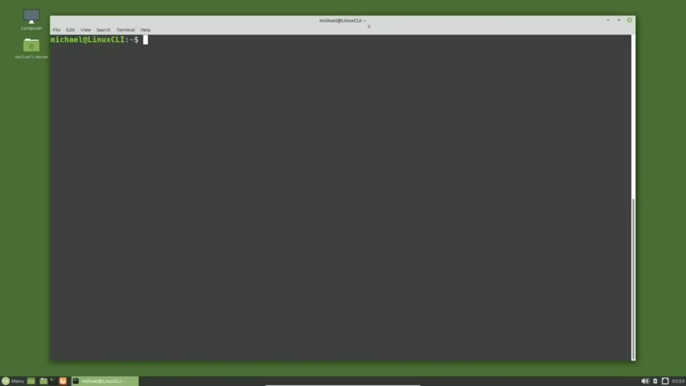
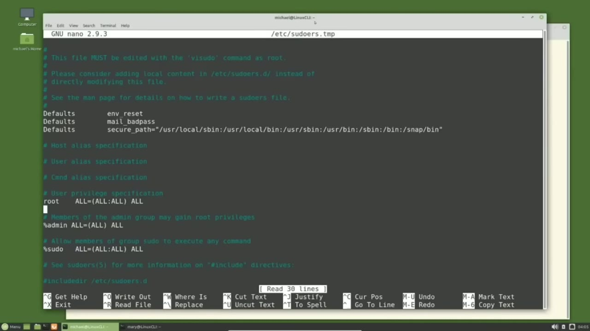
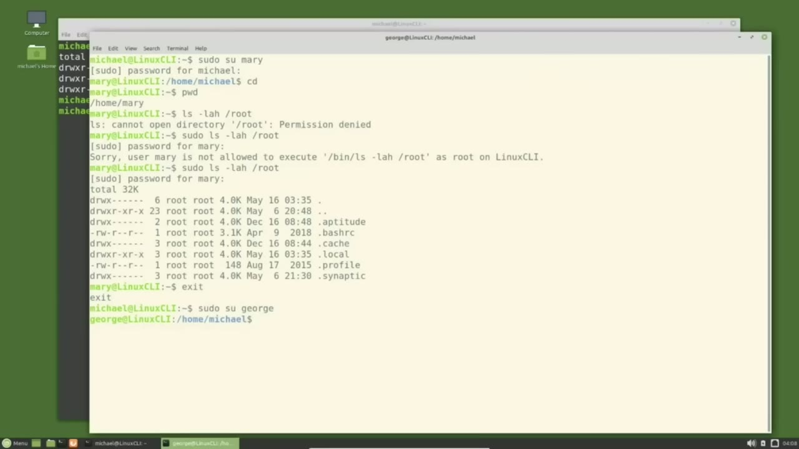
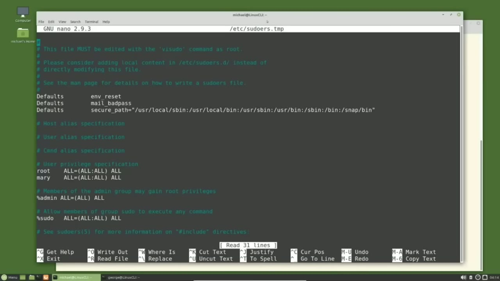

[← Course contents](../../01.md)

# 20. Adding Root Privileges

**Course:** [Linux Command Line - Entire Tutorial Series](https://www.youtube.com/watch?v=avg65oY7sj4)  
**Transcript:** [`Linux Command Line - Entire Tutorial Series transcript`](../../../../course_videos/Linux%20Command%20Line%20-%20Entire%20Tutorial%20Series/Linux%20Command%20Line%20-%20Entire%20Tutorial%20Series.txt)  
**Video:** 02:40:57–02:48:38 ([open at this time](https://www.youtube.com/watch?v=avg65oY7sj4&t=9657s))

## Introduction

Up to now in this series, we've been using the privileged user that was created when we installed the operating system. I've added some new users with the adduser command and this creates home directories for the users. And I've added two users because we're going to look at two different methods to make the standard users privileged users. The first thing I'm going to do is open a new terminal by clicking on file.

## Detailed Explanation

<details>
  <summary>Step 1 — Run `adduser`, `ls -lh /root`, `sudo`</summary>

### Step 1 — Run `adduser`, `ls -lh /root`, `sudo`

- [x] **Use `adduser`**
  - Up to now in this series, we've been using the privileged user that was created when we installed the operating system.
  - I've added some new users with the `adduser` command and this creates home directories for the users.
  - And I've added two users because we're going to look at two different methods to make the standard users privileged users.

- [x] **The first thing I'm going to do is open a new terminal by clicking on**
  - The first thing I'm going to do is open a new terminal by clicking on file.
  - Open terminal and I'm going to use the light profile that we created back in video 2 of this series.
  - In this terminal I'm going to switch to the Mary user with soud soud and I'll go to her home directory with cd and print that out with pwd.

- [x] **Use `ls -lh /root`**
  - I'm going to try and view the root directory as Mary with `ls -lh /root`.
  - We get the permissions denied error, so I will add SudoLS-L-H-L-H-R-Rut.
  - And here we see that Mary does not have privileges to view the root directory.

- [x] **Use `sudo`, `nano`**
  - To make Mary a privileged user, I'm going over to the other terminal, where I'm logged in as the Michael user, a privileged user.
  - And I'm going to make Mary a privileged user by...
  - Updating the Sudor file. To update the Sudower file, I will type `sudo`, v.i. `sudo`. And notice that the vi `sudo` is all one word. It is not VI-Space `sudo`. It's the single word vi `sudo`. And pressing Enter, and this takes us into the Sudoor's file. But notice on this Ubuntu based operating system, we're using `nano` and not

- [x] **Use `sudo`**
  - Even though the command is vi `sudo` and not NanoSudu.
  - We want to add the Mary id to this file and we want to add it right below this line here, this user privilege specification line.
  - So I'm going down to that and that line itself, user privilege specification is just a comment.

```bash
adduser
ls -lh /root
sudo
nano
```



</details>

<details>
  <summary>Step 2 — Run `sudo`</summary>

### Step 2 — Run `sudo`

- [x] **Use `sudo`**
  - Below that we see root all equals all all all that's giving the `sudo` privileges.
  - I'm going to press enter and add Mary right below root.
  - And the rest of this line I will just type the same thing.

- [x] **All equals left parent all colon all space all**
  - All equals left parent all colon all space all.
  - And I'm using all uppercase because they're using all uppercase for the root user.
  - I want to save this, so I'm going to hold down control and press X to exit and then Y to save and enter to not change that file name.

- [x] **Now let's go back over to the other terminal where we're logged in as**
  - Now let's go back over to the other terminal where we're logged in as Mary.
  - I'm going to press the arrow up and enter.
  - We need to type in Mary's password again.

- [x] **We can now see the root directory showing us that Mary is now a**
  - We can now see the root directory showing us that Mary is now a privileged user.
  - I'm going to exit out of Mary by typing exit.
  - And I'm going to log in as the George user with soud, su, George.

```bash
sudo
```



</details>

<details>
  <summary>Step 3 — Run `cd`, `ls -lah /root`, `sudo ls -lah /root`</summary>

### Step 3 — Run `cd`, `ls -lah /root`, `sudo ls -lah /root`

- [x] **Use `cd`, `ls -lah /root`**
  - And I'm going to go to his home directory by typing `cd` and then pwd.
  - And we see that we are now in George's home directory.
  - I'm going to clear the screen and try and view the root directory with `ls -lah /root`.

- [x] **Use `sudo ls -lah /root`**
  - Permissions denied, so we'll add `sudo ls -lah /root`.
  - And we see that George does not have privileges to view the file.
  - I'm going back over to the other terminal where I'm logged in as Michael.

- [x] **Use `sudo`**
  - And I'm going to add George to the `sudo` group.
  - I know we haven't talked about groups or file ownership yet and we will be getting to that shortly.
  - For now, we just need to know that adding George to the group `sudo` will make George a privileged user.

- [x] **Use `id`**
  - First, let's look at the groups that the user `id` Michael has.
  - For that I will type `id`. I can press enter here or I can add on Michael.
  - Here we see a list of groups that the Michael user `id` is in.

- [x] **Use `sudo`**
  - The one that we're interested here is `sudo`.
  - This is the group that will give us access to run the `sudo` command.
  - Note if you are using Red Hat or CentOS, instead of using `sudo` for the group, they use the wheel group and most likely that name wheel comes from someone who is a big wheel or someone important.

- [x] **Use `sudo`**
  - We are not using a Red Hat based release here.
  - We're using a Debian Ubuntu based release, so we are using the `sudo` group.
  - If you don't know which group your distro uses, you can check that in the Soudoers file.

- [x] **Use `sudo`**
  - I'm typing `sudo`, V-I-`sudo`, and we see right down here, Allow member of group `sudo` to execute any command.
  - Now we also see above that members of the admin group may gain root privileges.
  - That admin group is only there for backward compatibility.

```bash
cd
ls -lah /root
sudo ls -lah /root
sudo
id
```



</details>

<details>
  <summary>Step 4 — Run `sudo`, `usermod`, `sudo usermod`</summary>

### Step 4 — Run `sudo`, `usermod`, `sudo usermod`

- [x] **Use `sudo`, `usermod`, `sudo usermod`**
  - So we want to use the group `sudo`.
  - I'm going to exit out of here without saving anything by pressing Ctrl+X.
  - And I'm going to add George to the `sudo` group with the `usermod` command that we have seen in previous tutorials in this series. I'm typing `sudo usermod`, then a -because these are options and an A for append, then the uppercase G for group.

- [x] **Use `sudo`**
  - And then the group name that we want to add the user to, which is `sudo`.
  - He should be added to the `sudo` group.
  - Let's check it out by going over to the other terminal.

- [x] **Use `sudo`**
  - `sudo` l.s -lh /root password for George.
  - And we see that George is still unable to view the root directory.
  - The problem is George needs to sign out and then back in to update the route privileges.

- [x] **Use `sudo su su`**
  - So I will exit out of the George id with exit.
  - And then go back in with `sudo`, su, su, George.
  - So there's no confusion on who we're at.

- [x] **Use `sudo`, `ls -lah /root`**
  - And I will type `sudo`.
  - `ls -lah /root`.
  - We can now view the root directory showing George has root privileges.

- [x] **In the next video, we will continue looking at the Linux command line**
  - In the next video, we will continue looking at the Linux command line.

```bash
sudo
usermod
sudo usermod
sudo su su
ls -lah /root
```



</details>

<details>
  <summary>Questions and Answers</summary>

## Questions and Answers

### Question 1: What does `adduser` do in this chapter?

<details>
<summary>Answer</summary>

- [x] I've added some new users with the `adduser` command and this creates home directories for the users.

</details>

### Question 2: What does `ls -lh /root` do in this chapter?

<details>
<summary>Answer</summary>

- [x] I'm going to try and view the root directory as Mary with `ls -lh /root`.

</details>

### Question 3: What does `sudo` do in this chapter?

<details>
<summary>Answer</summary>

- [x] Updating the Sudor file. To update the Sudower file, I will type `sudo`, v.i. `sudo`. And notice that the vi `sudo` is all one word. It is not VI-Space `sudo`. It's the single word vi `sudo`. And pressing Enter, and this takes us into the Sudoor's file. But notice on this Ubuntu based operating system, we're using Nano and not

</details>

### Question 4: What does `nano` do in this chapter?

<details>
<summary>Answer</summary>

- [x] Updating the Sudor file. To update the Sudower file, I will type sudo, v.i. sudo. And notice that the vi sudo is all one word. It is not VI-Space sudo. It's the single word vi sudo. And pressing Enter, and this takes us into the Sudoor's file. But notice on this Ubuntu based operating system, we're using `nano` and not

</details>

### Question 5: What does `cd` do in this chapter?

<details>
<summary>Answer</summary>

- [x] And I'm going to go to his home directory by typing `cd` and then pwd.

</details>

### Question 6: What does `ls -lah /root` do in this chapter?

<details>
<summary>Answer</summary>

- [x] I'm going to clear the screen and try and view the root directory with `ls -lah /root`.

</details>

### Question 7: What does `sudo ls -lah /root` do in this chapter?

<details>
<summary>Answer</summary>

- [x] Permissions denied, so we'll add `sudo ls -lah /root`.

</details>

### Question 8: What does `id` do in this chapter?

<details>
<summary>Answer</summary>

- [x] For that I will type `id`. I can press enter here or I can add on Michael.

</details>

### Question 9: What does `usermod` do in this chapter?

<details>
<summary>Answer</summary>

- [x] And I'm going to add George to the Sudo group with the `usermod` command that we have seen in previous tutorials in this series. I'm typing Sudo `usermod`, then a -because these are options and an A for append, then the uppercase G for group.

</details>

### Question 10: What does `sudo usermod` do in this chapter?

<details>
<summary>Answer</summary>

- [x] And I'm going to add George to the Sudo group with the usermod command that we have seen in previous tutorials in this series. I'm typing `sudo usermod`, then a -because these are options and an A for append, then the uppercase G for group.

</details>

### Question 11: What does `sudo su su` do in this chapter?

<details>
<summary>Answer</summary>

- [x] And then go back in with Sudo, su, su, George.

</details>

</details>

## Summary

This chapter, Adding Root Privileges, walks through Run adduser, ls -lh /root, sudo; Run sudo; Run cd, ls -lah /root, sudo ls -lah /root; Run sudo, usermod, sudo usermod. Commands from the transcript: `adduser`, `ls -lh /root`, `sudo`, `nano`, `cd`, `ls -lah /root`, `sudo ls -lah /root`, `id`, `usermod`, `sudo usermod`, `sudo su su`.

## References

- [Linux Command Line - Entire Tutorial Series (YouTube)](https://www.youtube.com/watch?v=avg65oY7sj4)
- [This chapter at 02:40:57](https://www.youtube.com/watch?v=avg65oY7sj4&t=9657s)
- [Local transcript](../../../../course_videos/Linux%20Command%20Line%20-%20Entire%20Tutorial%20Series/Linux%20Command%20Line%20-%20Entire%20Tutorial%20Series.txt)
