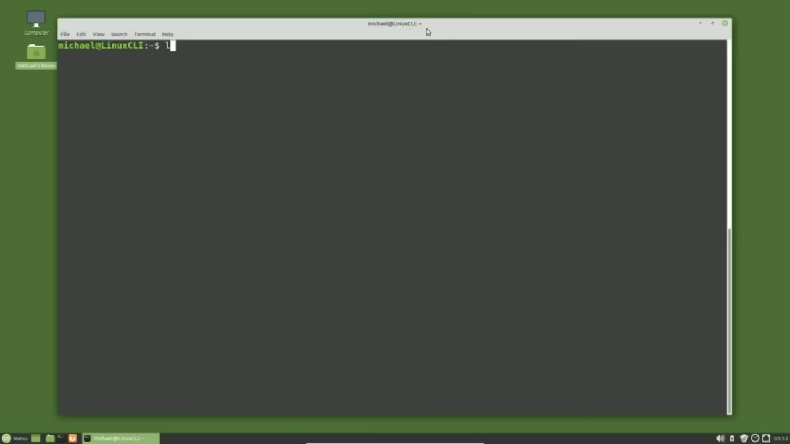
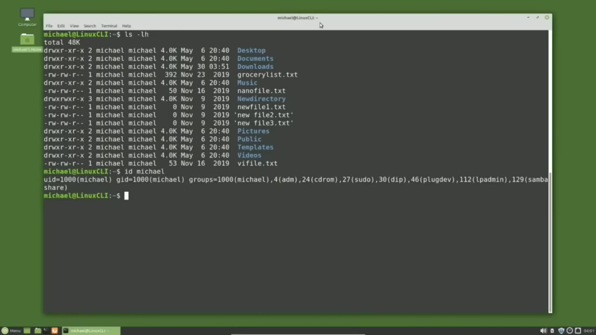
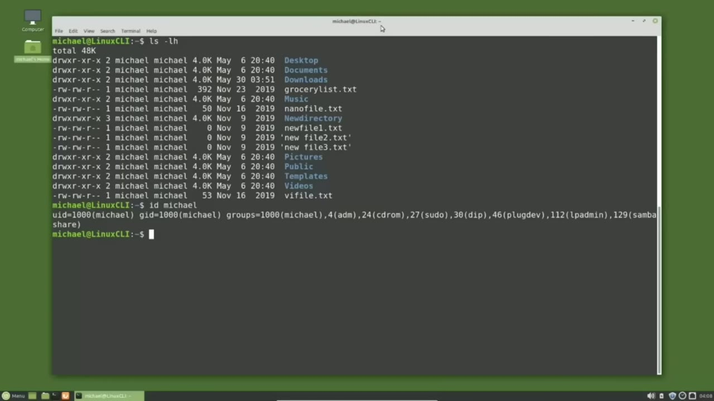
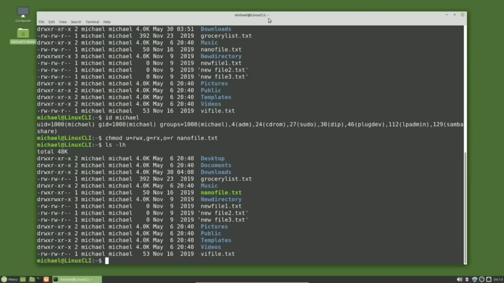
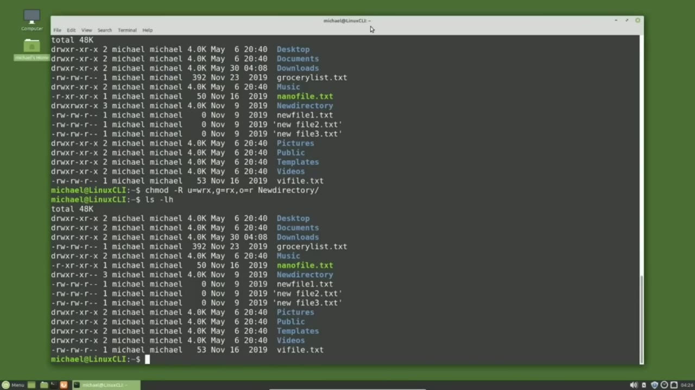

[← Course contents](../../01.md)

# 21. File and Directory Permissions

**Course:** [Linux Command Line - Entire Tutorial Series](https://www.youtube.com/watch?v=avg65oY7sj4)  
**Transcript:** [`Linux Command Line - Entire Tutorial Series transcript`](../../../../course_videos/Linux%20Command%20Line%20-%20Entire%20Tutorial%20Series/Linux%20Command%20Line%20-%20Entire%20Tutorial%20Series.txt)  
**Video:** 02:48:38–03:00:29 ([open at this time](https://www.youtube.com/watch?v=avg65oY7sj4&t=10118s))

## Introduction

When I type ls -lh, we see the files and directories in this directory and up to now I haven't really said much about the first, third, and fourth columns that we see here. We're going to look at what they are and why they're important. We're going to start with the third column. The third column is the user owner of the file or directory on the right.

## Detailed Explanation

<details>
  <summary>Step 1 — Run `ls -lh`, `id`</summary>

### Step 1 — Run `ls -lh`, `id`

- [x] **Use `ls -lh`**
  - When I type `ls -lh`, we see the files and directories in this directory and up to now I haven't really said much about the first, third, and fourth columns that we see here.
  - We're going to look at what they are and why they're important.
  - We're going to start with the third column.

- [x] **The third column is the user owner of the file or directory on the**
  - The third column is the user owner of the file or directory on the right.
  - You'll see why I'm calling this the user owner in a moment or two.
  - The fourth column is the group associated with the file or directory.

- [x] **Use `id`**
  - Every file and directory must have a user owner and a group assigned to it.
  - When I type `id`, or `id` Michael, we see the user `id` for Michael and the group `id` for Michael, and then all the groups the user `id` Michael is a member of.
  - And notice they all have a number with the name.

- [x] **Linux uses the numbers. The user id name and the group name**
  - Linux uses the numbers. The user `id` name and the group name.
  - They're there just to help us humans know that user `id` 1000 is for Michael and group `id` 1000 is the group for Michael.
  - A few videos back, we deleted a user but kept the files.

- [x] **Since the user id was gone, there was no name to display as the user**
  - Since the user `id` was gone, there was no name to display as the user owner or the group. So all we saw was the user owner number and the group number.
  - So files and directories must have a user owner and a group. Now that we know what columns 3 and 4 are, let's look at the first column. And I think we discussed this first character of that first column in an earlier tutorial in this series. That tells us what type of file it is. If we have a D,

```bash
ls -lh
id
```



</details>

<details>
  <summary>Step 2 — If we have a dash or a hyphen, it's for a file</summary>

### Step 2 — If we have a dash or a hyphen, it's for a file

- [x] **If we have a dash or a hyphen, it's for a file**
  - If we have a dash or a hyphen, it's for a file.
  - And we've also seen the L for a Sim link.
  - There are a few others, but those are the three most common.

- [x] **The rest of this first column are the file permissions**
  - The rest of this first column are the file permissions.
  - Let's look at the permissions for the Documents Directory.
  - The permissions column is broken up into four sections.

- [x] **The first section we just talked about, and that's that first**
  - The first section we just talked about, and that's that first character that tells us the file type.
  - The next section, tells us the permissions of the user owner from column 3.
  - And we see these permissions are R for read, W for right, and X for execute.

- [x] **And they use an X instead of an E for execute**
  - And they use an X instead of an E for execute.
  - So the user owner has read, write, and execute permissions.
  - The third section is the group permissions.

- [x] **If you're not the user owner of the file from column 3, but you are a**
  - If you're not the user owner of the file from column 3, but you are a member of that group from column 4, You have read permissions and instead of write permissions you've got a -meaning group members cannot write to this file, but they do have execute permissions.
  - The fourth section are the permissions for anyone who is not the user owner of the file.



</details>

<details>
  <summary>Step 3 — Run `chmod`, `ls -lh`</summary>

### Step 3 — Run `chmod`, `ls -lh`

- [x] **They're not in the group, but they do have access to this file**
  - They're not in the group, but they do have access to this file.
  - And in this case, those permissions are the same permissions as the group.
  - They can read the files. They cannot write the files.

- [x] **In this case, we're looking at a directory**
  - In this case, we're looking at a directory.
  - And just because the directory permissions says they have access to read and execute doesn't mean they can read and execute every file in that directory.
  - The permissions for a file or directory in that directory have a priority over the directory permissions.

- [x] **When I say that, I mean if there's a file in that directory that has**
  - When I say that, I mean if there's a file in that directory that has all dashes for the group and other, Those no access dashes will override the folder directory permissions.
  - Group and other will not have any access to that file or directory.
  - Although they'll be able to see the file name or the directory name, they will not be able to do anything with that file or directory.

- [x] **Use `chmod`**
  - A file owner can change or modify the permissions of their files with the `chmod` command.
  - I'm going to change the permissions for the nanofile.txt file And to do that, I will type `chmod` for change mode.
  - And I want to change the user owner to have read, write, execute privileges.

- [x] **So I will type you for user owner, then equals to assign the**
  - So I will type you for user owner, then equals to assign the permissions of read, write, execute.
  - Now I'm going to place a comma to separate things.
  - And I'll put an equal sign to assign the permissions of read.

- [x] **Use `ls -lh`**
  - And execute. Notice I did not place a dash or a hyphen in there, just the R for read and X for execute.
  - And now another comma. And I will give the other permissions of read only. So O equals R.
  - Then I will add a space and the file name I want to change, which in this case is nano file.T and `ls -lh` shows us that the nanophile. txt file permissions have been updated.

- [x] **Here you can see why I've been referring to the file owner as the**
  - Here you can see why I've been referring to the file owner as the user owner throughout this video.
  - Because when you update the file permissions this way, O is for other and you is for user owner.

```bash
chmod
ls -lh
```



</details>

<details>
  <summary>Step 4 — Run `chmod ugo`, `ls -lh`, `chmod uppercase`</summary>

### Step 4 — Run `chmod ugo`, `ls -lh`, `chmod uppercase`

- [x] **Use `chmod ugo`, `ls -lh`**
  - If we want to give everyone the same permissions like read only, I can type `chmod ugo` for user group and other, and then the equal sign that will set the permissions equal to what I place after the equal sign.
  - Then our space in the file name, nano file. txt, pressing Enter and `ls -lh`.
  - Shows the permissions are set for user group and other to only have read privileges.

- [x] **Instead of the equal sign, we can use a plus sign to add permissions**
  - Instead of the equal sign, we can use a plus sign to add permissions.
  - Let's say that I want to add execute permissions for the user owner, the group, and other.
  - I can do that by typing chamad, U for user, G for group, O for other, plus to add the permission of execute.

- [x] **Use `ls -lh`**
  - And because I have user group and other, instead of typing ugo, I can use an A.
  - And I'm adding the execute privilege and I want to do that for the nanofile.TXT and `ls -lh` shows us that now we have read and execute privileges for everyone for the nanophile. txt file.
  - We can also take away permissions with the -sign and we can do multiple changes in a single command.

- [x] **I will add right permissions for the user owner and take away the**
  - I will add right permissions for the user owner and take away the read and write permissions for the group and other with the command.
  - Chimad, U for user, and I'm going to add the right permissions with plus W, then the comma, and then G for group, O for other, and I'm going to take away the read execute permissions with -rx.
  - And notice there's no space around the comma.

- [x] **Use `ls -lh`**
  - When we do multiple changes at a time, there's no space between the changes, just a comma.
  - And `ls -lh` shows that we've added the right permission for the user owner and taken away the read-execute permissions for the group and other.
  - If we're changing the permissions for a directory and we want the same permissions to be applied for every file...

- [x] **Use `chmod uppercase`**
  - And directory in that directory, we would need to add the uppercase R option for recursive.
  - I'll type chmod, uppercase R for recursively apply these permissions.
  - We'll give the user owner, read, write, and execute permissions.

- [x] **Use `ls -lh`**
  - The group permissions will be read and execute, and then for everyone else, we will give them read permissions.
  - I will give this the directory name, new directory.
  - And typing `ls -lh` shows us that the new directory permissions are now set that way.

- [x] **Setting the privileges this way is called alphabetic notation or**
  - Setting the privileges this way is called alphabetic notation or symbolic notation.
  - They're the same thing depending on who you're talking to.
  - It is when we can see the letters or the symbols.

- [x] **The other notation for setting privileges is called octal notation**
  - The other notation for setting privileges is called octal notation.
  - We still use the same read, write, and execute for user owner, group and other, but we use a single number to set the user owner privileges, a different number to set the group privileges, and a third number for the privileges of other.
  - How this works is read, write, and execute each have a value assigned to them.

```bash
chmod ugo
ls -lh
chmod uppercase
```



</details>

<details>
  <summary>Step 5 — Run `chmod`, `chmod 754 nanophile.txt`, `ls -lh`</summary>

### Step 5 — Run `chmod`, `chmod 754 nanophile.txt`, `ls -lh`

- [x] **Read has a value of four, write has a value of two, and execute has a**
  - Read has a value of four, write has a value of two, and execute has a value of one.
  - If we have these up 4 plus 2 plus 1, we get 7, the highest number we can have.
  - So we have 8 different numbers we can use for the permissions, and that's where we get the name Octal permissions.

- [x] **In this case, the user owner has read, write, and execute privileges**
  - In this case, the user owner has read, write, and execute privileges.
  - So we have 4 plus 2 plus 1 and we get 7.
  - So the user owner octal privileges is 7.

- [x] **The group privileges are read and execute**
  - The group privileges are read and execute.
  - 4 plus 1 gives us the octal number of 5.
  - And the other only has read privileges, so their octal number is 4.

- [x] **Use `chmod`, `chmod 754 nanophile.txt`, `ls -lh`**
  - Then we take that same `chmod` to change mode of the user privileges with those 3 numbers.
  - `chmod 754 nanophile.txt`.
  - `ls -lh`.

- [x] **Use `chmod 7-00`**
  - And we see we updated the privileges using the octal notation this time.
  - If we want to give the user owner full privileges and no privileges for the group or other, I would Chimod the file permissions to be 7-0.0.
  - And I'll do that with `chmod 7-00` nanofile.t.

- [x] **Use `ls -lh`**
  - `ls -lh`.
  - And now only the user owner has privileges for this file.
  - If you are working on a website or something connected to the internet, it's usually a bad idea to give the privileges of 777.

- [x] **Although you may need to at times, at least temporarily, you should**
  - Although you may need to at times, at least temporarily, you should still be careful when and where you do that.
  - If you have a website with 777 privileges available to the general public, you are inviting hackers not only to add malicious...
  - But also they can execute that malicious code.

- [x] **In general, if you want the public to have right access to a**
  - In general, if you want the public to have right access to a directory, that's okay, but don't give them execute access for that same directory.
  - And the same thing for the execute privileges.
  - If you want the general public to be able to execute files, that's okay too.

- [x] **Just don't give them right privileges for that same directory**
  - Just don't give them right privileges for that same directory.
  - In the next tutorial, we'll continue looking at the Linux command line.

```bash
chmod
chmod 754 nanophile.txt
ls -lh
chmod 7-00
```



</details>

<details>
  <summary>Questions and Answers</summary>

## Questions and Answers

### Question 1: What does `ls -lh` do in this chapter?

<details>
<summary>Answer</summary>

- [x] When I type `ls -lh`, we see the files and directories in this directory and up to now I haven't really said much about the first, third, and fourth columns that we see here.

</details>

### Question 2: What does `id` do in this chapter?

<details>
<summary>Answer</summary>

- [x] When I type `id`, or `id` Michael, we see the user `id` for Michael and the group `id` for Michael, and then all the groups the user `id` Michael is a member of.

</details>

### Question 3: What does `chmod` do in this chapter?

<details>
<summary>Answer</summary>

- [x] A file owner can change or modify the permissions of their files with the `chmod` command.

</details>

### Question 4: What does `chmod ugo` do in this chapter?

<details>
<summary>Answer</summary>

- [x] If we want to give everyone the same permissions like read only, I can type `chmod ugo` for user group and other, and then the equal sign that will set the permissions equal to what I place after the equal sign.

</details>

### Question 5: What does `chmod uppercase` do in this chapter?

<details>
<summary>Answer</summary>

- [x] I'll type chmod, uppercase R for recursively apply these permissions.

</details>

### Question 6: What does `chmod 754 nanophile.txt` do in this chapter?

<details>
<summary>Answer</summary>

- [x] `chmod 754 nanophile.txt`.

</details>

### Question 7: What does `chmod 7-00` do in this chapter?

<details>
<summary>Answer</summary>

- [x] And I'll do that with `chmod 7-00` nanofile.t.

</details>

### Question 8: What does step 1 cover (Run ls -lh, id)?

<details>
<summary>Answer</summary>

- [x] When I type `ls -lh`, we see the files and directories in this directory and up to now I haven't really said much about the first, third, and fourth columns that we see here.
- [x] We're going to look at what they are and why they're important.
- [x] We're going to start with the third column.

</details>

### Question 9: What does step 2 cover (If we have a dash or a hyphen, it's for a file)?

<details>
<summary>Answer</summary>

- [x] If we have a dash or a hyphen, it's for a file.
- [x] And we've also seen the L for a Sim link.
- [x] There are a few others, but those are the three most common.

</details>

### Question 10: What does step 3 cover (Run chmod, ls -lh)?

<details>
<summary>Answer</summary>

- [x] They're not in the group, but they do have access to this file.
- [x] And in this case, those permissions are the same permissions as the group.
- [x] They can read the files. They cannot write the files.

</details>

</details>

## Summary

This chapter, File and Directory Permissions, walks through Run ls -lh, id; If we have a dash or a hyphen, it's for a file; Run chmod, ls -lh; Run chmod ugo, ls -lh, chmod uppercase; Run chmod, chmod 754 nanophile.txt, ls -lh. Commands from the transcript: `ls -lh`, `id`, `chmod`, `chmod ugo`, `chmod uppercase`, `chmod 754 nanophile.txt`, `chmod 7-00`.

## References

- [Linux Command Line - Entire Tutorial Series (YouTube)](https://www.youtube.com/watch?v=avg65oY7sj4)
- [This chapter at 02:48:38](https://www.youtube.com/watch?v=avg65oY7sj4&t=10118s)
- [Local transcript](../../../../course_videos/Linux%20Command%20Line%20-%20Entire%20Tutorial%20Series/Linux%20Command%20Line%20-%20Entire%20Tutorial%20Series.txt)
