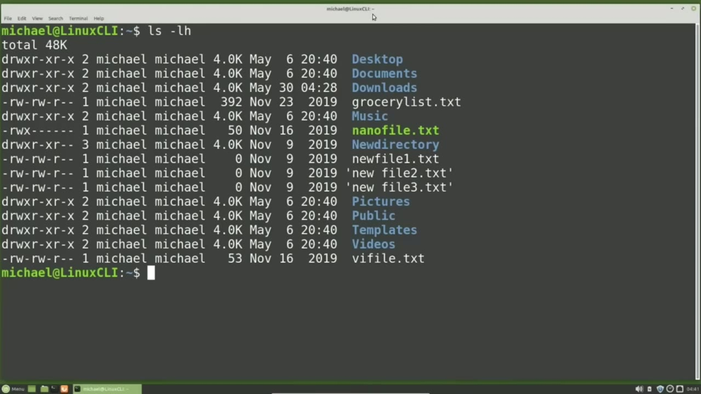
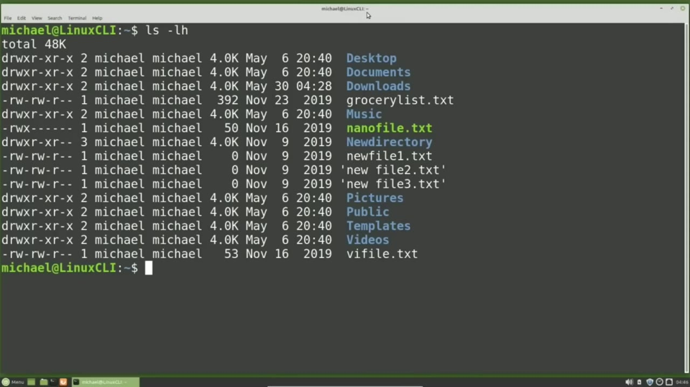
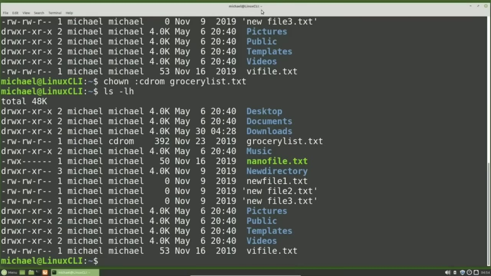
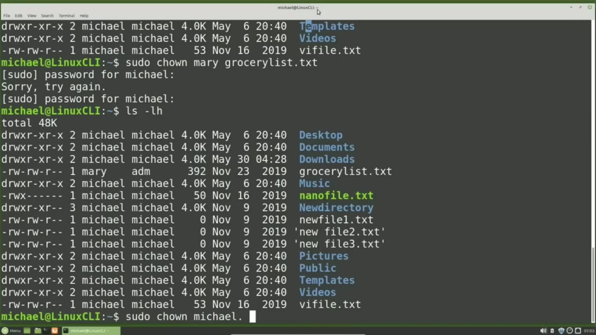

[← Course contents](../../01.md)

# 22. File Ownership

**Course:** [Linux Command Line - Entire Tutorial Series](https://www.youtube.com/watch?v=avg65oY7sj4)  
**Transcript:** [`Linux Command Line - Entire Tutorial Series transcript`](../../../../course_videos/Linux%20Command%20Line%20-%20Entire%20Tutorial%20Series/Linux%20Command%20Line%20-%20Entire%20Tutorial%20Series.txt)  
**Video:** 03:00:29–03:07:14 ([open at this time](https://www.youtube.com/watch?v=avg65oY7sj4&t=10829s))

## Introduction

In the last video we talked about file permissions for the user owner, group, and other. We were able to change the file permissions for files we are the user owner of without needing to be a privileged user. From here forward I'm going to refer to the user owner as owner. Standard Linux users cannot change the file owner.

## Detailed Explanation

<details>
  <summary>Step 1 — In the last video we talked about file permissions for the user owner</summary>

### Step 1 — In the last video we talked about file permissions for the user owner

- [x] **In the last video we talked about file permissions for the user**
  - In the last video we talked about file permissions for the user owner, group, and other.
  - We were able to change the file permissions for files we are the user owner of without needing to be a privileged user.
  - From here forward I'm going to refer to the user owner as owner.

- [x] **Standard Linux users cannot change the file owner**
  - Standard Linux users cannot change the file owner.
  - But they can change the group for their files, but only to a group of which they are a member.
  - You may be thinking, why can't I give my file to someone else?

- [x] **It's my file. I should be able to share my files with anyone I like**
  - It's my file. I should be able to share my files with anyone I like.
  - And you can share what's in your files with anyone you like by changing the file permissions as we saw in the last video.
  - But you will need to be a privileged user to change the owner of a file.

- [x] **There are a couple of reasons why you cannot just change the owner of**
  - There are a couple of reasons why you cannot just change the owner of one of your files or directories to another user id.
  - One reason is you may have a disk quota on your login id, and if you change the owner of a file, that file would no longer count against your disk quota, and it will count against the disk quota of the user id you just set it to.
  - Another reason is someone might put some malicious code in a file and then change the owner of that file to your login id.

- [x] **And then you could be blamed for putting malicious code on the**
  - And then you could be blamed for putting malicious code on the computer.
  - So only a privileged user can change the file owner.



</details>

<details>
  <summary>Step 2 — Run `groups`, `chgrp`, `which`</summary>

### Step 2 — Run `groups`, `chgrp`, `which`

- [x] **Use `groups`**
  - An owner can update the group for a file or directory, he or she is the owner of, but as I mentioned earlier, it is limited to the `groups` that user id is a member.
  - To find out what `groups` my user id is a member, I will type `groups`.
  - If we want to see what `groups` another user id is a member of, we would add that user id after `groups`.

- [x] **For example, groups Mary shows that Mary is only in the group Mary**
  - For example, `groups` Mary shows that Mary is only in the group Mary.
  - Shows the username and then the `groups` that I am a member in.
  - Note the `groups` PlugDev, cdrom, and adm.

- [x] **We're going to use those groups in this video**
  - We're going to use those `groups` in this video.
  - Looking at the file permissions for the GroceryList.T.
  - We see it has read and write access for the user in the group, but if you are not logged in as Michael, and you are not in the group, Michael, you can only read this file.

- [x] **I'm going to change the group permissions for the file Grocerlist.TXT**
  - I'm going to change the group permissions for the file Grocerlist.TXT.
  - Using the chone or change owner command by typing Chon, Michael, colon, plug dev, grocery list. txt.
  - Here I'm saying change the owner to Michael, `which` is changing the owner to what it already is.

- [x] **Then I'm changing the group to be plugged dev, and I'm doing this all**
  - Then I'm changing the group to be plugged dev, and I'm doing this all for the file, GroceryList.txty.
  - And that shows the file group has been updated.
  - To just change the group with the chone change owner command, I can leave off the user owner and start with the colon.

- [x] **Use `chgrp`, `which`**
  - So nothing to the left of the colon means don't change the file owner, only change the group.
  - And here again we see the group was updated.
  - Another way to change the group for a file is with the `chgrp` command, `which` is short for change group.

```bash
groups
chgrp
which
```



</details>

<details>
  <summary>Step 3 — Run `chgrp adm`, `sudo`, `ls -lh`</summary>

### Step 3 — Run `chgrp adm`, `sudo`, `ls -lh`

- [x] **Use `chgrp adm`, `sudo`**
  - I'll change the group for the GroceryList.T file with `chgrp adm` GroceryLest.TXT.
  - And here again we see the group was updated for the GroceryList.TXT file.
  - To only change the file owner, I will start with `sudo`.

- [x] **Because I will need to be a privileged user to change the file owner**
  - Because I will need to be a privileged user to change the file owner.
  - And then I will put in the new user id that I want to change this to, which is Mary.
  - And I don't need a colon or the group since I'm not changing those at all.

- [x] **I will just add in the file I want to change this for, which is**
  - I will just add in the file I want to change this for, which is Grocerylist.TXT.
  - Now if I placed a colon after Mary with no group, It would also change the group to marry, but censors no colon, it will only change the owner.
  - I need to type in my password to submit a privileged user command.

- [x] **Use `ls -lh`**
  - And then let's show the files with `ls -lh`.
  - And we see the file owner is now Mary, but the group is still adm.
  - We can also use the period instead of a colon for any chone change owner command.

- [x] **The period and the colon are interchangeable**
  - The period and the colon are interchangeable.
  - I'm going to change the owner and the group back to Michael with the Chon command.

```bash
chgrp adm
sudo
ls -lh
```



</details>

<details>
  <summary>Step 4 — Run `ls -lh`</summary>

### Step 4 — Run `ls -lh`

- [x] **I need to be a privileged user for that, so I will start with**
  - I need to be a privileged user for that, so I will start with Sudo-Chone, Michael.
  - And from here, I can put the colon Michael to change the user and the group to Michael.
  - I can remove the group, but if I leave the colon, that will change the user and the group to Michael.

- [x] **Use `ls -lh`**
  - And because the colon and the period are interchangeable for the chone command, I can also change this to Michael, period, and this will change the owner and the group both to Michael.
  - I'll give it the file name, grocery list. txt, `ls -lh`.
  - And here we see the owner and the group were both changed to Michael.

- [x] **Using the chone command with just the user id and no period or colon**
  - Using the chone command with just the user id and no period or colon, will only update the owner of a file. Using Chon with a user id followed by a period or a colon, will set the owner of that file as well as the group of a file.
  - In the next video, we'll continue looking at the Linux command line.

```bash
ls -lh
```



</details>

<details>
  <summary>Questions and Answers</summary>

## Questions and Answers

### Question 1: What does `groups` do in this chapter?

<details>
<summary>Answer</summary>

- [x] To find out what `groups` my user id is a member, I will type `groups`.

</details>

### Question 2: What does `chgrp` do in this chapter?

<details>
<summary>Answer</summary>

- [x] Another way to change the group for a file is with the `chgrp` command, which is short for change group.

</details>

### Question 3: What does `which` do in this chapter?

<details>
<summary>Answer</summary>

- [x] Another way to change the group for a file is with the chgrp command, `which` is short for change group.

</details>

### Question 4: What does `chgrp adm` do in this chapter?

<details>
<summary>Answer</summary>

- [x] I'll change the group for the GroceryList.T file with `chgrp adm` GroceryLest.TXT.

</details>

### Question 5: What does `sudo` do in this chapter?

<details>
<summary>Answer</summary>

- [x] To only change the file owner, I will start with `sudo`.

</details>

### Question 6: What does `ls -lh` do in this chapter?

<details>
<summary>Answer</summary>

- [x] And then let's show the files with `ls -lh`.

</details>

### Question 7: What does step 1 cover (In the last video we talked about file permissions for the user owner)?

<details>
<summary>Answer</summary>

- [x] In the last video we talked about file permissions for the user owner, group, and other.
- [x] We were able to change the file permissions for files we are the user owner of without needing to be a privileged user.
- [x] From here forward I'm going to refer to the user owner as owner.

</details>

### Question 8: What does step 2 cover (Run groups, chgrp, which)?

<details>
<summary>Answer</summary>

- [x] An owner can update the group for a file or directory, he or she is the owner of, but as I mentioned earlier, it is limited to the `groups` that user id is a member.
- [x] To find out what `groups` my user id is a member, I will type `groups`.
- [x] If we want to see what `groups` another user id is a member of, we would add that user id after `groups`.

</details>

### Question 9: What does step 3 cover (Run chgrp adm, sudo, ls -lh)?

<details>
<summary>Answer</summary>

- [x] I'll change the group for the GroceryList.T file with `chgrp adm` GroceryLest.TXT.
- [x] And here again we see the group was updated for the GroceryList.TXT file.
- [x] To only change the file owner, I will start with `sudo`.

</details>

### Question 10: What does step 4 cover (Run ls -lh)?

<details>
<summary>Answer</summary>

- [x] I need to be a privileged user for that, so I will start with Sudo-Chone, Michael.
- [x] And from here, I can put the colon Michael to change the user and the group to Michael.
- [x] I can remove the group, but if I leave the colon, that will change the user and the group to Michael.

</details>

</details>

## Summary

This chapter, File Ownership, walks through In the last video we talked about file permissions for the user owner; Run groups, chgrp, which; Run chgrp adm, sudo, ls -lh; Run ls -lh. Commands from the transcript: `groups`, `chgrp`, `which`, `chgrp adm`, `sudo`, `ls -lh`.

## References

- [Linux Command Line - Entire Tutorial Series (YouTube)](https://www.youtube.com/watch?v=avg65oY7sj4)
- [This chapter at 03:00:29](https://www.youtube.com/watch?v=avg65oY7sj4&t=10829s)
- [Local transcript](../../../../course_videos/Linux%20Command%20Line%20-%20Entire%20Tutorial%20Series/Linux%20Command%20Line%20-%20Entire%20Tutorial%20Series.txt)
