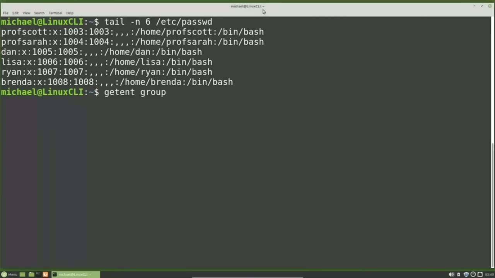
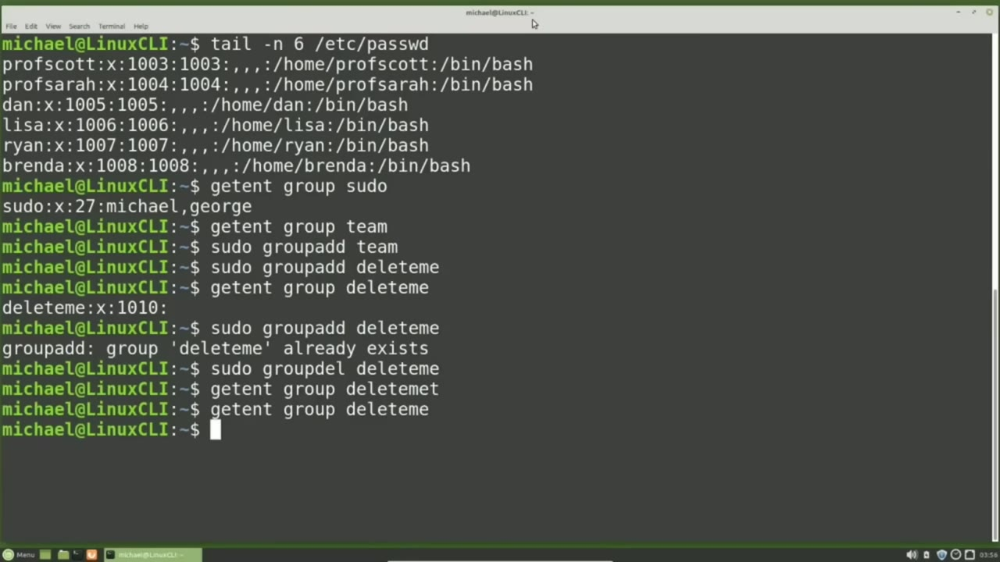
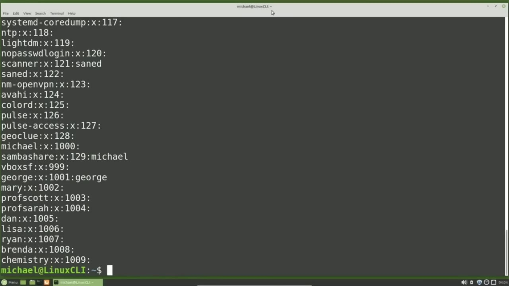
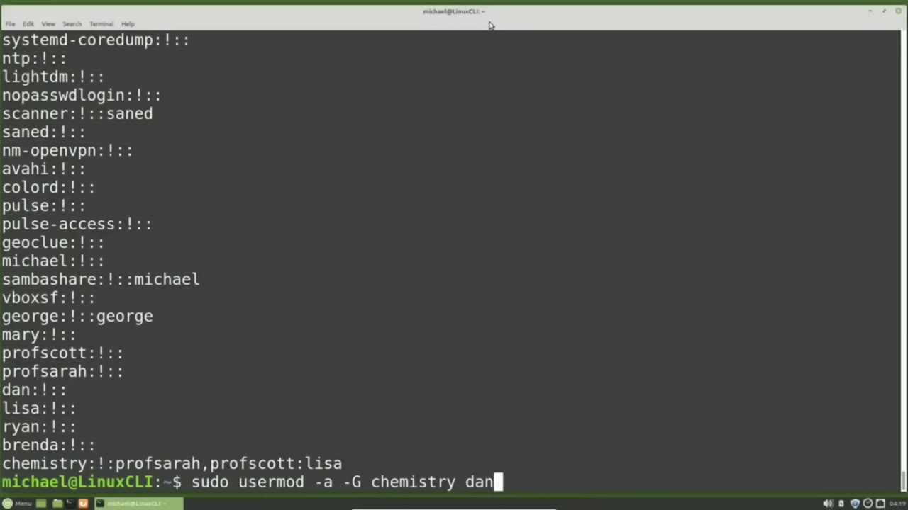

[← Course contents](../../01.md)

# 23. Groups pt1

**Course:** [Linux Command Line - Entire Tutorial Series](https://www.youtube.com/watch?v=avg65oY7sj4)  
**Transcript:** [`Linux Command Line - Entire Tutorial Series transcript`](../../../../course_videos/Linux%20Command%20Line%20-%20Entire%20Tutorial%20Series/Linux%20Command%20Line%20-%20Entire%20Tutorial%20Series.txt)  
**Video:** 03:07:14–03:16:27 ([open at this time](https://www.youtube.com/watch?v=avg65oY7sj4&t=11234s))

## Introduction

I have added six more non-privileged users to the system. Prof Scott, Prof. Sarah, Dan, Lisa, Ryan, and Brenda. I want to add a new group to this computer, but before I do, I want to see if the group exists. One way to see if a group exists is with the Get Ent command.

## Detailed Explanation

<details>
  <summary>Step 1 — Run `sudo`, `groupadd`, `sudo groupadd delete`</summary>

### Step 1 — Run `sudo`, `groupadd`, `sudo groupadd delete`

- [x] **I have added six more non-privileged users to the system**
  - I have added six more non-privileged users to the system.
  - Prof Scott, Prof. Sarah, Dan, Lisa, Ryan, and Brenda.
  - I want to add a new group to this computer, but before I do, I want to see if the group exists.

- [x] **Use `sudo`**
  - One way to see if a group exists is with the Get Ent command.
  - I will type Get Ent space, group, and then the group name.
  - I know that there's a group called `sudo`, so I will type in Get Ent Group `sudo`.

- [x] **Use `sudo`**
  - Here we see the group name `sudo`.
  - And the group information following it, separated by colones.
  - We see an X for the password, then the group number, then all of the user IDs of the members in this group, Michael and George.

- [x] **Use `groupadd`**
  - To see if the Team group exists, I will type Get Ent Group Team.
  - And we see nothing showing us that there is no group called Team.
  - I'm going to add my new group with the `groupadd` command.

- [x] **Use `sudo`**
  - And I must be a privileged user to add a group.
  - So I will type `sudo`, Group, Add, Team.
  - I'm going to add one more group, `sudo`, Group, Add, and I'm going to call this group, delete me.

- [x] **Use `sudo groupadd delete`**
  - To show the new group delete me was created, I will type Get Ent Group delete me and we see the group was created.
  - If I try to add a group that already exists, `sudo `groupadd` delete` Me.
  - I just get a warning message, so it's not a problem if we try to add a group a second time.

- [x] **Use `sudo`**
  - And again, we must be a privileged user to delete a group.
  - I will delete the Delete Me group with `sudo`, Group Deletele, Delete Me.
  - And we can show that with Get Ent Group Delete Me.

- [x] **And to make sure it's gone, I'm going to spell Delete Me correctly**
  - And to make sure it's gone, I'm going to spell Delete Me correctly.
  - Now I'm going to change the name of the group team I added earlier to Chemistry.

```bash
sudo
groupadd
sudo groupadd delete
```



</details>

<details>
  <summary>Step 2 — Run `which`, `usermod`</summary>

### Step 2 — Run `which`, `usermod`

- [x] **Use `which`, `usermod`**
  - This group is now going to be used for the chemistry department of the local university. To update a group name, I will use the group mod command, `which` stands for Group Modify. And it works the same way for groups as the `usermod` command works for users.
  - To check the help for Group Mod, I will type Group Mod.
  - And here what we want to do is change the name of the group so we can use the -n option or the -dash.

- [x] **New -name option. So I will type Soudou because we need to be a**
  - New -name option. So I will type Soudou because we need to be a privileged user to modify a group.
  - Then the group mod command. And now I want the option, `which` can be -n, or I can use the -dash new name. And then I need to give it the new group name, `which` we want to be chemistry.
  - And then we want to apply this all to the current group name of team.

- [x] **So we're going to give the new name chemistry to the group currently**
  - So we're going to give the new name chemistry to the group currently called team.
  - Linux groups are stored in the file /etc/group.
  - We can display the content of the /etc/group file with cat /etc/group.

- [x] **We do not need to be a privileged user to view the /etc/group file**
  - We do not need to be a privileged user to view the /etc/group file.
  - It's very similar to the /etc/passwd file that we looked at in an earlier video in this series.
  - Here we see our group chemistry at the bottom of the file.

- [x] **We see an X for the password, we didn't give it a password, then we**
  - We see an X for the password, we didn't give it a password, then we see the group number and if they had any group members we would see those group members listed right after that last colon.
  - Just like the /etc PastWD file has an /etc/shadow file.

```bash
which
usermod
```



</details>

<details>
  <summary>Step 3 — Run `sudo cat /etc`, `sudo gpasswd -A`, `gpasswd`</summary>

### Step 3 — Run `sudo cat /etc`, `sudo gpasswd -A`, `gpasswd`

- [x] **Use `sudo cat /etc`**
  - The /etc/group file has a shadow file called /etc G Shadow.
  - We need to be a privileged user to view the EtsyG Shadow file, just like we need to be a privileged user to view the /etc/shadow file.
  - So I'll view the EtsyG Shadow file with `sudo`, Cat, /etc, G, shadow.

- [x] **And we see the content of the G Shadow file**
  - And we see the content of the G Shadow file.
  - Looking at the Chemistry Group, it has the name Chemistry.
  - We did not give it a password, so the password shows as an exclamation point.

- [x] **Then we would see the group administrators, if there were any**
  - Then we would see the group administrators, if there were any.
  - And lastly, we would see the group members if there were any members in this group, which there are not yet.
  - I'm going to add some group administrators and some group members to the Chemistry Group.

- [x] **Use `sudo gpasswd -A`, `gpasswd`**
  - To add a group administrator, we can use the G-PassWD command.
  - `sudo `gpasswd` -A` Prof Scott Chemistry Here we have to use sud because we need to be a privileged user The command is `gpasswd` Then we've got the -uppercase A option Which means set the administrator list I want to set the administrator list to Prof Scott And then the group we want to do this for, which is the Chemistry Group.
  - Pressing Enter shows the standard Linux, no news is good news.

- [x] **And to show that Professor Scott has been added to the chemistry**
  - And to show that Professor Scott has been added to the chemistry group, I will type SudoCat at cg Shadow.
  - And we see Prof Scott there as a group administrator for the chemistry group.
  - Now we want to add Professor Sarah as an administrator on the chemistry group as well.

- [x] **Use `sudo`**
  - `sudo` G-Pess wd -uppercase A for group administrators and I will add Prof Sarah, Prof Scott, and then the group we want this for, which is chemistry.
  - So when we're using that -uppercase A option for administrators, we need to give it the complete list of group administrators every time.
  - And now we want to view the EtsyG Shadow File again.

- [x] **Use `sudo usermod -uppercase`**
  - And we see we now have two group administrators on the chemistry group.
  - As a Linux privileged user, I'm going to add Lisa to the chemistry group with `sudo usermod -uppercase` G for group.
  - And we want to add that group to the user.

- [x] **Use `sudo usermod -lowercase`**
  - Lisa. I'm hitting the arrow up two times to view the EtsyG shadow file again and we see Lisa was added as a member to the group chemistry. I'm going to add one more member to this group and that will be Dan.
  - To do that I will type `sudo usermod -lowercase` a uppercase G chemistry Dan.

```bash
sudo cat /etc
sudo gpasswd -A
gpasswd
sudo
sudo usermod -uppercase
sudo usermod -lowercase
```



</details>

<details>
  <summary>Step 4 — Run `sudo`, `usermod`</summary>

### Step 4 — Run `sudo`, `usermod`

- [x] **Use `sudo`, `usermod`**
  - We're using `sudo` because we need to be a privileged user.
  - `usermod` is a command.
  - The lowercase A means we want to append or add the uppercase G for group of chemistry.

- [x] **We have the chemistry going with the group**
  - We have the chemistry going with the group.
  - And we want to apply this all for the user id Dan.
  - When we added Lisa to the chemistry group, we did not use that -a to append the group.

- [x] **clear out all the members in the chemistry group and set it to a**
  - clear out all the members in the chemistry group and set it to a single user Lisa.
  - Now that we have Lisa in the group we need to append the group with Dan.
  - Otherwise it would reset it and only have Dan as a member.

- [x] **I'm pressing Enter and we just added Dan to the group chemistry**
  - I'm pressing Enter and we just added Dan to the group chemistry.
  - Pressing arrow up we will show what's in the G shadow file.
  - Now we see we've got two group administrators, Prof Sarah and Prof.

- [x] **And we also have two members in this Chemistry group, Lisa and Dan**
  - And we also have two members in this Chemistry group, Lisa and Dan.
  - In the next video we'll continue looking at the Linux command line groups.

```bash
sudo
usermod
```



</details>

<details>
  <summary>Questions and Answers</summary>

## Questions and Answers

### Question 1: What does `sudo` do in this chapter?

<details>
<summary>Answer</summary>

- [x] I know that there's a group called `sudo`, so I will type in Get Ent Group `sudo`.

</details>

### Question 2: What does `groupadd` do in this chapter?

<details>
<summary>Answer</summary>

- [x] I'm going to add my new group with the `groupadd` command.

</details>

### Question 3: What does `sudo groupadd delete` do in this chapter?

<details>
<summary>Answer</summary>

- [x] If I try to add a group that already exists, `sudo groupadd delete` Me.

</details>

### Question 4: What does `which` do in this chapter?

<details>
<summary>Answer</summary>

- [x] This group is now going to be used for the chemistry department of the local university. To update a group name, I will use the group mod command, `which` stands for Group Modify. And it works the same way for groups as the usermod command works for users.

</details>

### Question 5: What does `usermod` do in this chapter?

<details>
<summary>Answer</summary>

- [x] This group is now going to be used for the chemistry department of the local university. To update a group name, I will use the group mod command, which stands for Group Modify. And it works the same way for groups as the `usermod` command works for users.

</details>

### Question 6: What does `sudo cat /etc` do in this chapter?

<details>
<summary>Answer</summary>

- [x] So I'll view the EtsyG Shadow file with Sudo, Cat, /etc, G, shadow.

</details>

### Question 7: What does `sudo gpasswd -A` do in this chapter?

<details>
<summary>Answer</summary>

- [x] `sudo gpasswd -A` Prof Scott Chemistry Here we have to use sud because we need to be a privileged user The command is GpassWD Then we've got the -uppercase A option Which means set the administrator list I want to set the administrator list to Prof Scott And then the group we want to do this for, which is the Chemistry Group.

</details>

### Question 8: What does `gpasswd` do in this chapter?

<details>
<summary>Answer</summary>

- [x] sudo `gpasswd` -A Prof Scott Chemistry Here we have to use sud because we need to be a privileged user The command is `gpasswd` Then we've got the -uppercase A option Which means set the administrator list I want to set the administrator list to Prof Scott And then the group we want to do this for, which is the Chemistry Group.

</details>

### Question 9: What does `sudo usermod -uppercase` do in this chapter?

<details>
<summary>Answer</summary>

- [x] As a Linux privileged user, I'm going to add Lisa to the chemistry group with `sudo usermod -uppercase` G for group.

</details>

### Question 10: What does `sudo usermod -lowercase` do in this chapter?

<details>
<summary>Answer</summary>

- [x] To do that I will type `sudo usermod -lowercase` a uppercase G chemistry Dan.

</details>

</details>

## Summary

This chapter, Groups pt1, walks through Run sudo, groupadd, sudo groupadd delete; Run which, usermod; Run sudo cat /etc, sudo gpasswd -A, gpasswd; Run sudo, usermod. Commands from the transcript: `sudo`, `groupadd`, `sudo groupadd delete`, `which`, `usermod`, `sudo cat /etc`, `sudo gpasswd -A`, `gpasswd`, `sudo usermod -uppercase`, `sudo usermod -lowercase`.

## References

- [Linux Command Line - Entire Tutorial Series (YouTube)](https://www.youtube.com/watch?v=avg65oY7sj4)
- [This chapter at 03:07:14](https://www.youtube.com/watch?v=avg65oY7sj4&t=11234s)
- [Local transcript](../../../../course_videos/Linux%20Command%20Line%20-%20Entire%20Tutorial%20Series/Linux%20Command%20Line%20-%20Entire%20Tutorial%20Series.txt)
