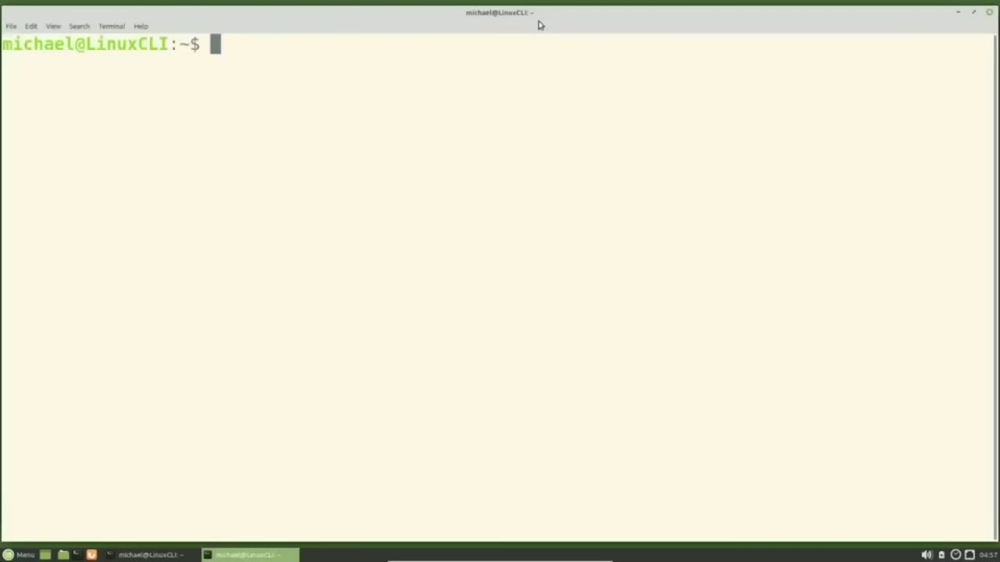
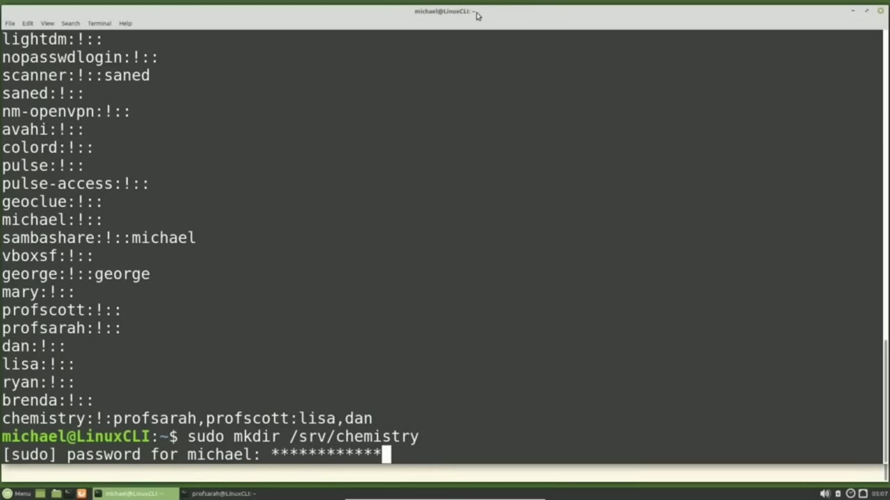
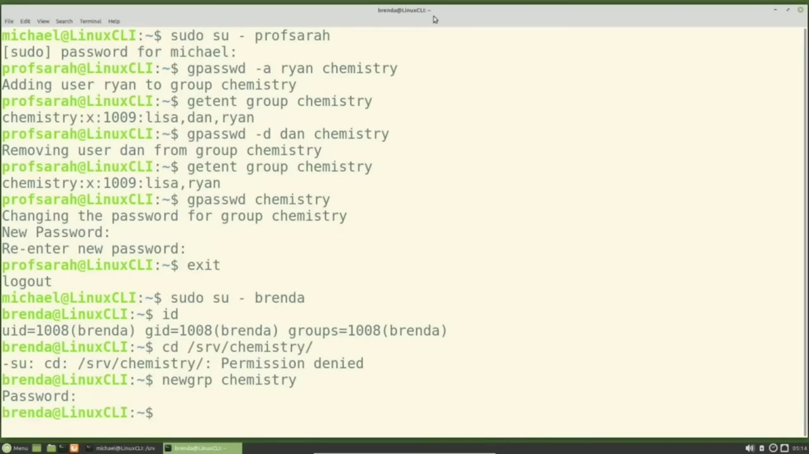
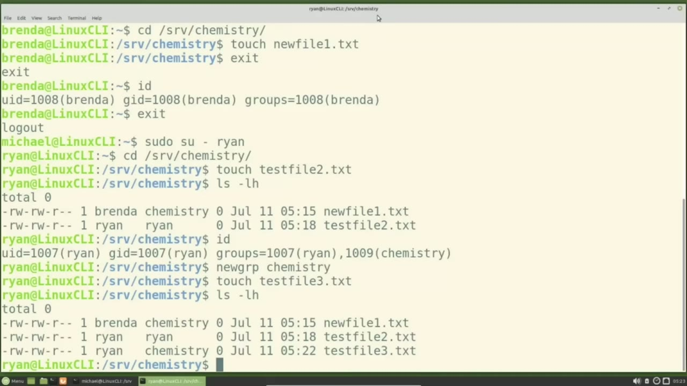

[← Course contents](../../01.md)

# 24. Groups pt2

**Course:** [Linux Command Line - Entire Tutorial Series](https://www.youtube.com/watch?v=avg65oY7sj4)  
**Transcript:** [`Linux Command Line - Entire Tutorial Series transcript`](../../../../course_videos/Linux%20Command%20Line%20-%20Entire%20Tutorial%20Series/Linux%20Command%20Line%20-%20Entire%20Tutorial%20Series.txt)  
**Video:** 03:16:27–03:26:46 ([open at this time](https://www.youtube.com/watch?v=avg65oY7sj4&t=11787s))

## Introduction

Picking up from where we left off in the last video, as a privileged user, we added two administrators to the Chemistry Group, Prof Scott and Prof. Sarah. And we added two members Lisa and Dan. To show what a group administrator can do, I'm going to open another terminal, File, Open terminal and make this the light theme. And I'm going to switch to Professor Sarah with Soudou su -u -prof As a group administrator, Professor Sarah can now add and remove user IDs from the Chemistry Group without needing to contact the it department to have a privileged useradd and remove user IDs from her group.

## Detailed Explanation

<details>
  <summary>Step 1 — Run `su -u -prof`, `useradd`</summary>

### Step 1 — Run `su -u -prof`, `useradd`

- [x] **Picking up from where we left off in the last video, as a privileged**
  - Picking up from where we left off in the last video, as a privileged user, we added two administrators to the Chemistry Group, Prof Scott and Prof.
  - Sarah. And we added two members Lisa and Dan.
  - To show what a group administrator can do, I'm going to open another terminal, File, Open terminal and make this the light theme.

- [x] **Use `su -u -prof`, `useradd`**
  - And I'm going to switch to Professor Sarah with Soudou `su -u -prof` As a group administrator, Professor Sarah can now add and remove user IDs from the Chemistry Group without needing to contact the it department to have a privileged `useradd` and remove user IDs from her group.
  - Prof Sarah can add Ryan to the Chemistry group by typing G past wd -A Ryan Chemistry The -lowercase A is the option for add a member Then we need to give it the user id of the member we're going to add which is Ryan And then we give the group to which we want this all to apply to which is chemistry
  - Pressing Enter We see that Ryan was added to the group Chemistry Profsera is not a privileged user, so she cannot see what is in the /etc G shadow file.

- [x] **But she can view who the users are in the chemistry group with Get**
  - But she can view who the users are in the chemistry group with Get Ent Group Chemistry.
  - And here we see that Ryan was added to the Chemistry Group.
  - Prof. Sarah can delete users from the Chemistry Group with G-PessWD-D for delete.

- [x] **So we're going to delete Dan from the Chemistry Group**
  - So we're going to delete Dan from the Chemistry Group.
  - We see that Dan was removed from the chemistry group.
  - And here we do the Get-Nt again to show that Dan was removed from the group chemistry.

- [x] **Administrative users can also set, reset, or remove a group password**
  - Administrative users can also set, reset, or remove a group password.
  - I'm going to set the password for the Chemistry Group as Professor Sarah.
  - By typing G, pass wd, and then the name of the group, Chemistry.

- [x] **We're asked for the new password, and I will type that again**
  - We're asked for the new password, and I will type that again.
  - And Prof. Sarah has just set a password for the Chemistry Group.
  - I want to create a directory for the Chemistry Group, but Prof. Sarah is not a privileged user.

- [x] **She is only an administrator for the Chemistry Group**
  - She is only an administrator for the Chemistry Group.
  - So I will switch back to the other terminal where I am logged in as privileged user Michael.
  - And I will create the new directory with sudo-Makder srv Chemistry.

```bash
su -u -prof
useradd
```



</details>

<details>
  <summary>Step 2 — Run `ls -lh`, `sudo chgrp chemistry`, `ls`</summary>

### Step 2 — Run `ls -lh`, `sudo chgrp chemistry`, `ls`

- [x] **Use `ls -lh`, `sudo chgrp chemistry`**
  - I've made the new directory and I'm going to cd into the srv directory and type `ls -lh` so we can see the new chemistry directory file permissions and ownership.
  - I'm going to change the group for this new directory to be the chemistry group with Sudo, chgrp, chemistry, chemistry.
  - To change the group to chemistry for the directory chemistry.

- [x] **Use `ls -lh`, `ls`**
  - And typing `ls -lh`, we see that the group was changed to chemistry.
  - I also want to change the permissions of the Chemistry directory, so I will type Sudo-chmod -770 Chemistry.
  - And I'll show that update with the `ls` command.

- [x] **And here we see the root user has full access**
  - And here we see the root user has full access.
  - Anyone in the chemistry group has full access and there is no access for anyone who is not the root user and not in the chemistry group.
  - I'm going over to the other terminal again and I'm going to exit out of Prof Sarah by typing exit.

- [x] **Use `sudo su -Brenda`, `id`**
  - And now I'm going to switch to the user `id` Brenda by typing `sudo su -Brenda`.
  - And she is not a member of the chemistry group.
  - I will show this by typing `id`, and we see that Brenda has the GID or group `id` of Brenda.

- [x] **As Brenda, I will try to cd to change directory into the chemistry**
  - As Brenda, I will try to cd to change directory into the chemistry directory with cd, srv, chemistry, and we see she gets permissions denied.
  - But if Professor Sarah, who set the password for the chemistry group, gives that password to Brenda, Brenda can temporarily be a member of the chemistry group by typing new grp for new group chemistry.
  - Now she's asked for that chemistry password. She can type that in.

```bash
ls -lh
sudo chgrp chemistry
ls
sudo su -Brenda
id
```



</details>

<details>
  <summary>Step 3 — Run `id`, `touch`, `su -su -ryan`</summary>

### Step 3 — Run `id`, `touch`, `su -su -ryan`

- [x] **Use `id`, `touch`**
  - And now when I type `id`, we see that Brenda has the group `id` of chemistry.
  - And she now has read, write, and execute privileges for anything in that directory.
  - As Brenda, I will type `touch` New File 1.t.TXT.

- [x] **Use `id`**
  - Brenda will continue being a member of the Chemistry Group until she either new groups back to Brenda types Exit to Exit out of the Chemistry Group or logs out.
  - I will type Exit to exit Brenda out of the chemistry group.
  - Typing `id` shows once again Brenda has the GID of Brenda.

- [x] **Use `su -su -ryan`**
  - And typing exit again takes us out of the Brenda user `id` and I'm back to the Michael user `id`.
  - Now I'm going to switch to the Ryan user `id` with soud `su -su -ryan`.
  - Ryan is a member of the chemistry group.

- [x] **Use `touch test`, `ls -lh`**
  - As Ryan, I'm going to cd into the srv Chemistry Directory.
  - I will add a text file in this directory with `touch test` file 2.TXT.
  - Now typing `ls -lh` to see the files in this directory.

- [x] **We see that Brenda created her file with a group of chemistry**
  - We see that Brenda created her file with a group of chemistry.
  - But the file Ryan created has a user and a group of Ryan.
  - And looking at the file permissions, only Ryan can read and write to this file.

- [x] **Use `id`**
  - There may be times when he wants to do that, but most often he is going to want to collaborate with the other group members in this group.
  - Typing `id` shows us Ryan has a user `id` of Ryan and a group `id` of Ryan.
  - But he can temporarily change that group `id` to be chemistry the same way Brenda did by typing new grp Chemistry.

- [x] **Use `ls -lh`**
  - Now Ryan will create a file and we will list those out with `ls -lh`.
  - This shows that Ryan's new file has a group permission of chemistry, but Ryan may want to change the group for his test file 2.tXT file.

```bash
id
touch
su -su -ryan
touch test
ls -lh
```



</details>

<details>
  <summary>Step 4 — Run `ls -lh`, `sudo usermod -lowercase`, `usermod`</summary>

### Step 4 — Run `ls -lh`, `sudo usermod -lowercase`, `usermod`

- [x] **Use `ls -lh`**
  - He can change the group with Chone, colon, chemistry, test file 2.tXT, `ls -lh` to show that it's updated.
  - And now all the files have the group of chemistry.
  - Ryan's group `id` will stay that way until Ryan exits out of the chemistry group or until he logs off.

- [x] **I will type exit and his group id is back to the Ryan Group id**
  - I will type exit and his group `id` is back to the Ryan Group `id`.
  - Ryan only uses this login for the Chemistry Group and he wants to permanently change his group `id` to be the Chemistry Group `id`.
  - To do that, we need to contact a privileged user.

- [x] **Use `sudo usermod -lowercase`**
  - Only a privileged user can update the group `id`.
  - And to update Ryan's group `id`, I will type `sudo `usermod` -lowercase` G to set the group `id`.
  - Then the group `id` I want to set this to, which is Chemistry.

- [x] **Use `usermod`**
  - And then the user `id` I want this all to apply to, which is Ryan.
  - In the last video, we used the `usermod` with the uppercase G, which removed all the group members and set the group to have a single group member of Lisa.
  - Then we added member Dan with an uppercase G option, but we also had to use the lowercase A with the uppercase G to add or append Dan as a group member.

- [x] **And if we didn't have the -a, it would have taken out Lisa and made**
  - And if we didn't have the -a, it would have taken out Lisa and made the group members only Dan.
  - In this case, we just want to update the group `id`, so we use the lowercase G, and then the group that we want to change it to, and then the user `id` we want to apply it to.
  - Pressing Enter. That was updated, and we can show that with `id` Ryan.

- [x] **Use `id`**
  - Now we see that his GID or group `id` is chemistry.
  - And how I remember which G to use and when to use the -lowercase A option is.
  - When we type `id`, we see the lowercase G right there for G `id`.

- [x] **And we never use the lowercase with a lowercase**
  - And we never use the lowercase with a lowercase.
  - So the lowercase A will never go with a lowercase G.
  - And we almost always want to use it with the uppercase G.

- [x] **In the next video, we'll look at more permissions for the Linux**
  - In the next video, we'll look at more permissions for the Linux command line.
  - In this video, we're going to look at the Set UID flag.

```bash
ls -lh
sudo usermod -lowercase
usermod
id
```



</details>

<details>
  <summary>Questions and Answers</summary>

## Questions and Answers

### Question 1: What does `su -u -prof` do in this chapter?

<details>
<summary>Answer</summary>

- [x] And I'm going to switch to Professor Sarah with Soudou `su -u -prof` As a group administrator, Professor Sarah can now add and remove user IDs from the Chemistry Group without needing to contact the it department to have a privileged useradd and remove user IDs from her group.

</details>

### Question 2: What does `useradd` do in this chapter?

<details>
<summary>Answer</summary>

- [x] And I'm going to switch to Professor Sarah with Soudou su -u -prof As a group administrator, Professor Sarah can now add and remove user IDs from the Chemistry Group without needing to contact the it department to have a privileged `useradd` and remove user IDs from her group.

</details>

### Question 3: What does `ls -lh` do in this chapter?

<details>
<summary>Answer</summary>

- [x] I've made the new directory and I'm going to cd into the srv directory and type `ls -lh` so we can see the new chemistry directory file permissions and ownership.

</details>

### Question 4: What does `sudo chgrp chemistry` do in this chapter?

<details>
<summary>Answer</summary>

- [x] I'm going to change the group for this new directory to be the chemistry group with Sudo, chgrp, chemistry, chemistry.

</details>

### Question 5: What does `ls` do in this chapter?

<details>
<summary>Answer</summary>

- [x] And I'll show that update with the `ls` command.

</details>

### Question 6: What does `sudo su -Brenda` do in this chapter?

<details>
<summary>Answer</summary>

- [x] And now I'm going to switch to the user id Brenda by typing `sudo su -Brenda`.

</details>

### Question 7: What does `id` do in this chapter?

<details>
<summary>Answer</summary>

- [x] I will show this by typing `id`, and we see that Brenda has the GID or group `id` of Brenda.

</details>

### Question 8: What does `touch` do in this chapter?

<details>
<summary>Answer</summary>

- [x] As Brenda, I will type `touch` New File 1.t.TXT.

</details>

### Question 9: What does `su -su -ryan` do in this chapter?

<details>
<summary>Answer</summary>

- [x] Now I'm going to switch to the Ryan user id with soud `su -su -ryan`.

</details>

### Question 10: What does `touch test` do in this chapter?

<details>
<summary>Answer</summary>

- [x] I will add a text file in this directory with `touch test` file 2.TXT.

</details>

### Question 11: What does `sudo usermod -lowercase` do in this chapter?

<details>
<summary>Answer</summary>

- [x] And to update Ryan's group id, I will type `sudo usermod -lowercase` G to set the group id.

</details>

### Question 12: What does `usermod` do in this chapter?

<details>
<summary>Answer</summary>

- [x] In the last video, we used the `usermod` with the uppercase G, which removed all the group members and set the group to have a single group member of Lisa.

</details>

</details>

## Summary

This chapter, Groups pt2, walks through Run su -u -prof, useradd; Run ls -lh, sudo chgrp chemistry, ls; Run id, touch, su -su -ryan; Run ls -lh, sudo usermod -lowercase, usermod. Commands from the transcript: `su -u -prof`, `useradd`, `ls -lh`, `sudo chgrp chemistry`, `ls`, `sudo su -Brenda`, `id`, `touch`, `su -su -ryan`, `touch test`, `sudo usermod -lowercase`, `usermod`.

## References

- [Linux Command Line - Entire Tutorial Series (YouTube)](https://www.youtube.com/watch?v=avg65oY7sj4)
- [This chapter at 03:16:27](https://www.youtube.com/watch?v=avg65oY7sj4&t=11787s)
- [Local transcript](../../../../course_videos/Linux%20Command%20Line%20-%20Entire%20Tutorial%20Series/Linux%20Command%20Line%20-%20Entire%20Tutorial%20Series.txt)
