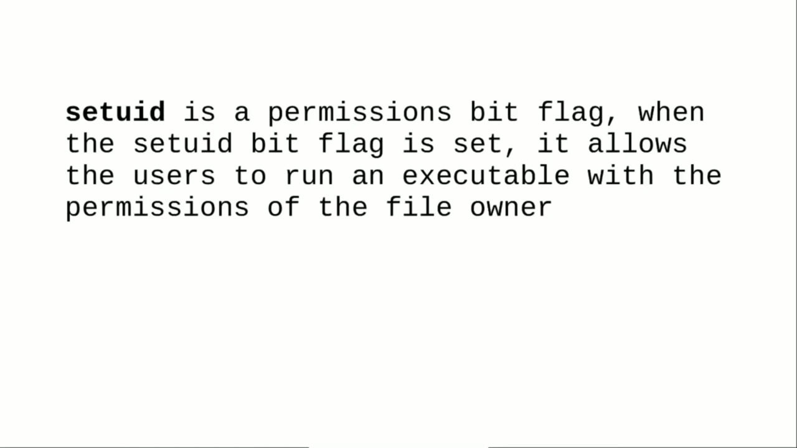
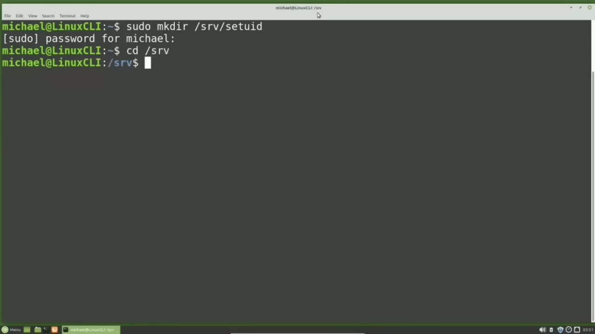
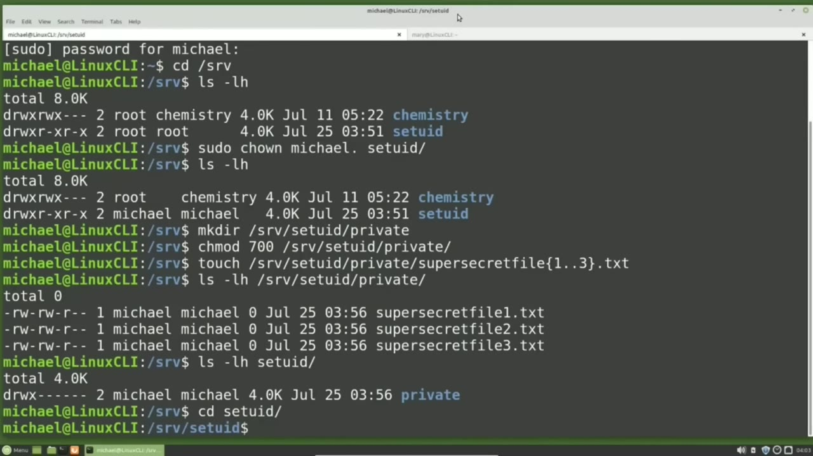
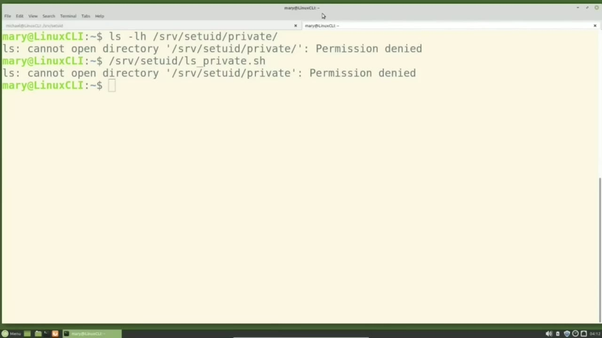
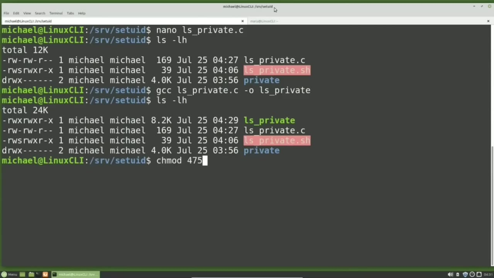

[← Course contents](../../01.md)

# 25. setuid

**Course:** [Linux Command Line - Entire Tutorial Series](https://www.youtube.com/watch?v=avg65oY7sj4)  
**Transcript:** [`Linux Command Line - Entire Tutorial Series transcript`](../../../../course_videos/Linux%20Command%20Line%20-%20Entire%20Tutorial%20Series/Linux%20Command%20Line%20-%20Entire%20Tutorial%20Series.txt)  
**Video:** 03:26:46–03:40:35 ([open at this time](https://www.youtube.com/watch?v=avg65oY7sj4&t=12406s))

## Introduction

Looking up what the Set UID flag does, we'll find a definition similar to this. When the Set UID bit flag is set, it allows the users to run an executable with the permissions of the file owner. And then the most common example people use to explain Set UID is the PassWD command. Every user on the system can update their password with the PassWD command.

## Detailed Explanation

<details>
  <summary>Step 1 — Run `passwd`, `which`, `w -d`</summary>

### Step 1 — Run `passwd`, `which`, `w -d`

- [x] **Use `passwd`**
  - Looking up what the Set UID flag does, we'll find a definition similar to this.
  - When the Set UID bit flag is set, it allows the users to run an executable with the permissions of the file owner.
  - And then the most common example people use to explain Set UID is the `passwd` command.

- [x] **Use `passwd`, `which`**
  - Every user on the system can update their password with the `passwd` command.
  - The passwords are stored in the /etc/shadow file, a file owned by the root user, so when the standard user runs the `passwd` command, they run that command as the Root user, `which` allows them to update their password in the /etc/shadow file.
  - To find out what files being executed when I type `passwd`, I'm going to type `which` `passwd`.

- [x] **Use `w -d`**
  - And Linux tells us we're executing the file /usr slash b-i-n slash past wd.
  - So when I type past `w -d`, I'm really saying go to the /usr-S-BIN directory and run past wd from there.
  - To see the permissions of the past `w -d` file, I will type L-S-L-H-U-S-R-BIN past `w -d`.

- [x] **Here we see an S where we usually see an X or a hyphen for the owner**
  - Here we see an S where we usually see an X or a hyphen for the owner execute permission.
  - That S is showing us the Set UID bit is set for the file, user, bin, pass wd.
  - The owner of that file is root, so when anyone on the computer executes that file, it is executed as the root user.

- [x] **Running this file as the root user allows a standard user to update**
  - Running this file as the root user allows a standard user to update their password in the /etc/shadow file.
  - A file that only root and privileged users have access to.
  - Now that we know the basics of how set UID works, let's try and create our own executable file.

- [x] **Use `sudo`**
  - I'm going to clear the screen and I'm going to make a new directory for our set UID test.
  - `sudo` make dirsrv set UID.
  - Now I'm going into the srv directory with cd.

```bash
passwd
which
w -d
sudo
```



</details>

<details>
  <summary>Step 2 — Run `ls -lh`, `sudo`, `touch srv`</summary>

### Step 2 — Run `ls -lh`, `sudo`, `touch srv`

- [x] **Use `ls -lh`, `sudo`**
  - Srv and showing it was created with `ls -lh`.
  - We see that the owner in the group are now root.
  - I'm going to change them both to Michael with `sudo` Chon Michael.

- [x] **And now we see the owner in the group are both Michael**
  - And now we see the owner in the group are both Michael.
  - And the permissions show Michael has full permissions and everyone else has read and execute permissions for this new Set UID directory.
  - Inside the new directory, I'm going to create a directory called Private with...

- [x] **Use `touch srv`**
  - I'll set the directory permissions to be 700, so only the owner of Michael has access to that new directory.
  - And I want to put some super secret files in this new private directory.
  - I will add them with touch, srv.

- [x] **Use `ls -lhlhs -rv`, `ls -lh`**
  - Set UID, Private, Super Secret files, 1.3.3.T.T.
  - And now, because I'm the Michael user, I can see what is in that private directory with `ls -lhlhs -rv`, Set UID Private.
  - And typing `ls -lh`, Set UID, shows us the owner and the group are set to Michael and that only the owner has access to this directory.

- [x] **Use `ls srv`**
  - I'm going to open a new terminal tab with the light theme that was created early on in this video tutorial series.
  - And in this tab, I'm going to switch to the Mary user with S-U-Hyth-Mary.
  - And now as Mary, I'm going to try to read the directory with an `ls srv` set UID private.

- [x] **And we see that Mary does not have permissions, which is what we**
  - And we see that Mary does not have permissions, which is what we expect.
  - The plan now is to create an executable file to read the private directory and turn on the set UID bit so Mary or anyone on the system can run that file and view what is in the private directory.
  - I'm going back over to where I'm logged in as Michael.

```bash
ls -lh
sudo
touch srv
ls -lhlhs -rv
ls srv
```



</details>

<details>
  <summary>Step 3 — Run `nano`, `bash`, `ls -lh`</summary>

### Step 3 — Run `nano`, `bash`, `ls -lh`

- [x] **Use `nano`, `bash`**
  - And I'm going into the Set UID directory with cd.
  - Now I'm going to use `nano` to write a short script in the Set UID directory that will read the private directory that only Michael has privileges to read.
  - This is not a tutorial on `bash` scripting, so explanations will be minimal.

- [x] **Use `bash`, `ls -lh`**
  - This is a `bash` script, so I'm ending my file name with.sh.
  - And every `bash` script starts with hashtag exclamation point or bang, which is often referred to as Shebang /bin `bash`.
  - And then our `bash` script will have a single line of `ls -lh` srv set UID private.

- [x] **Use `ls -lh`, `bash`**
  - which will just list out the content in the private directory.
  - So I'm just pressing Enter and typing `ls -lh` to show the new `bash` script was created.
  - Now we want to enable the Set UID flag for this file.

- [x] **Use `usermod`, `chmod`, `ls private.s.s`**
  - And we can do that with the `usermod` command.
  - I will type `chmod`.
  - U plus S, ls, private.S.S.

- [x] **Use `ls -lh`**
  - And the U plus S is setting the set UID flag for the user.
  - Let's take a look at that with `ls -lh`.
  - And we notice the S in our permissions doesn't look quite right.

- [x] **When we looked at the past wd file permissions, we saw it as a**
  - When we looked at the past wd file permissions, we saw it as a lowercase S.
  - The uppercase s means the set UID flag is set, but the file is not set as an executable file.
  - We can fix this with Chamod plus X, LSPrivate.sh.

- [x] **Use `ls -lh`**
  - Now when I type `ls -lh`, we see that lowercase S and everything looks correct.
  - Let's try out the executable with the Michael user.
  - To run an executable in the same directory, I can type dot slash and then the file name of LSPrivate. s.h. And we see that it runs.

- [x] **Or I can give it the full path name of slash srv set UID**
  - Or I can give it the full path name of slash srv set UID LSPrivate.S.Private.S.
  - And we see that runs as well. Now let's switch over to Mary and see if she can run this as the Michael user.
  - And we see she gets a permissions denied.

```bash
nano
bash
ls -lh
usermod
chmod
ls private.s.s
```



</details>

<details>
  <summary>Step 4 — Run `bash`, `passwd`, `nano -l-Sprivate.c`</summary>

### Step 4 — Run `bash`, `passwd`, `nano -l-Sprivate.c`

- [x] **Use `bash`, `passwd`**
  - The set UID is not working for a `bash` script file.
  - Going back over to the terminal where I'm logged in as Michael.
  - Let's take another look at that `passwd` file.

- [x] **Use `passwd`, `bash`**
  - I will cap out that file with Cat, User, Bin, `passwd`.
  - And we see a lot of special characters, which tells us this is not a `bash` script, but a compiled program.
  - I'm going to clear the screen with Clear.

- [x] **Use `nano -l-Sprivate.c`, `ls -lh`**
  - To make this script into a compiled program, I'm going to create a new file with `nano -l-Sprivate.c`.
  - This new file is going to be a C program that we're going to compile.
  - But the only line we're really concerned with is a line where we do the `ls -lh` for our directory forward slash srv slash set UID slash private.

- [x] **Use `ls -lh`**
  - That's the same line that was in our one-line script.
  - I'm going to exit out with Ctrl+X, Y to save the modified buffer, and enter to save the name as it is.
  - I'm typing `ls -lh` to show that file was created.

- [x] **Use `ls underscore`, `ls -lh`**
  - And to do that, I'm going to type gcc `ls underscore` private.c And then we give it the output file name that we want for our compiled C program, which is `ls underscore` private.
  - Pressing Enter, we see it compiled with no problems.
  - Typing `ls -lh` shows that it was created, but we still need to enable that set UID flag.

- [x] **This time I'm going to set it with the Octo method**
  - This time I'm going to set it with the Octo method.
  - Normally when we use the Octal method to set a file or directory's permissions, We'll only see three digits. We're actually using four digits every time, but that first digit is a zero.
  - So 0755 and 755 are the same thing. They both mean no special permissions, just the regular file permissions.

- [x] **To set the Set UID flag with the Octal method, I'm going to change**
  - To set the Set UID flag with the Octal method, I'm going to change that first position from a zero to a four.

```bash
bash
passwd
nano -l-Sprivate.c
ls -lh
ls underscore
```



</details>

<details>
  <summary>Step 5 — Run `ls private`, `ls -lh`, `ls underscore`</summary>

### Step 5 — Run `ls private`, `ls -lh`, `ls underscore`

- [x] **Use `ls private`, `ls -lh`**
  - 4755 `ls private` and pressing Enter.
  - Now typing `ls -lh` shows us the user is Michael and the Set UID flag is set.
  - So if this works as described at the beginning of this video, when someone runs this command, they will run it as the user Michael and be able to view the contents of that private directory.

- [x] **Use `ls private`, `ls underscore`**
  - First, I will run this as the user Michael with the full path.
  - Srv, set UID, `ls private`.
  - Srv set UID `ls underscore` private.

- [x] **And she still gets a permissions denied**
  - And she still gets a permissions denied.
  - This still does not work, but we have one more thing that we can do to try and make this work.
  - And that is to change the file owner to be root.

- [x] **Use `ls private`, `sudo`, `ls underscore`**
  - Let's go back over to the other terminal tab.
  - To change the owner of the `ls private` file, I will need to be a privileged user.
  - So I will start with `sudo` chon root dot `ls underscore` private.

- [x] **Use `ls -lh`, `sudo chmod 4755 ls underscore`**
  - Doing the `ls -lh` now.
  - Shows the file owner and group are now root, but we lost the set UID.
  - I need to set that again with `sudo chmod 4755 ls underscore` private.

- [x] **Use `ls -lh`**
  - Typing `ls -lh` to make sure that was set.
  - We see the S for the user executable bit.
  - So let's try it as Michael slash srv set UID.

- [x] **Use `ls underscore`**
  - `ls underscore` private still working there. Now let's try this as Mera.
  - So now we can update our set UID definition, at least for an Ubuntu-based Linux Mint mate operating system to be set UID is a permissions bit flag.
  - When the set UID bit flag is set, it allows the users to run a compiled executable with the permissions of the file owner, and the file owner must be root.

- [x] **In the next video we'll continue looking at special permissions for**
  - In the next video we'll continue looking at special permissions for the Linux command line.
  - In this video we're going to look at enabling the Set GID flag and the Sticky Bit.

```bash
ls private
ls -lh
ls underscore
sudo
sudo chmod 4755 ls underscore
```



</details>

<details>
  <summary>Questions and Answers</summary>

## Questions and Answers

### Question 1: What does `passwd` do in this chapter?

<details>
<summary>Answer</summary>

- [x] And then the most common example people use to explain Set UID is the `passwd` command.

</details>

### Question 2: What does `which` do in this chapter?

<details>
<summary>Answer</summary>

- [x] To find out what files being executed when I type PassWD, I'm going to type `which` PassWD.

</details>

### Question 3: What does `w -d` do in this chapter?

<details>
<summary>Answer</summary>

- [x] So when I type past `w -d`, I'm really saying go to the /usr-S-BIN directory and run past wd from there.

</details>

### Question 4: What does `sudo` do in this chapter?

<details>
<summary>Answer</summary>

- [x] `sudo` make dirsrv set UID.

</details>

### Question 5: What does `ls -lh` do in this chapter?

<details>
<summary>Answer</summary>

- [x] Srv and showing it was created with `ls -lh`.

</details>

### Question 6: What does `touch srv` do in this chapter?

<details>
<summary>Answer</summary>

- [x] I will add them with touch, srv.

</details>

### Question 7: What does `ls -lhlhs -rv` do in this chapter?

<details>
<summary>Answer</summary>

- [x] And now, because I'm the Michael user, I can see what is in that private directory with `ls -lhlhs -rv`, Set UID Private.

</details>

### Question 8: What does `ls srv` do in this chapter?

<details>
<summary>Answer</summary>

- [x] And now as Mary, I'm going to try to read the directory with an `ls srv` set UID private.

</details>

### Question 9: What does `nano` do in this chapter?

<details>
<summary>Answer</summary>

- [x] Now I'm going to use `nano` to write a short script in the Set UID directory that will read the private directory that only Michael has privileges to read.

</details>

### Question 10: What does `bash` do in this chapter?

<details>
<summary>Answer</summary>

- [x] This is not a tutorial on `bash` scripting, so explanations will be minimal.

</details>

### Question 11: What does `usermod` do in this chapter?

<details>
<summary>Answer</summary>

- [x] And we can do that with the `usermod` command.

</details>

### Question 12: What does `chmod` do in this chapter?

<details>
<summary>Answer</summary>

- [x] I will type `chmod`.

</details>

</details>

## Summary

This chapter, setuid, walks through Run passwd, which, w -d; Run ls -lh, sudo, touch srv; Run nano, bash, ls -lh; Run bash, passwd, nano -l-Sprivate.c; Run ls private, ls -lh, ls underscore. Commands from the transcript: `passwd`, `which`, `w -d`, `sudo`, `ls -lh`, `touch srv`, `ls -lhlhs -rv`, `ls srv`, `nano`, `bash`, `usermod`, `chmod`, `ls private.s.s`, `nano -l-Sprivate.c`.

## References

- [Linux Command Line - Entire Tutorial Series (YouTube)](https://www.youtube.com/watch?v=avg65oY7sj4)
- [This chapter at 03:26:46](https://www.youtube.com/watch?v=avg65oY7sj4&t=12406s)
- [Local transcript](../../../../course_videos/Linux%20Command%20Line%20-%20Entire%20Tutorial%20Series/Linux%20Command%20Line%20-%20Entire%20Tutorial%20Series.txt)
