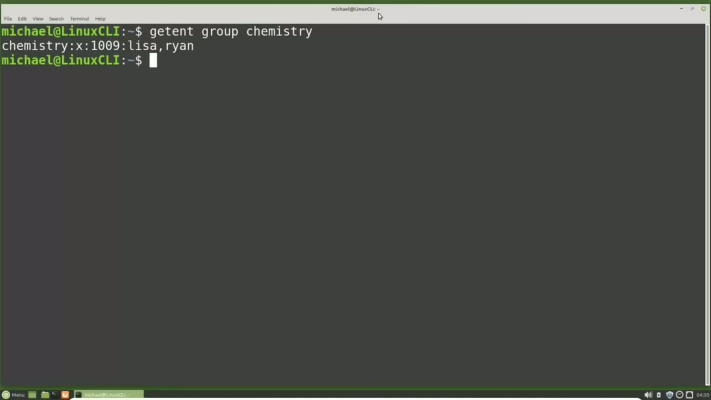
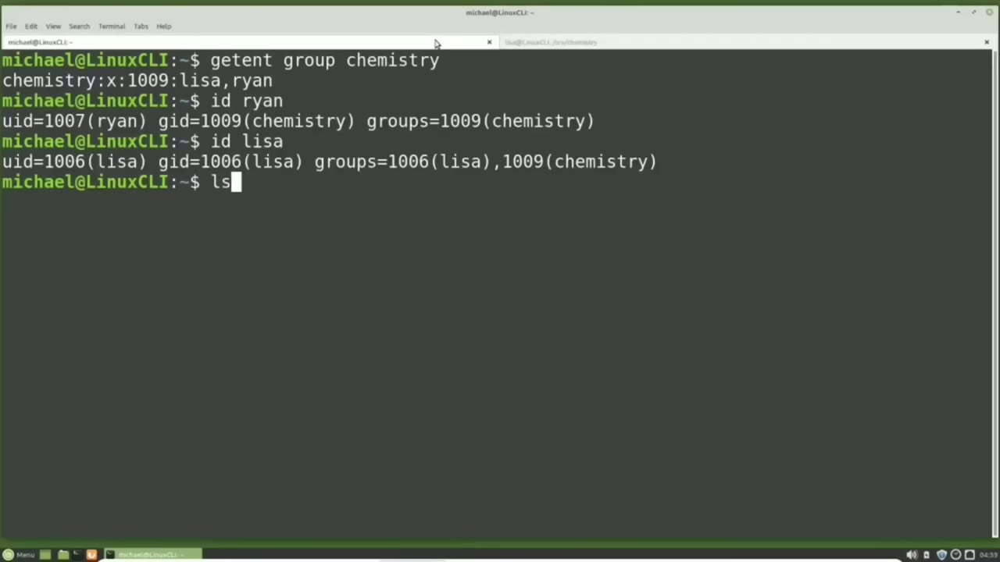
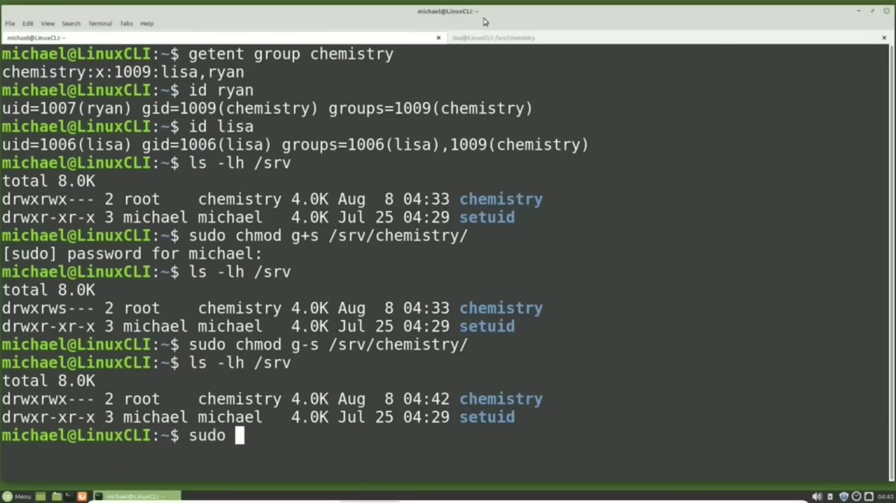
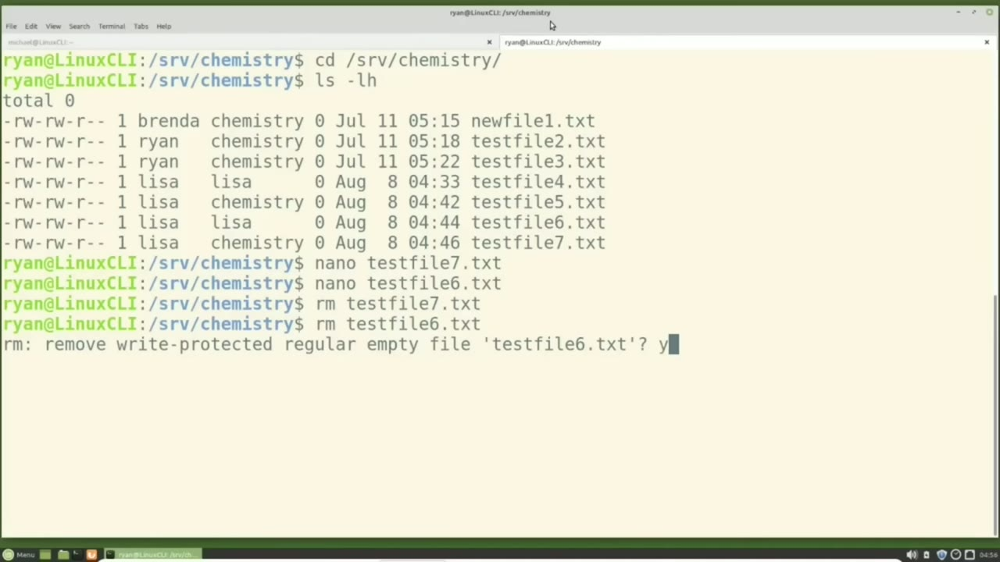

[← Course contents](../../01.md)

# 26. setgid and sticky bit

**Course:** [Linux Command Line - Entire Tutorial Series](https://www.youtube.com/watch?v=avg65oY7sj4)  
**Transcript:** [`Linux Command Line - Entire Tutorial Series transcript`](../../../../course_videos/Linux%20Command%20Line%20-%20Entire%20Tutorial%20Series/Linux%20Command%20Line%20-%20Entire%20Tutorial%20Series.txt)  
**Video:** 03:40:35–03:51:52 ([open at this time](https://www.youtube.com/watch?v=avg65oY7sj4&t=13235s))

## Introduction

And to see how this works, we're going to use the Chemistry Group directory that we created in an earlier video in this tutorial series. To see what users we have in the Chemistry Group, I'm going to type... We updated Ryan's GID to be chemistry, and we can see that when we type id Ryan. I will type id Lisa to show that Lisa still has her original group of Lisa.

## Detailed Explanation

<details>
  <summary>Step 1 — Run `id`, `ls -lh`</summary>

### Step 1 — Run `id`, `ls -lh`

- [x] **Use `id`**
  - And to see how this works, we're going to use the Chemistry Group directory that we created in an earlier video in this tutorial series.
  - To see what users we have in the Chemistry Group, I'm going to type...
  - We updated Ryan's GID to be chemistry, and we can see that when we type `id` Ryan.

- [x] **Use `id`**
  - I will type `id` Lisa to show that Lisa still has her original group of Lisa.
  - I'm going to open a new terminal tab with the light colored theme that we created back at the beginning of this tutorial series.
  - I'm going to switch to the user Lisa with SOUSU-S-U-Lisa.

- [x] **Use `ls -lh`**
  - Lisa is a member of the Chemistry Group so she can cd into the slash SRV-chemistry directory Test file 4.T.
  - Typing `ls -lh` We see that Lisa has the same problem that Ryan had.
  - When Lisa creates a file, it sets her group `id` as the new files group `id`.

- [x] **To get around this problem, Ryan changed his group id to be chemistry**
  - To get around this problem, Ryan changed his group `id` to be chemistry.
  - And Brenda used the new grp command to temporarily change her group `id` to be chemistry.
  - We don't want to make all the Chemistry group members update their GID or make them new grp before making any files in the Chemistry directory.

- [x] **Because we need to be a privileged user to set the GID flag, I'm**
  - Because we need to be a privileged user to set the GID flag, I'm going back over to the Terminal tab where I'm logged in as Michael.

```bash
id
ls -lh
```



</details>

<details>
  <summary>Step 2 — Run `ls -lh -srv`, `sudo chmod g`, `ls -lh`</summary>

### Step 2 — Run `ls -lh -srv`, `sudo chmod g`, `ls -lh`

- [x] **Use `ls -lh -srv`, `sudo chmod g`, `ls -lh`**
  - I'm going to type `ls -lh -srv` to show the Chemistry Directory User owner and group have read, write, and execute permissions, while other has no permissions at all.
  - To enable the set GID flag for the Chemistry Group, I'm going to type `sudo chmod g` plus S slash srv slash chemistry.
  - And to show the permissions were updated, I will type `ls -lh` slash srv.

- [x] **Use `touch test`**
  - And we see we have enabled the set GID bit because we see the lowercase S in place of the group execute bit.
  - Now let's switch over to the terminal tab where Lisa is signed in and I will create a file with `touch test` File 5.T.T.L.S.L.H.
  - And we see when Lisa creates a file now in the Chemistry Directory the group id is set to Chemistry.

- [x] **Use `ls -lh`**
  - So here we see that enabling the set GID flag for a directory will give new files created in that directory the group of that directory.
  - To disable the set GID I will need to switch back to the Michael user.
  - And we can disable that set GID flag with S S slash srv slash chemistry and then typing `ls -lh` slash srv shows the set GID flag has been disabled.

- [x] **Use `touch test`, `ls -lh`**
  - Going over to the other tab and typing `touch test` file 6.TXT and then `ls -lh`.
  - We see the new file was created with the group of Lisa.
  - Going back over to the terminal where I'm logged in as Michael.

- [x] **I'm going to enable the set GID flag again, but this time I'm going**
  - I'm going to enable the set GID flag again, but this time I'm going to use the Octal permissions.
  - This is similar to what we saw in the last video, where we added the number 4 before the 770 for set UID.
  - For the set GID, we're going to add the number 2.

```bash
ls -lh -srv
sudo chmod g
ls -lh
touch test
```



</details>

<details>
  <summary>Step 3 — Run `sudo chmod 2`, `touch test`, `ls -lh`</summary>

### Step 3 — Run `sudo chmod 2`, `touch test`, `ls -lh`

- [x] **Use `sudo chmod 2`, `touch test`, `ls -lh`**
  - So I will type `sudo chmod 2`.
  - Switching over to the other tab, the Lisa user will create another file with Touch, test file 7.TXT, and `ls -lh` shows us the new file has the group of chemistry.
  - Going back to the terminal tab where I'm logged in as Michael, I'm going to clear the screen.

- [x] **Now we're going to look at how the sticky bit works**
  - Now we're going to look at how the sticky bit works.
  - When people talk about the sticky bit, the explanation usually starts with the /tmp directory.
  - The /tmp directory is a place where temporary files are stored.

- [x] **Use `reboot`, `ls -lh`**
  - These files will be deleted after 10 days or on the next system `reboot`, whichever comes first.
  - I'm going to type `ls -lh` forward slash so we can see the /tmp file permissions.
  - The thing to notice here, is the file execute permissions for other. We see a lowercase T instead of the lowercase X that lets us know the sticky bit is enabled.

- [x] **Use `sudo`**
  - We are going to use the chemistry directory, which we already have set up, to show how this sticky bit works.
  - I'm going over to the other tab where I'm logged in as Lisa and I'm going to log out of Lisa with exit.
  - And now I'm going to log in as Ryan with `sudo`.

- [x] **Use `su -Ryan`, `ls -lh`, `nano test`**
  - `su -Ryan`. I'm going to clear the screen and cd into the srv Chemistry directory.
  - Typing `ls -lh`. We see the four files that were just created by Lisa, two files with the group of Lisa and two with a group of chemistry.
  - I'm going to type `nano test` file 7.t.t.com. txt and Ryan can edit this file.

- [x] **And now Ryan will attempt to edit test file 6 with nano test file**
  - And now Ryan will attempt to edit test file 6 with `nano test` file 6.t.com.
  - Is unwriteable. Holding down control and pressing x to exit out.
  - Now Ryan is going to try and delete test file 7 with rm.

- [x] **Test file 7.T and that gets removed without a problem**
  - Test file 7.T and that gets removed without a problem.
  - He's now going to try and remove test file 6.t.
  - He gets a message here asking him to confirm that he wants to remove test file 6.

- [x] **Txt, a file that he does not have access to edit**
  - Txt, a file that he does not have access to edit.

```bash
sudo chmod 2
touch test
ls -lh
reboot
sudo
su -Ryan
nano test
```



</details>

<details>
  <summary>Step 4 — Run `yes`, `ls -lh`, `sudo chmod`</summary>

### Step 4 — Run `yes`, `ls -lh`, `sudo chmod`

- [x] **Use `yes`, `ls -lh`**
  - Ryan will type `yes`, press enter and typing `ls -lh` shows that both test file 7 and test file 6 which he has no access to edit were both deleted.
  - I'm going back over to the other terminal tab where I'm logged in as Michael.
  - I'm going to clear the screen and check the permissions of the chemistry group with `ls -lh` slash srv and now we want to set the sticky bit for the chemistry directory.

- [x] **Use `sudo chmod`**
  - To do that I will type `sudo chmod` plus T. The O is for other. The T is for sticky bit. And we want to do that for the srv Chemistry Directory. And because there's only one T, we don't need that. Oh, I can say Chmad plus T to add the sticky bit to the slash srv chemistry directory.
  - Pressing Enter. We have set the sticky bit. I'm going over to the other terminal tab.
  - And now Ryan will try and remove the test file 4.txt file that has a group of Lisa.

- [x] **Asking to confirm that he wants to remove that file**
  - Asking to confirm that he wants to remove that file.
  - He does not have permissions to remove that file.
  - Either. Now Ryan's going to try and remove test file 3.TXT. Ryan is the user owner of that file.

- [x] **Use `ls -lh`**
  - Pressing Enter, typing `ls -lh` shows Ryan was able to remove a file that he was the user owner of.
  - And that goes for every user in this directory.
  - So the sticky bit works with the remove command and when that is set, the user owner can only remove their own files.

- [x] **Use `ls -lh`**
  - One last thing we need to do is go back over to the other terminal tab and type `ls -lh` slash srv.
  - And we see an uppercase T for the sticky bit because other does not have execute access for this file.
  - It is an uppercase T which is what we want.

- [x] **Use `sudo chmod -T`**
  - To remove this sticky bit, I will type `sudo chmod -T`, and it could be O -T slash srv chemistry.
  - I do want to enable a sticky bit again, and this time using the octal method.
  - And with that, the sticky bit is going to be a value of 1.

- [x] **Remember in the last video, we enabled the set UID**
  - Remember in the last video, we enabled the set UID.
  - With a value of 4. Then earlier in this video, we enabled the set GID with a value of 2.
  - And when we have no special permissions, we have the value of 0.

- [x] **So now we have the sticky bit that will have a value of 1**
  - So now we have the sticky bit that will have a value of 1.
  - But we also want to enable the set GID flag.
  - So we will want to add the 1 and the 2 together.

- [x] **Use `sudo chmod 3-770`, `ls -lh`**
  - `sudo chmod 3-770` slash srv slash Chemistry. One is for the sticky bit, two is for the GID bit, and when we add them together we get the three.
  - Now typing `ls -lh` slash srv shows us the sticky bit is enabled once again.
  - In the next video, we will continue to look at more Linux advanced file permissions.

```bash
yes
ls -lh
sudo chmod
sudo chmod -T
sudo chmod 3-770
```



</details>

<details>
  <summary>Questions and Answers</summary>

## Questions and Answers

### Question 1: What does `id` do in this chapter?

<details>
<summary>Answer</summary>

- [x] We updated Ryan's GID to be chemistry, and we can see that when we type `id` Ryan.

</details>

### Question 2: What does `ls -lh` do in this chapter?

<details>
<summary>Answer</summary>

- [x] Typing `ls -lh` We see that Lisa has the same problem that Ryan had.

</details>

### Question 3: What does `ls -lh -srv` do in this chapter?

<details>
<summary>Answer</summary>

- [x] I'm going to type `ls -lh -srv` to show the Chemistry Directory User owner and group have read, write, and execute permissions, while other has no permissions at all.

</details>

### Question 4: What does `sudo chmod g` do in this chapter?

<details>
<summary>Answer</summary>

- [x] To enable the set GID flag for the Chemistry Group, I'm going to type `sudo chmod g` plus S slash srv slash chemistry.

</details>

### Question 5: What does `touch test` do in this chapter?

<details>
<summary>Answer</summary>

- [x] Now let's switch over to the terminal tab where Lisa is signed in and I will create a file with `touch test` File 5.T.T.L.S.L.H.

</details>

### Question 6: What does `sudo chmod 2` do in this chapter?

<details>
<summary>Answer</summary>

- [x] So I will type `sudo chmod 2`.

</details>

### Question 7: What does `reboot` do in this chapter?

<details>
<summary>Answer</summary>

- [x] These files will be deleted after 10 days or on the next system `reboot`, whichever comes first.

</details>

### Question 8: What does `sudo` do in this chapter?

<details>
<summary>Answer</summary>

- [x] And now I'm going to log in as Ryan with `sudo`.

</details>

### Question 9: What does `su -Ryan` do in this chapter?

<details>
<summary>Answer</summary>

- [x] `su -Ryan`. I'm going to clear the screen and cd into the srv Chemistry directory.

</details>

### Question 10: What does `nano test` do in this chapter?

<details>
<summary>Answer</summary>

- [x] I'm going to type `nano test` file 7.t.t.com. txt and Ryan can edit this file.

</details>

### Question 11: What does `yes` do in this chapter?

<details>
<summary>Answer</summary>

- [x] Ryan will type `yes`, press enter and typing ls -lh shows that both test file 7 and test file 6 which he has no access to edit were both deleted.

</details>

### Question 12: What does `sudo chmod` do in this chapter?

<details>
<summary>Answer</summary>

- [x] To do that I will type `sudo chmod` plus T. The O is for other. The T is for sticky bit. And we want to do that for the srv Chemistry Directory. And because there's only one T, we don't need that. Oh, I can say Chmad plus T to add the sticky bit to the slash srv chemistry directory.

</details>

</details>

## Summary

This chapter, setgid and sticky bit, walks through Run id, ls -lh; Run ls -lh -srv, sudo chmod g, ls -lh; Run sudo chmod 2, touch test, ls -lh; Run yes, ls -lh, sudo chmod. Commands from the transcript: `id`, `ls -lh`, `ls -lh -srv`, `sudo chmod g`, `touch test`, `sudo chmod 2`, `reboot`, `sudo`, `su -Ryan`, `nano test`, `yes`, `sudo chmod`, `sudo chmod -T`, `sudo chmod 3-770`.

## References

- [Linux Command Line - Entire Tutorial Series (YouTube)](https://www.youtube.com/watch?v=avg65oY7sj4)
- [This chapter at 03:40:35](https://www.youtube.com/watch?v=avg65oY7sj4&t=13235s)
- [Local transcript](../../../../course_videos/Linux%20Command%20Line%20-%20Entire%20Tutorial%20Series/Linux%20Command%20Line%20-%20Entire%20Tutorial%20Series.txt)
