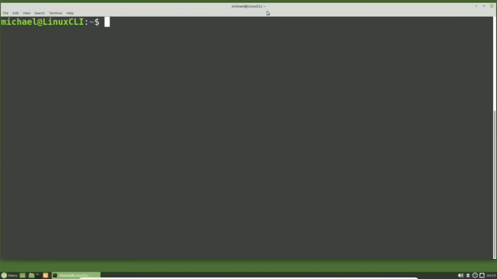
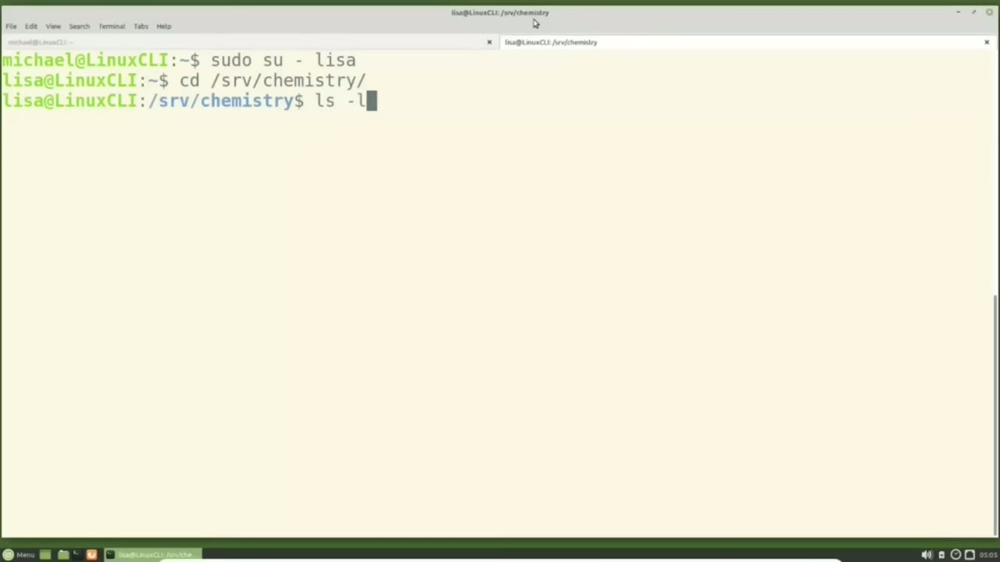
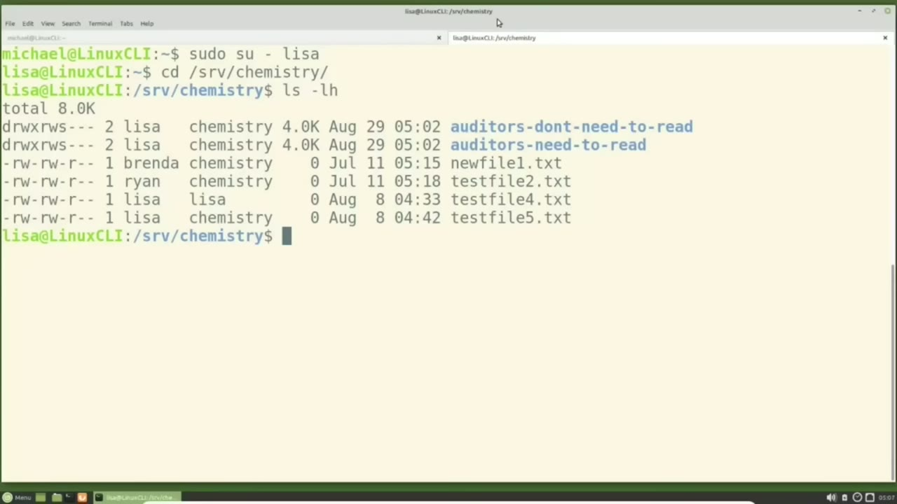
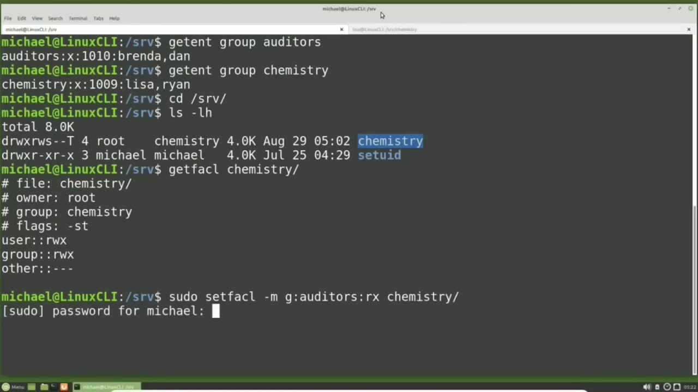
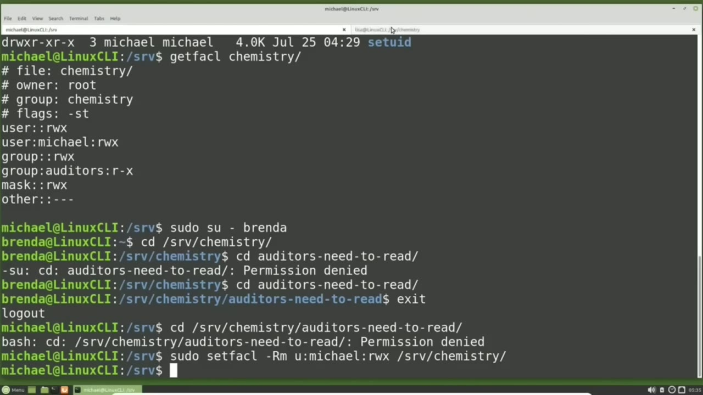

[← Course contents](../../01.md)

# 27. ACLs pt1

**Course:** [Linux Command Line - Entire Tutorial Series](https://www.youtube.com/watch?v=avg65oY7sj4)  
**Transcript:** [`Linux Command Line - Entire Tutorial Series transcript`](../../../../course_videos/Linux%20Command%20Line%20-%20Entire%20Tutorial%20Series/Linux%20Command%20Line%20-%20Entire%20Tutorial%20Series.txt)  
**Video:** 03:51:52–04:02:59 ([open at this time](https://www.youtube.com/watch?v=avg65oY7sj4&t=13912s))

## Introduction

I have added a group called Auditors and I've added Brenda and Dan as members in the Auditors group. We'll see that by typing get and group auditors. And we still have Lisa and Ryan as members in the Chemistry group. We'll see that with Get Ent Group Chemistry.

## Detailed Explanation

<details>
  <summary>Step 1 — Run `ls -lh`</summary>

### Step 1 — Run `ls -lh`

- [x] **I have added a group called Auditors and I've added Brenda and Dan as**
  - I have added a group called Auditors and I've added Brenda and Dan as members in the Auditors group.
  - We'll see that by typing get and group auditors.
  - And we still have Lisa and Ryan as members in the Chemistry group.

- [x] **We'll see that with Get Ent Group Chemistry**
  - We'll see that with Get Ent Group Chemistry.
  - I'm going to open a new light tab as we've done in the previous tutorials.
  - I'm going to switch over to the Lisa user with SOU-S-U-Hifin Lisa.

- [x] **Use `ls -lh`**
  - And Lisa will go into the Chemistry directory with cd srv Chemistry.
  - Typing `ls -lh`.
  - We see that Lisa has added two new sub-directories in the Chemistry directory.

- [x] **One called Auditors Need to Read, and the other called Auditors Don't**
  - One called Auditors Need to Read, and the other called Auditors Don't Need to Read.
  - The problem we have now is we want everyone in the Chemistry group to have edit permissions for...
  - The Chemistry Directory and every directory in the Chemistry Directory.

- [x] **But we also want to give the Auditors Group Read Only access to the**
  - But we also want to give the Auditors Group Read Only access to the Chemistry Directory and then Read Only access to the Auditors Need to Read Directory.
  - With the file permissions we've looked at up to now, we can't do this because we need one group to have Edit permissions and another group to have Read Only permissions for that same directory.

```bash
ls -lh
```





</details>

<details>
  <summary>Step 2 — Run `file`, `ls -lh`, `sudo`</summary>

### Step 2 — Run `file`, `ls -lh`, `sudo`

- [x] **Use `file`**
  - To give two groups different permissions for the same `file` or directory, we are going to use `file` ACL permissions.
  - Access Control List is a feature that may be turned off by default in some versions of Linux and may not work at all in other versions of Linux.
  - Also, some of the older `file` backup programs may not recognize ACL `file` permissions.

- [x] **So it is possible to restore a file from a backup and have it lose**
  - So it is possible to restore a `file` from a backup and have it lose the access control list permissions.
  - The Access Control List feature is turned on by default on my version of Linux Mint.
  - I'm going back over to the other tab where I'm logged in as Michael.

- [x] **Use `ls -lh`**
  - And I'm going to cd into the srv directory and type `ls -lh`.
  - Currently, we don't have any ACL `file` permissions on either directory.
  - I can tell that because files and directories with ACL permissions will have a plus sign to the right of the permissions.

- [x] **Use `ls -lh`**
  - We can see `file` in directory ACL permissions with the command, get facl, which is short for Get `file` Access Control List.
  - And the `file` or directory that we want to see the `file` access control list permissions.
  - And the result of this command shows us the same permissions that we see with the `ls -lh` command.

- [x] **We see the file name is Chemistry, the owner of root group of**
  - We see the `file` name is Chemistry, the owner of root group of chemistry, and we see the set.
  - Then we see the user and group both have read, write, and execute permissions, and other has no permissions at all.
  - Now I'm going to add ACL permissions for the Auditors Group to give them read and execute permissions for the Chemistry Directory.

- [x] **Use `sudo`, `setfacl`**
  - The Chemistry Directory is owned by root, so we need to start the command with `sudo`.
  - Then the command itself, which is `setfacl`, which is short for Set `file` Access Control List or Set `file` ACL.
  - Then what I want to do is modify the ACL, so I'm using the -M option.

- [x] **And I want to modify the group so I will put a G next then a colon in**
  - And I want to modify the group so I will put a G next then a colon in the group name which is auditors then another colon and the permissions that I want to give it which are our X for read and execute then a space and the `file` or directory name I want to apply this for which is

```bash
file
ls -lh
sudo
setfacl
```



</details>

<details>
  <summary>Step 3 — Run `ls -lh`, `sudo`</summary>

### Step 3 — Run `ls -lh`, `sudo`

- [x] **Use `ls -lh`**
  - Chemistry pressing enter the new file ACLs are set I'm going to clear the screen and type `ls -lh`.
  - And now we see that plus sign after the file permissions that I was telling you about earlier, showing that this directory now has added ACL permissions.
  - To see what ACL permissions are set, we'll use that get facal command again.

- [x] **Get File ACL for the Chemistry directory**
  - Get File ACL for the Chemistry directory.
  - We now see a group auditors r-x showing the auditor's group has read and write access.
  - We're just going to note the mask settings are rwx and we're going to talk more about the mask in the next video.

- [x] **Use `sudo`**
  - I'm going to set the file ACL permissions for a user for the Chemistry Directory and this is done just like setting the ACLs for a group permission.
  - To a U for user. So once again I'll start with `sudo`, then set facl for Set File ACL, -M for Modify, then the U for user and we will change them for user Michael.
  - I'll give Michael rwx for srv Chemistry.

- [x] **Use `ls -lh`**
  - Pressing Enter, then typing `ls -lh` Doesn't change anything we see the plus sign that we saw before, but no other changes than that.
  - This shows we added one more row to the permissions.
  - We see we've added user Michael to have read, write, and execute permissions for the chemistry directory.

- [x] **I'm switching over to the Brenda user with SOUD-S-U-Hyphen Brenda**
  - I'm switching over to the Brenda user with SOUD-S-U-Hyphen Brenda.
  - Remember, Brenda is a member of the Auditors Group.

```bash
ls -lh
sudo
```



</details>

<details>
  <summary>Step 4 — Run `ls -lh`, `touch auditors`, `touch`</summary>

### Step 4 — Run `ls -lh`, `touch auditors`, `touch`

- [x] **Brenda is going to cd into the srv Chemistry Directory**
  - Brenda is going to cd into the srv Chemistry Directory.
  - And now she's going to try to cd into the Auditors Need to Read Directory.
  - I'm switching over to the other terminal tab where I'm logged in as Lisa.

- [x] **And Lisa can change the file permissions for the Auditors Need to**
  - And Lisa can change the file permissions for the Auditors Need to Read Directory.
  - Because she is the directory user owner.
  - Lisa will type Set facl for Set File ACL.

- [x] **She wants to modify for the group Auditors and she wants to give them**
  - She wants to modify for the group Auditors and she wants to give them read execute permission for the Auditors Need to Read Directory.
  - Switching back over to the other tab, Brenda will try to cd into the Auditors Need to Read Directory.
  - And now she gets in without any problem.

- [x] **And as Michael, I'm going to try to cd into the srv Chemistry**
  - And as Michael, I'm going to try to cd into the srv Chemistry Auditors Need to Read Directory.
  - When I gave myself permissions for the srv Chemistry directory, I did not include all the files and sub-directories.
  - And I'm going to add an uppercase R right before the M for Modify.

- [x] **Use `ls -lh`**
  - So I will set the file ACLs recursively, meaning for all the files and directories in the chemistry directory right now for Michael to have read, write, and execute permissions.
  - Pressing Enter, the Michael Login id now has read, write, and execute permissions for every file that is in the chemistry directory right now.
  - Switching back over to the other tab and typing `ls -lh` and I forgot the space, so I will do that again, typing `ls -lh`.

- [x] **Use `touch auditors`, `touch`**
  - We see plus signs next to every file and directory.
  - So when they all have the ACL permissions we just set for user Michael.
  - Lisa is now going to add a new file and directory in the Auditors Need to Read Directory with `touch auditors` Need to Read and she will `touch` File 1.TXT and she's going to make the directory. Auditors need to read.

- [x] **Use `ls -lh`**
  - The ir 1. Listing out the content for the Auditors Need to Read with `ls -lh`.
  - Auditors Need to Read shows we have no plus signs next to the permissions.
  - So no ACL permissions have been added. The reason the Michael user does not have any ACL permissions is because the command we ran gave Michael read, write, and execute privileges for every file in the Chemistry directory at that time.

- [x] **And after that, we added these files, so they were not included when**
  - And after that, we added these files, so they were not included when we ran that command.
  - The Auditors Group was given Read and Execute permissions for the Auditors can read directory, but we would like to give the Auditors' permission to the Auditors Need to read directory and every new file in directory created in the Auditors Need to Read Directory.
  - This can be done by setting the ACL default permissions for the Auditors Need to Read Directory.

- [x] **Use `touch`**
  - Lisa is going to update the ACL permissions for the Auditors Need to Read Directory with Setfackle -D for default and then we'll do the modify and then we will add the G for group auditors for the group that we want to modify then the rx for read execute the permissions we want to give the auditors and we want this all for the
  - Auditors need to read directory pressing enter Lisa will now add a new file in directory with make directory to and `touch` file to and once again she will l s -lh the auditors need to read And we see that directory 2 and file 2 both have ACL permissions added to them, showing the default permissions worked as expected.
  - We'll continue looking at Linux ACL permissions in the next video.

```bash
ls -lh
touch auditors
touch
```



</details>

<details>
  <summary>Questions and Answers</summary>

## Questions and Answers

### Question 1: What does `ls -lh` do in this chapter?

<details>
<summary>Answer</summary>

- [x] Typing `ls -lh`.

</details>

### Question 2: What does `file` do in this chapter?

<details>
<summary>Answer</summary>

- [x] To give two groups different permissions for the same `file` or directory, we are going to use `file` ACL permissions.

</details>

### Question 3: What does `sudo` do in this chapter?

<details>
<summary>Answer</summary>

- [x] The Chemistry Directory is owned by root, so we need to start the command with `sudo`.

</details>

### Question 4: What does `setfacl` do in this chapter?

<details>
<summary>Answer</summary>

- [x] Then the command itself, which is `setfacl`, which is short for Set File Access Control List or Set File ACL.

</details>

### Question 5: What does `touch auditors` do in this chapter?

<details>
<summary>Answer</summary>

- [x] Lisa is now going to add a new file and directory in the Auditors Need to Read Directory with `touch auditors` Need to Read and she will touch File 1.TXT and she's going to make the directory. Auditors need to read.

</details>

### Question 6: What does `touch` do in this chapter?

<details>
<summary>Answer</summary>

- [x] Lisa is now going to add a new file and directory in the Auditors Need to Read Directory with `touch` Auditors Need to Read and she will `touch` File 1.TXT and she's going to make the directory. Auditors need to read.

</details>

### Question 7: What does step 1 cover (Run ls -lh)?

<details>
<summary>Answer</summary>

- [x] I have added a group called Auditors and I've added Brenda and Dan as members in the Auditors group.
- [x] We'll see that by typing get and group auditors.
- [x] And we still have Lisa and Ryan as members in the Chemistry group.

</details>

### Question 8: What does step 2 cover (Run file, ls -lh, sudo)?

<details>
<summary>Answer</summary>

- [x] To give two groups different permissions for the same `file` or directory, we are going to use `file` ACL permissions.
- [x] Access Control List is a feature that may be turned off by default in some versions of Linux and may not work at all in other versions of Linux.
- [x] Also, some of the older `file` backup programs may not recognize ACL `file` permissions.

</details>

### Question 9: What does step 3 cover (Run ls -lh, sudo)?

<details>
<summary>Answer</summary>

- [x] Chemistry pressing enter the new file ACLs are set I'm going to clear the screen and type `ls -lh`.
- [x] And now we see that plus sign after the file permissions that I was telling you about earlier, showing that this directory now has added ACL permissions.
- [x] To see what ACL permissions are set, we'll use that get facal command again.

</details>

### Question 10: What does step 4 cover (Run ls -lh, touch auditors, touch)?

<details>
<summary>Answer</summary>

- [x] Brenda is going to cd into the srv Chemistry Directory.
- [x] And now she's going to try to cd into the Auditors Need to Read Directory.
- [x] I'm switching over to the other terminal tab where I'm logged in as Lisa.

</details>

</details>

## Summary

This chapter, ACLs pt1, walks through Run ls -lh; Run file, ls -lh, sudo; Run ls -lh, sudo; Run ls -lh, touch auditors, touch. Commands from the transcript: `ls -lh`, `file`, `sudo`, `setfacl`, `touch auditors`, `touch`.

## References

- [Linux Command Line - Entire Tutorial Series (YouTube)](https://www.youtube.com/watch?v=avg65oY7sj4)
- [This chapter at 03:51:52](https://www.youtube.com/watch?v=avg65oY7sj4&t=13912s)
- [Local transcript](../../../../course_videos/Linux%20Command%20Line%20-%20Entire%20Tutorial%20Series/Linux%20Command%20Line%20-%20Entire%20Tutorial%20Series.txt)
