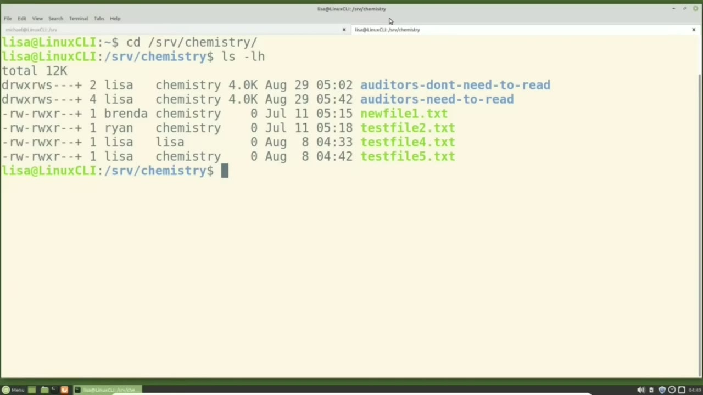
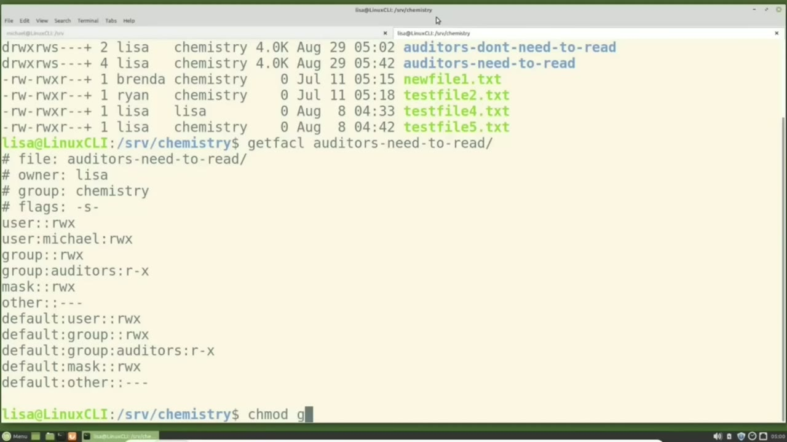
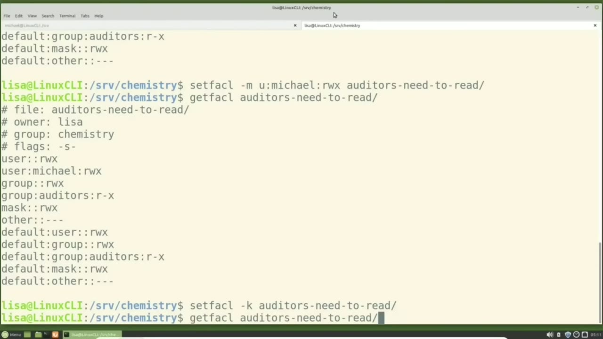
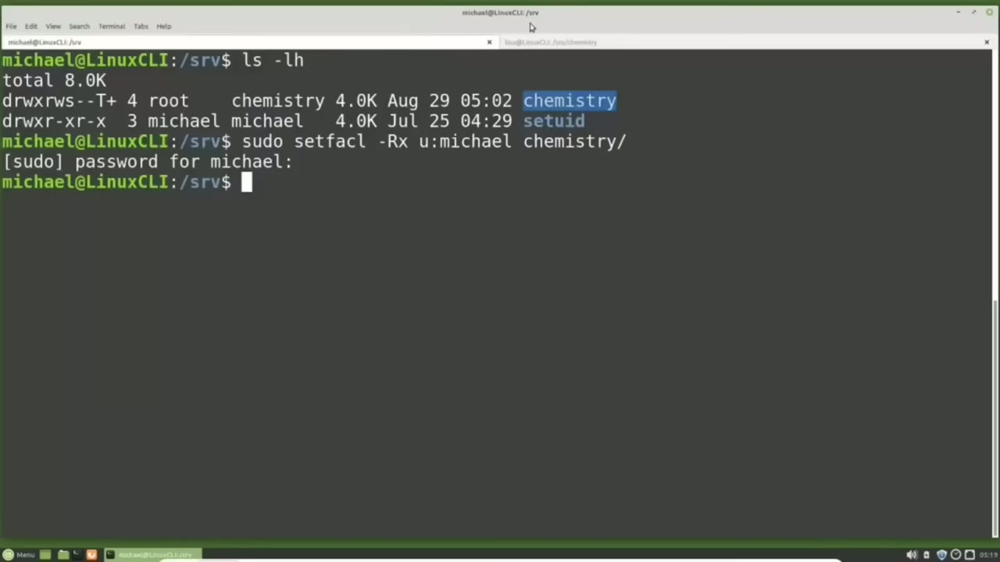

[← Course contents](../../01.md)

# 28. ACLs pt2

**Course:** [Linux Command Line - Entire Tutorial Series](https://www.youtube.com/watch?v=avg65oY7sj4)  
**Transcript:** [`Linux Command Line - Entire Tutorial Series transcript`](../../../../course_videos/Linux%20Command%20Line%20-%20Entire%20Tutorial%20Series/Linux%20Command%20Line%20-%20Entire%20Tutorial%20Series.txt)  
**Video:** 04:02:59–04:11:22 ([open at this time](https://www.youtube.com/watch?v=avg65oY7sj4&t=14579s))

## Introduction

Picking up from where we left off in the last video, we're in the chemistry directory and we are signed in as Lisa. Lisa will now look at the file ACL permissions for the auditors need to read directory with Auditors need to read. This shows us the permissions that we set in the last video. Starting at the top, we see the file name, owner and group, and then we see the set GID flag is enabled. Then we see the two users. The first one is the permissions for the owner Lisa.

## Detailed Explanation

<details>
  <summary>Step 1 — Picking up from where we left off in the last video, we're in the</summary>

### Step 1 — Picking up from where we left off in the last video, we're in the

- [x] **Picking up from where we left off in the last video, we're in the**
  - Picking up from where we left off in the last video, we're in the chemistry directory and we are signed in as Lisa.
  - Lisa will now look at the file ACL permissions for the auditors need to read directory with Auditors need to read. This shows us the permissions that we set in the last video.
  - Starting at the top, we see the file name, owner and group, and then we see the set GID flag is enabled.

- [x] **Then we see the two users. The first one is the permissions for the**
  - Then we see the two users. The first one is the permissions for the owner Lisa.
  - The second one is the file ACL permissions for Michael that we gave in the last video.
  - We're going to talk about the mask in just a moment.

- [x] **Let's finish talking about the rest of this list first**
  - Let's finish talking about the rest of this list first.
  - Below that we see Other, which is for everyone that is not the file user owner and not in the group, and we see there are no permissions for them.
  - Then we have the default permissions and we set these up at the end of the last video.

- [x] **These permissions will be applied to every file and directory created**
  - These permissions will be applied to every file and directory created in the Auditors Need to Read Directory.
  - And the thing to note about this is the auditors will get read and execute permissions for every file and directory created in that directory.
  - The ACL mask is a way to limit the permissions of the file ACLs without changing the user or group ACL permissions.

- [x] **We're used to see in a mask that looks like this**
  - We're used to see in a mask that looks like this.
  - It masks the face and allows the person wearing the mask to see.
  - And if this clip art had eyes, you could see that better.

- [x] **Our file ACL mask is going to have three holes in it**
  - Our file ACL mask is going to have three holes in it.
  - One for read, one for write, and one for execute.
  - If we cover up or mask the write and execute permissions, the users and groups with ACL permissions can now only read the file.

- [x] **Even if they have write and execute permissions because the write and**
  - Even if they have write and execute permissions because the write and execute permissions are now hidden behind the mask Lisa can change the mask permissions by updating the file permissions for that group For example Lisa will change the permissions and take away the group write and execute permissions with



</details>

<details>
  <summary>Step 2 — Run `chmod g`</summary>

### Step 2 — Run `chmod g`

- [x] **Use `chmod g`**
  - `chmod g` for group -wx for write and execute for the Auditors Need to Read directory. Now typing Get facl. Auditors need to read.
  - We see our mask has changed to R--dash, giving only read access to our mask.
  - Looking at the Michael user, Michael still has read, write, and execute permissions, but the mask only allows the read permission to be seen.

- [x] **Over on the right, we see the effective permission is set to read**
  - Over on the right, we see the effective permission is set to read.
  - Meaning the Michael user was given read, write, and execute permissions, but the write and execute permissions are unavailable because the mask is hiding them.
  - So the effective permissions for the Michael user is read only.

- [x] **Lisa is going to change the group file permissions for this directory**
  - Lisa is going to change the group file permissions for this directory and take away the read permissions and add execute permissions with the command.
  - G for group, -R to take away the read permissions, and plus X to add execute permissions for the auditors need to read directory.
  - Pressing the arrow up twice to get back the getfackle.

- [x] **Now we see the mask is updated to execute only and the effective**
  - Now we see the mask is updated to execute only and the effective permissions are execute only.
  - Lisa can change the mask back by updating the user permissions again or just by adding some new file ACL permissions.
  - Lisa will give the Michael user full ACL permissions again with Setfackle -M for Modify, User, Michael, rwx for read write and execute permissions for the Auditors Need to Read Directory.

- [x] **Pressing arrow up to get the get facc command again**
  - Pressing arrow up to get the get facc command again.
  - We now see that the mask is reset to the read, write, and execute permissions, and there is no longer any effective permissions.

```bash
chmod g
```



</details>

<details>
  <summary>Step 3 — Run `getfacl`, `sudo`, `ls -lh`</summary>

### Step 3 — Run `getfacl`, `sudo`, `ls -lh`

- [x] **Now let's look at how to remove ACL permissions**
  - Now let's look at how to remove ACL permissions.
  - The first one we're going to remove is the default permissions.
  - To remove the default permissions from the Auditors Need to Read Directory, Lisa will type Setfackle -K So -K will remove the default permissions from the Auditors Need to Read Directory.

- [x] **Use `getfacl`**
  - I'm pressing the arrow up to get back to that `getfacl` command and then enter.
  - We see we've removed the default permissions.
  - The auditor still have directory permissions of read and execute.

- [x] **That just won't be applied to every new file and directory added to**
  - That just won't be applied to every new file and directory added to this directory.
  - To remove the Michael ACL permissions from this directory, Lisa will type set facl -X and the -X will remove the U for user user Michael and that will be removed from the auditors need to read directory.
  - Arrow up again and there we see the Michael ACL permissions have been removed but the auditors still have read and execute permissions.

- [x] **Use `sudo`**
  - Let's remove the Michael ACL permissions recursively from the srv Chemistry Directory.
  - To do that, I'm going over to the other tab where I'm logged in as the Michael user.
  - We're going to start the command with `sudo` because this file is owned by root.

- [x] **Then we're going to set facl -uppercase R for recursively X the user**
  - Then we're going to set facl -uppercase R for recursively X the user Michael.
  - I have now removed all the ACL permissions for the Michael user from the Chemistry directory.
  - I can show that by going back over to the other tab.

- [x] **Use `ls -lh`**
  - Lisa will type `ls -lh` and we notice all of the files still have that plus sign next to their permissions showing there is some kind of ACL permissions.
  - Let's take a look at one of these files. I will type getfackle test file 4.t.
  - And we see the ACL permissions for Michael are no longer there, but we still have that ACL mask.

- [x] **To remove all of the file ACL permissions, we need to use the -B**
  - To remove all of the file ACL permissions, we need to use the -B option.

```bash
getfacl
sudo
ls -lh
```



</details>

<details>
  <summary>Step 4 — Run `sudo`, `ls -lh`</summary>

### Step 4 — Run `sudo`, `ls -lh`

- [x] **Use `sudo`**
  - Going back over to the other tab, I will type `sudo` Setfackle.
  - -R for recursively, then I'm using the B option, and then I'm adding the directory name we want to apply this to, which is chemistry.
  - So the -B option will remove all of the file ACL permissions for every file in directory in the chemistry directory, as if they were never added at all.

- [x] **Use `ls -lh`**
  - Going back over to the other tab, Lisa is typing `ls -lh`.
  - And we see that plus sign is gone showing us that there are no file ACLs for any file or directory in this directory.
  - If we want the auditors to have access to the auditors need to read directory, we will need to add those permissions back in once again.

- [x] **In the next tutorial, we'll continue looking at the Linux command line**
  - In the next tutorial, we'll continue looking at the Linux command line.
  - In this video, we're going to look at file attributes.

```bash
sudo
ls -lh
```



</details>

<details>
  <summary>Questions and Answers</summary>

## Questions and Answers

### Question 1: What does `chmod g` do in this chapter?

<details>
<summary>Answer</summary>

- [x] `chmod g` for group -wx for write and execute for the Auditors Need to Read directory. Now typing Get facl. Auditors need to read.

</details>

### Question 2: What does `getfacl` do in this chapter?

<details>
<summary>Answer</summary>

- [x] I'm pressing the arrow up to get back to that `getfacl` command and then enter.

</details>

### Question 3: What does `sudo` do in this chapter?

<details>
<summary>Answer</summary>

- [x] We're going to start the command with `sudo` because this file is owned by root.

</details>

### Question 4: What does `ls -lh` do in this chapter?

<details>
<summary>Answer</summary>

- [x] Lisa will type `ls -lh` and we notice all of the files still have that plus sign next to their permissions showing there is some kind of ACL permissions.

</details>

### Question 5: What does step 1 cover (Picking up from where we left off in the last video, we're in the)?

<details>
<summary>Answer</summary>

- [x] Picking up from where we left off in the last video, we're in the chemistry directory and we are signed in as Lisa.
- [x] Lisa will now look at the file ACL permissions for the auditors need to read directory with Auditors need to read. This shows us the permissions that we set in the last video.
- [x] Starting at the top, we see the file name, owner and group, and then we see the set GID flag is enabled.

</details>

### Question 6: What does step 2 cover (Run chmod g)?

<details>
<summary>Answer</summary>

- [x] `chmod g` for group -wx for write and execute for the Auditors Need to Read directory. Now typing Get facl. Auditors need to read.
- [x] We see our mask has changed to R--dash, giving only read access to our mask.
- [x] Looking at the Michael user, Michael still has read, write, and execute permissions, but the mask only allows the read permission to be seen.

</details>

### Question 7: What does step 3 cover (Run getfacl, sudo, ls -lh)?

<details>
<summary>Answer</summary>

- [x] Now let's look at how to remove ACL permissions.
- [x] The first one we're going to remove is the default permissions.
- [x] To remove the default permissions from the Auditors Need to Read Directory, Lisa will type Setfackle -K So -K will remove the default permissions from the Auditors Need to Read Directory.

</details>

### Question 8: What does step 4 cover (Run sudo, ls -lh)?

<details>
<summary>Answer</summary>

- [x] Going back over to the other tab, I will type `sudo` Setfackle.
- [x] -R for recursively, then I'm using the B option, and then I'm adding the directory name we want to apply this to, which is chemistry.
- [x] So the -B option will remove all of the file ACL permissions for every file in directory in the chemistry directory, as if they were never added at all.

</details>

</details>

## Summary

This chapter, ACLs pt2, walks through Picking up from where we left off in the last video, we're in the; Run chmod g; Run getfacl, sudo, ls -lh; Run sudo, ls -lh. Commands from the transcript: `chmod g`, `getfacl`, `sudo`, `ls -lh`.

## References

- [Linux Command Line - Entire Tutorial Series (YouTube)](https://www.youtube.com/watch?v=avg65oY7sj4)
- [This chapter at 04:02:59](https://www.youtube.com/watch?v=avg65oY7sj4&t=14579s)
- [Local transcript](../../../../course_videos/Linux%20Command%20Line%20-%20Entire%20Tutorial%20Series/Linux%20Command%20Line%20-%20Entire%20Tutorial%20Series.txt)
