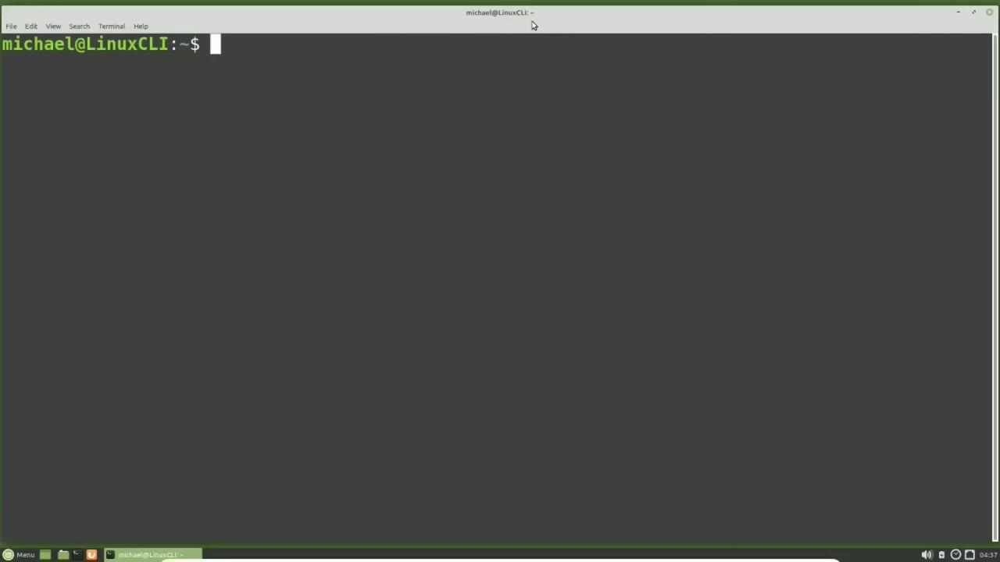
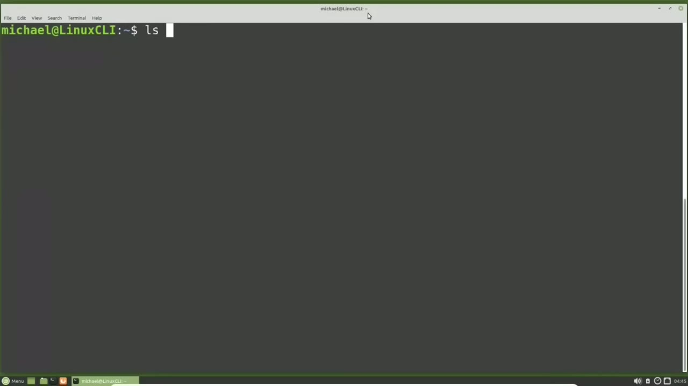
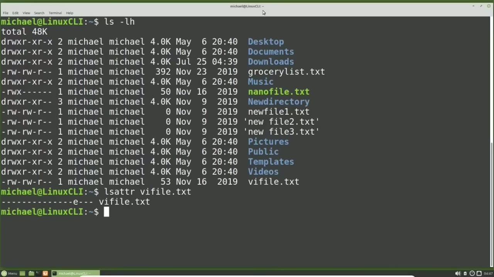
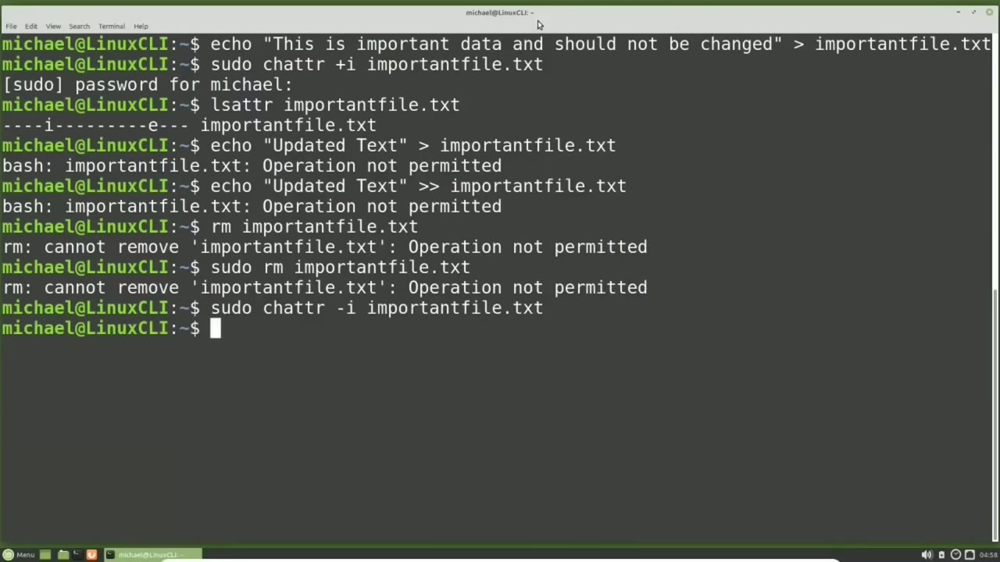
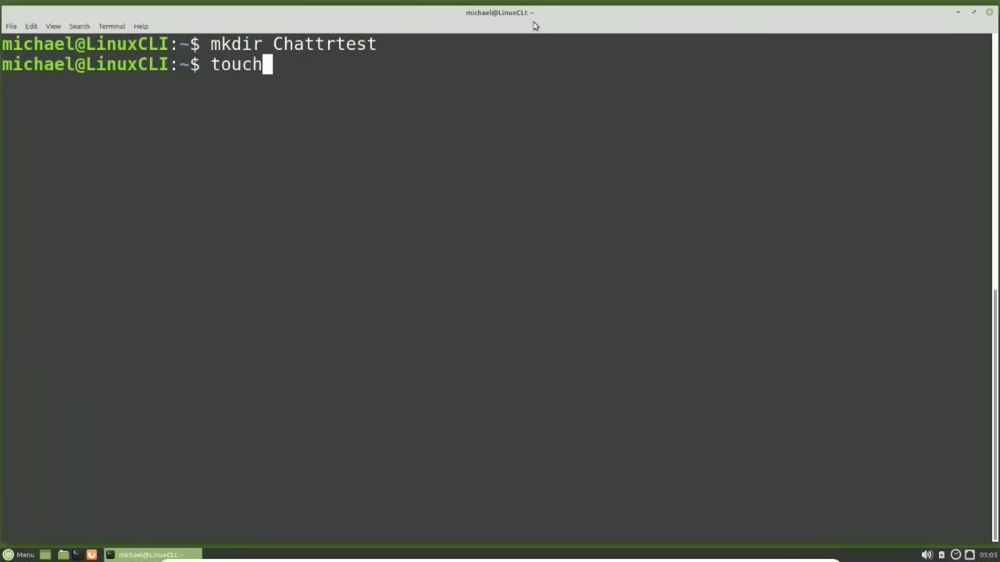
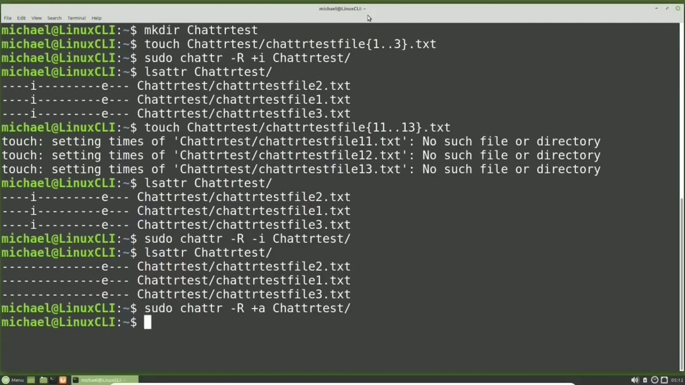

[← Course contents](../../01.md)

# 29. File Attributes

**Course:** [Linux Command Line - Entire Tutorial Series](https://www.youtube.com/watch?v=avg65oY7sj4)  
**Transcript:** [`Linux Command Line - Entire Tutorial Series transcript`](../../../../course_videos/Linux%20Command%20Line%20-%20Entire%20Tutorial%20Series/Linux%20Command%20Line%20-%20Entire%20Tutorial%20Series.txt)  
**Video:** 04:11:22–04:23:48 ([open at this time](https://www.youtube.com/watch?v=avg65oY7sj4&t=15082s))

## Introduction

And like File ACLs, file attributes may not work on all Linux file systems. I'm going to bring up the Man page for the Change Attribute command with Man, c-h-a-t-t-r. And scrolling down to the Bugs and Limitations section, we see the cs and U attributes are not honored by the e-xt-2, e-t-3, and e-t-4 file systems. The Linux Mint mate distribution I am using right now is using the ExtE4 file system, so those file attributes won't work on this file system.

## Detailed Explanation

<details>
  <summary>Step 1 — Run `ls -lh`, `lsattr`</summary>

### Step 1 — Run `ls -lh`, `lsattr`

- [x] **And like File ACLs, file attributes may not work on all Linux file**
  - And like File ACLs, file attributes may not work on all Linux file systems.
  - I'm going to bring up the Man page for the Change Attribute command with Man, c-h-a-t-t-r.
  - And scrolling down to the Bugs and Limitations section, we see the cs and U attributes are not honored by the e-xt-2, e-t-3, and e-t-4 file systems.

- [x] **The Linux Mint mate distribution I am using right now is using the**
  - The Linux Mint mate distribution I am using right now is using the ExtE4 file system, so those file attributes won't work on this file system.
  - I'm pressing Q to get out of the man page.
  - This video is not about file systems, but since I brought it up, one way to see what type of Linux file system you are using is to cat the EtsyFS tab file.

- [x] **I have the font increased and the lines don't line up perfectly, but**
  - I have the font increased and the lines don't line up perfectly, but if we look closely, we'll see there's a line for the file system and a line for the swap file.
  - We have a comment showing what each field is and going from right to left.
  - We see pass, dump, options, and then type.

- [x] **Then this first line is going to be the file system**
  - Then this first line is going to be the file system.
  - To left we see 1,0, errors equal remount, r0, and Exty4.
  - And below that line, we have another line and going from right to left there, four fields.

- [x] **Use `ls -lh`**
  - The swap file is used to help manage RAM memory.
  - I'm typing `ls -lh` to show what files we have in our home directory.
  - And I want to see the file attributes for this bottom file we have, V-I-File.TXT.

- [x] **Use `lsattr`**
  - Anyone with read access to a file can view the file attributes for a file.
  - I will list the file attributes with `lsattr` and then giving the file name which in this case is v-i file.TXT.
  - We see a lot of dashes and then an E and then some more dashes.

- [x] **The E is the file attribute for extents and that's for mapping out**
  - The E is the file attribute for extents and that's for mapping out the blocks on a disk.

```bash
ls -lh
lsattr
```





</details>

<details>
  <summary>Step 2 — Run `touch`, `echo`, `sudo`</summary>

### Step 2 — Run `touch`, `echo`, `sudo`

- [x] **Use `touch`, `echo`**
  - We are not going to `touch` that file attribute, but we are going to look at some other attributes.
  - I'm going to clear the screen again and create a file with the `echo` command.
  - And I'm going to direct the output of this text into a file called Importantfile. txt.

- [x] **To make sure this file does not get changed or deleted, we are going**
  - To make sure this file does not get changed or deleted, we are going to enable the immutable file attribute.
  - Immutable is just another word for unchangeable.
  - So we're going to make the ImportantFile.TXT file unchangeable with the immutable attribute.

- [x] **Use `sudo`, `chattr`**
  - Most file permissions can be updated by the file user owner. But file attributes can only be updated by a privileged user.
  - So I'm going to start this command with `sudo` and then the `chattr` command for change attribute. And then we need a space and then the attribute we want to change, which is the immutable attribute and we want to enable it. So I will type plus lowercase I.
  - And we can also think of the plus as add. So we want to add the lowercase i for a mutable attribute.

- [x] **Then we need another space and then the file name we want to change**
  - Then we need another space and then the file name we want to change the file attribute for, which in this case is the important file. txt.
  - Pressing Enter. Now our file is immutable or unchangeable.
  - Let's view the file attributes now with lsatr, Important file. txt.

- [x] **Use `echo`**
  - And we see the I for the immutable attribute has been set.
  - I'm going to try to change the text in that file with the `echo` command.
  - `echo` updated text and we're going to output that into the important file.T Pressing Enter, we get in Operations Not Permitted error.

- [x] **Use `rm`**
  - And if I try to append some text into that file, we get that same operation not permitted.
  - I'm going to try to remove that file with the `rm` command.
  - Again, we get the operation not permitted.

- [x] **Let's try that again, but this time I'm going to add sudo-remove**
  - Let's try that again, but this time I'm going to add sudo-remove important file.TXT.
  - So even as the root user, I'm unable to remove this file as long as it has that immutable file attribute set.
  - I will need to remove the immutable file attribute.

- [x] **Before we can change or remove any file with the immutable file**
  - Before we can change or remove any file with the immutable file attribute set.
  - And to remove the immutable file attribute, I will type Soudou, because we need to be a privileged user to change the file attributes, then chatr for change attribute, then a space, and then a -lowercase i, also known as the hyphen or the -sign or the takeaway sign to take away
  - And then we need to give it the file name, which is important file. txt.

```bash
touch
echo
sudo
chattr
rm
```



</details>

<details>
  <summary>Step 3 — Run `lsattr`, `sudo`</summary>

### Step 3 — Run `lsattr`, `sudo`

- [x] **Use `lsattr`, `sudo`**
  - And let's show that immutable attribute is now removed by typing `lsattr`, Important file. txt. And we do see the immutable attribute is gone.
  - Another useful file attribute is the lowercase A attribute for append only.
  - I'm going to add the append attribute to our important file with `sudo`.

- [x] **Use `lsattr`**
  - Chatr plus A to add the append only attribute and we're going to do that for the file Important file. txt and to show that that's set we'll type `lsattr` important file. txt and there we see the lowercase A showing us the append attribute has been set. Now we should be able to add to that file
  - But we should not be able to change anything that's there or delete the file itself. Let's test out the append only attribute the same way we did the immutable attribute and that is by trying to echo some text in there with echo updated text and we're going to put that into the important file.T file. Pressing Enter, we see that operation is not permitted.
  - Now let's try to append that data into the important file txt.

- [x] **By adding on the extra greater than sign**
  - By adding on the extra greater than sign.
  - And there we see that we were able to append that file.
  - Let's also try removing that file with Soudou Remove important file.T and again even as the root user, we're unable to remove this file with the append attribute set.

- [x] **The Append-only attribute is most useful for like a history file or a**
  - The Append-only attribute is most useful for like a history file or a log file, where you want to keep the history of what happened in that file, but you want to add new data to that file.
  - File attributes can also be applied to a directory.
  - I'm going to create a directory with M-K-Dur.

- [x] **And then we're going to give this directory name c-h-a-t-r test**
  - And then we're going to give this directory name c-h-a-t-r test.
  - And now let's add in some files into this directory.

```bash
lsattr
sudo
```



</details>

<details>
  <summary>Step 4 — Run `touch c-h-a-t-r`, `sudo`, `touch chatter`</summary>

### Step 4 — Run `touch c-h-a-t-r`, `sudo`, `touch chatter`

- [x] **Use `touch c-h-a-t-r`, `sudo`**
  - So we will `touch c-h-a-t-r` test and we'll call these files c-h-a-t-r.
  - Test file and we'll create three of them 1. dot.3 in the curly braces.
  - .txte. Now let's make this directory immutable with `sudo`, c-h-a-t-r for change attribute. Then we're going to use the -uppercase R which is the option to recursively apply this command for every file in this directory. Then we're going to press space and the plus lowercase i to add the immutable attribute.

- [x] **And then we're going to give it the directory name of chatter test**
  - And then we're going to give it the directory name of chatter test.
  - The attributes are set for that directory.
  - Let's see what that looks like with lsatr for list attributes for the chatter test directory.

- [x] **Use `touch chatter`**
  - And we see all three files show as immutable.
  - I'm going to try to add some new files to that directory with touch, chatter test, Chatter test files, and this time we'll call them 11 through 13.t.
  - And here we see that we are unable to add in any files into this directory.

- [x] **Use `lsattr`, `sudo`**
  - And bringing back the `lsattr` chatter test command.
  - Shows us that those new files were not added.
  - I'm going to remove the immutable attribute from that directory with `sudo`.

- [x] **Then the uppercase R to recursively apply the -sign lowercase I to**
  - Then the uppercase R to recursively apply the -sign lowercase I to take away the immutable attribute.
  - And we want to do this all for the chatter test directory.
  - And again, Listing the attributes for the Chatter Test directory, we see that the immutable attributes are gone.

- [x] **The last thing we're going to do in this video is add in the append**
  - The last thing we're going to do in this video is add in the append attribute for a file directory.
  - We'll do that with Soudo, C-H-A-T-R-U-Upper-case R, space plus sign, lowercase, A, and then the directory name of Chatter Test.

```bash
touch c-h-a-t-r
sudo
touch chatter
lsattr
```



</details>

<details>
  <summary>Step 5 — Run `lsattr`, `touch chatter`, `sudo rm chatter`</summary>

### Step 5 — Run `lsattr`, `touch chatter`, `sudo rm chatter`

- [x] **Use `lsattr`, `touch chatter`**
  - Show that it's there with the `lsattr`, chatter test, and we see that we have applied the append attribute to the chatter test directory.
  - Now let's try and add in some files with the touch, chatter test, chatter test files, and we will make these the 11 through 13.t.
  - Let's check out the status with the `lsattr` Chatter Test Command.

- [x] **Use `sudo rm chatter`**
  - And here we see we were able to add in these files, but notice the new files do not have the append attribute set.
  - We will have to set the append attribute for those files if we want to make those files append only.
  - But if we try to remove one of those files with Sudo, rm, Chatter Test, ChatterTest file will give it 13.txt because that does not have the Append Attribute set.

- [x] **When I press Enter, we still get an operation not permitted**
  - When I press Enter, we still get an operation not permitted.
  - This is showing us that because we set the directory permissions to Append Only, we can only add files to this directory and not remove them.
  - In the next tutorial, we will continue looking at the Linux command line.

```bash
lsattr
touch chatter
sudo rm chatter
```



</details>

<details>
  <summary>Questions and Answers</summary>

## Questions and Answers

### Question 1: What does `ls -lh` do in this chapter?

<details>
<summary>Answer</summary>

- [x] I'm typing `ls -lh` to show what files we have in our home directory.

</details>

### Question 2: What does `lsattr` do in this chapter?

<details>
<summary>Answer</summary>

- [x] I will list the file attributes with `lsattr` and then giving the file name which in this case is v-i file.TXT.

</details>

### Question 3: What does `touch` do in this chapter?

<details>
<summary>Answer</summary>

- [x] We are not going to `touch` that file attribute, but we are going to look at some other attributes.

</details>

### Question 4: What does `echo` do in this chapter?

<details>
<summary>Answer</summary>

- [x] I'm going to clear the screen again and create a file with the `echo` command.

</details>

### Question 5: What does `sudo` do in this chapter?

<details>
<summary>Answer</summary>

- [x] So I'm going to start this command with `sudo` and then the chattr command for change attribute. And then we need a space and then the attribute we want to change, which is the immutable attribute and we want to enable it. So I will type plus lowercase I.

</details>

### Question 6: What does `chattr` do in this chapter?

<details>
<summary>Answer</summary>

- [x] So I'm going to start this command with sudo and then the `chattr` command for change attribute. And then we need a space and then the attribute we want to change, which is the immutable attribute and we want to enable it. So I will type plus lowercase I.

</details>

### Question 7: What does `rm` do in this chapter?

<details>
<summary>Answer</summary>

- [x] I'm going to try to remove that file with the `rm` command.

</details>

### Question 8: What does `touch c-h-a-t-r` do in this chapter?

<details>
<summary>Answer</summary>

- [x] So we will `touch c-h-a-t-r` test and we'll call these files c-h-a-t-r.

</details>

### Question 9: What does `touch chatter` do in this chapter?

<details>
<summary>Answer</summary>

- [x] I'm going to try to add some new files to that directory with touch, chatter test, Chatter test files, and this time we'll call them 11 through 13.t.

</details>

### Question 10: What does `sudo rm chatter` do in this chapter?

<details>
<summary>Answer</summary>

- [x] But if we try to remove one of those files with Sudo, rm, Chatter Test, ChatterTest file will give it 13.txt because that does not have the Append Attribute set.

</details>

</details>

## Summary

This chapter, File Attributes, walks through Run ls -lh, lsattr; Run touch, echo, sudo; Run lsattr, sudo; Run touch c-h-a-t-r, sudo, touch chatter; Run lsattr, touch chatter, sudo rm chatter. Commands from the transcript: `ls -lh`, `lsattr`, `touch`, `echo`, `sudo`, `chattr`, `rm`, `touch c-h-a-t-r`, `touch chatter`, `sudo rm chatter`.

## References

- [Linux Command Line - Entire Tutorial Series (YouTube)](https://www.youtube.com/watch?v=avg65oY7sj4)
- [This chapter at 04:11:22](https://www.youtube.com/watch?v=avg65oY7sj4&t=15082s)
- [Local transcript](../../../../course_videos/Linux%20Command%20Line%20-%20Entire%20Tutorial%20Series/Linux%20Command%20Line%20-%20Entire%20Tutorial%20Series.txt)
