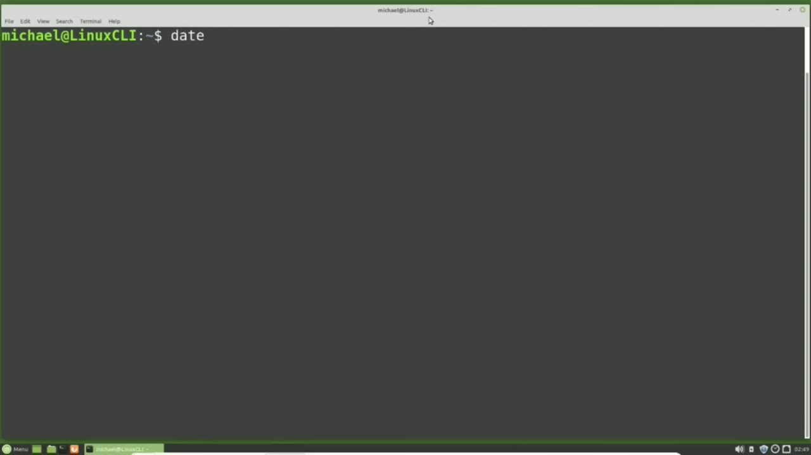
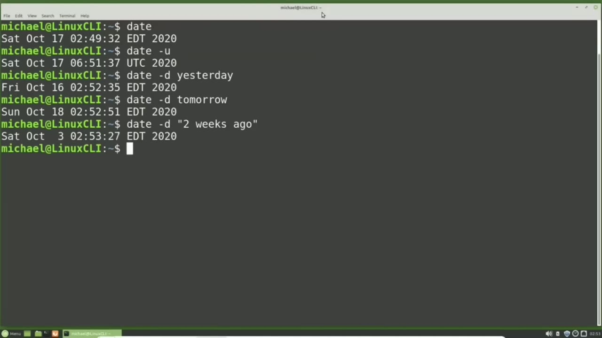
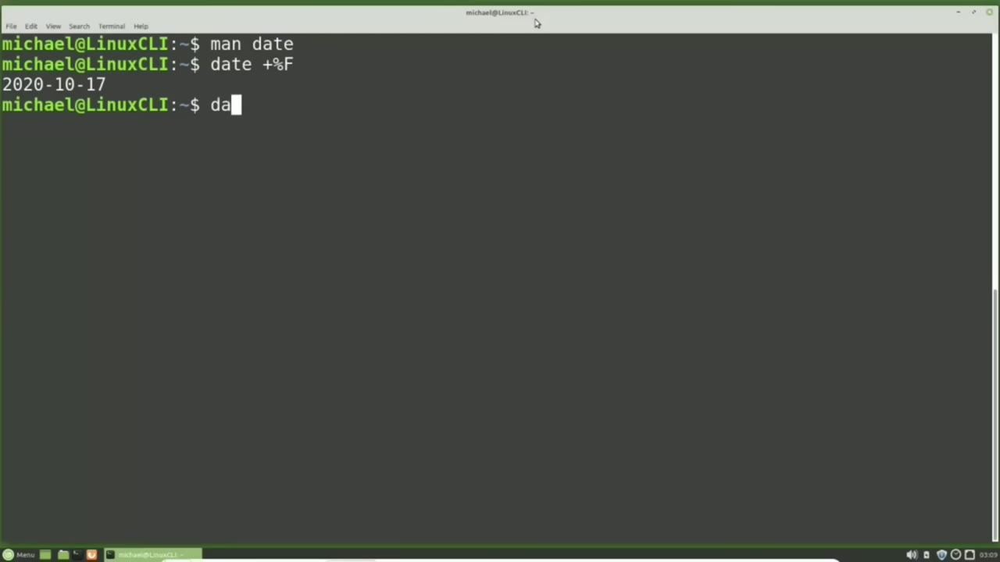
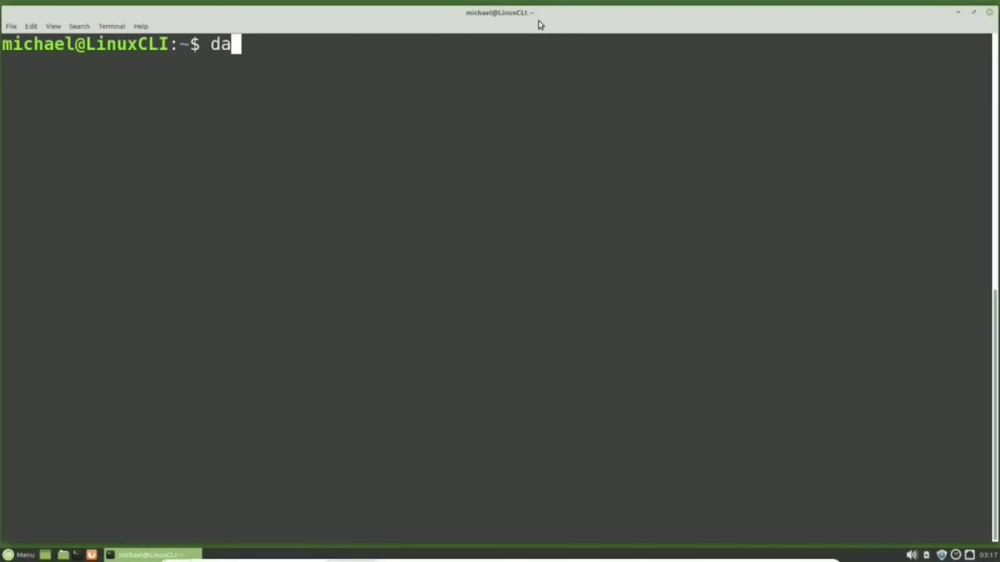

[← Course contents](../../01.md)

# 30. Time and Date pt1

**Course:** [Linux Command Line - Entire Tutorial Series](https://www.youtube.com/watch?v=avg65oY7sj4)  
**Transcript:** [`Linux Command Line - Entire Tutorial Series transcript`](../../../../course_videos/Linux%20Command%20Line%20-%20Entire%20Tutorial%20Series/Linux%20Command%20Line%20-%20Entire%20Tutorial%20Series.txt)  
**Video:** 04:23:48–04:32:41 ([open at this time](https://www.youtube.com/watch?v=avg65oY7sj4&t=15828s))

## Introduction

We can type date and press center. This gives us the current date and time the computer thinks it is. This computer is using edt for Eastern Daylight Time. With all the computers worldwide connecting to one another, they need a common time that all the computers can use.

## Detailed Explanation

<details>
  <summary>Step 1 — Run `date -U`, `date -D`</summary>

### Step 1 — Run `date -U`, `date -D`

- [x] **We can type date and press center**
  - We can type date and press center.
  - This gives us the current date and time the computer thinks it is.
  - This computer is using edt for Eastern Daylight Time.

- [x] **Use `date -U`**
  - With all the computers worldwide connecting to one another, they need a common time that all the computers can use.
  - And that is UTC, also known as the Coordinated Universal Time Zone.
  - To see the UTC time and date, I will type `date -U`.

- [x] **Use `date -D`**
  - And we see here there's a 4-hour difference between Eastern Daylight Time and UTC.
  - We can also use the date feature to see the date and time yesterday by typing `date -D` yesterday.
  - And we can see the date for tomorrow with `date -D` tomorrow.

- [x] **Use `date -D`**
  - To see the date in time two weeks ago we can type `date -D` quote two weeks ago.
  - And we need to put this in quotes because we have multiple values separated by spaces.

```bash
date -U
date -D
```



</details>

<details>
  <summary>Step 2 — Run `date -D -sign`, `date -d`, `date -d 2 weeks`</summary>

### Step 2 — Run `date -D -sign`, `date -d`, `date -d 2 weeks`

- [x] **Use `date -D -sign`, `date -d`**
  - Instead of saying two weeks ago, we can also use `date -D -sign` two weeks.
  - And that shows us the same as two weeks ago.
  - And to see a date 2 weeks in the future, we can type `date -d` plus 2 weeks.

- [x] **Use `date -d 2 weeks`, `date -d`, `date -d 12 25 20 25`**
  - Typing `date -d 2 weeks` is the same as the `date -d` plus sign 2 weeks.
  - We can ask for the date and `time` 2 weeks and 3 days from now with `date -d 2 weeks` three days. And we can also have used the `time`. We could say something like `date -d` two weeks, two hours. And that will give us the date and `time` two weeks and two hours from now. To find out what day of the week Christmas
  - 2025 lands on, we can type `date -d` 12, 25, 20, 25. And we see that Christmas 2025 lands on a Thursday.

- [x] **And now I want to change the format of how that date shows on the**
  - And now I want to change the format of how that date shows on the screen.
  - Instead of showing the day in three characters, I want to see the whole day of the week spelled out.
  - And I want to see the date in the format year first, then the month, then the day.

- [x] **Use `time`**
  - To see how to do that, I'm going to check the man page.
  - Right here at the top we see the -D option that we were just using.
  - And paging down, we see the -U for UTC `time`, which we also just looked at.

- [x] **Paging down again, we see format controls the output**
  - Paging down again, we see format controls the output.
  - And we see that the uppercase A will show the full date of the week, one of the things I was looking for.
  - And scrolling down a little bit, we see that percent sign F will show the full date as year dash, month, -day.

- [x] **Paging down again, we see the lowercase M is for month and the**
  - Paging down again, we see the lowercase M is for month and the uppercase M is for minute.
  - We also have a percent sign uppercase T for `time`.
  - And the lowercase Y and uppercase Y are for the two digit and four digit year.

```bash
date -D -sign
date -d
date -d 2 weeks
date -d 12 25 20 25
time
```



</details>

<details>
  <summary>Step 3 — Run `date`</summary>

### Step 3 — Run `date`

- [x] **So there are a lot of choices for formatting the date and time**
  - So there are a lot of choices for formatting the `date` and time.
  - I'm going to quit out of the man page so we can see how this `date` formatting works.
  - Space as we saw earlier and to change the formatting we need to use the plus sign and then we add the formatting that we want in this case I'm going to use the percent sign uppercase F and pressing enter shows us our `date` as year -month -day I want to add in the full spelling of the day of the week

- [x] **Use `date`**
  - And I will do that by typing `date` plus open quote percent sign uppercase a space percent sign uppercase f end quote and we need to have this in quotes because we have a space between the formatting values now i used double quotes to show that it can be done in single quotes i will change those to single quotes and we see it works here as well
  - Now we can add more text inside those quotes if we like i can say `date` plus today is percent sign uppercase a space percent sign uppercase f end quote now i want to change those dashes in the `date` to a forward slash but i still want to keep that year month day format
  - So instead of the f i'm going to use the uppercase y for the year the lowercase m for the month and the lowercase d for the day so now my command will look like `date` space plus sign open quote Today is percent sign uppercase A, space percent sign uppercase Y forward slash percent sign lowercase M forward slash percent sign lowercase D.

- [x] **If I want to show the day of the week in double quotes, I might type**
  - If I want to show the day of the week in double quotes, I might type something like this and add in our double quotes.
  - Because when it gets to the second, quote, it's going to think that it is the end quote.
  - We have two ways to fix this. The first way is to just change the outer quotes to single quotes. But if we change the text just a little bit and want to say today's `date` is, then we've got a single quote that it will think is the end quote.

- [x] **So to fix this, I'm going to change the outer quotes**
  - So to fix this, I'm going to change the outer quotes.
  - Back to double quotes and I'm going to add in the escape character before the double quotes around the day of the week. So that escape character, the backslash, will make the next character, that double quote, part of the string and not the end of string.
  - Pressing Enter. And if you need to print out a backslash, we would just add that in as two backslashes to print a single backslash.

- [x] **Now just like we formatted the date into a different format, we can**
  - Now just like we formatted the `date` into a different format, we can do the same with the time.

```bash
date
```



</details>

<details>
  <summary>Step 4 — Run `date`</summary>

### Step 4 — Run `date`

- [x] **Use `date`**
  - I'm going to type `date` plus percent sign uppercase t.
  - I'm going to format the time into hours and minutes by typing `date` plus percent sign uppercase h.
  - And this time we did not need the quotes, even though we had multiple values, because we did not have any spaces in between the values.

- [x] **If we want to see the time from a different time zone, we can do that**
  - If we want to see the time from a different time zone, we can do that by adding the time zone first with uppercase tz for time zone.
  - And then we'll put in an equal sign to set the time zone for this command.
  - And then I'll put the time zone in quotes.

- [x] **Los Angeles time zone with America forward slash loss underscore**
  - Los Angeles time zone with America forward slash loss underscore Angeles end quote space `date`.
  - And here we see our time in Pacific daylight time.
  - And then if we want to do any formatting for our time, we would do that after the `date`.

- [x] **We would add the plus sign for the formatting and put in something**
  - We would add the plus sign for the formatting and put in something like the percent sign T to just have the time show.
  - In the next video, we'll continue looking at the time and `date` for the Linux command line.

```bash
date
```



</details>

<details>
  <summary>Questions and Answers</summary>

## Questions and Answers

### Question 1: What does `date` do in this chapter?

<details>
<summary>Answer</summary>

- [x] We can type `date` and press center.

</details>

### Question 2: What does `date -U` do in this chapter?

<details>
<summary>Answer</summary>

- [x] To see the UTC time and date, I will type `date -U`.

</details>

### Question 3: What does `date -D` do in this chapter?

<details>
<summary>Answer</summary>

- [x] We can also use the date feature to see the date and time yesterday by typing `date -D` yesterday.

</details>

### Question 4: What does `date -D -sign` do in this chapter?

<details>
<summary>Answer</summary>

- [x] Instead of saying two weeks ago, we can also use `date -D -sign` two weeks.

</details>

### Question 5: What does `date -d 2 weeks` do in this chapter?

<details>
<summary>Answer</summary>

- [x] Typing `date -d 2 weeks` is the same as the date -d plus sign 2 weeks.

</details>

### Question 6: What does `date -d 12 25 20 25` do in this chapter?

<details>
<summary>Answer</summary>

- [x] 2025 lands on, we can type date -d 12, 25, 20, 25. And we see that Christmas 2025 lands on a Thursday.

</details>

### Question 7: What does `time` do in this chapter?

<details>
<summary>Answer</summary>

- [x] And paging down, we see the -U for UTC `time`, which we also just looked at.

</details>

### Question 8: What does step 1 cover (Run date -U, date -D)?

<details>
<summary>Answer</summary>

- [x] We can type date and press center.
- [x] This gives us the current date and time the computer thinks it is.
- [x] This computer is using edt for Eastern Daylight Time.

</details>

### Question 9: What does step 2 cover (Run date -D -sign, date -d, date -d 2 weeks)?

<details>
<summary>Answer</summary>

- [x] Instead of saying two weeks ago, we can also use `date -D -sign` two weeks.
- [x] And that shows us the same as two weeks ago.
- [x] And to see a date 2 weeks in the future, we can type `date -d` plus 2 weeks.

</details>

### Question 10: What does step 3 cover (Run date)?

<details>
<summary>Answer</summary>

- [x] So there are a lot of choices for formatting the `date` and time.
- [x] I'm going to quit out of the man page so we can see how this `date` formatting works.
- [x] Space as we saw earlier and to change the formatting we need to use the plus sign and then we add the formatting that we want in this case I'm going to use the percent sign uppercase F and pressing enter shows us our `date` as year -month -day I want to add in the full spelling of the day of the week

</details>

</details>

## Summary

This chapter, Time and Date pt1, walks through Run date -U, date -D; Run date -D -sign, date -d, date -d 2 weeks; Run date; Run date. Commands from the transcript: `date -U`, `date -D`, `date -D -sign`, `date -d`, `date -d 2 weeks`, `date -d 12 25 20 25`, `time`, `date`.

## References

- [Linux Command Line - Entire Tutorial Series (YouTube)](https://www.youtube.com/watch?v=avg65oY7sj4)
- [This chapter at 04:23:48](https://www.youtube.com/watch?v=avg65oY7sj4&t=15828s)
- [Local transcript](../../../../course_videos/Linux%20Command%20Line%20-%20Entire%20Tutorial%20Series/Linux%20Command%20Line%20-%20Entire%20Tutorial%20Series.txt)
