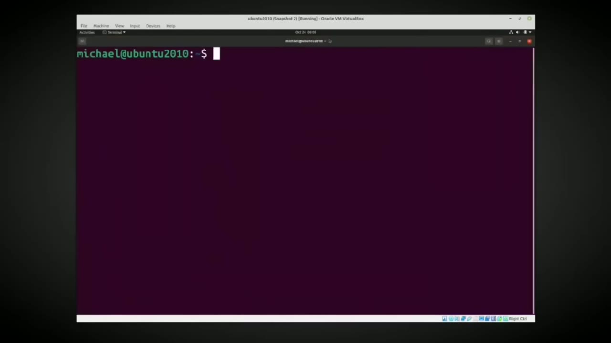
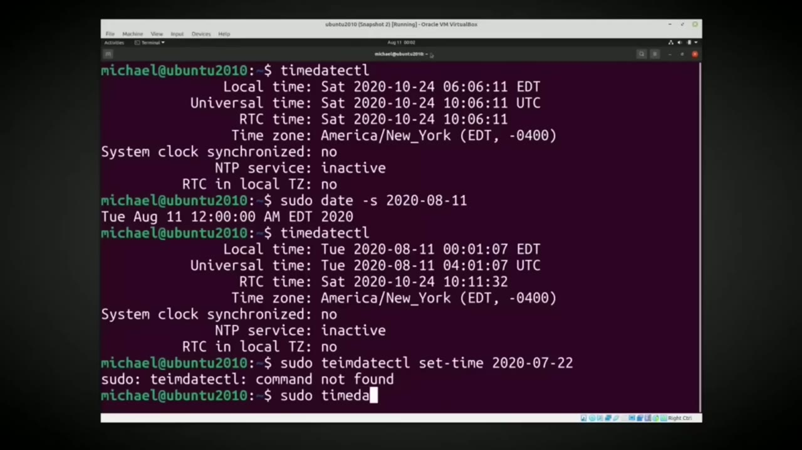
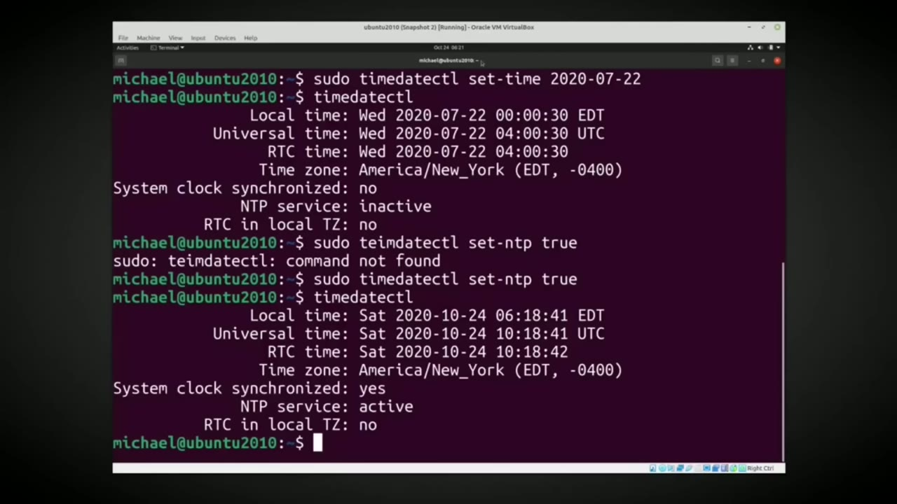
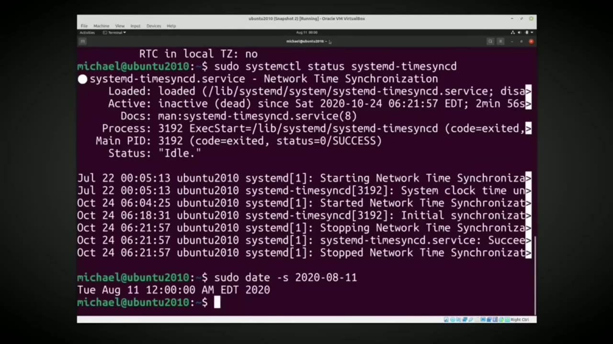

[← Course contents](../../01.md)

# 31. Time and Date pt2

**Course:** [Linux Command Line - Entire Tutorial Series](https://www.youtube.com/watch?v=avg65oY7sj4)  
**Transcript:** [`Linux Command Line - Entire Tutorial Series transcript`](../../../../course_videos/Linux%20Command%20Line%20-%20Entire%20Tutorial%20Series/Linux%20Command%20Line%20-%20Entire%20Tutorial%20Series.txt)  
**Video:** 04:32:41–04:41:55 ([open at this time](https://www.youtube.com/watch?v=avg65oY7sj4&t=16361s))

## Introduction

For this video, I'm using Ubuntu 2010 to make sure that I'm using the most up-to-date version of Ubuntu Linux. I have turned off the automatic time and date from the Settings menu. To see the time and date on this computer, I'm going to type timedatectl. This shows us that the local time is in edt.

## Detailed Explanation

<details>
  <summary>Step 1 — Run `timedatectl`, `date`, `sudo`</summary>

### Step 1 — Run `timedatectl`, `date`, `sudo`

- [x] **Use `timedatectl`**
  - For this video, I'm using Ubuntu 2010 to make sure that I'm using the most up-to-`date` version of Ubuntu Linux.
  - I have turned off the automatic time and `date` from the Settings menu.
  - To see the time and `date` on this computer, I'm going to type `timedatectl`.

- [x] **This shows us that the local time is in edt**
  - This shows us that the local time is in edt.
  - Or Eastern Daylight Time. Below that, we see the Universal Time or UTC Time.
  - And rtc stands for Real Time Clock, which is the clock on this computer.

- [x] **There's a little battery inside the computer keeping the clock**
  - There's a little battery inside the computer keeping the clock running when the computer is turned off.
  - And then we see the time zone. We are in the America, New York time zone.
  - That is telling us that the Eastern Daylight Time Zone is 4 hours less than the UTC time zone.

- [x] **And we see that difference up here between the local time and the**
  - And we see that difference up here between the local time and the Universal Time.
  - Below that we see System Clock Synchronized is set to No and NTP service is set to inactive.
  - This means that we are not synchronizing the time from the internet.

- [x] **Use `date`**
  - We can update the `date` and time with the `date` command that we saw in the last video by typing S-Dat-S.
  - The -s option is for set the time and `date`.
  - And then I'll give it a time and `date` I want to set it to 2020-08-11.

- [x] **Use `timedatectl`**
  - Pressing Enter shows us we just set the `date` to August 11th, 2020.
  - And since we did not give it a time, it is setting the time to zero seconds, just starting the day.
  - I'm going to arrow up to `timedatectl` again.

- [x] **Use `sudo`, `time date`, `timedatectl`**
  - This shows us that we updated the local time and the universal time, but the real time clock was not changed.
  - We can update the real time clock with `sudo`, time, `date` ctl, set time, and then I'll give it the time and `date` I want to set it to, which is 2020.
  - 07-22. Pressing Enter shows me that I typed `timedatectl` wrong.

```bash
timedatectl
date
sudo
time date
```



</details>

<details>
  <summary>Step 2 — Run `sudo timedatectl`, `timedatectl`, `sudo`</summary>

### Step 2 — Run `sudo timedatectl`, `timedatectl`, `sudo`

- [x] **Use `sudo timedatectl`, `timedatectl`**
  - `sudo timedatectl` set time 2020-07-022. This time we don't see the time and date was updated.
  - To show the update was successful, I will go back to the `timedatectl` command.
  - Notice this time, the real time clock date was set to July 22nd, 2020, but it also updated the Universal Time and the Local Time.

- [x] **Because we did not give it a time, it set it to 0 just starting the**
  - Because we did not give it a time, it set it to 0 just starting the day just after midnight.
  - We see the Universal Time was set to 4 a.m. because of the 4-hour time difference, and the real-time clock is keeping time in UTC Time, and that is shown here at the bottom.
  - Now let's look at the System Clock synchronized and NTP service.

- [x] **NTP is a way of having your computer go out to the internet to a**
  - NTP is a way of having your computer go out to the internet to a specific server and those servers keep the time with an atomic clock, geopositioning or the like to make sure that those have the most accurate time possible.
  - We're not going to set up NTP in this video.
  - There are some default servers that are already set up, and we're going to use those default servers.

- [x] **Use `sudo`, `time date`, `timedatectl`**
  - To turn on NTP, I just need to type `sudo`, Time, Date, ctl, Set NTP, True, and press Enter.
  - And again, I spelled the `timedatectl` wrong.
  - Let's fix that, and bring up the `time date` Control again.

- [x] **We see that the local time and the UTC time are now set to the NTP**
  - We see that the local time and the UTC time are now set to the NTP server time.
  - It also updated our real time clock to the NTP server time.
  - We see that the NTP service is active, but notice the system clock synchronized is also set to yes.

```bash
sudo timedatectl
timedatectl
sudo
time date
```



</details>

<details>
  <summary>Step 3 — Run `sudo timedatectl`, `timedatectl`, `sudo systemctl status`</summary>

### Step 3 — Run `sudo timedatectl`, `timedatectl`, `sudo systemctl status`

- [x] **Use `sudo timedatectl`, `timedatectl`**
  - I'm going to turn off the NTP service with `sudo timedatectl` set NTP false.
  - And bring back up the `timedatectl`.
  - Now we see the NTP service is inactive, but notice the system clock synchronized still shows as yes.

- [x] **Use `sudo systemctl status`**
  - To see if the system clock synchronized is still enabled, I'm going to type Sudo `systemctl`, Status, System D, Time SyncD.
  - Now before we go any further, I need to mention what System D is because we're going to see System D in future tutorials.
  - System D is a system made up of modules or services.

- [x] **Use `systemctl`**
  - A lot of the System D services have to do with starting up a Linux computer.
  - The System D-T-T-TimesyncD is one of the services of System D.
  - Not all Linux operating systems use System D, but Ubuntu and Red Hat CentOS operating systems do use system D. And this is our system D command. It starts off with `systemctl`.

- [x] **Use `timedatectl`**
  - That is telling us that we're using a system D service. The next part of it is status because we want to know what is the status of our system D service. And that system D service we want to see the status of is system D -time sync D. Pressing enter. We see that this
  - But when we look at the `timedatectl` command, it still shows the system clock synchronized as yes, but it's not active.
  - I'm going to press Ctrl+C to cancel out of here and update the date again with S-S-2020-08-08-11.

```bash
sudo timedatectl
timedatectl
sudo systemctl status
systemctl
```



</details>

<details>
  <summary>Step 4 — Run `timedatectl`, `sudo systemctl`, `time date`</summary>

### Step 4 — Run `timedatectl`, `sudo systemctl`, `time date`

- [x] **Use `timedatectl`, `sudo systemctl`**
  - Bringing back up the `timedatectl`.
  - Shows I was able to update the local and universal dates and that the system clock synchronized now shows as no.
  - I'm going to start the system clock synchronized with the command, `sudo systemctl`, start instead of status.

- [x] **Use `timedatectl`**
  - And then bringing back the `timedatectl` shows that the system clock synchronized is now set to yes and the NTP time is also active.
  - So these two services work together to keep the time accurate.
  - Now I want to change the time zone, but before I can change a time zone, I need to know what time zones are available.

- [x] **Use `time date`, `less`**
  - To find the available time zones, I will type...
  - Time, date, ctl, list, dash, time zones.
  - This shows a list of time zones using the `less` command.

- [x] **Use `less`**
  - And remember with the `less` command, we can use the arrow keys to go down and up.
  - And we can also use the page down and page up commands.
  - Here we see the America, Los Angeles time zone.

- [x] **Use `less`, `sudo`**
  - And I will cancel out of the `less` command with Ctrl+C.
  - And I want to update my time zone to be the America Los Angeles time zone.
  - To do that, I'm going to type `sudo` because you need to be a privileged user to update the time zone.

- [x] **Use `timedatectl`, `ls -le -sy`**
  - `timedatectl`, set time zone, and then I'm going to put this in double quotes.
  - And our time zone should be updated. To check it out, I'm going to type `ls -le -sy` local time.
  - And we see right here that the time zone has been set to America, Los Angeles.

- [x] **Use `timedatectl`**
  - Because we are running an Ubuntu operating system, we can also see the time zone with Cat, /etc, time zone.
  - And then the other way we can see the time zone is with the...
  - `timedatectl` command that we've been using throughout this tutorial.

- [x] **And we see that the Los Angeles pdt or Pacific Daylight Time is set**
  - And we see that the Los Angeles pdt or Pacific Daylight Time is set to 0700, meaning that it is 7 hours `less` than the UTC time zone.
  - In the next video, we will continue looking at the Linux command line.

```bash
timedatectl
sudo systemctl
time date
less
sudo
ls -le -sy
```



</details>

<details>
  <summary>Questions and Answers</summary>

## Questions and Answers

### Question 1: What does `timedatectl` do in this chapter?

<details>
<summary>Answer</summary>

- [x] To see the time and date on this computer, I'm going to type `timedatectl`.

</details>

### Question 2: What does `date` do in this chapter?

<details>
<summary>Answer</summary>

- [x] We can update the `date` and time with the `date` command that we saw in the last video by typing S-Dat-S.

</details>

### Question 3: What does `sudo` do in this chapter?

<details>
<summary>Answer</summary>

- [x] We can update the real time clock with `sudo`, time, date ctl, set time, and then I'll give it the time and date I want to set it to, which is 2020.

</details>

### Question 4: What does `time date` do in this chapter?

<details>
<summary>Answer</summary>

- [x] We can update the real time clock with Sudo, time, date ctl, set time, and then I'll give it the time and date I want to set it to, which is 2020.

</details>

### Question 5: What does `sudo timedatectl` do in this chapter?

<details>
<summary>Answer</summary>

- [x] `sudo timedatectl` set time 2020-07-022. This time we don't see the time and date was updated.

</details>

### Question 6: What does `sudo systemctl status` do in this chapter?

<details>
<summary>Answer</summary>

- [x] To see if the system clock synchronized is still enabled, I'm going to type Sudo systemctl, Status, System D, Time SyncD.

</details>

### Question 7: What does `systemctl` do in this chapter?

<details>
<summary>Answer</summary>

- [x] Not all Linux operating systems use System D, but Ubuntu and Red Hat CentOS operating systems do use system D. And this is our system D command. It starts off with `systemctl`.

</details>

### Question 8: What does `sudo systemctl` do in this chapter?

<details>
<summary>Answer</summary>

- [x] I'm going to start the system clock synchronized with the command, `sudo systemctl`, start instead of status.

</details>

### Question 9: What does `less` do in this chapter?

<details>
<summary>Answer</summary>

- [x] This shows a list of time zones using the `less` command.

</details>

### Question 10: What does `ls -le -sy` do in this chapter?

<details>
<summary>Answer</summary>

- [x] And our time zone should be updated. To check it out, I'm going to type `ls -le -sy` local time.

</details>

</details>

## Summary

This chapter, Time and Date pt2, walks through Run timedatectl, date, sudo; Run sudo timedatectl, timedatectl, sudo; Run sudo timedatectl, timedatectl, sudo systemctl status; Run timedatectl, sudo systemctl, time date. Commands from the transcript: `timedatectl`, `date`, `sudo`, `time date`, `sudo timedatectl`, `sudo systemctl status`, `systemctl`, `sudo systemctl`, `less`, `ls -le -sy`.

## References

- [Linux Command Line - Entire Tutorial Series (YouTube)](https://www.youtube.com/watch?v=avg65oY7sj4)
- [This chapter at 04:32:41](https://www.youtube.com/watch?v=avg65oY7sj4&t=16361s)
- [Local transcript](../../../../course_videos/Linux%20Command%20Line%20-%20Entire%20Tutorial%20Series/Linux%20Command%20Line%20-%20Entire%20Tutorial%20Series.txt)
