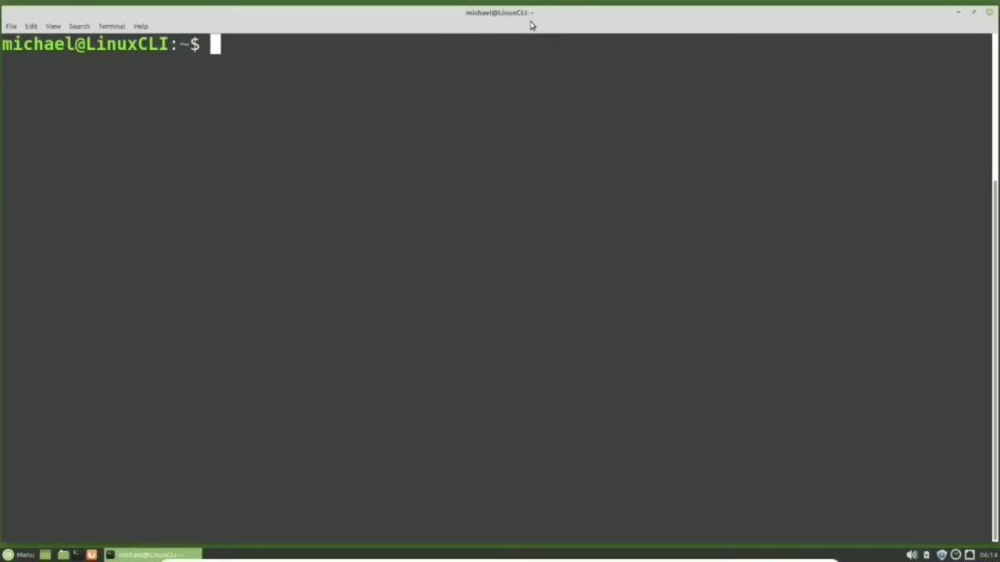
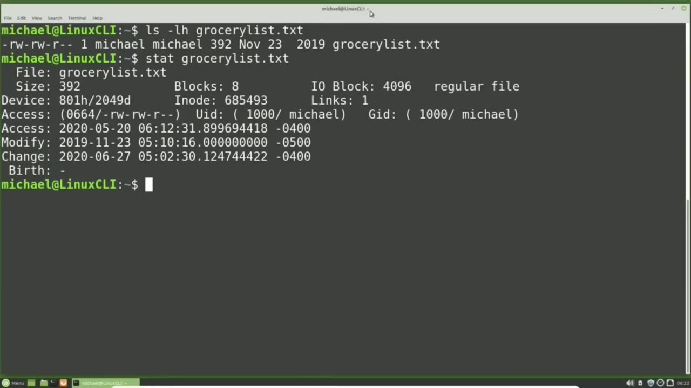
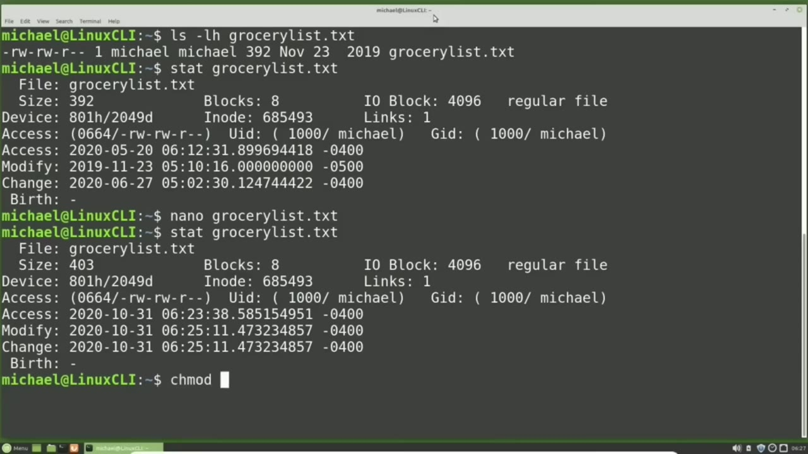
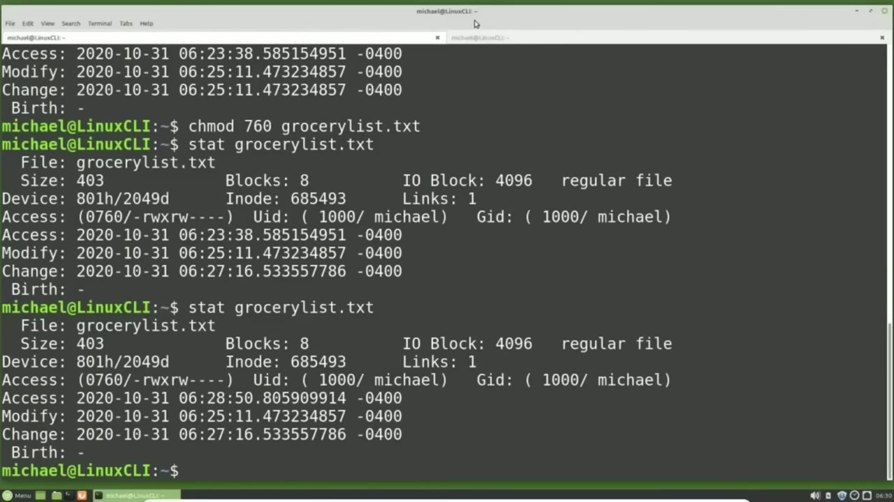
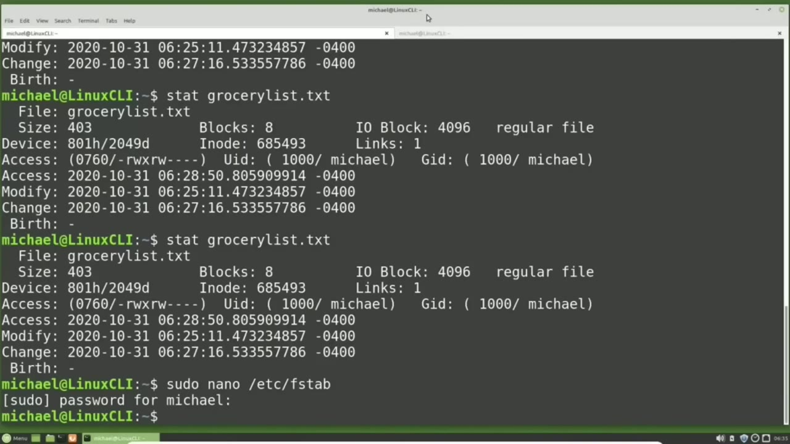

[← Course contents](../../01.md)

# 32. stat

**Course:** [Linux Command Line - Entire Tutorial Series](https://www.youtube.com/watch?v=avg65oY7sj4)  
**Transcript:** [`Linux Command Line - Entire Tutorial Series transcript`](../../../../course_videos/Linux%20Command%20Line%20-%20Entire%20Tutorial%20Series/Linux%20Command%20Line%20-%20Entire%20Tutorial%20Series.txt)  
**Video:** 04:41:55–04:53:52 ([open at this time](https://www.youtube.com/watch?v=avg65oY7sj4&t=16915s))

## Introduction

When we type ls -lh, We see information about the files in the current directory. When I type ls -lh and a file name, like GroceryList.TXT, well, let's clear the screen first. And type ls -lh GroceryList.TXT. And here we see information about a specific file.

## Detailed Explanation

<details>
  <summary>Step 1 — Run `ls -lh`, `ls`, `stat`</summary>

### Step 1 — Run `ls -lh`, `ls`, `stat`

- [x] **Use `ls -lh`**
  - When we type `ls -lh`, We see information about the files in the current directory.
  - When I type `ls -lh` and a file name, like GroceryList.TXT, well, let's clear the screen first.
  - And type `ls -lh` GroceryList.TXT.

- [x] **Use `ls`**
  - And here we see information about a specific file.
  - In an earlier tutorial we talked about iNodes and that most of the information shown with the `ls` command comes from the iNode of that file.
  - But that is not all the information stored on the iNode.

- [x] **Use `stat`, `stat grocerylist.txt`, `ls`**
  - To see all the information stored on the i node, we need to use the `stat` command.
  - `stat grocerylist.txt`.
  - Here we can see a lot of the information for the `ls` command is the same as the `stat` command.

- [x] **Use `ls`, `stat`**
  - The `ls` command starts with the file permissions and we see them here for the `stat` command as well.
  - The `stat` command also shows the Octal permissions.
  - The number of links is set to 1 for both the `ls` and the `stat` command.

- [x] **Use `ls`, `stat`**
  - Then we have the user in group for the `ls` command and it is also seen here in the `stat` command with a little more detail.
  - Then we see the file size for the `ls` command.
  - And the `stat` command.

- [x] **Use `ls`, `stat`**
  - We're going to come back to the date and time in a moment.
  - We're going to skip over that and show that the file name is also easily seen for both the `ls` command and the `stat` command.
  - Now let's look at the dates. We have one for the `ls` command, but we have three different dates for the `stat` command.

- [x] **Use `ls`**
  - For if you're including the birth date, the birth date is to show the original creation date of the file.
  - But that is not implemented in Linux. So we only have three different dates.
  - We can see here that the modified date is what the `ls` command is using.

- [x] **Use `stat`**
  - But the `stat` command also includes the time with fractions of seconds and this -500 to the right of it. The -500 and 400 are the time zones for the date.
  - The -500 is for the eastern time zone when daylight savings time did not apply.
  - The -400 times stamps are for the Eastern time zone during daylight savings time.

- [x] **In the spring, clocks are set 1 hour ahead for daylight savings time**
  - In the spring, clocks are set 1 hour ahead for daylight savings time.

```bash
ls -lh
ls
stat
stat grocerylist.txt
```



</details>

<details>
  <summary>Step 2 — Run `time -4`, `time -5`, `nano grocerylist`</summary>

### Step 2 — Run `time -4`, `time -5`, `nano grocerylist`

- [x] **Use `time -4`, `time -5`**
  - So now they're the same as UTC `time -4` hours instead of 5 hours.
  - Then in the fall, daylight savings time ends and the clocks are set back 1 hour making them the same as UTC `time -5` hours once again.
  - Looking at these three dates, the dates are all different, and the dates are not even close.

- [x] **Use `nano grocerylist`**
  - They are months apart. So how does each one get updated?
  - The easiest way to change the Modify Date is by modifying the content in the file.
  - I'm going to do that by typing `nano grocerylist`. txt and update this file.

- [x] **Down at the bottom by adding in the line new item 2**
  - Down at the bottom by adding in the line new item 2.
  - And I'm going to pause this video for a minute or two while I'm editing this file.
  - Now I'm going to save the file by holding down control and pressing X, then Y and enter.

- [x] **Use `stat`**
  - I'm going to `stat` that file again.
  - Notice the access time is a few minutes less than the modify and the change time.
  - That's because the access time is updated when I started Nano.

- [x] **Remember I paused the video for two minutes before saving the file**
  - Remember I paused the video for two minutes before saving the file.
  - The Modifying change dates were updated when I saved the file.
  - I'm going to pause the video again for a minute or two.

- [x] **And now I'm going to use the change mode command to change the file**
  - And now I'm going to use the change mode command to change the file permissions.

```bash
time -4
time -5
nano grocerylist
stat
```



</details>

<details>
  <summary>Step 3 — Run `chmod 760 grocerlylist.txt`, `stat`, `cat grocerylist.txt`</summary>

### Step 3 — Run `chmod 760 grocerlylist.txt`, `stat`, `cat grocerylist.txt`

- [x] **Use `chmod 760 grocerlylist.txt`, `stat`**
  - `chmod 760 grocerlylist.txt`.
  - And we'll `stat` that file once again.
  - And notice now only the change date and time was updated.

- [x] **This is because we did not modify the file content in any way**
  - This is because we did not modify the file content in any way.
  - And we did not access the file content in any way.
  - So only the change date and time was updated.

- [x] **Use `cat grocerylist.txt`, `stat`**
  - Now let's access the file without modifying it in any way.
  - To do that, I will type `cat grocerylist.txt`.
  - Going back to our original tab, I'm going to `stat` the file once again.

- [x] **And notice now, only the access date and time was updated**
  - And notice now, only the access date and time was updated.
  - Because we accessed the data, we viewed it, but we did not modify or change it in any way.
  - I'm going over to the other tab once again, and I'm going to cat the GroceryList.T file once again.

```bash
chmod 760 grocerlylist.txt
stat
cat grocerylist.txt
```



</details>

<details>
  <summary>Step 4 — Run `stat`, `sudo -nano`</summary>

### Step 4 — Run `stat`, `sudo -nano`

- [x] **Use `stat`**
  - Going back to the original tab, let's `stat` that GroceryList.T file again.
  - And this time, the access date is the same as the last time.
  - But a moment ago, cadding the file updated the access time.

- [x] **Why didn't the access time get updated just like it did a moment ago?**
  - Why didn't the access time get updated just like it did a moment ago?
  - Was used to keep track of every time the file was accessed until kernel update version 2.6.30.
  - Most likely this change was made to help system performance.

- [x] **But here's how the access time works now after kernel update 2.6.30**
  - But here's how the access time works now after kernel update 2.6.30.
  - The access time only gets updated on rights and once for the first read after a write.
  - Remember we updated the GrocerlyList.T.file, which did a write.

- [x] **Use `sudo -nano`**
  - Then I used Cat to show what was in that file and we saw the access time was updated, but now it won't update again until we do another file right.
  - If you want to make the Access Time update after every access, you have to modify the fs tab file to set strict daytime.
  - This is going a little bit off topic, but since we looked at the fs tab file a few videos back, We'll look at it here too. I'm going to type `sudo -nano` slash /etc f-s tab.

- [x] **I'm going to add comma strict a time to the end of my options for my**
  - I'm going to add comma strict a time to the end of my options for my Ext.T4 file system.
  - So I'm going down to my file system right here.
  - Then we see the slash is the mount point.

- [x] **So right here, after the O, I'm going to add comma, strict a time**
  - So right here, after the O, I'm going to add comma, strict a time.
  - And because my font is a little big, it looks a little funny.
  - Y to save and enter to write as the EtsyFS tab.

```bash
stat
sudo -nano
```



</details>

<details>
  <summary>Step 5 — Run `reboot`, `stat grocery`, `stat`</summary>

### Step 5 — Run `reboot`, `stat grocery`, `stat`

- [x] **Use `reboot`, `stat grocery`**
  - Now I'm going to `reboot` my machine to make the changes take effect.
  - I've restarted the computer so i will now type `stat grocery` list dot t x t and go over to the other tab where i can cat Grocerlist.T.T. Going back to the original tab, statting that file again, shows me the access time was updated. But to make sure this works properly, I need to do it at least
  - Two times, so I'm going over to the other tab. Cadding the file once again, going back to the original tab and statting it shows once again our access time was updated.

- [x] **Use `stat`**
  - Now some people just use the `stat` command to see if a file exists.
  - They'll `stat` a file and we see how it exists, but if we add something like a one at the end, we see, oh, cannot `stat` the file, no such file or directory.
  - So that's how you would use it to see if a file exists or not.

- [x] **Use `date`, `stat`, `man stat`**
  - A few videos back, we saw that we could customize the output of the `date` command.
  - We can do the same type of thing with the `stat` command.
  - `man stat`. I'm going to page down. And here we see the valid format sequences for files.

- [x] **Use `stat`, `printf`**
  - The ones I'm going to note here are the percent sign uppercase A for access rights in human readable form. The uppercase G for group name of owner. The percent sign N for file name and the percent sign X time of last access human readable.
  - I'm pressing Q to quit out of the help screen.
  - And to print out the `stat` information formatted, we need to add `printf`.

- [x] **Use `stat`, `stat -printf`**
  - So the `stat` command would now look like `stat -printf` equals and percent sign N will show the file name.
  - And we want that for the file, GroceryList.TXT.
  - And we see it printed that out, but it did not put a line return, so our prompt came right up next to our output.

- [x] **I'm going to press Enter and bring that up again**
  - I'm going to press Enter and bring that up again.
  - I'm going to add a double quote and add some text, file, colon, space.
  - So I'm going to use that escape character we saw in a previous video.

- [x] **And then we end with the file name of GroceryList. txt**
  - And then we end with the file name of GroceryList. txt.
  - Pressing Enter, we see file is GroceryList.t.
  - I'm going to add in the other information into the same line.

- [x] **I had the last access time, so I'll say, was last accessed on**
  - I had the last access time, so I'll say, was last accessed on, 0.C.C.S.S.S. Lowercase X.
  - Then the escape character N for a new line has a group of 0.C.
  - Percent sign uppercase G. Escape character N for new line and permissions of percent sign uppercase A.

- [x] **And then we're going to end with the escape character N for new line**
  - And then we're going to end with the escape character N for new line.
  - Shows us all the information but it's kind of jumbled together there so I'm going to bring that back by pressing the arrow up and I'm going to end with an extra new line escape character and for new line and go to the beginning of this before the file and start with a blank line by adding the escape character
  - New line now when I press enter it looks a little nicer with the blank lines above it and below it in the next video We will continue looking at the Linux command line.

```bash
reboot
stat grocery
stat
date
man stat
printf
stat -printf
```



</details>

<details>
  <summary>Questions and Answers</summary>

## Questions and Answers

### Question 1: What does `ls -lh` do in this chapter?

<details>
<summary>Answer</summary>

- [x] When we type `ls -lh`, We see information about the files in the current directory.

</details>

### Question 2: What does `ls` do in this chapter?

<details>
<summary>Answer</summary>

- [x] In an earlier tutorial we talked about iNodes and that most of the information shown with the `ls` command comes from the iNode of that file.

</details>

### Question 3: What does `stat` do in this chapter?

<details>
<summary>Answer</summary>

- [x] To see all the information stored on the i node, we need to use the `stat` command.

</details>

### Question 4: What does `stat grocerylist.txt` do in this chapter?

<details>
<summary>Answer</summary>

- [x] `stat grocerylist.txt`.

</details>

### Question 5: What does `time -4` do in this chapter?

<details>
<summary>Answer</summary>

- [x] So now they're the same as UTC `time -4` hours instead of 5 hours.

</details>

### Question 6: What does `time -5` do in this chapter?

<details>
<summary>Answer</summary>

- [x] Then in the fall, daylight savings time ends and the clocks are set back 1 hour making them the same as UTC `time -5` hours once again.

</details>

### Question 7: What does `nano grocerylist` do in this chapter?

<details>
<summary>Answer</summary>

- [x] I'm going to do that by typing `nano grocerylist`. txt and update this file.

</details>

### Question 8: What does `chmod 760 grocerlylist.txt` do in this chapter?

<details>
<summary>Answer</summary>

- [x] `chmod 760 grocerlylist.txt`.

</details>

### Question 9: What does `cat grocerylist.txt` do in this chapter?

<details>
<summary>Answer</summary>

- [x] To do that, I will type `cat grocerylist.txt`.

</details>

### Question 10: What does `sudo -nano` do in this chapter?

<details>
<summary>Answer</summary>

- [x] This is going a little bit off topic, but since we looked at the fs tab file a few videos back, We'll look at it here too. I'm going to type `sudo -nano` slash /etc f-s tab.

</details>

### Question 11: What does `reboot` do in this chapter?

<details>
<summary>Answer</summary>

- [x] Now I'm going to `reboot` my machine to make the changes take effect.

</details>

### Question 12: What does `stat grocery` do in this chapter?

<details>
<summary>Answer</summary>

- [x] I've restarted the computer so i will now type `stat grocery` list dot t x t and go over to the other tab where i can cat Grocerlist.T.T. Going back to the original tab, statting that file again, shows me the access time was updated. But to make sure this works properly, I need to do it at least

</details>

</details>

## Summary

This chapter, stat, walks through Run ls -lh, ls, stat; Run time -4, time -5, nano grocerylist; Run chmod 760 grocerlylist.txt, stat, cat grocerylist.txt; Run stat, sudo -nano; Run reboot, stat grocery, stat. Commands from the transcript: `ls -lh`, `ls`, `stat`, `stat grocerylist.txt`, `time -4`, `time -5`, `nano grocerylist`, `chmod 760 grocerlylist.txt`, `cat grocerylist.txt`, `sudo -nano`, `reboot`, `stat grocery`, `date`, `man stat`.

## References

- [Linux Command Line - Entire Tutorial Series (YouTube)](https://www.youtube.com/watch?v=avg65oY7sj4)
- [This chapter at 04:41:55](https://www.youtube.com/watch?v=avg65oY7sj4&t=16915s)
- [Local transcript](../../../../course_videos/Linux%20Command%20Line%20-%20Entire%20Tutorial%20Series/Linux%20Command%20Line%20-%20Entire%20Tutorial%20Series.txt)
