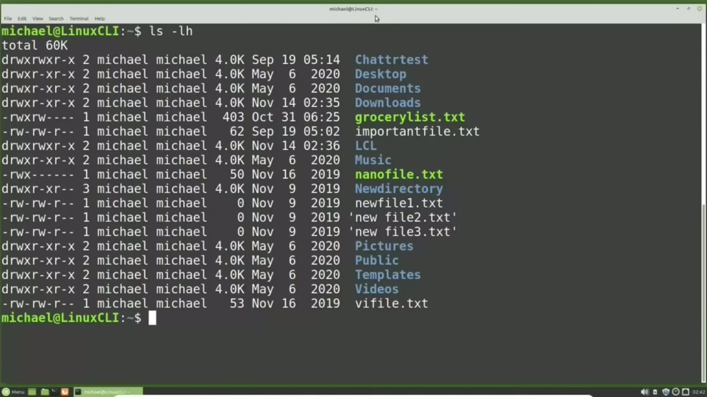
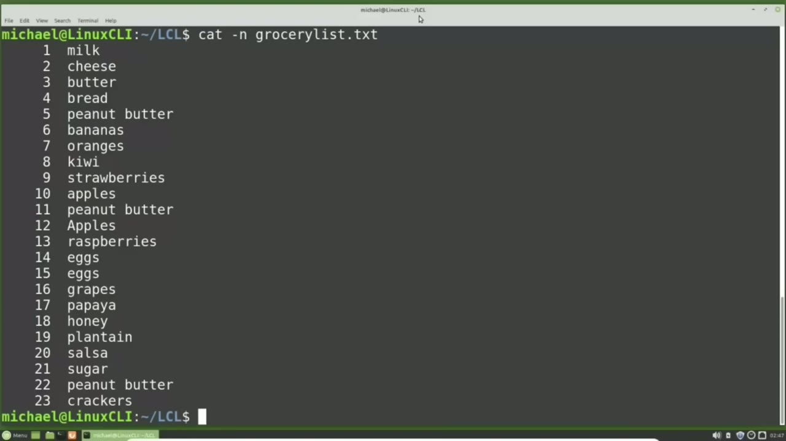
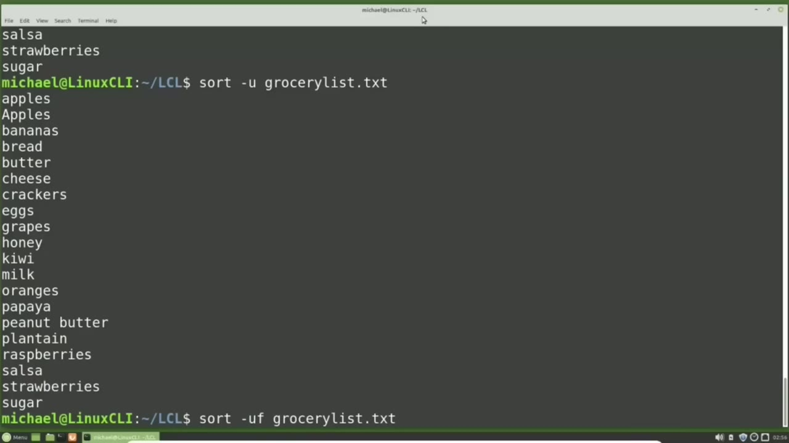
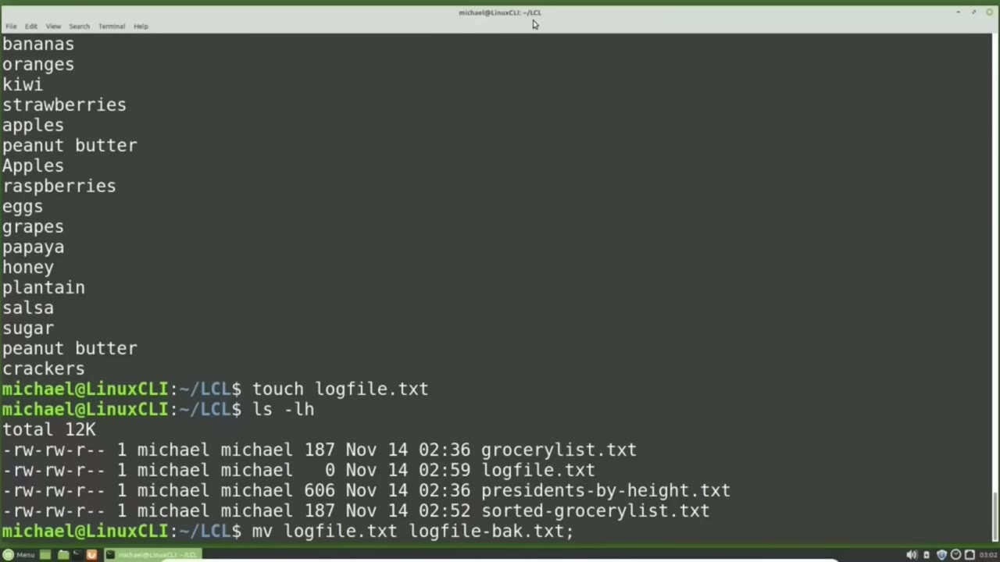
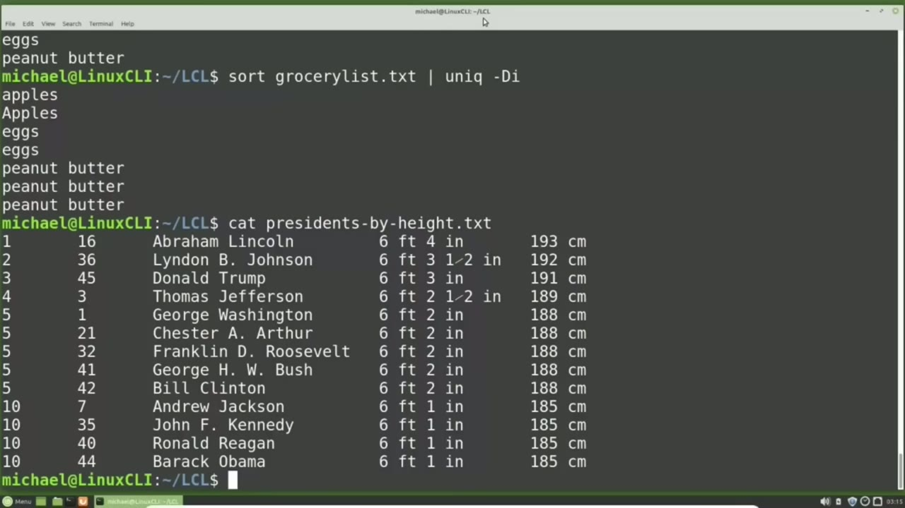

[← Course contents](../../01.md)

# 33. wc, sort, uniq

**Course:** [Linux Command Line - Entire Tutorial Series](https://www.youtube.com/watch?v=avg65oY7sj4)  
**Transcript:** [`Linux Command Line - Entire Tutorial Series transcript`](../../../../course_videos/Linux%20Command%20Line%20-%20Entire%20Tutorial%20Series/Linux%20Command%20Line%20-%20Entire%20Tutorial%20Series.txt)  
**Video:** 04:53:52–05:06:51 ([open at this time](https://www.youtube.com/watch?v=avg65oY7sj4&t=17632s))

## Introduction

I have created a new directory in my home directory called lcl for Linux Commandline. And I'm going to cd into the lcl directory and type ls -lh. We see that I have placed two new files in this directory, one called Presidentsby height.T and the other called GroceryList.TXT. The GroceryList.T file is just an edited version of the GroceryList.T file from Video 7 that we've been working with up till now.

## Detailed Explanation

<details>
  <summary>Step 1 — Run `ls -lh`, `wc`, `cat -n`</summary>

### Step 1 — Run `ls -lh`, `wc`, `cat -n`

- [x] **Use `ls -lh`**
  - I have created a new directory in my home directory called lcl for Linux Commandline.
  - And I'm going to cd into the lcl directory and type `ls -lh`.
  - We see that I have placed two new files in this directory, one called Presidentsby height.T and the other called GroceryList.TXT.

- [x] **The GroceryList.T file is just an edited version of the GroceryList.T**
  - The GroceryList.T file is just an edited version of the GroceryList.T file from Video 7 that we've been working with up till now.
  - Both of these files can be downloaded from my website.
  - There's a link in the YouTube description to my website where you can download these text files for free.

- [x] **Use `wc`**
  - I'm going to type `wc` space GroceryList. txt.
  - The `wc` stands for word count, or count all the words in this file, which will also count all the lines and the characters in this file as well.
  - Pressing Enter. We see 23, 26, and 187. And then the file name Grocery List. txt.

- [x] **Use `cat -n`**
  - 23 is the number of lines in this file. 26 is the number of words in this file.
  - And the 187 is the number of characters in the GroceryList. txt file.
  - I'm going to cat out the content of this file with line numbers by typing `cat -n` grocery list.TXT.

- [x] **And here we see it starts with milk and ends with crackers**
  - And here we see it starts with milk and ends with crackers.
  - And a moment ago, we saw that there were 26 words in this file.
  - We see three extra words because we have peanut butter, which has two words instead of one, three times in this file on lines 5, 11, and 22.

- [x] **These three extra words give us 26 words in this file**
  - These three extra words give us 26 words in this file.

```bash
ls -lh
wc
cat -n
```



</details>

<details>
  <summary>Step 2 — Run `wc -lowercase`, `touch`, `cat grocerlyssess`</summary>

### Step 2 — Run `wc -lowercase`, `touch`, `cat grocerlyssess`

- [x] **Use `wc -lowercase`**
  - If I only want to see the number of lines in this file with the word count command, I would type `wc -lowercase` L and then the file name, Grocery List. txt, and then pressing enter.
  - We only see the number of lines 23 and then the file name.
  - If I want to see the content of the GroceryList.T. file sorted, I will type the command, sort, GroceryList.t.

- [x] **And to sort this file in descending order, I would do the same thing**
  - And to sort this file in descending order, I would do the same thing.
  - I'm pressing an arrow up to bring back that command, but I'm going to add the -lowercase R option.
  - And we see the output is now in descending order.

- [x] **Use `touch`, `cat grocerlyssess`**
  - When we use the sort command like this, I want to make sure that it's clear to you that this does not `touch` the content in the file GroceryList. txt.
  - We're just reading the GroceryList.T file, sorting it and printing that sorted output on the screen.
  - I will type `cat grocerlyssess`. txt.

- [x] **And we see the original content has not been changed in any way**
  - And we see the original content has not been changed in any way.
  - It still starts with milk and ends with crackers.
  - We can redirect the output to a file like we saw in video 8.

- [x] **I'll do that with sort, grocery list. txt**
  - I'll do that with sort, grocery list. txt.
  - Then we add the redirect output character or the greater than sign and then give it a file name.
  - Sorted GrocerlyList.T and pressing enter.

- [x] **That placed the sorted output into the file sorted-GroceryList.T and**
  - That placed the sorted output into the file sorted-GroceryList.T and we can see that by catting that file with cat sorted GroceryList. txt.
  - We see that there are duplicate items on our list. We see Apples is on the list twice.
  - Eggs is on the list twice and peanut butter is on the list three times.

- [x] **Use `sort -U`**
  - To filter out all those duplicates, I'm going to sort this file again, but this time I'm going to use the -u option for unique.
  - So my sorted output will now filter out all the duplicates leaving only one of each unique item.
  - `sort -U` grocery list.t.

- [x] **Now we see that eggs is only on the list one time and peanut butter**
  - Now we see that eggs is only on the list one time and peanut butter is only on the list one time, but we still have apples on the list twice.
  - The problem is that Linux treats uppercase letters and lowercase letters as different letters.
  - That's why the sort thinks apples with lowercase A is different than apples with an uppercase A.

- [x] **To filter out the matching words with a different case, we'll need to**
  - To filter out the matching words with a different case, we'll need to add the -F option.
  - -F means fold each letter to an uppercase character before comparing.
  - I'm pressing the arrow up to bring back that last command, and I'm adding a lowercase F.

```bash
wc -lowercase
touch
cat grocerlyssess
sort -U
```



</details>

<details>
  <summary>Step 3 — Run `sort -U`, `uniq`, `touch log`</summary>

### Step 3 — Run `sort -U`, `uniq`, `touch log`

- [x] **Use `sort -U`, `uniq`**
  - Just after the U for unique. So now we're going to `sort -U` for unique and -F to fold to uppercase before comparing.
  - Pressing Enter. Now we have our sorted grocery list file that has apples only once in the list, eggs only once in the list, and peanut butter only once in the list.
  - Now there is also a unique command. Let's take a look at how that unique command works by typing unique `uniq` space GroceryList. txt.

- [x] **We see that it filtered out one of the eggs, but the three peanut but**
  - We see that it filtered out one of the eggs, but the three peanut but the three peanut butters are all still there and the two different apples are still there as well.
  - The unique filtered out one of the eggs because they were right next to each other.
  - To filter out the peanut butter duplicates, we're going to need to sort this file before we can use Unique.

- [x] **To do that, we're going to need to use the pipe command**
  - To do that, we're going to need to use the pipe command.
  - Before we go any further, I want to talk about the different ways we can run multiple commands on a single line and why we might want to do that.
  - Let's start with the semicolon. When we place a semicolon between two commands, it means finish the first command, then execute the second command. A time when we would want to do something like this is when we want to run two commands one after the other as quick as

- [x] **Use `touch log`, `ls -lh`**
  - Possible. Doing something like a log file rotation is a good example.
  - To show you what I mean, I'm going to create a file called logfile.T with `touch log` file.
  - And now I'll type `ls -lh` and we see our logfile. txt file is out there.

- [x] **Use `file -back.t`**
  - And log files are constantly being filled up with data and log files can get very large, too large to work with easily.
  - To prevent this from happening, what we want to do is move the log file to a backup file, then create a new log file as fast as possible to continue catching all the new log file records.
  - And we're going to move that to log `file -back.t`.

- [x] **That's our one command, so now I'm going to put the semicolon**
  - That's our one command, so now I'm going to put the semicolon.

```bash
sort -U
uniq
touch log
ls -lh
file -back.t
```



</details>

<details>
  <summary>Step 4 — Run `which`, `touch log`, `ls -lh`</summary>

### Step 4 — Run `which`, `touch log`, `ls -lh`

- [x] **Use `which`, `touch log`**
  - And now I'm going to add the next command, `which` we want to do is `touch log` file.T.
  - So now we have two separate commands separated by a semicolon.
  - If we had more, we would just add another semicolon and another command, add another semicolon, another command.

- [x] **Use `ls -lh`**
  - Pressing Enter, and then `ls -lh`.
  - Shows us we were able to rotate our log file.
  - That semicolon is great for running multiple commands on a single line, but it won't help us out with what we want to do here.

- [x] **Use `sort`**
  - We want to take the output from the `sort` command and use it as input for the unique command.
  - For that we're going to use the pipe symbol.
  - The pipe symbol works similar to that output redirection that we've already seen and used in this tutorial series.

- [x] **Use `sort`**
  - `sort` GroceryList.TXT, then added the Redirection symbol, that greater than sign, to place the output from the `sort` command into a new file.
  - I'm going to replace that greater than sign with the pipe symbol, and then add the unique command.
  - This will take the output from the `sort` command and pipe it in as input to the unique command.

- [x] **Use `sort`**
  - So the Unique Command will read in that Sorted Output and then display the output from the Unique Command on the screen.
  - Looking at this output, you're probably thinking this was no big deal.
  - We just did the same thing with the `sort` Command using the -U option.

- [x] **And you would be right for this example, but the advantage of using**
  - And you would be right for this example, but the advantage of using the Unique Command is that the Unique Command also gives us the option to see `which` items were duplicated.
  - To find out `which` items were duplicated, I'm going to press the arrow up and add the -lowercase D on the end to show the duplicates.
  - Pressing Enter. Now we see Eggs and Peanut Butter.

```bash
which
touch log
ls -lh
sort
```



</details>

<details>
  <summary>Step 5 — Run `sort -k2`</summary>

### Step 5 — Run `sort -k2`

- [x] **This shows us that eggs and peanut butter were on the list more than**
  - This shows us that eggs and peanut butter were on the list more than one time, but it did not find the apples.
  - Remember, one had an uppercase A. We need to tell it to find all the duplicates and ignore the case.
  - So I'm going to press the arrow up and I'm going to add a -I at the end.

- [x] **So now we're telling it to only show us the duplicates and ignore the**
  - So now we're telling it to only show us the duplicates and ignore the case.
  - Now we see that apples, eggs and peanut butter were all on the list more than one time.
  - But this doesn't tell us how many times each item was found.

- [x] **To do that, I'm going to press the arrow up key again and change that**
  - To do that, I'm going to press the arrow up key again and change that lowercase D to an uppercase d and instead of having the -i separate i'm going to put them both together that doesn't matter we can have them separate or together pressing enter now we see the lowercase
  - A in the uppercase a in apples eggs is on there twice and peanut butter is on there three times at the beginning of this video i mentioned there was a file called presidents by height i'm going to cat that out right now with cat presidents by height This file shows us the top 10 tallest us presidents.
  - We see the order in the far left column making Abraham Lincoln the tallest president at 6 foot 4.

- [x] **Then we have the next 3 tallest presidents, and then we have a 5-way**
  - Then we have the next 3 tallest presidents, and then we have a 5-way tie for number 5 and a 4-way tie for number 10.
  - The second column shows the presidential order.
  - So that 16 means Abraham Lincoln was the 16th president.

- [x] **Use `sort -k2`**
  - Looking down at George Washington, we see that he was the first president.
  - To sort this file in the Presidential Order or the second column, we can use the sort command with the K option for key column.
  - `sort -k2`, Presidents by height.

- [x] **Looking at this, it looks like something went wrong because we see 16**
  - Looking at this, it looks like something went wrong because we see 16 before 1.
  - And a little further down the line, we see 3.6 is less than 3 space. And 3.5 is less than 3.6.
  - It just sorted by character order, not numerical order.

- [x] **We're going to have to tell it that we want it in numerical order**
  - We're going to have to tell it that we want it in numerical order.
  - I'm pressing the arrow up key to bring back that last command and adding the -n.
  - Before the K for key column in the number 2.

- [x] **Pressing Enter. Now we see it in the sorted order we were expecting**
  - Pressing Enter. Now we see it in the sorted order we were expecting.
  - And if we want to sort this file by first name, I'm going to press the arrow up again to bring back that last command.
  - And we're going to change the key column to number 3.

- [x] **And we're going to take off the end for numeric because this time we**
  - And we're going to take off the end for numeric because this time we do have characters.
  - So we're going to sort by key column 3, precedence by height.
  - And now we see they are all in order by first name.

- [x] **In the next tutorial, we'll continue looking at the Linux command line**
  - In the next tutorial, we'll continue looking at the Linux command line.

```bash
sort -k2
```



</details>

<details>
  <summary>Questions and Answers</summary>

## Questions and Answers

### Question 1: What does `ls -lh` do in this chapter?

<details>
<summary>Answer</summary>

- [x] And I'm going to cd into the lcl directory and type `ls -lh`.

</details>

### Question 2: What does `wc` do in this chapter?

<details>
<summary>Answer</summary>

- [x] I'm going to type `wc` space GroceryList. txt.

</details>

### Question 3: What does `cat -n` do in this chapter?

<details>
<summary>Answer</summary>

- [x] I'm going to cat out the content of this file with line numbers by typing `cat -n` grocery list.TXT.

</details>

### Question 4: What does `wc -lowercase` do in this chapter?

<details>
<summary>Answer</summary>

- [x] If I only want to see the number of lines in this file with the word count command, I would type `wc -lowercase` L and then the file name, Grocery List. txt, and then pressing enter.

</details>

### Question 5: What does `sort` do in this chapter?

<details>
<summary>Answer</summary>

- [x] If I want to see the content of the GroceryList.T. file sorted, I will type the command, `sort`, GroceryList.t.

</details>

### Question 6: What does `touch` do in this chapter?

<details>
<summary>Answer</summary>

- [x] When we use the sort command like this, I want to make sure that it's clear to you that this does not `touch` the content in the file GroceryList. txt.

</details>

### Question 7: What does `cat grocerlyssess` do in this chapter?

<details>
<summary>Answer</summary>

- [x] I will type `cat grocerlyssess`. txt.

</details>

### Question 8: What does `sort -U` do in this chapter?

<details>
<summary>Answer</summary>

- [x] `sort -U` grocery list.t.

</details>

### Question 9: What does `uniq` do in this chapter?

<details>
<summary>Answer</summary>

- [x] Now there is also a unique command. Let's take a look at how that unique command works by typing unique `uniq` space GroceryList. txt.

</details>

### Question 10: What does `touch log` do in this chapter?

<details>
<summary>Answer</summary>

- [x] To show you what I mean, I'm going to create a file called logfile.T with `touch log` file.

</details>

### Question 11: What does `file -back.t` do in this chapter?

<details>
<summary>Answer</summary>

- [x] And we're going to move that to log `file -back.t`.

</details>

### Question 12: What does `which` do in this chapter?

<details>
<summary>Answer</summary>

- [x] And now I'm going to add the next command, `which` we want to do is touch log file.T.

</details>

</details>

## Summary

This chapter, wc, sort, uniq, walks through Run ls -lh, wc, cat -n; Run wc -lowercase, touch, cat grocerlyssess; Run sort -U, uniq, touch log; Run which, touch log, ls -lh; Run sort -k2. Commands from the transcript: `ls -lh`, `wc`, `cat -n`, `wc -lowercase`, `touch`, `cat grocerlyssess`, `sort -U`, `uniq`, `touch log`, `file -back.t`, `which`, `sort`, `sort -k2`.

## References

- [Linux Command Line - Entire Tutorial Series (YouTube)](https://www.youtube.com/watch?v=avg65oY7sj4)
- [This chapter at 04:53:52](https://www.youtube.com/watch?v=avg65oY7sj4&t=17632s)
- [Local transcript](../../../../course_videos/Linux%20Command%20Line%20-%20Entire%20Tutorial%20Series/Linux%20Command%20Line%20-%20Entire%20Tutorial%20Series.txt)
