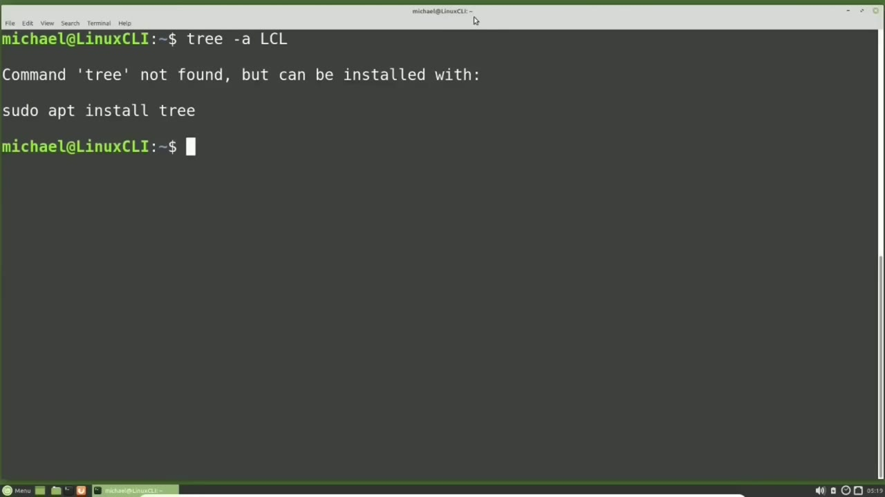
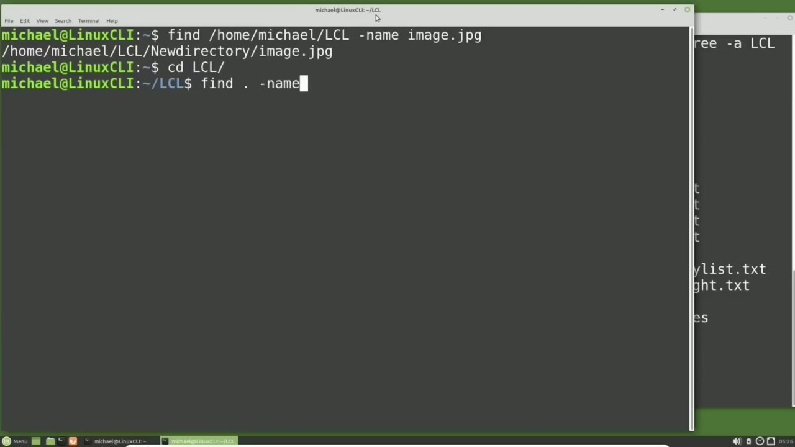
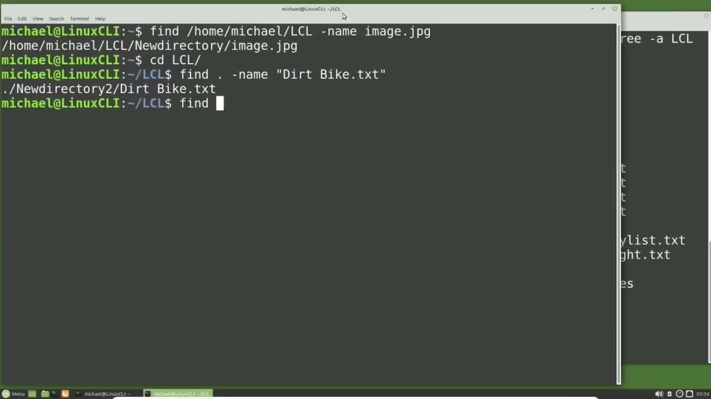
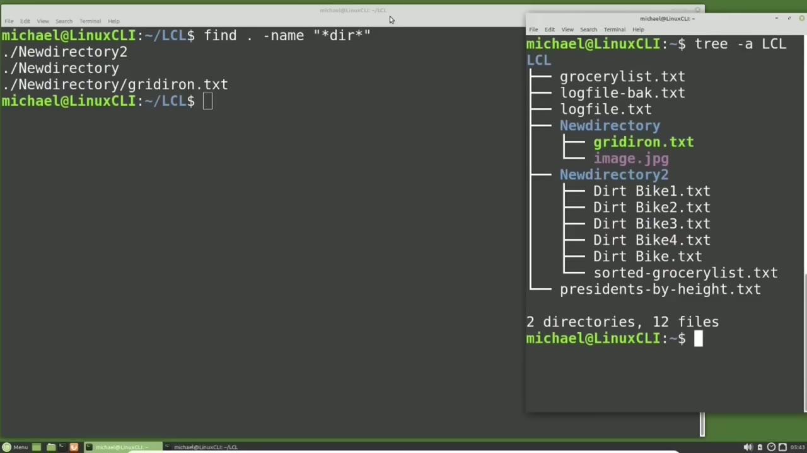

[← Course contents](../../01.md)

# 34. find pt1

**Course:** [Linux Command Line - Entire Tutorial Series](https://www.youtube.com/watch?v=avg65oY7sj4)  
**Transcript:** [`Linux Command Line - Entire Tutorial Series transcript`](../../../../course_videos/Linux%20Command%20Line%20-%20Entire%20Tutorial%20Series/Linux%20Command%20Line%20-%20Entire%20Tutorial%20Series.txt)  
**Video:** 05:06:51–05:16:58 ([open at this time](https://www.youtube.com/watch?v=avg65oY7sj4&t=18411s))

## Introduction

Pressing Enter, we get the message Command Tree not found, but can be installed with sudo apt install tree. So I will type sudo apt install Tree. I'm going to clear the screen with Clear. This shows that I have created two new directories to the lcl directory I created in the last video. And I've added some files in those directories.

## Detailed Explanation

<details>
  <summary>Step 1 — Run `sudo apt install tree`, `find`, `type -name`</summary>

### Step 1 — Run `sudo apt install tree`, `find`, `type -name`

- [x] **Use `sudo apt install tree`**
  - Pressing Enter, we get the message Command Tree not found, but can be installed with `sudo apt install tree`. So I will type `sudo apt install tree`.
  - I'm going to clear the screen with Clear.
  - This shows that I have created two new directories to the lcl directory I created in the last video.

- [x] **And I've added some files in those directories**
  - And I've added some files in those directories.
  - Most of these just have the file name inside them, so they're not empty files.
  - I'm going to resize this window and move it over to the side here.

- [x] **Use `find`**
  - We are just going to use this window as a reference as needed.
  - Opening up another terminal, I'm going to resize this a little bit so we can easily get to both of the terminals.
  - We are going to start our look at the `find` command in this tutorial.

- [x] **Use `find`**
  - I'm going to use the `find` command to search the lcl directory for the file image.jpG.
  - To do that, I will type the `find` command and then the directory where I want to search, which is Home, Michael, lcl.
  - This will search that directory and all the directories and files below it.

- [x] **Use `type -name`**
  - So I will `type -name`.
  - And then the file name that I'm looking for, which is image.jpG.
  - And we see it found it in the new directory directory.

- [x] **Instead of typing the absolute name Home Michael lcl, I'm going to cd**
  - Instead of typing the absolute name Home Michael lcl, I'm going to cd into the lcl directory with cdlcl.
  - And now when I type Define Command, I can use the period or dot to search the current directory I am in, as well as all the files and directories below it.
  - Once again, I'm searching for a file name.

```bash
sudo apt install tree
find
type -name
```



</details>

<details>
  <summary>Step 2 — Run `type -name`, `find`</summary>

### Step 2 — Run `type -name`, `find`

- [x] **Use `type -name`**
  - So I'll `type -name`.
  - And then I want to `find` the dirt bike.TxT file.
  - And I'll need to put quotes around that because it contains a space in the file name.

- [x] **Use `find`**
  - Pressing Enter and we see that the `find` command found our file.
  - I also want to note that when we use the absolute path to `find` image.jpG, the `find` command returned us an absolute path.
  - And when we use the relative path or the dot, the `find` command returned us a relative path.

- [x] **Use `find`**
  - Finding files this way works great, as long as you know the exact file name.
  - But most of the time, we're not going to know the complete file name we're looking for. We might know only part of the file name. To search for something where we don't know the complete file name, we're going to use wild cards. There are three wild cards we're going to use with the `find` command. We have the asteris that some people call the glob.
  - That is wild for something or nothing. Something meaning a single character or many characters and nothing meaning no characters at all.

- [x] **Any of those work in place of the asteris wild card**
  - Any of those work in place of the asteris wild card.
  - Then we have the question mark, which is wild for any single character.
  - There must be a character. It doesn't matter what that character is, but there must be one single character in place of the question mark.

- [x] **And lastly, we have the brackets, which works similar to the question**
  - And lastly, we have the brackets, which works similar to the question mark, meaning there must be a single character.
  - But this time, that character must also be one of the characters in the brackets.

```bash
type -name
find
```



</details>

<details>
  <summary>Step 3 — Run `find dot`, `type -name`</summary>

### Step 3 — Run `find dot`, `type -name`

- [x] **Use `find dot`**
  - Let's take a look at some examples to see how this works.
  - I will type `find dot`, hyphen, name, double quote, asteris, list asteris, end quote.
  - Checking this with our tree diagram shows us it found list in the GroceryList.T file and list in the Sorted-GroceryList.TXT file in the new directory 2 directory.

- [x] **And we don't need to use double quotes. We can use single quotes**
  - And we don't need to use double quotes. We can use single quotes.
  - And here we see using single quotes returns us the same result.
  - So it doesn't matter which quotes you use, but it's a good idea to use quotes when working with the wildcards.

- [x] **A common use of the asteris or glob wildcard is when finding a**
  - A common use of the asteris or glob wildcard is when finding a certain type of file.
  - We'll say we want to find everything that ends with dot txt.
  - So if you're looking for a specific file type, the asterisk or glob can be very useful.

- [x] **Use `find dot`, `type -name`**
  - Moving on to the question mark, which is wild for any single character.
  - I will type `find dot`, and then the name dirt bike, question mark, dot txt, end quote.
  - And I forgot to `type -name`.

- [x] **I'm going to bring back that command with the arrow up and add in**
  - I'm going to bring back that command with the arrow up and add in -name.
  - This time it only found dirt bike one through four.
  - We see that it did not include dirt bike.txtee because there was no character between the dirt bike and the dot txt. And now I will add in the brackets, dirt bike.

- [x] **Left bracket, we're going to search for two or four, right bracket**
  - Left bracket, we're going to search for two or four, right bracket.
  - Pressing enter shows us this time we only found dirt bikes two and four.
  - We can also add in a dash here between the two and four and search for anything to through for.

- [x] **Use `find dot`**
  - And we find dirt bike three as well, because three is between two and four.
  - And I'm going to use the Find command to find anything that has dir in it in the lcl directory.
  - So I will type `find dot`, hyphen name, quote, asteris, dir, asteris, end quote.

- [x] **Pressing Enter, we see that we found two directories and a single**
  - Pressing Enter, we see that we found two directories and a single file called Gridiron, but it did not find any of the Dirtbike files.
  - That's because the find search is case sensitive.

```bash
find dot
type -name
```



</details>

<details>
  <summary>Step 4 — Run `find`</summary>

### Step 4 — Run `find`

- [x] **Use `find`**
  - To tell the `find` command, I want to ignore the case when we are searching for a name.
  - So now we're telling the `find` command to search for dir in any case, upper or lower or any combination in between.
  - Now we are seeing all the file names and directories that have dir in it.

- [x] **We may want to filter this down to just the files with dir**
  - We may want to filter this down to just the files with dir.
  - To do that, I'll press the arrow up to bring that command back and add in hyphen type F for files. Pressing Enter. Now we only see files that have dir in it.
  - And we can do the same thing for directories by pressing the arrow up key and changing that F to a D for directories.

- [x] **And now we see only the directories with dir in the title**
  - And now we see only the directories with dir in the title.
  - I'm going to clear the screen again and type in the same as we did earlier, `find` dot, hyphen, name, quote, asterist, list, asterisk quote.
  - And we'll remember that we found this in the current directory, as well as in the new directory 2 directory.

- [x] **There are times when we may only want to look in the current**
  - There are times when we may only want to look in the current directory and not include any subdirectories below that current directory.
  - To do that, I'm going to press arrow up to bring back that command and add in the -max depth option.
  - And we're going to have a max depth of one, meaning only search the current directory.

- [x] **Use `find`**
  - And we can also do the opposite. I'll press arrow up.
  - So now we're telling the `find` command to go down to the sub-directory or 2 down to start your search.
  - Bringing back that fine command, we could also have put in the two sub-directories.

- [x] **That's the relative directory and we can also add in the absolute**
  - That's the relative directory and we can also add in the absolute directory /home, Michael, lcl, new directory to directory.
  - I've taken out the period so it will search only those two directories.
  - We're going to take out the min-depth two and we're searching for the name of asteris list asteris.

- [x] **Use `find`**
  - And notice because it was in the absolute directory, the `find` Command returned us our result with the Absolute Directory.
  - This will end our first part of the Look at the `find` Command.
  - In the next video, we're going to continue looking at the `find` Command for the Linux command line.

- [x] **Use `find`**
  - In the last video we used the `find` Command to `find` files by the file name.

```bash
find
```



</details>

<details>
  <summary>Questions and Answers</summary>

## Questions and Answers

### Question 1: What does `sudo apt install tree` do in this chapter?

<details>
<summary>Answer</summary>

- [x] Pressing Enter, we get the message Command Tree not found, but can be installed with `sudo apt install tree`. So I will type `sudo apt install tree`.

</details>

### Question 2: What does `find` do in this chapter?

<details>
<summary>Answer</summary>

- [x] We are going to start our look at the `find` command in this tutorial.

</details>

### Question 3: What does `type -name` do in this chapter?

<details>
<summary>Answer</summary>

- [x] So I will `type -name`.

</details>

### Question 4: What does `find dot` do in this chapter?

<details>
<summary>Answer</summary>

- [x] I will type `find dot`, hyphen, name, double quote, asteris, list asteris, end quote.

</details>

### Question 5: What does step 1 cover (Run sudo apt install tree, find, type -name)?

<details>
<summary>Answer</summary>

- [x] Pressing Enter, we get the message Command Tree not found, but can be installed with `sudo apt install tree`. So I will type `sudo apt install tree`.
- [x] I'm going to clear the screen with Clear.
- [x] This shows that I have created two new directories to the lcl directory I created in the last video.

</details>

### Question 6: What does step 2 cover (Run type -name, find)?

<details>
<summary>Answer</summary>

- [x] So I'll `type -name`.
- [x] And then I want to `find` the dirt bike.TxT file.
- [x] And I'll need to put quotes around that because it contains a space in the file name.

</details>

### Question 7: What does step 3 cover (Run find dot, type -name)?

<details>
<summary>Answer</summary>

- [x] Let's take a look at some examples to see how this works.
- [x] I will type `find dot`, hyphen, name, double quote, asteris, list asteris, end quote.
- [x] Checking this with our tree diagram shows us it found list in the GroceryList.T file and list in the Sorted-GroceryList.TXT file in the new directory 2 directory.

</details>

### Question 8: What does step 4 cover (Run find)?

<details>
<summary>Answer</summary>

- [x] To tell the `find` command, I want to ignore the case when we are searching for a name.
- [x] So now we're telling the `find` command to search for dir in any case, upper or lower or any combination in between.
- [x] Now we are seeing all the file names and directories that have dir in it.

</details>

</details>

## Summary

This chapter, find pt1, walks through Run sudo apt install tree, find, type -name; Run type -name, find; Run find dot, type -name; Run find. Commands from the transcript: `sudo apt install tree`, `find`, `type -name`, `find dot`.

## References

- [Linux Command Line - Entire Tutorial Series (YouTube)](https://www.youtube.com/watch?v=avg65oY7sj4)
- [This chapter at 05:06:51](https://www.youtube.com/watch?v=avg65oY7sj4&t=18411s)
- [Local transcript](../../../../course_videos/Linux%20Command%20Line%20-%20Entire%20Tutorial%20Series/Linux%20Command%20Line%20-%20Entire%20Tutorial%20Series.txt)
