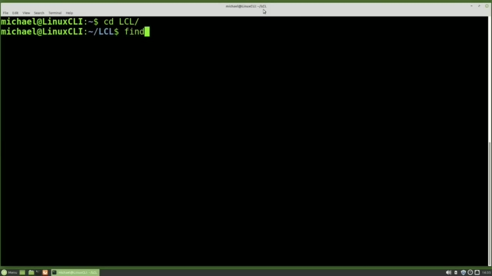
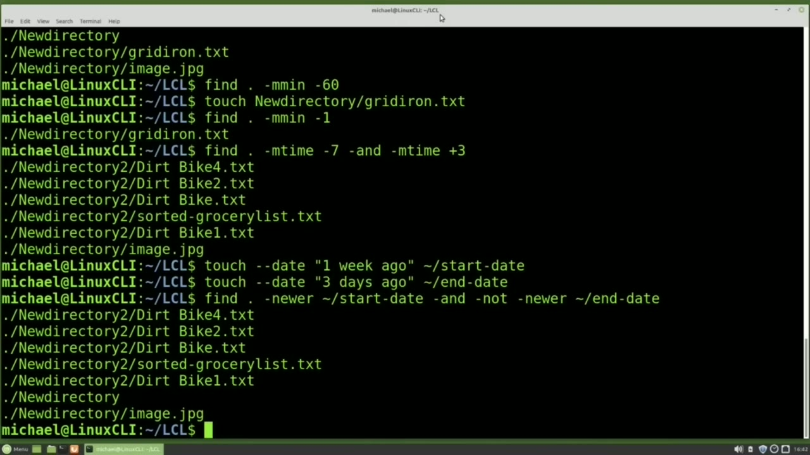
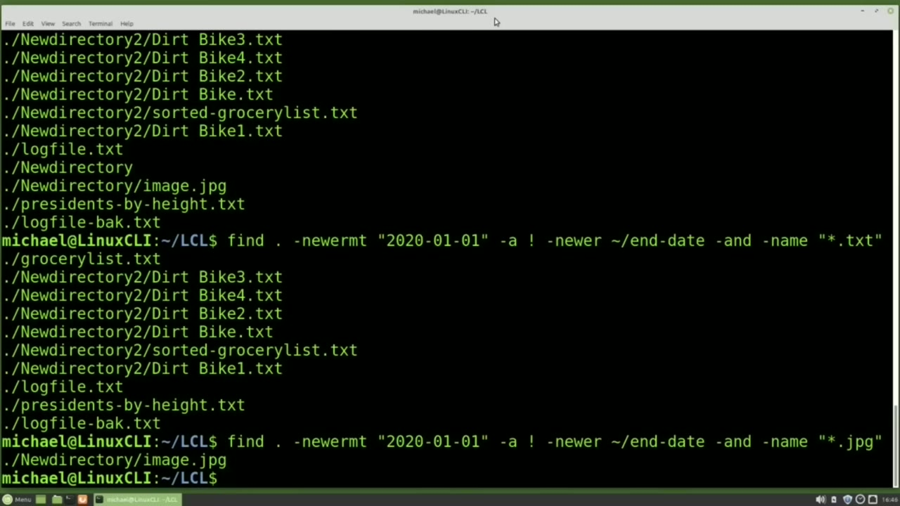
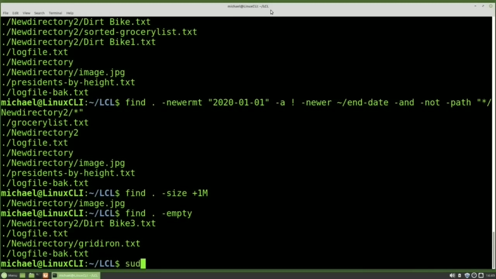

[← Course contents](../../01.md)

# 35. find pt2

**Course:** [Linux Command Line - Entire Tutorial Series](https://www.youtube.com/watch?v=avg65oY7sj4)  
**Transcript:** [`Linux Command Line - Entire Tutorial Series transcript`](../../../../course_videos/Linux%20Command%20Line%20-%20Entire%20Tutorial%20Series/Linux%20Command%20Line%20-%20Entire%20Tutorial%20Series.txt)  
**Video:** 05:16:58–05:27:32 ([open at this time](https://www.youtube.com/watch?v=avg65oY7sj4&t=19018s))

## Introduction

But that is not the only way the Find Command can find things. I'm going into the lcl directory with cdlcl and I want to find all the files in this directory and the directories below that have been modified within the last seven days. I'll do that by typing find dot -m time -7 and notice this time we're not using -name at all because we're not searching by the name. This time we're searching by the modified time.

## Detailed Explanation

<details>
  <summary>Step 1 — Run `find dot -m`, `time -7`, `stat`</summary>

### Step 1 — Run `find dot -m`, `time -7`, `stat`

- [x] **Use `find dot -m`, `time -7`**
  - But that is not the only way the Find Command can find things.
  - I'm going into the lcl directory with cdlcl and I want to find all the files in this directory and the directories below that have been modified within the last seven days.
  - I'll do that by typing `find dot -m` `time -7` and notice this time we're not using -name at all because we're not searching by the name.

- [x] **This time we're searching by the modified time**
  - This time we're searching by the modified time.
  - And then I'm adding the -7 to find everything that was modified within the last 7 days.
  - And to find everything that was modified more than 7 days ago, I will change that -7 to a plus 7.

- [x] **And another way to find things that were modified more than 7 days**
  - And another way to find things that were modified more than 7 days ago is going back to the original -7.
  - That gives us the same thing as m time plus 7.
  - And instead of typing dash not, we can also put in the exclamation point, also known as bang.

- [x] **That also shows us everything that's been modified more than seven**
  - That also shows us everything that's been modified more than seven days ago.
  - Instead of the modified time, I want to find everything that has an access time that has been updated within the last seven days.
  - Take out the knot and change the m time to an a for access time and i can do the same thing for the change time change that a to a t for changed and there's everything where the change time has been updated within the last seven days we talked about the differences between modified time

- [x] **Use `stat`, `touch`**
  - Access time and change time in video 32 when we looked at the `stat` command We can find everything in the lcl directory and the directories below that have been updated within the last 60 minutes with Find.
  - And we see nothing has been updated within the last 60 minutes.
  - I will `touch` new directory slash gridiron.t.

- [x] **And now I'll go back to that find command and instead of 60 minutes**
  - And now I'll go back to that find command and instead of 60 minutes I'm going to change it to one minute.
  - And we see that new directory gridiron.txte has been updated within the last minute.
  - At times we may want to view files updated within a range of dates.

- [x] **Use `time -7`, `touch -dash`**
  - Let's say we want to find everything that was modified within the last week, but not modified within the last three days.
  - To do that, I will type m `time -7` dash and -m time plus 3.
  - I have seen people use a file to hold the start date and end date for the find command to do that we'll first create a start date with the start date we want to use so I will say `touch -dash` date and then in quotes one week ago and I'm going to store this in my home directory so I'm using the till day for that

- [x] **Use `touch -dash`**
  - Slash start date and then for our end date we'll do the same thing `touch -dash` date three days ago and we'll also put that in our home directory and we'll call this end -date Now we're going to change our find command a little bit.
  - Our fine command will be find dot for this directory in the directories below.
  - -newer than the home directory slash start -date.

```bash
find dot -m
time -7
stat
touch
touch -dash
```



</details>

<details>
  <summary>Step 2 — Run `time -7`</summary>

### Step 2 — Run `time -7`

- [x] **Use `time -7`**
  - And that's showing us the same thing as the find m `time -7` and m time plus 3.
  - Now earlier we saw we could replace not with the exclamation point bang.
  - And we can do the same thing for or with -oh.

- [x] **We don't have one here, but we're showing it with the end as -a**
  - We don't have one here, but we're showing it with the end as -a.
  - If you're mixing your date formats, let's say that for our start date, instead of using the start date, I want to type it out as 2020-01-01.
  - So we're going to make the start date everything for the 2020 calendar year.

- [x] **But instead of newer, we'll need to add on something like mt for**
  - But instead of newer, we'll need to add on something like mt for modified time.
  - If I left this just as newer, it would show us an error.
  - And there's our result for all the files that have been updated between 2020 2001 and three days ago.

- [x] **When we're creating search criteria, we don't have to stick to a**
  - When we're creating search criteria, we don't have to stick to a single search criteria.
  - I may also want to just filter this down to just text files.
  - So I'll say dash and -name, quote asteris.

- [x] **Now we filter this down to just the text files within that date range**
  - Now we filter this down to just the text files within that date range.
  - And we can do the same thing by changing this to jpg for jpeg.

```bash
time -7
```



</details>

<details>
  <summary>Step 3 — there's the only jpeg that meets the search criteria</summary>

### Step 3 — there's the only jpeg that meets the search criteria

- [x] **And there's the only jpeg that meets the search criteria**
  - And there's the only jpeg that meets the search criteria.
  - Another thing we might want to do is filter out a path.
  - Let's go back to just the date range here.

- [x] **And we see that we have the new directory 2 and some in the new**
  - And we see that we have the new directory 2 and some in the new directory.
  - Let's filter out the new directory to directory.
  - To do that, I will add in dash and dash not -path.

- [x] **And now in quotes, I'll put in asteris slash new directory 2 slash**
  - And now in quotes, I'll put in asteris slash new directory 2 slash asteris.
  - And we filtered out all the results from the new directory to directory.
  - This can also be helpful if you're doing a search and you don't have access to a specific directory.

- [x] **You want to filter out those results. Add in the dash not -path**
  - You want to filter out those results. Add in the dash not -path.
  - Sometimes we might be running out of disk space and we want to see what our large files are.
  - I'm going to find in this directory and the directories below all the files with a -size greater than so I'm using the plus one megabyte. Anything greater than a We have one file, the image.jpG.

- [x] **Another thing we can search for is empty files**
  - Another thing we can search for is empty files.
  - Let's find in the lcl directory and below with a dot.



</details>

<details>
  <summary>Step 4 — Run `sudo find`, `sudo`, `sudo -ls -lh`</summary>

### Step 4 — Run `sudo find`, `sudo`, `sudo -ls -lh`

- [x] **Use `sudo find`**
  - Other things we can `find` are items that have a specific user.
  - I'm going to type `sudo`, `find`, and I'm going to look in the slash srv slash chemistry directory.
  - For everything that has a user, so I'm using -user of Ryan.

- [x] **Use `sudo`, `sudo find`**
  - The srv chemistry directory and files were created in a previous tutorial, and the Michael user was not a part of that group.
  - That's why I need to use `sudo` before the command to view everything in that directory.
  - We can also `find` files by a specific group with `sudo find`.

- [x] **Use `sudo -ls -lh`**
  - Srv Chemistry -Group of Lisa We see that there's one file where Lisa is the owner of a group And I'll type `sudo -ls -lh` slash srv Chemistry to show what's in that directory.
  - And there we see that Ryan is the user of the Test 2 file and that the Test File 4.tXT file has a group of Lisa.
  - We can also `find` files with specific file permissions.

- [x] **Use `find`**
  - I'm going to type `find` all the files in the lcl directory and the directories below that have a -perm for permissions of 777.
  - And there we see we've got one file gridiron.txte.
  - Once we have a fine result set like this one here, let's say that we want to delete that.

- [x] **What we do is we create our find command like we have here and if we**
  - What we do is we create our `find` command like we have here and if we add...
  - -delete, it's going to delete everything that was found in that `find` command.
  - So in this case it'll be a single file, gridiron.txt.

- [x] **Use `find`**
  - And if I try and `find` all the files now that have a permission of 777 and we get no results because we just deleted them all.
  - Besides the `find` command, we can also `find` files with the locate command.
  - We can do that with locate and then the file name.

- [x] **Use `sudo update`, `find`**
  - I'm going to use the name GroceryList. txt. Here we see it's found three times. I'm going to copy the GroceryList.TXT file and make this GroceryList.tXT2. Now if I try and locate those again, our new file is not found because the locate has not updated the database. To update the database,
  - I will type `sudo`, update db. And now if I type in Locate GrocerlyList.TXT. It finds our GroceryList.TXT too.
  - The Locate is very fast, but does not have those filtering features that the `find` Command has.

- [x] **In the next video, we'll continue looking at the Linux command line**
  - In the next video, we'll continue looking at the Linux command line.

```bash
sudo find
sudo
sudo -ls -lh
find
sudo update
```



</details>

<details>
  <summary>Questions and Answers</summary>

## Questions and Answers

### Question 1: What does `find` do in this chapter?

<details>
<summary>Answer</summary>

- [x] But that is not the only way the `find` Command can `find` things.

</details>

### Question 2: What does `find dot -m` do in this chapter?

<details>
<summary>Answer</summary>

- [x] I'll do that by typing `find dot -m` time -7 and notice this time we're not using -name at all because we're not searching by the name.

</details>

### Question 3: What does `time -7` do in this chapter?

<details>
<summary>Answer</summary>

- [x] I'll do that by typing find dot -m `time -7` and notice this time we're not using -name at all because we're not searching by the name.

</details>

### Question 4: What does `stat` do in this chapter?

<details>
<summary>Answer</summary>

- [x] Access time and change time in video 32 when we looked at the `stat` command We can find everything in the lcl directory and the directories below that have been updated within the last 60 minutes with Find.

</details>

### Question 5: What does `touch` do in this chapter?

<details>
<summary>Answer</summary>

- [x] I will `touch` new directory slash gridiron.t.

</details>

### Question 6: What does `touch -dash` do in this chapter?

<details>
<summary>Answer</summary>

- [x] I have seen people use a file to hold the start date and end date for the find command to do that we'll first create a start date with the start date we want to use so I will say `touch -dash` date and then in quotes one week ago and I'm going to store this in my home directory so I'm using the till day for that

</details>

### Question 7: What does `sudo find` do in this chapter?

<details>
<summary>Answer</summary>

- [x] I'm going to type Sudo, find, and I'm going to look in the slash srv slash chemistry directory.

</details>

### Question 8: What does `sudo` do in this chapter?

<details>
<summary>Answer</summary>

- [x] That's why I need to use `sudo` before the command to view everything in that directory.

</details>

### Question 9: What does `sudo -ls -lh` do in this chapter?

<details>
<summary>Answer</summary>

- [x] Srv Chemistry -Group of Lisa We see that there's one file where Lisa is the owner of a group And I'll type `sudo -ls -lh` slash srv Chemistry to show what's in that directory.

</details>

### Question 10: What does `sudo update` do in this chapter?

<details>
<summary>Answer</summary>

- [x] I will type Sudo, update db. And now if I type in Locate GrocerlyList.TXT. It finds our GroceryList.TXT too.

</details>

</details>

## Summary

This chapter, find pt2, walks through Run find dot -m, time -7, stat; Run time -7; there's the only jpeg that meets the search criteria; Run sudo find, sudo, sudo -ls -lh. Commands from the transcript: `find dot -m`, `time -7`, `stat`, `touch`, `touch -dash`, `sudo find`, `sudo`, `sudo -ls -lh`, `find`, `sudo update`.

## References

- [Linux Command Line - Entire Tutorial Series (YouTube)](https://www.youtube.com/watch?v=avg65oY7sj4)
- [This chapter at 05:16:58](https://www.youtube.com/watch?v=avg65oY7sj4&t=19018s)
- [Local transcript](../../../../course_videos/Linux%20Command%20Line%20-%20Entire%20Tutorial%20Series/Linux%20Command%20Line%20-%20Entire%20Tutorial%20Series.txt)
