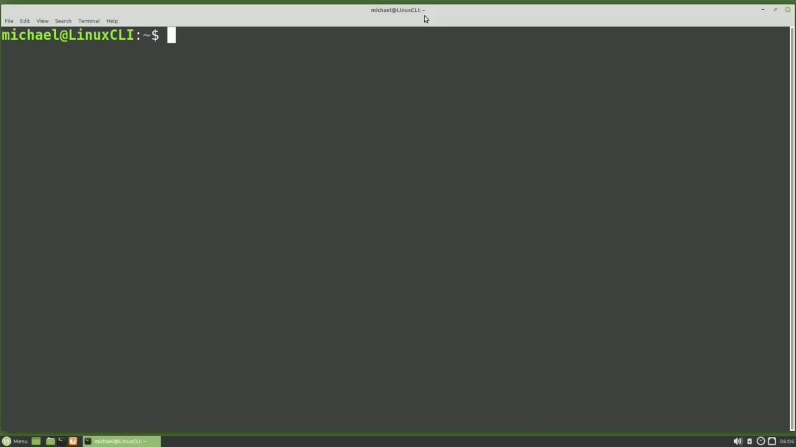
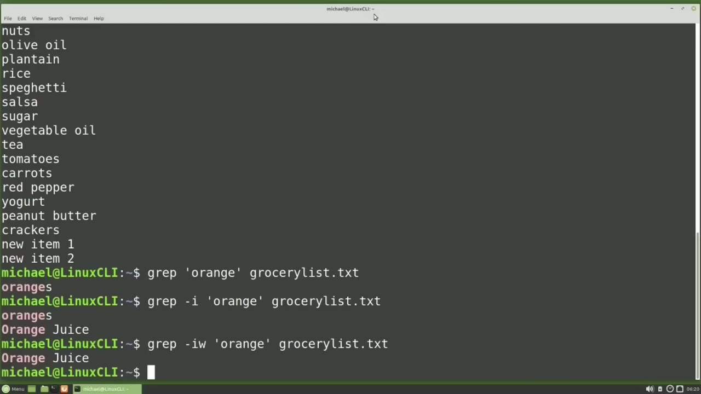
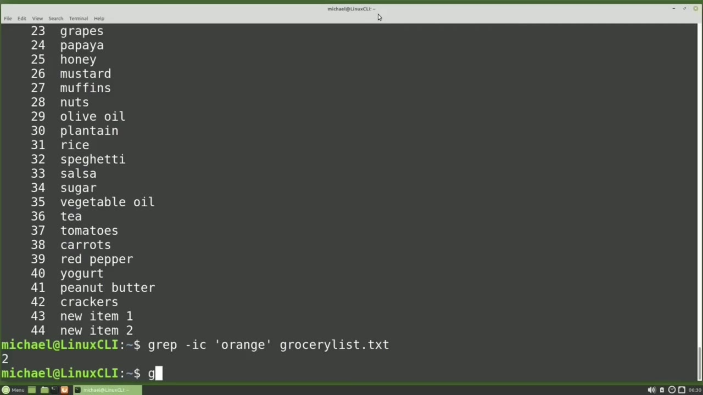
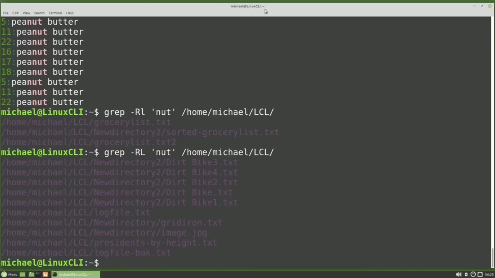

[← Course contents](../../01.md)

# 36. grep

**Course:** [Linux Command Line - Entire Tutorial Series](https://www.youtube.com/watch?v=avg65oY7sj4)  
**Transcript:** [`Linux Command Line - Entire Tutorial Series transcript`](../../../../course_videos/Linux%20Command%20Line%20-%20Entire%20Tutorial%20Series/Linux%20Command%20Line%20-%20Entire%20Tutorial%20Series.txt)  
**Video:** 05:27:32–05:36:42 ([open at this time](https://www.youtube.com/watch?v=avg65oY7sj4&t=19652s))

## Introduction

In the last couple of videos, we looked at the Find Command, and the Find Command works well for finding files, but sometimes we want to find a specific string of characters in a file. Will use grep. The name grep goes back to the old days of Unix and stood for Global Regular Expression Print. Grep will search through a file or files for a regular expression and then show us the lines where that regular expression was found. I'm going to use grep to search the GroceryList.T file for a regex. regex is just short for regular expression.

## Detailed Explanation

<details>
  <summary>Step 1 — Run `find`, `grep`, `grep goes`</summary>

### Step 1 — Run `find`, `grep`, `grep goes`

- [x] **Use `find`, `grep`, `grep goes`**
  - In the last couple of videos, we looked at the `find` Command, and the `find` Command works well for finding files, but sometimes we want to `find` a specific string of characters in a file.
  - Will use `grep`. The name `grep goes` back to the old days of Unix and stood for Global Regular Expression Print.
  - `grep` will search through a file or files for a regular expression and then show us the lines where that regular expression was found.

- [x] **Use `grep`**
  - I'm going to use `grep` to search the GroceryList.T file for a regex. regex is just short for regular expression.
  - And I'll use both terms regex and regular expression to mean the same thing in this tutorial.
  - I'm going to type `grep` to GroceryList. txt.

- [x] **Use `grep`**
  - And this is the original GrocerlyList.T file from Video 7, not the updated GroceryList.T file from Video 33.
  - Earlier I said `grep` would search for a regular expression, but here I'm just typing in the word 2.
  - That's correct. The word 2 is a very simple regular expression.

- [x] **And that regular expression is just the letters T and O next to each**
  - And that regular expression is just the letters T and O next to each other in that order.
  - We will talk more about regular expressions in the next video.
  - For this video, all our regular expressions will be text characters in an order.

- [x] **Use `grep found`**
  - And right now we want to `find` every line in the file GroceryList. txt where the letters T and O are found in that order.
  - We see four lines where `grep found` the regular expression 2.
  - The regular expression 2 is highlighted, but the entire line is returned.

- [x] **I will cat the Grocerlist.TXT file to remind us what is in that file**
  - I will cat the Grocerlist.TXT file to remind us what is in that file.
  - It's just a list of items you might `find` on a grocery list, and Enter was pressed at the end of each line.
  - Depending on the file that you're grepping, your line of text may be much longer than what you expect.

- [x] **Use `grep`**
  - I'm going to `grep` for orange in my GroceryList.t.fxT file.
  - It's a good idea to put your regular expressions in quotes.
  - Even though it's not necessary to do so for these simple regular expressions, it's a good practice to get into.

- [x] **I will put all my regular expressions in quotes**
  - I will put all my regular expressions in quotes.
  - Pressing Enter, we see that Orange is found once in oranges.
  - But looking over what is in our GroceryList.T file, we see Orange is on there a second time with an uppercase O for Orange Juice.

- [x] **Use `grep searches`**
  - `grep searches` for an exact match, including Case.
  - To search for my regular expression and ignore the case, I will add a -lowercase I And here we see it found orange twice, once with the lower case O in the line oranges and once with the uppercase O in the line orange juice.
  - This works pretty well, but I may only want to `find` my regular expression when it is a word by itself and not part of a larger word.

- [x] **This will search Case Insensitive and then only return the lines**
  - This will search Case Insensitive and then only return the lines where my regex is a single word and not part of a larger word.

```bash
find
grep
grep goes
grep found
grep searches
```



</details>

<details>
  <summary>Step 2 — Run `grep`, `grep results`, `cat -N`</summary>

### Step 2 — Run `grep`, `grep results`, `cat -N`

- [x] **Use `grep`**
  - Now we only see Orange Juice. `grep` is still returning the entire line, which is why we see Orange Juice, but Orange is a word by itself, meaning with spaces on both sides of it.
  - And oranges is not included because it is a bigger word that includes the word orange.
  - We may want to know what line numbers our regex is found on.

- [x] **I will take out that W option and change it to an N**
  - I will take out that W option and change it to an N.
  - So we still have our I to ignore the case, but now we have the N to show us the line numbers where it is found as well.
  - And we see oranges is found on line 8 and orange juice is found on line 27.

- [x] **Use `grep`, `grep results`**
  - There may be times when we want to filter out the lines where our regex is found, meaning show me the entire file, but don't show me the lines where oranges is found on lines 8 and 27.
  - To do that, we want to `grep` the opposite or inverse of the `grep results`.
  - So I will use the lowercase V option to show us the inverse results.

- [x] **Use `cat -N`**
  - I'm still keeping the eye in there for the case insensitive.
  - And adding the V for the inverse. Here we don't see oranges or orange juice, but since we know the line numbers, we may want to pipe our results out to cat and then add the line numbers with pipe `cat -N`.
  - Now we can see around lines 27 and going up around line 8, we can see that oranges was filtered out just as we had expected.

- [x] **We may not care where the regex is found**
  - We may not care where the regex is found.
  - We just want to know how many times our regex is found in that file.
  - And for that we'll use the C option for count.

- [x] **Use `grep finds`**
  - I'll take off the cat n and I'm going to change the V to a C.
  - And we're still using the I for case insensitive.
  - And `grep finds` the word orange in two places.

- [x] **Now I'm going to change my regular expression**
  - Now I'm going to change my regular expression.

```bash
grep
grep results
cat -N
grep finds
```



</details>

<details>
  <summary>Step 3 — Run `grep`</summary>

### Step 3 — Run `grep`

- [x] **Use `grep`**
  - I'm going to `grep` for the word nut.
  - And I'm going to search for that in my home directory and then in the lcl directory.
  - And actually this will not work as it's set up.

- [x] **Use `grep`**
  - Linux is responding telling us that we're trying to `grep` a directory.
  - And we can't do that, but we can `grep` all the files in that directory recursively by adding a -R.
  - To this command. Now we will rep recursively every file in that directory and its subdirectories.

- [x] **Use `grep`**
  - And we see that nut is found three times in the Grocery List.T. File found in Home Michael, lcl. And it's found three times in the Sorted Grocerly List.T.file in the Home Michael lcl New Directory 2 directory. And then it's found a third time in the Grocery List.T.2 file.
  - We saw earlier that we could show the lines in our regex by adding an N to the `grep` command.
  - And notice our Sorted File shows all the lines are right next to each other.

- [x] **If we don't want to show the path, we can hide the path by adding -H**
  - If we don't want to show the path, we can hide the path by adding -H.
  - We still have our line numbers showing because we still have the -N option.
  - If we want to show the path only, we can use the -L option.

- [x] **That -L option will suppress the normal output and print only the**
  - That -L option will suppress the normal output and print only the files where the regex is found. And then if we change that lowercase L to an uppercase L, this will show us the opposite of that lowercase L.

```bash
grep
```



</details>

<details>
  <summary>Step 4 — Run `grep`, `passwd`, `grep lisa`</summary>

### Step 4 — Run `grep`, `passwd`, `grep lisa`

- [x] **Use `grep`, `passwd`**
  - This lists all the files in the lcl directory that `grep` does not match the regex. Up to now, we've used `grep` on specific files and we've greped a directory, but we can also pipe data into `grep`, like we have with less and sort earlier in this tutorial series.
  - What I mean by that is in an earlier tutorial we used Cat, /etc, `passwd`, and that showed us the big file with everything in it.
  - And then I would start speaking about a specific user like Lisa.

- [x] **Use `grep`, `grep lisa`**
  - Well, we can pipe our cat into `grep`, and just select that line.
  - Pipe, `grep`, Lisa.
  - And now we just see the single line for Lisa.

- [x] **Use `ls`, `grep`**
  - And that works for other things as well.
  - Let's use the `ls` command.
  - And again, I'll press the arrow up and add Pipe, `grep`, and we'll `grep` for anything that starts with gro.

- [x] **Use `grep`, `ls`**
  - Now it doesn't have to be part of the name. We can `grep` for anything in the `ls` command.
  - Let's `grep` for 2019. And there's all the files that were updated in 2019.
  - Or maybe I want to see all the files with a specific permission, like r-x.

- [x] **Use `grep`**
  - And there's all our files with a permission of R-Sach-X.
  - In the next tutorial, we're going to get an introduction of regex and how it works with `grep` for the Linux command line.
  - In the last video, we said that `grep` comes from the old days of Unix and stood for Global Regular Expression Print.

```bash
grep
passwd
grep lisa
ls
```



</details>

<details>
  <summary>Questions and Answers</summary>

## Questions and Answers

### Question 1: What does `find` do in this chapter?

<details>
<summary>Answer</summary>

- [x] In the last couple of videos, we looked at the `find` Command, and the `find` Command works well for finding files, but sometimes we want to `find` a specific string of characters in a file.

</details>

### Question 2: What does `grep` do in this chapter?

<details>
<summary>Answer</summary>

- [x] Will use `grep`. The name `grep` goes back to the old days of Unix and stood for Global Regular Expression Print.

</details>

### Question 3: What does `grep goes` do in this chapter?

<details>
<summary>Answer</summary>

- [x] Will use grep. The name `grep goes` back to the old days of Unix and stood for Global Regular Expression Print.

</details>

### Question 4: What does `grep found` do in this chapter?

<details>
<summary>Answer</summary>

- [x] We see four lines where `grep found` the regular expression 2.

</details>

### Question 5: What does `grep searches` do in this chapter?

<details>
<summary>Answer</summary>

- [x] `grep searches` for an exact match, including Case.

</details>

### Question 6: What does `grep results` do in this chapter?

<details>
<summary>Answer</summary>

- [x] To do that, we want to grep the opposite or inverse of the `grep results`.

</details>

### Question 7: What does `cat -N` do in this chapter?

<details>
<summary>Answer</summary>

- [x] And adding the V for the inverse. Here we don't see oranges or orange juice, but since we know the line numbers, we may want to pipe our results out to cat and then add the line numbers with pipe `cat -N`.

</details>

### Question 8: What does `grep finds` do in this chapter?

<details>
<summary>Answer</summary>

- [x] And `grep finds` the word orange in two places.

</details>

### Question 9: What does `passwd` do in this chapter?

<details>
<summary>Answer</summary>

- [x] What I mean by that is in an earlier tutorial we used Cat, /etc, `passwd`, and that showed us the big file with everything in it.

</details>

### Question 10: What does `grep lisa` do in this chapter?

<details>
<summary>Answer</summary>

- [x] Pipe, Grep, Lisa.

</details>

### Question 11: What does `ls` do in this chapter?

<details>
<summary>Answer</summary>

- [x] Let's use the `ls` command.

</details>

</details>

## Summary

This chapter, grep, walks through Run find, grep, grep goes; Run grep, grep results, cat -N; Run grep; Run grep, passwd, grep lisa. Commands from the transcript: `find`, `grep`, `grep goes`, `grep found`, `grep searches`, `grep results`, `cat -N`, `grep finds`, `passwd`, `grep lisa`, `ls`.

## References

- [Linux Command Line - Entire Tutorial Series (YouTube)](https://www.youtube.com/watch?v=avg65oY7sj4)
- [This chapter at 05:27:32](https://www.youtube.com/watch?v=avg65oY7sj4&t=19652s)
- [Local transcript](../../../../course_videos/Linux%20Command%20Line%20-%20Entire%20Tutorial%20Series/Linux%20Command%20Line%20-%20Entire%20Tutorial%20Series.txt)
