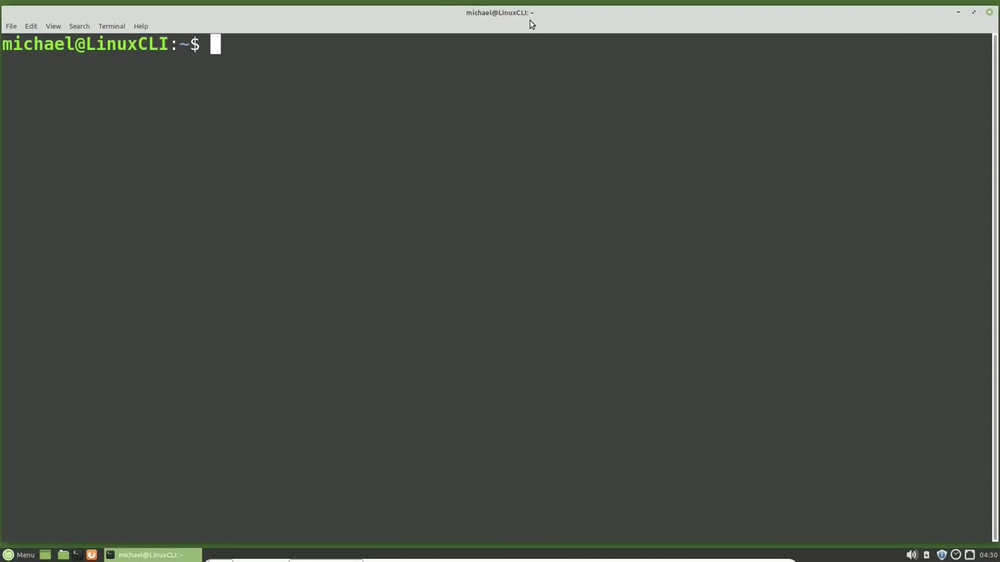
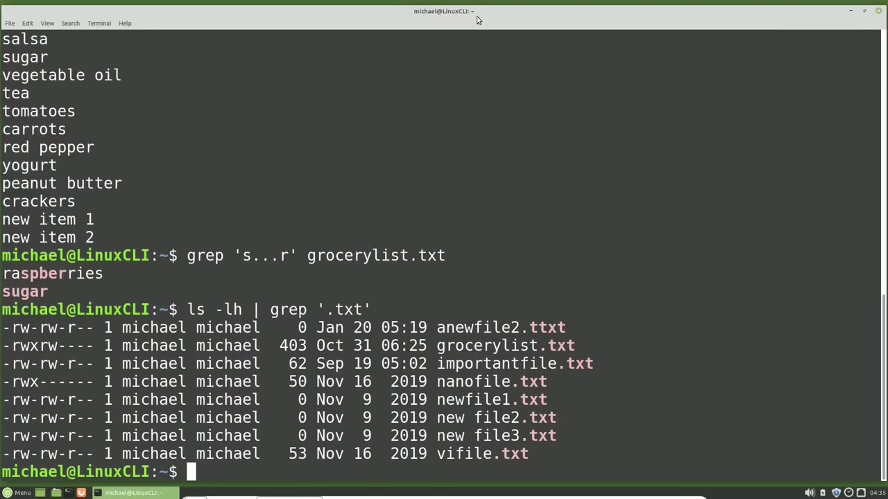
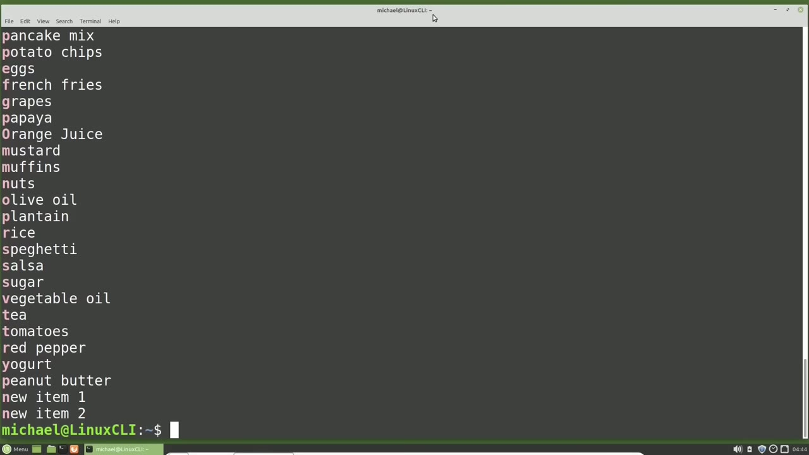

[← Course contents](../../01.md)

# 37. Intro to RegEx pt1

**Course:** [Linux Command Line - Entire Tutorial Series](https://www.youtube.com/watch?v=avg65oY7sj4)  
**Transcript:** [`Linux Command Line - Entire Tutorial Series transcript`](../../../../course_videos/Linux%20Command%20Line%20-%20Entire%20Tutorial%20Series/Linux%20Command%20Line%20-%20Entire%20Tutorial%20Series.txt)  
**Video:** 05:36:42–05:42:57 ([open at this time](https://www.youtube.com/watch?v=avg65oY7sj4&t=20202s))

## Introduction

We also said that a regular expression can be referred to as regex. In short, a regular expression is a string of text that allows us to create patterns that help match, locate, and manage text. Regular expressions have been around for years and are used in many programming languages and text editors, sometimes having slight differences. Regular expressions can be quite complex, but we're not going to get that deep into regular expressions.

## Detailed Explanation

<details>
  <summary>Step 1 — Run `grep`, `ls -lh`</summary>

### Step 1 — Run `grep`, `ls -lh`

- [x] **We also said that a regular expression can be referred to as regex**
  - We also said that a regular expression can be referred to as regex.
  - In short, a regular expression is a string of text that allows us to create patterns that help match, locate, and manage text.
  - Regular expressions have been around for years and are used in many programming languages and text editors, sometimes having slight differences.

- [x] **Use `grep`**
  - Regular expressions can be quite complex, but we're not going to get that deep into regular expressions.
  - That's why this is called an introduction to regular expressions.
  - Here we will get a basic understanding of how to create regular expressions used with the `grep` command.

- [x] **We're going to be using that same grocery list.T file that we've been**
  - We're going to be using that same grocery list.T file that we've been using throughout this video series, but I will cat it out once again just to remind us of what's in that file.
  - The first thing we're going to look at is how to use the period wildcard with Rejects.
  - The period is a regular expression wildcard for a single character.

- [x] **Use `grep`**
  - It can be any character, but there must be a single character for each period.
  - This works the same as we saw in the Fine Command a few videos back.
  - I will type `grep` quote S period period period R end quote space Grocery List. txt and that returns sugar and raspberries.

- [x] **Use `ls -lh`, `grep`**
  - We see that both of these have the pattern S, 3 characters and then an R.
  - Now I'm going to type `ls -lh` pipe, `grep` quote period txt, end quote.
  - And a quick look makes us think our output is correct, but if we take a closer look and look at that top file called A New File 2, we see that those last four characters are actually T ttxt.

- [x] **We wanted to search for period txt, but we ended up searching for**
  - We wanted to search for period txt, but we ended up searching for Wildcard txt.
  - To turn off that wild card feature, we need to add the escape character, which is a backslash.

```bash
grep
ls -lh
```



</details>

<details>
  <summary>Step 2 — Run `grep`, `find`</summary>

### Step 2 — Run `grep`, `find`

- [x] **Use `grep`**
  - And we'll add that right before the period to make it dot txt and not wildcard txt now the ttxt file is not included in our `grep` output i've got a list of regex characters we're looking at in this video we started with the period wildcard and then we have the escape character and i will put the complete list of what is shown in this video out on the website
  - And you can download it for free and i'll put a link to the download in the video description below this YouTube video.
  - The next thing we're going to look at is the carrot symbol.

- [x] **For me, it's Shift 6 on my American Quirty keyboard**
  - For me, it's Shift 6 on my American Quirty keyboard.
  - And that character means the line of text will start with the following character or characters.
  - I want to create a regular expression to `find` all the lines that start with the letter C, so my command will look like...

- [x] **Use `grep`**
  - `grep` quote, carrot, c, end quote, grocery list. txt.
  - And here we see all the lines in the file that start with the letter C.
  - Adding an H after the C will filter down the output.

- [x] **Use `find`**
  - Now the output will only show the lines that start with c.h.
  - Or maybe we want to change our regex to show everything starting with the letter C or the letter H.
  - We already saw this one too when we were looking at the `find` command.

- [x] **And the brackets allow us to search for any single character between**
  - And the brackets allow us to search for any single character between those brackets.
  - So in this case, we have the carrot at the beginning, which means the line starts with.
  - Then we have the brackets, which means any single character in those brackets.

- [x] **So in this case, our line can start with the letter C or our line can**
  - So in this case, our line can start with the letter C or our line can start with the letter H.
  - If we want to search for everything that does not start with the letter C or the letter H, we would add a carrot inside of those brackets.
  - And this is where things can get a little tricky.

```bash
grep
find
```



</details>

<details>
  <summary>Step 3 — Run `grep`</summary>

### Step 3 — Run `grep`

- [x] **The carrot outside of the brackets means the line starts with the**
  - The carrot outside of the brackets means the line starts with the next characters.
  - But the carrot inside the brackets has a totally different meaning.
  - The line starts with anything that is not a C.

- [x] **Use `grep`**
  - Or an H. We can also `grep` for lines that end with specific text.
  - The end of line symbol is the dollar sign. So typing `grep` Quote S dollar sign quote GrocerlyList. txt will show us the lines that end with a lowercase S.
  - The thing to note here is the dollar sign is on the right of what we are grepping, whereas the carrot was on the left.

- [x] **Or the beginning of the line. And the carrot in the brackets as well**
  - Or the beginning of the line. And the carrot in the brackets as well was on the left.
  - Here we want the characters we are grapping for to be on the left and the dollar sign on the right.
  - And it doesn't have to be a single character. I was just using a single character to get more results. Let's add in ie to make that ies. Or I could change that to an entire word, something like chips.

- [x] **And here we see the only line that ends with chips, which is potato**
  - And here we see the only line that ends with chips, which is potato chips.
  - Here we see what we've looked at so far.
  - But there is more that I want to include in our introduction to regular expressions, but this is a good breaking point.

- [x] **In the next video, we are going to finish our look at regular**
  - In the next video, we are going to finish our look at regular expressions for the Linux command line.

```bash
grep
```



</details>

<details>
  <summary>Questions and Answers</summary>

## Questions and Answers

### Question 1: What does `grep` do in this chapter?

<details>
<summary>Answer</summary>

- [x] Here we will get a basic understanding of how to create regular expressions used with the `grep` command.

</details>

### Question 2: What does `ls -lh` do in this chapter?

<details>
<summary>Answer</summary>

- [x] Now I'm going to type `ls -lh` pipe, grep quote period txt, end quote.

</details>

### Question 3: What does `find` do in this chapter?

<details>
<summary>Answer</summary>

- [x] We already saw this one too when we were looking at the `find` command.

</details>

### Question 4: What does step 1 cover (Run grep, ls -lh)?

<details>
<summary>Answer</summary>

- [x] We also said that a regular expression can be referred to as regex.
- [x] In short, a regular expression is a string of text that allows us to create patterns that help match, locate, and manage text.
- [x] Regular expressions have been around for years and are used in many programming languages and text editors, sometimes having slight differences.

</details>

### Question 5: What does step 2 cover (Run grep, find)?

<details>
<summary>Answer</summary>

- [x] And we'll add that right before the period to make it dot txt and not wildcard txt now the ttxt file is not included in our `grep` output i've got a list of regex characters we're looking at in this video we started with the period wildcard and then we have the escape character and i will put the complete list of what is shown in this video out on the website
- [x] And you can download it for free and i'll put a link to the download in the video description below this YouTube video.
- [x] The next thing we're going to look at is the carrot symbol.

</details>

### Question 6: What does step 3 cover (Run grep)?

<details>
<summary>Answer</summary>

- [x] The carrot outside of the brackets means the line starts with the next characters.
- [x] But the carrot inside the brackets has a totally different meaning.
- [x] The line starts with anything that is not a C.

</details>

</details>

## Summary

This chapter, Intro to RegEx pt1, walks through Run grep, ls -lh; Run grep, find; Run grep. Commands from the transcript: `grep`, `ls -lh`, `find`.

## References

- [Linux Command Line - Entire Tutorial Series (YouTube)](https://www.youtube.com/watch?v=avg65oY7sj4)
- [This chapter at 05:36:42](https://www.youtube.com/watch?v=avg65oY7sj4&t=20202s)
- [Local transcript](../../../../course_videos/Linux%20Command%20Line%20-%20Entire%20Tutorial%20Series/Linux%20Command%20Line%20-%20Entire%20Tutorial%20Series.txt)
