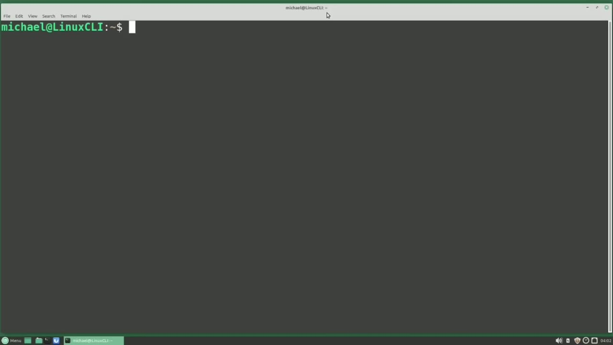
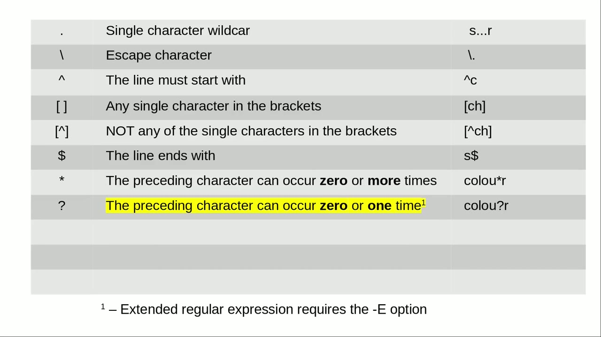
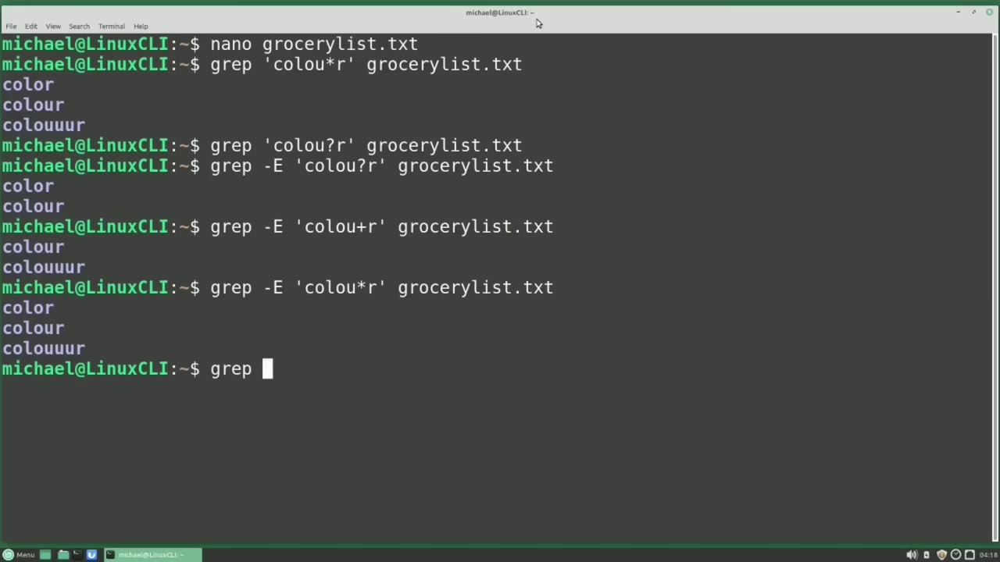
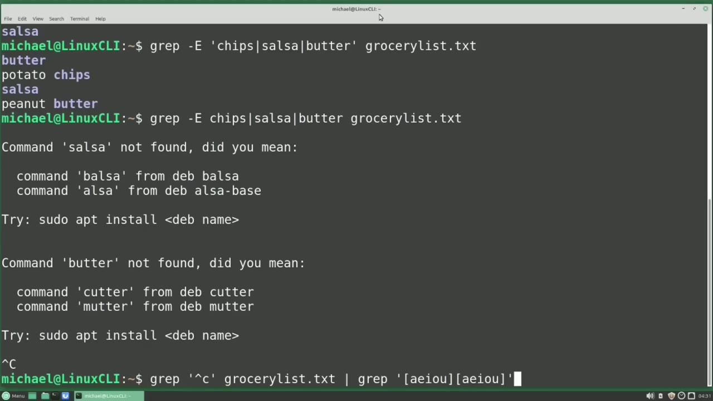

[← Course contents](../../01.md)

# 38. Intro to RegEx pt2

**Course:** [Linux Command Line - Entire Tutorial Series](https://www.youtube.com/watch?v=avg65oY7sj4)  
**Transcript:** [`Linux Command Line - Entire Tutorial Series transcript`](../../../../course_videos/Linux%20Command%20Line%20-%20Entire%20Tutorial%20Series/Linux%20Command%20Line%20-%20Entire%20Tutorial%20Series.txt)  
**Video:** 05:42:57–05:54:04 ([open at this time](https://www.youtube.com/watch?v=avg65oY7sj4&t=20577s))

## Introduction

We are picking up from where we left off in the last video. And I'm going to add some items to our grocery list. txt file. I'm typing nano grocery list.txte. I'm going down to the bottom of the file.

## Detailed Explanation

<details>
  <summary>Step 1 — Run `nano grocery`, `grep`</summary>

### Step 1 — Run `nano grocery`, `grep`

- [x] **Use `nano grocery`**
  - We are picking up from where we left off in the last video.
  - And I'm going to add some items to our grocery list. txt file.
  - I'm typing `nano grocery` list.txte.

- [x] **I'm going down to the bottom of the file**
  - I'm going down to the bottom of the file.
  - And I'm going to add the word corn and then color and then color again, but this time with the you in it.
  - Color one more time but I'm going to add 3 U's.

- [x] **And now I will save this by pressing Ctrl+X and then Y without**
  - And now I will save this by pressing Ctrl+X and then Y without control and then enter.
  - Now that we have updated our file we are going to look at how the asterisk works for a regular expression.
  - We are also going to look at the question mark as well as the plus sign because these are all very similar but slightly different.

- [x] **Use `grep`**
  - Starting with the asteris, we see that the preceding character can occur zero or more times.
  - I'm going to `grep` for the word color with the you and then I'm adding the asteris right after that you.
  - So that preceding character, the you can occur zero or more times.

- [x] **And I'm grepping the file Grocerylist.T.T that we just updated**
  - And I'm grepping the file Grocerylist.T.T that we just updated.
  - We see it returned the American spelling of color without the U because the asteris allows for the U zero times.

```bash
nano grocery
grep
```



</details>

<details>
  <summary>Step 2 — Run `grep`</summary>

### Step 2 — Run `grep`

- [x] **Then we see color with the single U and the three U because the**
  - Then we see color with the single U and the three U because the asteris also allows for the preceding character to show one or more times.
  - I've highlighted this one because it's an extended regular expression.
  - Extended regular expression just means it's not one of the original regular expressions.

- [x] **Use `grep`**
  - So we will have to add a -uppercase E to our `grep`.
  - The question mark allows for the preceding character zero or one time.
  - I'm going to press the arrow up to bring back that previous command, and I'm going to change that asterisk to a question mark.

- [x] **And when I press enter, nothing is returned**
  - And when I press enter, nothing is returned.
  - The problem is we didn't have that -uppercase E.
  - We didn't get an error because that r-j-x we were searching for was c-o-l-o-u question mark R.

- [x] **As if we had a backslash before the question mark to escape it**
  - As if we had a backslash before the question mark to escape it.
  - So that is why we did not get an error and we did not find anything.
  - I'm going to press the arrow up again and add in the...

- [x] **-uppercase e for extended regular expression and press enter**
  - -uppercase e for extended regular expression and press enter.
  - Now we see the words color without any U and color with the single U, but the color with the three U is not included. That's because there is more than one U and the question mark only returns zero or one occurrence of the character before it.
  - The other special character similar to the asteris in the question mark is the plus sign and the plus sign will return the lines if the character before the plus sign occurs at least one time or more than one time. Pressing the arrow up again I will change that question mark to a plus sign and press enter.

- [x] **Use `grep`**
  - Here we see exactly what we would expect to see.
  - The American spelling of color without the U is not included in the output but the version with the single U and the version with the 3 U's are showing in the output.
  - Now we can run `grep` with the -uppercase E every time.

- [x] **I'll press the arrow up and go over and change that plus sign to an**
  - I'll press the arrow up and go over and change that plus sign to an asteris.
  - Pressing enter, we see it runs the same with the -uppercase E as it did the first time without the -uppercase E.
  - So we can include that -uppercase E every time if we like.

- [x] **Some of us are used to see an asteris as a wildcard for anything**
  - Some of us are used to see an asteris as a wildcard for anything, zero or more times.
  - But with regex, it's a wild card for the single character preceding it.
  - So how do we do a wild card of nothing, single character of anything, or multiple characters of anything?

- [x] **To do that, we can precede the asteris with a period**
  - To do that, we can precede the asteris with a period.

```bash
grep
```



</details>

<details>
  <summary>Step 3 — Run `grep`</summary>

### Step 3 — Run `grep`

- [x] **Use `grep`**
  - `grep`, quote, C, O, period, asteris, R, end quote.
  - GroceryList.T.T. The period is a wildcard for a single value.
  - The asteris makes that wildcard good for zero or more occurrences.

- [x] **Use `grep`**
  - Now our `grep` will work for anything that has C, O, followed by nothing, or followed by a character or many characters, zero or more times, then followed by an R.
  - Pressing Enter. This time we see Corn is also included, as well as those three different versions of color.
  - Another extended regular expression I want to talk about is the or expression.

- [x] **Use `grep`**
  - And the or can be done with the pipe character.
  - Let's `grep` our GroceryList.t.f for chips or salsa.
  - We will start with `grep` and then we'll add the -uppercase E because or is an extended regular expression.

- [x] **Now let's add in our regular expression which will be quote chips**
  - Now let's add in our regular expression which will be quote chips.
  - Pipe, salsa, end quote, grocery list. txt.
  - Here we see potato chips and salsa are both on the grocery list.

- [x] **I'm pressing arrow up and I will add in pipe, butter**
  - I'm pressing arrow up and I will add in pipe, butter.
  - And here we see it found butter and peanut butter.
  - As well as the potato chips and salsa that it found a moment to go.

- [x] **Now this is also a good example of why we need to put our regular**
  - Now this is also a good example of why we need to put our regular expression in quotes.
  - If we remove the quotes from this regular expression, this time the grip fails.
  - It failed because it thinks we're trying to pipe chips into salsa and pipe that salsa into butter, which makes no sense at all. So I'm going to press Ctrl+C to cancel out of that.

- [x] **Use `grep`**
  - To `grep` with and, let's say we want to `grep` for everything that starts with a C and has two vowels next to each other, we could type `grep`, quote, carrot.
  - C, end quote, grocery list. txt. That's the first part that will find all the lines that start with the letter C.
  - Then we want to pipe that `grep` into another `grep`.

- [x] **Use `grep`**
  - And then this `grep` will be for the two vowels next to each other.
  - And to find a vowel, I'm going to use the brackets and type in all the vowels.
  - A-e-i-o-u, closing bracket, and I want another vowel right next to that so I'll use the open bracket A E I ou closing bracket and closing quote.

```bash
grep
```



</details>

<details>
  <summary>Step 4 — Run `grep`, `last`, `grep character`</summary>

### Step 4 — Run `grep`, `last`, `grep character`

- [x] **Use `grep`**
  - Now the first `grep` will grab everything that starts with the letter C and the second `grep` will be two vowels next to each other.
  - Pressing enter. Here we see we have all the lines that start with the letter C and have two vowels next to each other. Now that's not the only way to do this but I wanted to show that you can grab your `grep`.
  - Other things we might want to do are `grep` for the uppercase letters.

- [x] **Use `grep`**
  - To `grep` for uppercase letters, we can use the hyphen inside the brackets to specify a range.
  - I'm going to `grep`, open quote, open bracket, and I want anything that is in uppercase A through uppercase Z.
  - End in bracket, ending quote, GroceryList.TXT.

- [x] **Use `last`**
  - Pressing enter, we see all the uppercase letters found in that file.
  - We can also add in the numbers. I'm pressing the arrow up to bring back the `last` command.
  - And this time I want anything uppercase A through uppercase Z or 0 through 9.

- [x] **Pressing Enter. We see all the lines with uppercase characters or**
  - Pressing Enter. We see all the lines with uppercase characters or numbers in it.
  - I have another page here of regular expressions with some character classes.
  - These are all pretty straightforward on what you would expect.

- [x] **Use `grep`**
  - Upper is for uppercase characters and so on.
  - And I will type this in just as we think it would work out from looking at the character classes.
  - I'm going to `grep`, open quote, bracket, colon, upper, ending colon, ending bracket, and end quote.

- [x] **Use `grep character`**
  - And then the file name of GroceryList.T.
  - When I press Enter, we see the message `grep character` class syntax is, and then they show colon space colon within two sets of brackets, not one set of brackets.
  - We got this message because it was confused.

- [x] **It found the two colones, but only one set of brackets**
  - It found the two colones, but only one set of brackets.
  - So it doesn't know if we wanted a character class or if we wanted a single character from within there that starts with a colon and a u and a p and a p and an e and an r.
  - So we need to add in a second set of brackets to tell it that we're looking for a single character that is in the character class upper.

- [x] **So I would grab for something that is within the character class**
  - So I would grab for something that is within the character class, colon, upper.
  - And once again we see all the uppercase letters in the grocery list.T.
  - File. Pressing arrow up, I'm going to add in the digit character class.

- [x] **Now this becomes a little clearer that inside our brackets we're**
  - Now this becomes a little clearer that inside our brackets we're searching for the upper character class and the digit character class in the grocery list.t.tXT file.
  - And our output shows that using the upper and digit character classes is doing the same thing as the uppercase A to uppercase Z 0 through 9 that we saw just a moment ago.
  - In the next video, we will continue looking at the Linux command line.

```bash
grep
last
grep character
```



</details>

<details>
  <summary>Questions and Answers</summary>

## Questions and Answers

### Question 1: What does `nano grocery` do in this chapter?

<details>
<summary>Answer</summary>

- [x] I'm typing `nano grocery` list.txte.

</details>

### Question 2: What does `grep` do in this chapter?

<details>
<summary>Answer</summary>

- [x] I'm going to `grep` for the word color with the you and then I'm adding the asteris right after that you.

</details>

### Question 3: What does `last` do in this chapter?

<details>
<summary>Answer</summary>

- [x] We can also add in the numbers. I'm pressing the arrow up to bring back the `last` command.

</details>

### Question 4: What does `grep character` do in this chapter?

<details>
<summary>Answer</summary>

- [x] When I press Enter, we see the message `grep character` class syntax is, and then they show colon space colon within two sets of brackets, not one set of brackets.

</details>

### Question 5: What does step 1 cover (Run nano grocery, grep)?

<details>
<summary>Answer</summary>

- [x] We are picking up from where we left off in the last video.
- [x] And I'm going to add some items to our grocery list. txt file.
- [x] I'm typing `nano grocery` list.txte.

</details>

### Question 6: What does step 2 cover (Run grep)?

<details>
<summary>Answer</summary>

- [x] Then we see color with the single U and the three U because the asteris also allows for the preceding character to show one or more times.
- [x] I've highlighted this one because it's an extended regular expression.
- [x] Extended regular expression just means it's not one of the original regular expressions.

</details>

### Question 7: What does step 3 cover (Run grep)?

<details>
<summary>Answer</summary>

- [x] `grep`, quote, C, O, period, asteris, R, end quote.
- [x] GroceryList.T.T. The period is a wildcard for a single value.
- [x] The asteris makes that wildcard good for zero or more occurrences.

</details>

### Question 8: What does step 4 cover (Run grep, last, grep character)?

<details>
<summary>Answer</summary>

- [x] Now the first `grep` will grab everything that starts with the letter C and the second `grep` will be two vowels next to each other.
- [x] Pressing enter. Here we see we have all the lines that start with the letter C and have two vowels next to each other. Now that's not the only way to do this but I wanted to show that you can grab your `grep`.
- [x] Other things we might want to do are `grep` for the uppercase letters.

</details>

</details>

## Summary

This chapter, Intro to RegEx pt2, walks through Run nano grocery, grep; Run grep; Run grep; Run grep, last, grep character. Commands from the transcript: `nano grocery`, `grep`, `last`, `grep character`.

## References

- [Linux Command Line - Entire Tutorial Series (YouTube)](https://www.youtube.com/watch?v=avg65oY7sj4)
- [This chapter at 05:42:57](https://www.youtube.com/watch?v=avg65oY7sj4&t=20577s)
- [Local transcript](../../../../course_videos/Linux%20Command%20Line%20-%20Entire%20Tutorial%20Series/Linux%20Command%20Line%20-%20Entire%20Tutorial%20Series.txt)
