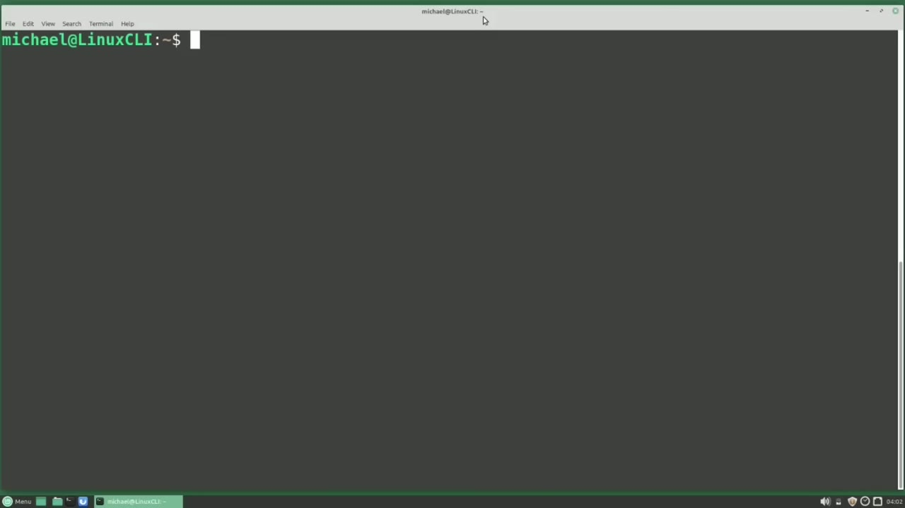
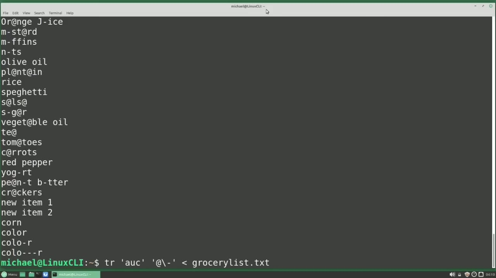
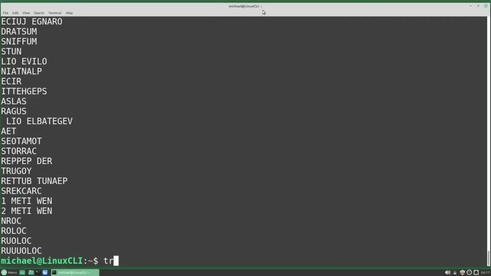
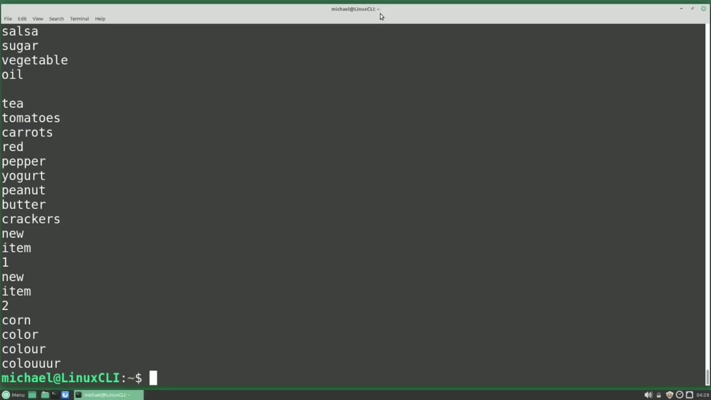
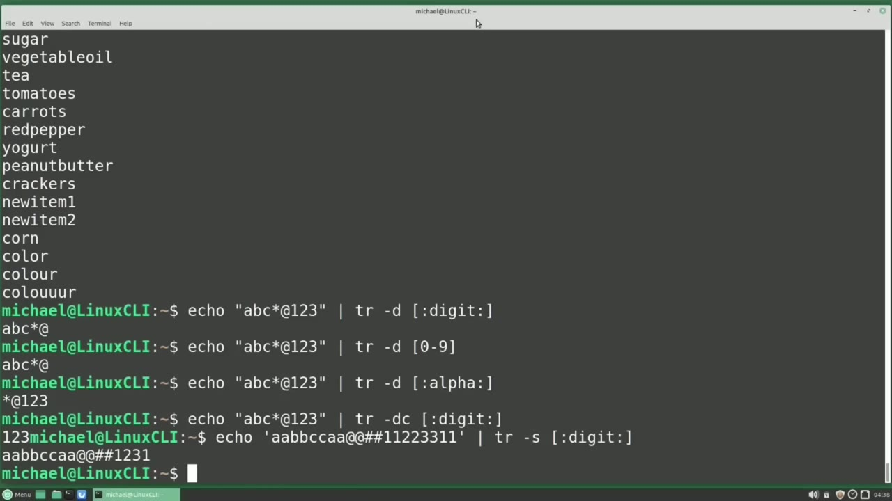

[← Course contents](../../01.md)

# 39. tr

**Course:** [Linux Command Line - Entire Tutorial Series](https://www.youtube.com/watch?v=avg65oY7sj4)  
**Transcript:** [`Linux Command Line - Entire Tutorial Series transcript`](../../../../course_videos/Linux%20Command%20Line%20-%20Entire%20Tutorial%20Series/Linux%20Command%20Line%20-%20Entire%20Tutorial%20Series.txt)  
**Video:** 05:54:04–06:06:58 ([open at this time](https://www.youtube.com/watch?v=avg65oY7sj4&t=21244s))

## Introduction

And what Translate will do is it will take any single character and translate that single character into another character of your choosing. So let's say we want to translate all the lowercase A's in the GroceryList.T file to at signs. To do that, I would type tr, quote, a quote, space, quote, at symbol, quote. And then we cannot just add the file name at the end like we did with Grep in the last couple of videos.

## Detailed Explanation

<details>
  <summary>Step 1 — Run `tr`, `grep`, `cat`</summary>

### Step 1 — Run `tr`, `grep`, `cat`

- [x] **Use `tr`**
  - And what Translate will do is it will take any single character and translate that single character into another character of your choosing.
  - So let's say we want to translate all the lowercase A's in the GroceryList.T file to at signs.
  - To do that, I would type `tr`, quote, a quote, space, quote, at symbol, quote.

- [x] **Use `grep`, `tr`**
  - And then we cannot just add the file name at the end like we did with `grep` in the last couple of videos.
  - When using `tr`, we need to use the less than angle bracket before the file name.
  - And we've seen this in videos earlier in the series.

- [x] **We see that all the lowercase A's are now changed to at symbols**
  - We see that all the lowercase A's are now changed to at symbols.
  - This will not update the GrocerlyList. txt file.
  - The updated output is just shown on the screen.

- [x] **Use `tr`, `cat`**
  - We can redirect the output of `tr` to a file and we'll do that later in this video.
  - Another way to get input into the `tr` command is with `cat` in Pipe.
  - I will type `cat`.

- [x] **Pipe. tr. Quote, A, quote, at symbol, quote**
  - Pipe. `tr`. Quote, A, quote, at symbol, quote.
  - And I said this works for any single character.
  - But we can do more than one character at a time.

- [x] **I want to translate all the A's to add symbols and now I'm going to**
  - I want to translate all the A's to add symbols and now I'm going to add the U's and I want to translate them all to a dash.
  - I'm going over to the A and I will add the U after that.
  - And then what I want to translate this to, I will make that a dash or a hyphen.

- [x] **And actually I'm going to add in the backslash hyphen**
  - And actually I'm going to add in the backslash hyphen.
  - Just to make sure that `tr` knows that I want the hyphen and this is not going to be a range.
  - So this command will change all of the A's to at symbols and all of the U's to hyphens.

- [x] **Pressing Enter, we see that all of the A's are at symbols and all of**
  - Pressing Enter, we see that all of the A's are at symbols and all of the U's are hyphens.
  - And we can add in more than two characters. We can put in as many as we like.
  - So what happens if we have more characters on the left than on the right?

```bash
tr
grep
cat
```



</details>

<details>
  <summary>Step 2 — For example, I'm going to add the letter C in the characters to</summary>

### Step 2 — For example, I'm going to add the letter C in the characters to

- [x] **For example, I'm going to add the letter C in the characters to**
  - For example, I'm going to add the letter C in the characters to translate, 2. Pressing Enter. Here we see all the lowercase a's were translated to at symbols.
  - All of the U's were translated to hyphens and also all of the C's were translated to hyphens or dashes as well.
  - So if there are more characters on the left, it just uses that last character on the right over and over for every character that does not have a match.

- [x] **If I add more characters to the left and nothing to the right, they**
  - If I add more characters to the left and nothing to the right, they will all be translated to the last character matched, which in this case is a dash.
  - Now what if I add more characters to the right than on the left?
  - When I press Enter, we see that all of the Cs are now translated to W, but after that all the characters don't have matches, so they're just ignored and not used.

- [x] **Let's use the -range now to make all of the characters uppercase**
  - Let's use the -range now to make all of the characters uppercase.
  - To make all of the letters uppercase, I want to tr translate everything that is a lowercase a through lowercase Z to be in uppercase A through uppercase Z.
  - So all the A's will be translated uppercase B's will be translated to an uppercase B and so on and so forth all the way through Z.

- [x] **And we'll do this for our GroceryList.TxT file**
  - And we'll do this for our GroceryList.TxT file.
  - And here we see all of the characters translated to uppercase.
  - Now if we try reversing that order, changing the lowercase A through lowercase Z to uppercase Z through uppercase A, we get an error.

- [x] **But we can go back to the lowercase A through lowercase Z to**
  - But we can go back to the lowercase A through lowercase Z to uppercase A to uppercase Z and we can...
  - And here we see that new item 1 becomes 1 Meti when and color becomes roloc.



</details>

<details>
  <summary>Step 3 — Run `tr`</summary>

### Step 3 — Run `tr`

- [x] **Use `tr`**
  - We can also use the character classes we are introduced to in an earlier video in this series to make all of the letters uppercase.
  - I'll type `tr`, quote, left bracket, colon, lower, right bracket, quote.
  - And we want all the lower to be translated to quote, left bracket, colon, upper, right bracket, quote.

- [x] **And the input will be our grocery list. txt file**
  - And the input will be our grocery list. txt file.
  - Now let's change all of the line returns to spaces in the grocery list.t.file.
  - And then we want to change them into a space.

- [x] **And now we see our GrocerlyList.T.file as one single line**
  - And now we see our GrocerlyList.T.file as one single line.
  - And this even took out the final line return after the last character.
  - So I'm going to press Enter to get to a new line.

- [x] **I have updated the Presidents by Height file from Video 33, and I've**
  - I have updated the Presidents by Height file from Video 33, and I've added a header record and made that a csv file.
  - file csv stands for comma separated values and when we open this file with a spreadsheet program like Libre Office the spreadsheet program will read in the data into rows and columns separating the column fields by the commas and right here we see that the separator options are tab comma semicolon and it's giving us an
  - Idea of what this will look like with the header order by height presidential number the name and pressing okay opens up that spreadsheet program with our csv file.

- [x] **And we see that all of the fields line up nicely**
  - And we see that all of the fields line up nicely.
  - We saw that that spreadsheet will also read in tab separated values.
  - To create a tab separated value file, we will read in our csv file and translate all of the commas to tab separators.

- [x] **Use `tr`**
  - And to do that, we will type `tr`, comma, quote, backslash T, quote, That will be for our tab values.
  - And we want the input to be the Presidents by height.csv file.
  - There we see we've changed all of the commas to tabs, but we need to write this out to a file.

- [x] **And we do that by adding the greater than angle bracket and then a**
  - And we do that by adding the greater than angle bracket and then a new file name, which will be Presidents by height.
  - But I'm going to change this to tsv instead of csv.
  - And then we can open that with Libre Office as well.

- [x] **And that opens as well without any problems**
  - And that opens as well without any problems.
  - Earlier in this video, we translated all of the line returns to spaces.
  - If we go back to that command, and then we try to change those spaces back to line returns by piping that output into `tr`, quote, space, quote, quote, back slash n quote to add back in all of the line returns.

- [x] **And the problem is that some of the items had spaces in them, like**
  - And the problem is that some of the items had spaces in them, like new item one, and that is throwing off our translate back.
  - To make this work, we need to delete all of the spaces from that file before we do our translations.

```bash
tr
```



</details>

<details>
  <summary>Step 4 — Run `tr -d`, `echo`</summary>

### Step 4 — Run `tr -d`, `echo`

- [x] **Use `tr -d`**
  - And I'm going to delete those spaces with the tr command.
  - And to do that, I'm going to type `tr -d`.
  - For delete and then I'm going to use the character class of blank.

- [x] **So what we're going to do is delete all of the blank spaces**
  - So what we're going to do is delete all of the blank spaces.
  - And you might think that we want to use the space character class, but the space character class will delete anything that's white space, including line returns, tab characters and the like, whereas blank will just delete all of the spaces.
  - And we want that for our grocery list.txt file.

- [x] **Then we can tr all of our line returns to spaces and pipe that into**
  - Then we can tr all of our line returns to spaces and pipe that into the tr to make all of the spaces line returns and pressing enter now we see our items as we expected without any spaces between them. Translate has the delete option which we just saw but it also has a way of
  - Removing repeated characters that tr calls squeezing.
  - But let's review the delete option first.

- [x] **Use `echo`**
  - So I'm going to type `echo`, quote, abc, asteris, at symbol, one, two, three, end quote.
  - And I'm going to pipe that into tr where I want to delete anything that is a digit.
  - And we see it removed all of the digits with the Rejects class digits.

- [x] **Now we can also do this with the range of 0 through 9**
  - Now we can also do this with the range of 0 through 9.
  - We don't need to use the character classes.
  - I'm just going to use the character classes to try and keep things simple.

- [x] **Because this is more about how the tr delete and squeeze**
  - Because this is more about how the tr delete and squeeze functionality works and not Rejects.
  - So going back to the classes, I'm going to change the digits now to Alpha.
  - And here we see that it removed the Alphabetic characters, but we still have those special characters showing.

- [x] **tr has a way of removing everything except the numbers**
  - tr has a way of removing everything except the numbers.
  - And that is to delete the complement of the regex, meaning remove everything except what is in the regex.
  - So going back to the digits, I want to remove everything except the digits.

- [x] **When I press Enter, we see that it removed all of the letters and**
  - When I press Enter, we see that it removed all of the letters and special characters, including that final end of line return.
  - The way that squeeze works is similar to delete, only it only removes the repeating characters.
  - And this is going to `echo` in some repeating characters.

- [x] **Then we're going to pipe that into tr with the S for squeeze**
  - Then we're going to pipe that into tr with the S for squeeze.
  - And then we're going to squeeze only the digits.
  - And squeeze is going to remove the repeated characters.

- [x] **We see that we have one, two, three, one**
  - We see that we have one, two, three, one.

```bash
tr -d
echo
```



</details>

<details>
  <summary>Step 5 — when it removes the repeating characters, it means repeating characters</summary>

### Step 5 — when it removes the repeating characters, it means repeating characters

- [x] **So when it removes the repeating characters, it means repeating**
  - So when it removes the repeating characters, it means repeating characters right next to each other.
  - The one does repeat, but it's not next to the other one.
  - So the repeated characters next to each other are squeezed.

- [x] **And we can squeeze the complement, meaning squeeze everything except**
  - And we can squeeze the complement, meaning squeeze everything except the digits.
  - And we can use delete and squeeze in the same command.
  - Delete and squeeze. So I'm going to delete the digits and I want to squeeze the alpha.

- [x] **This deleted all the digits and squeezed the letters. Notice nothing**
  - This deleted all the digits and squeezed the letters. Notice nothing happened to the special characters.
  - Now we can also add in the complement to the delete and squeeze.
  - And when I press enter here, what happens is the complement worked with the digit and everything that was not a digit was deleted.

- [x] **But there were no alpha characters to squeeze**
  - But there were no alpha characters to squeeze.
  - So to make this work, we need to change our command a little bit.
  - Instead of alpha, the only thing left is digits, so we need to squeeze the digits.

- [x] **And this deletes everything that's not a number and then squeezes the**
  - And this deletes everything that's not a number and then squeezes the numbers.
  - In the next video, we'll continue looking at the Linux command line.



</details>

<details>
  <summary>Questions and Answers</summary>

## Questions and Answers

### Question 1: What does `tr` do in this chapter?

<details>
<summary>Answer</summary>

- [x] To do that, I would type `tr`, quote, a quote, space, quote, at symbol, quote.

</details>

### Question 2: What does `grep` do in this chapter?

<details>
<summary>Answer</summary>

- [x] And then we cannot just add the file name at the end like we did with `grep` in the last couple of videos.

</details>

### Question 3: What does `cat` do in this chapter?

<details>
<summary>Answer</summary>

- [x] I will type `cat`.

</details>

### Question 4: What does `tr -d` do in this chapter?

<details>
<summary>Answer</summary>

- [x] And to do that, I'm going to type `tr -d`.

</details>

### Question 5: What does `echo` do in this chapter?

<details>
<summary>Answer</summary>

- [x] So I'm going to type `echo`, quote, abc, asteris, at symbol, one, two, three, end quote.

</details>

### Question 6: What does step 1 cover (Run tr, grep, cat)?

<details>
<summary>Answer</summary>

- [x] And what Translate will do is it will take any single character and translate that single character into another character of your choosing.
- [x] So let's say we want to translate all the lowercase A's in the GroceryList.T file to at signs.
- [x] To do that, I would type `tr`, quote, a quote, space, quote, at symbol, quote.

</details>

### Question 7: What does step 2 cover (For example, I'm going to add the letter C in the characters to)?

<details>
<summary>Answer</summary>

- [x] For example, I'm going to add the letter C in the characters to translate, 2. Pressing Enter. Here we see all the lowercase a's were translated to at symbols.
- [x] All of the U's were translated to hyphens and also all of the C's were translated to hyphens or dashes as well.
- [x] So if there are more characters on the left, it just uses that last character on the right over and over for every character that does not have a match.

</details>

### Question 8: What does step 3 cover (Run tr)?

<details>
<summary>Answer</summary>

- [x] We can also use the character classes we are introduced to in an earlier video in this series to make all of the letters uppercase.
- [x] I'll type `tr`, quote, left bracket, colon, lower, right bracket, quote.
- [x] And we want all the lower to be translated to quote, left bracket, colon, upper, right bracket, quote.

</details>

### Question 9: What does step 4 cover (Run tr -d, echo)?

<details>
<summary>Answer</summary>

- [x] And I'm going to delete those spaces with the tr command.
- [x] And to do that, I'm going to type `tr -d`.
- [x] For delete and then I'm going to use the character class of blank.

</details>

### Question 10: What does step 5 cover (when it removes the repeating characters, it means repeating characters)?

<details>
<summary>Answer</summary>

- [x] So when it removes the repeating characters, it means repeating characters right next to each other.
- [x] The one does repeat, but it's not next to the other one.
- [x] So the repeated characters next to each other are squeezed.

</details>

</details>

## Summary

This chapter, tr, walks through Run tr, grep, cat; For example, I'm going to add the letter C in the characters to; Run tr; Run tr -d, echo; when it removes the repeating characters, it means repeating characters. Commands from the transcript: `tr`, `grep`, `cat`, `tr -d`, `echo`.

## References

- [Linux Command Line - Entire Tutorial Series (YouTube)](https://www.youtube.com/watch?v=avg65oY7sj4)
- [This chapter at 05:54:04](https://www.youtube.com/watch?v=avg65oY7sj4&t=21244s)
- [Local transcript](../../../../course_videos/Linux%20Command%20Line%20-%20Entire%20Tutorial%20Series/Linux%20Command%20Line%20-%20Entire%20Tutorial%20Series.txt)
