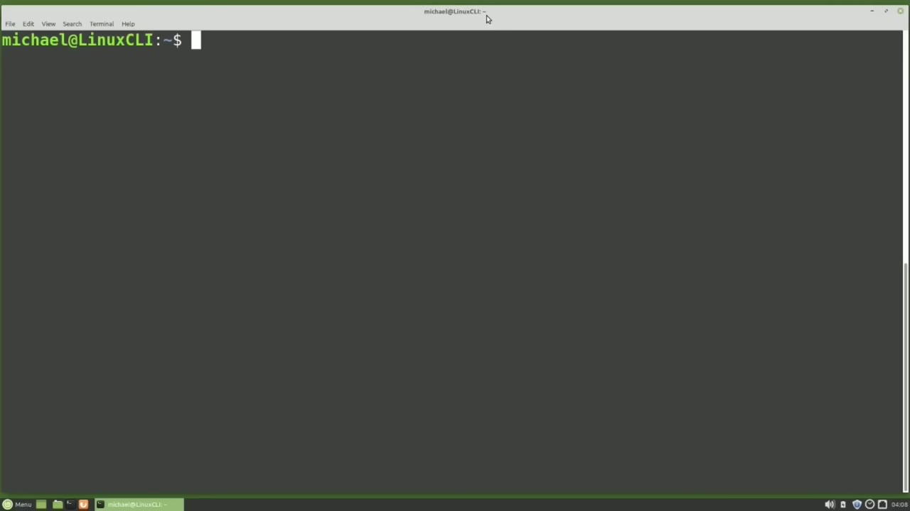
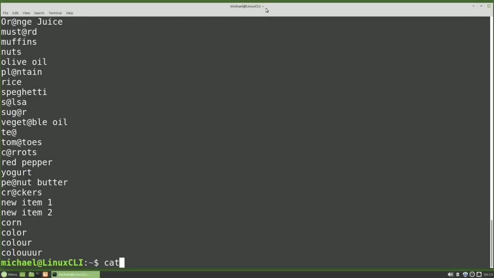
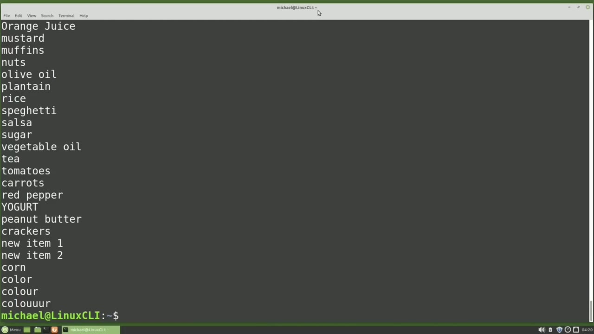

[← Course contents](../../01.md)

# 40. sed pt1

**Course:** [Linux Command Line - Entire Tutorial Series](https://www.youtube.com/watch?v=avg65oY7sj4)  
**Transcript:** [`Linux Command Line - Entire Tutorial Series transcript`](../../../../course_videos/Linux%20Command%20Line%20-%20Entire%20Tutorial%20Series/Linux%20Command%20Line%20-%20Entire%20Tutorial%20Series.txt)  
**Video:** 06:06:58–06:15:27 ([open at this time](https://www.youtube.com/watch?v=avg65oY7sj4&t=22018s))

## Introduction

Sed is short for Stream Editor and it modifies a stream of input before passing it along to the output. Set is similar to tr, but Sed has more features and can modify the input in more ways than tr. Like the regex tutorials, this won't be a complete Sed tutorial, just an introduction to Sed, enough to get you a basic understanding of some of the most common said functionality. One of the most used features of Sed is Substitute.

## Detailed Explanation

<details>
  <summary>Step 1 — Run `sed`, `tr`</summary>

### Step 1 — Run `sed`, `tr`

- [x] **Use `sed`**
  - `sed` is short for Stream Editor and it modifies a stream of input before passing it along to the output.
  - Set is similar to `tr`, but `sed` has more features and can modify the input in more ways than `tr`.
  - Like the regex tutorials, this won't be a complete `sed` tutorial, just an introduction to `sed`, enough to get you a basic understanding of some of the most common said functionality.

- [x] **Use `sed`, `tr`**
  - One of the most used features of `sed` is Substitute.
  - Let's use said substitute to edit all the lowercase a's to be at signs in the GroceryList.T file, like we did with the `tr` command.
  - Our command will start with said, then a space, then a single quote, and then the lowercase S for substitute.

- [x] **Then we'll add a delimiter of a forward slash, and then the current**
  - Then we'll add a delimiter of a forward slash, and then the current value that we're searching for, which in this case is a lowercase a.
  - And then the new value that we want to substitute in, which in this case is the at sign.
  - Then we have the final delimiter, an end quote, and then we'll add in the file name that we want to use as input, which in this case is the GroceryList.T file. With said, we do not need to add in that less than angle bracket before the input file name. Pressing Enter shows us the updated text on the screen.

- [x] **We can add in that less than angle bracket**
  - We can add in that less than angle bracket.
  - We just don't need to add in that less than angle bracket like we did with `tr`.

```bash
sed
tr
```



</details>

<details>
  <summary>Step 2 — Run `cat`</summary>

### Step 2 — Run `cat`

- [x] **Use `cat`**
  - It sends the edited output to the screen where we can redirect that output to a file if we like.
  - Using `cat`, I will show the GroceryList.T.file and we see that this file has not been updated.
  - If we leave off the file name and just type in the said command without a file name, said will expect input from the standard input, which means we just type in our data.

- [x] **And we see here that said edits each line when enter is pressed**
  - And we see here that said edits each line when enter is pressed.
  - I'm going to hold down control and press D to gracefully get out of that.
  - We can also hold down control and press C to cancel out.

- [x] **When we typed Papaya and Banana here, it's clear to see that said**
  - When we typed Papaya and Banana here, it's clear to see that said only updates the first occurrence of that search string. We can change this. If we want to update only the second occurrence, we do that by adding a 2 after the final delimiter. And now we see only the
  - Second occurrence is updated. And we see that here in Salsa and Plantain.
  - And that will work for any number as long as the search string is found that many times on a line.

- [x] **And we can also use a G instead of that 2**
  - And we can also use a G instead of that 2.
  - And it will globally edit every occurrence on the line.
  - We see all the A's were changed to add signs in the words salsa and plantain.

- [x] **And we're not limited to a single letter with said like we are with tr**
  - And we're not limited to a single letter with said like we are with tr.
  - I will type said, quote S slash yogurt, and we're going to replace lowercase yogurt with uppercase yogurt.

```bash
cat
```



</details>

<details>
  <summary>Step 3 — we'll do that for the GrocerlyList.TXT file</summary>

### Step 3 — we'll do that for the GrocerlyList.TXT file

- [x] **And we'll do that for the GrocerlyList.TXT file**
  - And we'll do that for the GrocerlyList.TXT file.
  - We see here that yogurt was updated to uppercase.
  - So the said substitute works more like the traditional search and replace most of us are already familiar with.

- [x] **Now the delimiter does not have to be a forward slash**
  - Now the delimiter does not have to be a forward slash.
  - We can change the delimiter to be a colon.
  - In fact, we can change that delimiter to be anything we like.

- [x] **The delimiter becomes whatever follows the S for substitute**
  - The delimiter becomes whatever follows the S for substitute.
  - I'm going to make this the letter D for delimiter.
  - Using a D makes things a little more difficult to read.

- [x] **When we are doing a substitute, the current value is actually a**
  - When we are doing a substitute, the current value is actually a regular expression.
  - Said, quote, S, forward slash, and then I'm going to use a regular expression to find everything that starts with the letter C. And I'm going to replace that with space, space, C, final delimiter, and in quote, for the grocery list.t.fxT file.
  - And here we see everything that starts with the lowercase C is now indented two spaces.

- [x] **Maybe we want to indent the entire file two spaces**
  - Maybe we want to indent the entire file two spaces.
  - And now we say add space space to every line.



</details>

<details>
  <summary>Step 4 — Run `nano`</summary>

### Step 4 — Run `nano`

- [x] **Instead of indenting two spaces, maybe we want to change the**
  - Instead of indenting two spaces, maybe we want to change the indentation to a tab character.
  - Now we've indented every line with a tab character.
  - And we'll change anything that's a vowel to be an asteris for the GrocerlyList.TXT file.

- [x] **And let's also add in that G to make this edit work globally**
  - And let's also add in that G to make this edit work globally.
  - Or maybe we want to remove the vowels altogether and replace them with nothing.
  - We can put multiple said commands on a single line, but when we do this, we need to add a lowercase -E before the command.

- [x] **To tell said we're going to have multiple commands**
  - To tell said we're going to have multiple commands.
  - If we don't add that -E, said will think the command is an input file.
  - The first one will be substituting the A for the ampersand, which we've already seen.

- [x] **Use `nano`**
  - And then we're going to add in another edit, which will be substitute everything that starts with the letter C for space space C and we'll do that for the Grocery List.T file. The -lowercase E is for edit. There's also a -lowercase F for file.
  - Maybe you have the same said command you want to run over and over or you might have multiple commands that you want to run over and over and sometimes it's easier just to put those into a file.
  - To create a said file, I'm going to type `nano`.

- [x] **Said file.Txt. In this file, we'll start it with a comment. And to do**
  - Said file.Txt. In this file, we'll start it with a comment. And to do that, I'll add a hashtag.
  - This is a said file. And then we'll add in our command. And here we don't need the quotes because it's in a said file. To save this, I'm going to press Ctrl+X and then Y without control.
  - And then enter. And now I will said -f to use our said file is input said file text and we'll apply this to the grocery list.

- [x] **Txt file and it works just the same as it did when we put both**
  - Txt file and it works just the same as it did when we put both commands on one line said can also read multiple files in i will add in the presidents by height c sv file and we see that said processes these in the order that they are on the input.
  - So it did the GrocereryList.T file first and then the Presidentsby-Hight.csvFee file.
  - This is a good breaking point, so we're going to end this video here.

- [x] **In the next video, we're going to complete our introductory look at**
  - In the next video, we're going to complete our introductory look at the said command for the Linux command line.

```bash
nano
```


</details>

<details>
  <summary>Questions and Answers</summary>

## Questions and Answers

### Question 1: What does `sed` do in this chapter?

<details>
<summary>Answer</summary>

- [x] `sed` is short for Stream Editor and it modifies a stream of input before passing it along to the output.

</details>

### Question 2: What does `tr` do in this chapter?

<details>
<summary>Answer</summary>

- [x] Let's use said substitute to edit all the lowercase a's to be at signs in the GroceryList.T file, like we did with the `tr` command.

</details>

### Question 3: What does `cat` do in this chapter?

<details>
<summary>Answer</summary>

- [x] Using `cat`, I will show the GroceryList.T.file and we see that this file has not been updated.

</details>

### Question 4: What does `nano` do in this chapter?

<details>
<summary>Answer</summary>

- [x] To create a said file, I'm going to type `nano`.

</details>

### Question 5: What does step 1 cover (Run sed, tr)?

<details>
<summary>Answer</summary>

- [x] `sed` is short for Stream Editor and it modifies a stream of input before passing it along to the output.
- [x] Set is similar to `tr`, but `sed` has more features and can modify the input in more ways than `tr`.
- [x] Like the regex tutorials, this won't be a complete `sed` tutorial, just an introduction to `sed`, enough to get you a basic understanding of some of the most common said functionality.

</details>

### Question 6: What does step 2 cover (Run cat)?

<details>
<summary>Answer</summary>

- [x] It sends the edited output to the screen where we can redirect that output to a file if we like.
- [x] Using `cat`, I will show the GroceryList.T.file and we see that this file has not been updated.
- [x] If we leave off the file name and just type in the said command without a file name, said will expect input from the standard input, which means we just type in our data.

</details>

### Question 7: What does step 3 cover (we'll do that for the GrocerlyList.TXT file)?

<details>
<summary>Answer</summary>

- [x] And we'll do that for the GrocerlyList.TXT file.
- [x] We see here that yogurt was updated to uppercase.
- [x] So the said substitute works more like the traditional search and replace most of us are already familiar with.

</details>

### Question 8: What does step 4 cover (Run nano)?

<details>
<summary>Answer</summary>

- [x] Instead of indenting two spaces, maybe we want to change the indentation to a tab character.
- [x] Now we've indented every line with a tab character.
- [x] And we'll change anything that's a vowel to be an asteris for the GrocerlyList.TXT file.

</details>

</details>

## Summary

This chapter, sed pt1, walks through Run sed, tr; Run cat; we'll do that for the GrocerlyList.TXT file; Run nano. Commands from the transcript: `sed`, `tr`, `cat`, `nano`.

## References

- [Linux Command Line - Entire Tutorial Series (YouTube)](https://www.youtube.com/watch?v=avg65oY7sj4)
- [This chapter at 06:06:58](https://www.youtube.com/watch?v=avg65oY7sj4&t=22018s)
- [Local transcript](../../../../course_videos/Linux%20Command%20Line%20-%20Entire%20Tutorial%20Series/Linux%20Command%20Line%20-%20Entire%20Tutorial%20Series.txt)
