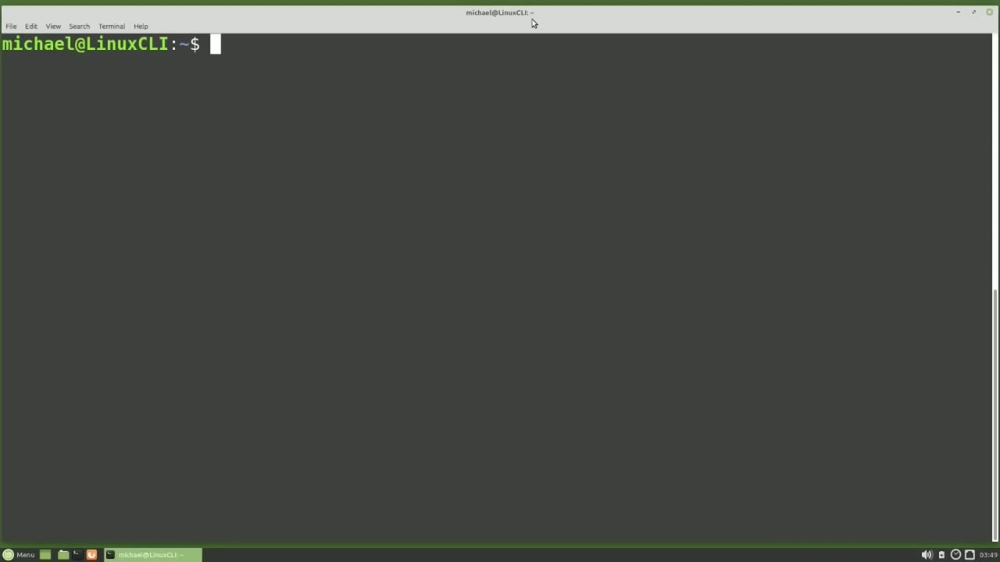
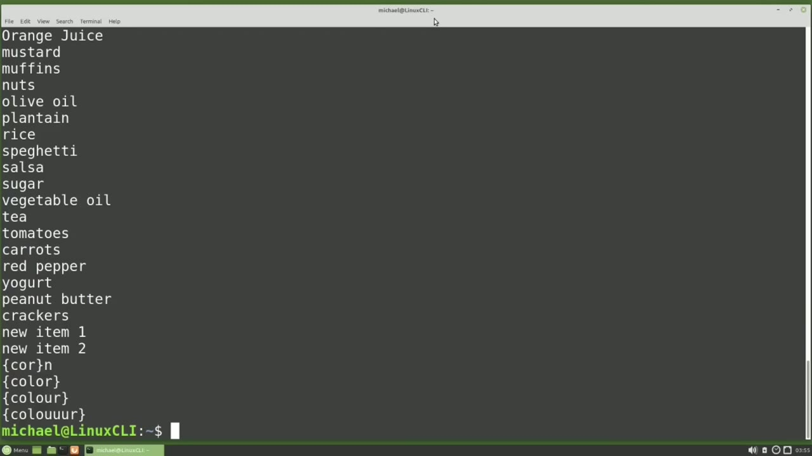
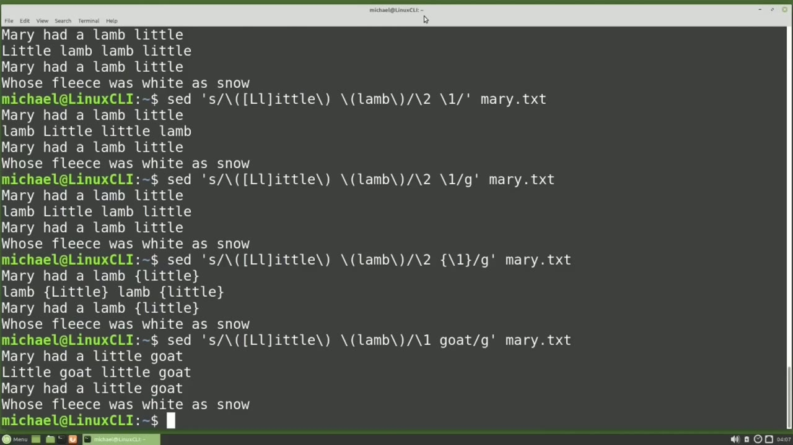
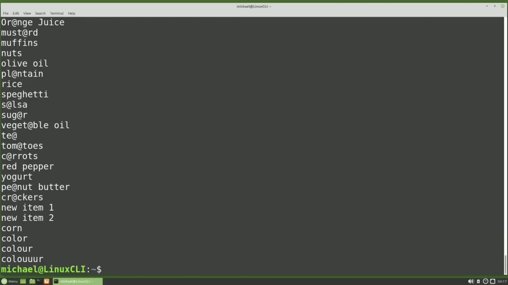
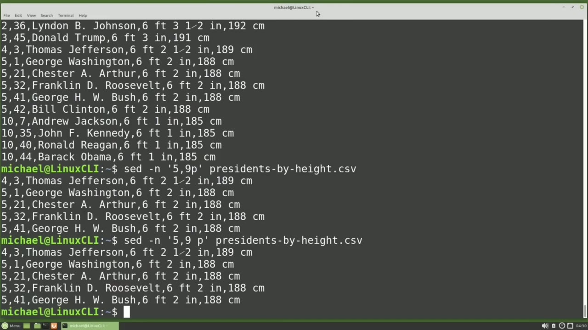
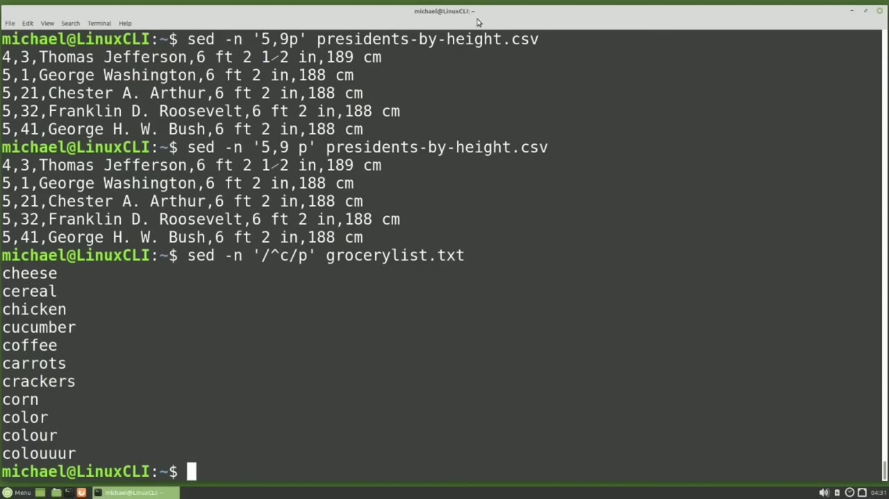

[← Course contents](../../01.md)

# 41. sed pt2

**Course:** [Linux Command Line - Entire Tutorial Series](https://www.youtube.com/watch?v=avg65oY7sj4)  
**Transcript:** [`Linux Command Line - Entire Tutorial Series transcript`](../../../../course_videos/Linux%20Command%20Line%20-%20Entire%20Tutorial%20Series/Linux%20Command%20Line%20-%20Entire%20Tutorial%20Series.txt)  
**Video:** 06:15:27–06:27:51 ([open at this time](https://www.youtube.com/watch?v=avg65oY7sj4&t=22527s))

## Introduction

Continuing on from where we left off in the last video, Set has two special values that can be used in the replacement string. The ampersand will substitute in the search string value into the replacement string. For example, when I type said space, quote, S for substitute, the delimiter, then the word corn a delimiter, then inside of curly braces I will put the ampersand. End quote. And then the file, GroceryList. txt.

## Detailed Explanation

<details>
  <summary>Step 1 — Run `sed`</summary>

### Step 1 — Run `sed`

- [x] **Continuing on from where we left off in the last video, Set has two**
  - Continuing on from where we left off in the last video, Set has two special values that can be used in the replacement string.
  - The ampersand will substitute in the search string value into the replacement string.
  - For example, when I type said space, quote, S for substitute, the delimiter, then the word corn a delimiter, then inside of curly braces I will put the ampersand.

- [x] **End quote. And then the file, GroceryList. txt**
  - End quote. And then the file, GroceryList. txt.
  - Pressing Enter, we see that corn now has parentheses around it.
  - For something like this, I could have just typed corn inside of those curly braces instead of the ampersand.

- [x] **Use `sed`**
  - This is much more useful when our Rejects becomes a search string, something like c.o. Wildcard asteris for zero or more times.
  - Here we see that `sed` now replaces those curly braces around everything that fits that regex search criteria.
  - The other special value for the replacement string are the escaped with a backslash number.

- [x] **And this works by breaking up a regex search field into parts with**
  - And this works by breaking up a regex search field into parts with parentheses.
  - To really understand how the numbers parentheses work, I have created a new file and that new file is called Mary.TXT.
  - And we see that Mary.TxT is just that Mary had a little lamb nursery rhyme.

- [x] **The replacement field escape numbers work similar to the ampersand**
  - The replacement field escape numbers work similar to the ampersand, but we can have multiple values, so they're numbered.
  - For example, I will type said, space, quote, S for substitute, and then the delimiter.
  - Now I'm going to press the escape character, which is a backslash, then the left or opening parenthesis, and the word little.

- [x] **Then the escape character again, and a closing or right parenthesis**
  - Then the escape character again, and a closing or right parenthesis.
  - This much right here is the single value that will be like the ampersand.
  - But we want to have two values, so I'm adding in a space, then the escape character, opening parenthesis, I'm typing in lamb, escape character right parenthesis, and then the delimiter.

- [x] **Now I want to add my replacement string to print out the second value**
  - Now I want to add my replacement string to print out the second value first so I'm going to type escape character 2 space escape character 1 we will then add in our ending delimiter end quote and then the file name which will be Mary txt the result of this is it writes out the second value first then a space then the first value so our regex searches for
  - Little space lamb and little was in parentheses so that became our first value and lamb was also in parenthesis so that became our second value then in the replacement string we told said to print out our second value first and then our first value so we reversed the order notice here on line
  - Two the first little lamb did not get switched around this is because it has an uppercase l for a lowercase L. For the Redgex to recognize the uppercase L or the lowercase L, we're going to need to update our search. We're going to need to add brackets around our L

- [x] **And add in that uppercase L inside the brackets. So now that letter**
  - And add in that uppercase L inside the brackets. So now that letter can be an uppercase L or a lowercase L. Now we see it switched Little and Lamb the first time it was found on line 2, but not the second one.
  - To make the update in both places, we need to add the G after the delimiter to apply it globally.
  - We can also add in some curly braces or other text.

- [x] **I'm putting in curly braces because we saw that with the ampersand**
  - I'm putting in curly braces because we saw that with the ampersand.
  - Maybe Mary did not have a little lamb, but a little goat.
  - We can update our replacement string to show that with...

- [x] **We first want to have the one here first because it's little**
  - We first want to have the one here first because it's little.

```bash
sed
```





</details>

<details>
  <summary>Step 2 — Goat. And this shows we don't have to use all of the values in the</summary>

### Step 2 — Goat. And this shows we don't have to use all of the values in the

- [x] **Goat. And this shows we don't have to use all of the values in the**
  - Goat. And this shows we don't have to use all of the values in the output.
  - And if we don't need them in the output, we can remove them from the...
  - Input, meaning I can remove the parentheses around Lamb.

- [x] **We still want Lamb in there as part of our regex search string**
  - We still want Lamb in there as part of our regex search string.
  - And this shows we can substitute part of the regex search value in the replacement value, whereas the ampersand replaces the entire regex search value in the replacement value.
  - When using the -uppercase E with this said substitute, We don't need the escape characters before the parentheses in our search value.

- [x] **I'm typing said-uppercase E, quote S for substitute**
  - I'm typing said-uppercase E, quote S for substitute.
  - Now instead of using escape parentheses, I'm just putting parentheses around the word tomatoes.
  - And then for my output, I will say canned escape character 1.

- [x] **And this time I'm going to use the grocery list. txt file**
  - And this time I'm going to use the grocery list. txt file.
  - And here we see tomatoes is now canned tomatoes.
  - And since we're using the extended regex, we can make that tomatoes in or.

- [x] **And here we see the canned corn, canned tomatoes and canned nuts**
  - And here we see the canned corn, canned tomatoes and canned nuts.
  - I'm going back to the first substitute command that we saw in the said part 1 video where we substituted the letter A's for at symbols in the grocery list. txt file.



</details>

<details>
  <summary>Step 3 — Pressing Enter, we see that this prints out all of the lines in the</summary>

### Step 3 — Pressing Enter, we see that this prints out all of the lines in the

- [x] **Pressing Enter, we see that this prints out all of the lines in the**
  - Pressing Enter, we see that this prints out all of the lines in the Grocery List.T file by default.
  - We can turn off the default printing by adding a -N option.
  - Now when I press Enter, We don't see anything printed because we turned off the default printing, so nothing was printed.

- [x] **To print out only the lines that were updated, we can add P for print**
  - To print out only the lines that were updated, we can add P for print after the ending delimiter.
  - Now we see only the lines that were updated.
  - If I remove that -N that turned off the default printing and press Enter, here we see all of the lines printed out by default and then all of the lines that had a substitute are also printed out.

- [x] **So the entire file is printed out one time by default and the**
  - So the entire file is printed out one time by default and the substituted lines get printed a second time.
  - In this example, we're only updating the first occurrence of the A, and we can see that here in Salsa.
  - To switch all of the A's to at symbols, we'll need to add a G after that final delimiter, and the G is for Global. We can put that after the P or before the P.

- [x] **It works the same both ways. We don't need to use the substitute**
  - It works the same both ways. We don't need to use the substitute feature when printing out lines.
  - For example, if I type said P, and this time I'm going to use the Presidents by height csv file, we see it prints out every line in the file twice.
  - To print the lines out only one time, we'll need to turn off the default printing with that -N.

- [x] **We see that first record, the header record, looks a little different**
  - We see that first record, the header record, looks a little different than the rest of the file.
  - I want to print out only the first record in this file.



</details>

<details>
  <summary>Step 4 — Run `sed -n`</summary>

### Step 4 — Run `sed -n`

- [x] **To do that, I will update this command to print out the first line of**
  - To do that, I will update this command to print out the first line of the file with 1P.
  - So our command is said, turn off the default printing, and 1P means print the first line of our Presidentsby height.csv file.
  - And if we want the third line instead of the first, we just change that one to a three.

- [x] **If we want to print the last line in the file, and we don't know how**
  - If we want to print the last line in the file, and we don't know how many lines are in that file, we can use a dollar sign.
  - Now if we're using the dollar sign, we need to put quotes around it to let Linux know that we want this to be used as a said command.
  - We may want to print off all the lines except the header record.

- [x] **To do that, We update our said command to be 2 comma dollar sign p**
  - To do that, We update our said command to be 2 comma dollar sign p.
  - So now we're going to turn off the default printing, start in the second line, print all the way to the last line of our Presidents by height csv file.
  - Maybe we want to print out lines just 5 through 9.

- [x] **For that, I would change the 2 to a 5, change the dollar sign to a 9**
  - For that, I would change the 2 to a 5, change the dollar sign to a 9, and there we go lines 5 through 9.
  - Another thing we might want to do is put a space before that P.
  - So it's lines 5 through 9 space P and that works as well.

- [x] **Use `sed -n`**
  - We can also print out lines that only meet specific regex criteria.
  - Let's print out all of the lines that start with the letter C.
  - To do that I will type `sed -n` to turn off the default printing.

- [x] **And then in quotes, I'm going to put my regex to find the lines that**
  - And then in quotes, I'm going to put my regex to find the lines that start with the letter C.
  - And I want to print them out, end quote.
  - And that's going to be for our grocery list. txt file.

```bash
sed -n
```



</details>

<details>
  <summary>Step 5 — Run `grep`, `head`</summary>

### Step 5 — Run `grep`, `head`

- [x] **Use `grep`**
  - Now this is doing the same thing as `grep`.
  - Let's say we want to print out a range of records.
  - Instead of starting with the letter C, I want to print out everything that starts with the letter R.

- [x] **And then keep printing until we find a letter C**
  - And then keep printing until we find a letter C.
  - So I'm going to start with the letter R at a comma, add our ending regex, which will be lines that start with the letter C.
  - So C will now start printing when it finds a line that starts with the letter R and continue printing until it finds a letter C.

- [x] **And we see here that it started printing when it found raspberries**
  - And we see here that it started printing when it found raspberries.
  - And stopped printing when it found coffee, then started printing again when it found rice, and stopped printing when it found carrots, then started printing again when it found red pepper, and stopped when it found crackers.
  - Let's check out the original file with Cat Grocerlist.TXT.

- [x] **Here we see the same thing. We see where this started printing when**
  - Here we see the same thing. We see where this started printing when it found raspberries and stopped printing when it found coffee.
  - Then started printing again when it found rice and stop printing when it found carrots.
  - Then started printing again when it found red pepper and stopped when it found crackers.

- [x] **Maybe I want to start on the line one and end on the line where I**
  - Maybe I want to start on the line one and end on the line where I find chicken.
  - Said has one more thing that I want to comment about and that is the cue for quit.
  - If I type said 11Q grocery list. txt, it prints out the first 11 lines of the grocery list.T file.

- [x] **Use `head`**
  - And if I change that to said 3 Q, it prints out the first three lines.
  - So said with the Q option works like the `head` command that we've seen in a previous video.
  - But enough to get you familiar with some of the main features of said.

- [x] **In the next video, we'll continue looking at the Linux command line**
  - In the next video, we'll continue looking at the Linux command line.

```bash
grep
head
```



</details>

<details>
  <summary>Questions and Answers</summary>

## Questions and Answers

### Question 1: What does `sed` do in this chapter?

<details>
<summary>Answer</summary>

- [x] Here we see that `sed` now replaces those curly braces around everything that fits that regex search criteria.

</details>

### Question 2: What does `sed -n` do in this chapter?

<details>
<summary>Answer</summary>

- [x] To do that I will type `sed -n` to turn off the default printing.

</details>

### Question 3: What does `grep` do in this chapter?

<details>
<summary>Answer</summary>

- [x] Now this is doing the same thing as `grep`.

</details>

### Question 4: What does `head` do in this chapter?

<details>
<summary>Answer</summary>

- [x] So said with the Q option works like the `head` command that we've seen in a previous video.

</details>

### Question 5: What does step 1 cover (Run sed)?

<details>
<summary>Answer</summary>

- [x] Continuing on from where we left off in the last video, Set has two special values that can be used in the replacement string.
- [x] The ampersand will substitute in the search string value into the replacement string.
- [x] For example, when I type said space, quote, S for substitute, the delimiter, then the word corn a delimiter, then inside of curly braces I will put the ampersand.

</details>

### Question 6: What does step 2 cover (Goat. And this shows we don't have to use all of the values in the)?

<details>
<summary>Answer</summary>

- [x] Goat. And this shows we don't have to use all of the values in the output.
- [x] And if we don't need them in the output, we can remove them from the...
- [x] Input, meaning I can remove the parentheses around Lamb.

</details>

### Question 7: What does step 3 cover (Pressing Enter, we see that this prints out all of the lines in the)?

<details>
<summary>Answer</summary>

- [x] Pressing Enter, we see that this prints out all of the lines in the Grocery List.T file by default.
- [x] We can turn off the default printing by adding a -N option.
- [x] Now when I press Enter, We don't see anything printed because we turned off the default printing, so nothing was printed.

</details>

### Question 8: What does step 4 cover (Run sed -n)?

<details>
<summary>Answer</summary>

- [x] To do that, I will update this command to print out the first line of the file with 1P.
- [x] So our command is said, turn off the default printing, and 1P means print the first line of our Presidentsby height.csv file.
- [x] And if we want the third line instead of the first, we just change that one to a three.

</details>

### Question 9: What does step 5 cover (Run grep, head)?

<details>
<summary>Answer</summary>

- [x] Now this is doing the same thing as `grep`.
- [x] Let's say we want to print out a range of records.
- [x] Instead of starting with the letter C, I want to print out everything that starts with the letter R.

</details>

</details>

## Summary

This chapter, sed pt2, walks through Run sed; Goat. And this shows we don't have to use all of the values in the; Pressing Enter, we see that this prints out all of the lines in the; Run sed -n; Run grep, head. Commands from the transcript: `sed`, `sed -n`, `grep`, `head`.

## References

- [Linux Command Line - Entire Tutorial Series (YouTube)](https://www.youtube.com/watch?v=avg65oY7sj4)
- [This chapter at 06:15:27](https://www.youtube.com/watch?v=avg65oY7sj4&t=22527s)
- [Local transcript](../../../../course_videos/Linux%20Command%20Line%20-%20Entire%20Tutorial%20Series/Linux%20Command%20Line%20-%20Entire%20Tutorial%20Series.txt)
