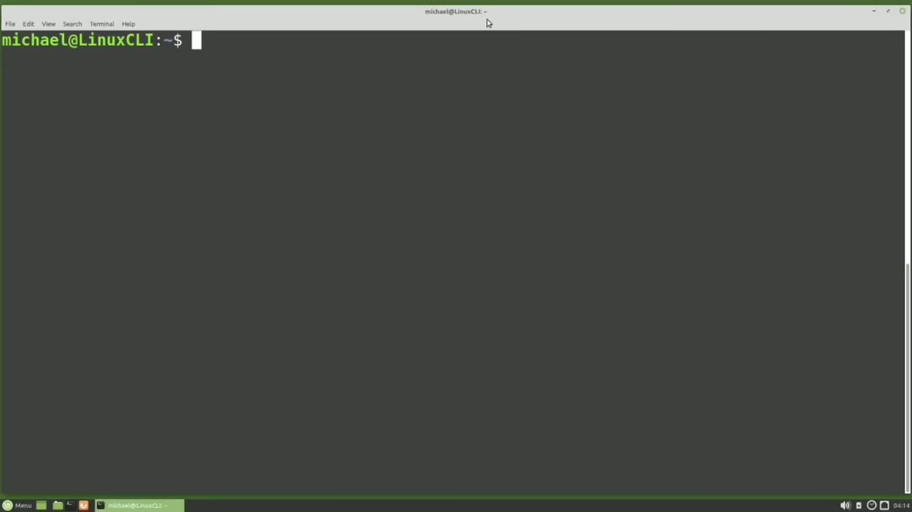
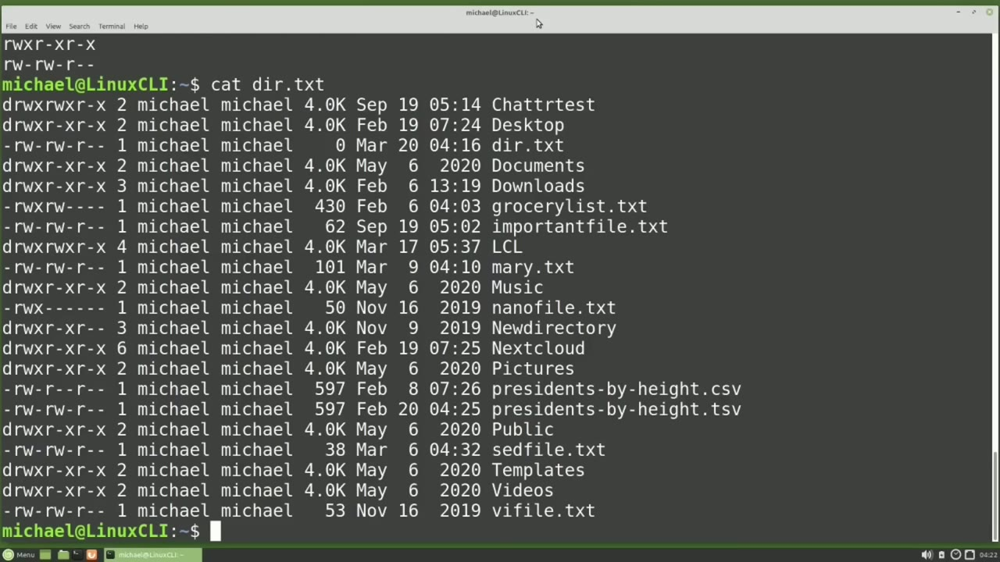
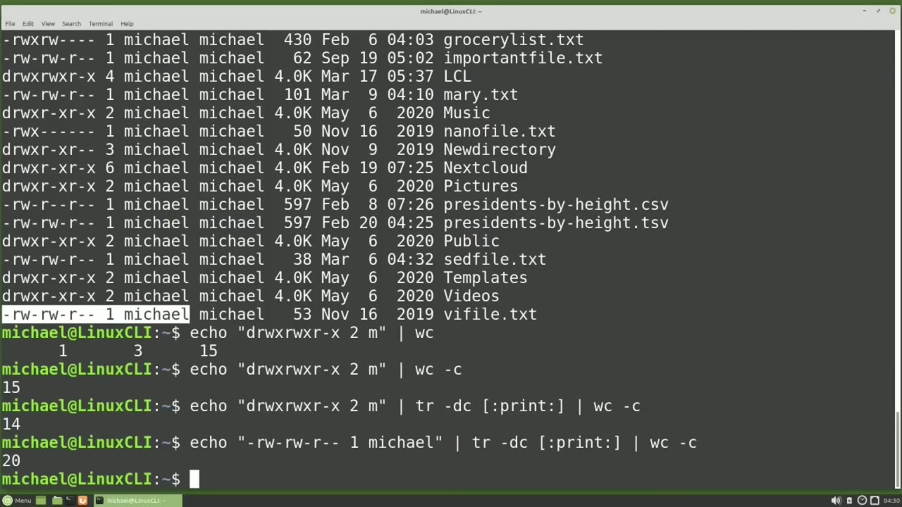
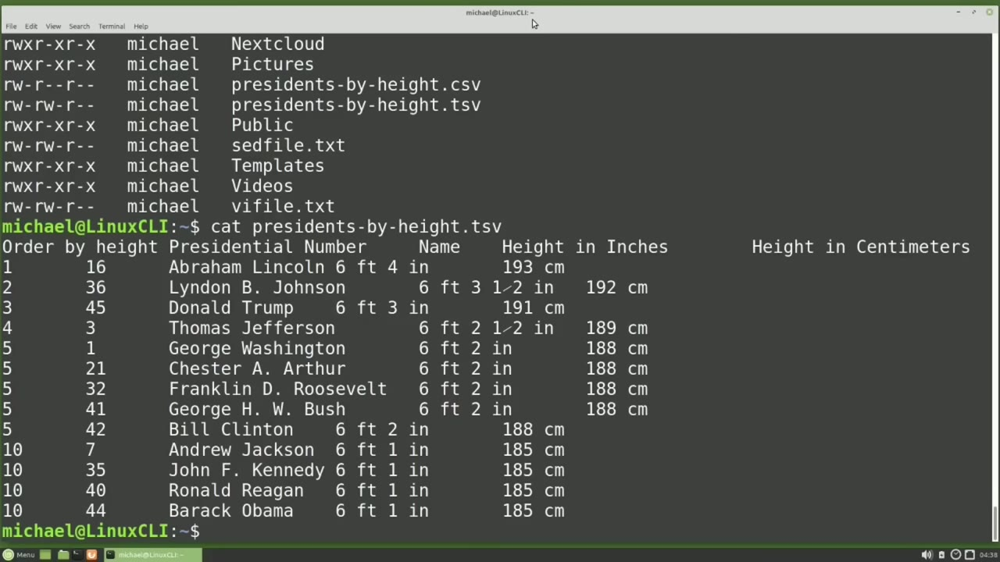

[← Course contents](../../01.md)

# 42. cut

**Course:** [Linux Command Line - Entire Tutorial Series](https://www.youtube.com/watch?v=avg65oY7sj4)  
**Transcript:** [`Linux Command Line - Entire Tutorial Series transcript`](../../../../course_videos/Linux%20Command%20Line%20-%20Entire%20Tutorial%20Series/Linux%20Command%20Line%20-%20Entire%20Tutorial%20Series.txt)  
**Video:** 06:27:51–06:39:23 ([open at this time](https://www.youtube.com/watch?v=avg65oY7sj4&t=23271s))

## Introduction

The cut command allows us to quickly and easily cut out selected portions of a file, one of three ways. The three ways of cutting text are by characters, bytes, or fields. In this tutorial, we will only be working with text files and because each text character is one byte. Bites and characters are the same for us. So we are only going to look at cutting characters and fields. I'm going to type l.s-lh and we see that all of the fields line up nicely in columns. So this will work well as a good example to cut fields. We can pipe this ls into cut, but I'm going to put this data into a file.

## Detailed Explanation

<details>
  <summary>Step 1 — Run `ls`, `ls -lh`, `cut -c`</summary>

### Step 1 — Run `ls`, `ls -lh`, `cut -c`

- [x] **The cut command allows us to quickly and easily cut out selected**
  - The cut command allows us to quickly and easily cut out selected portions of a file, one of three ways.
  - The three ways of cutting text are by characters, bytes, or fields.
  - In this tutorial, we will only be working with text files and because each text character is one byte. Bites and characters are the same for us.

- [x] **Use `ls`, `ls -lh`**
  - So we are only going to look at cutting characters and fields. I'm going to type l.s-lh and we see that all of the fields line up nicely in columns. So this will work well as a good example to cut fields. We can pipe this `ls` into cut, but I'm going to put this data into a file.
  - Mainly because I want to remove that first line with the total 80K.
  - To put this into a file, I will type `ls -lh`.

- [x] **And to remove the first line, I'm going to pipe this into a said**
  - And to remove the first line, I'm going to pipe this into a said command, said -n, quote, 2 comma dollar sign, space P, quote.
  - And we learned about said in the last video.
  - I'm going to write the output from here into a file called dir.txt.

- [x] **Use `ls -lh`**
  - And I'm using that greater than angle bracket to write out the file.
  - And now I want to cat out that file just to make sure it has what we expect.
  - And here we see the same text as the `ls -lh` command without the first line and without the highlighting.

- [x] **I'm going to use Cut to pull off the file permissions from this file**
  - I'm going to use Cut to pull off the file permissions from this file, which will be in columns 2 through 10. That first column is the file type.
  - So the permissions start in column 2 and go through column 10.
  - The cut command starts with cut, then a space, and then I need to tell it what I want to cut, meaning bytes, characters, or fields.

- [x] **I want to cut characters, so I will add -C for characters, and then**
  - I want to cut characters, so I will add -C for characters, and then the fields that I want to cut, which are 2 through 10.
  - And then the file I want to cut this from, which is dir.txt.
  - And here we see we just select it off or cut the permissions in columns 2 through 10.

- [x] **Use `ls -lh`, `cut -c`**
  - We can do the same with `ls -lh` and then pipe that into `cut -c` 2-10.
  - But when we do it this way, we get that first line that we removed before creating the file.
  - So I will keep using the file. Let's look at that complete file again.

- [x] **The next field I want to add to my Cut Fields command is the file**
  - The next field I want to add to my Cut Fields command is the file owner.
  - To find the column positions of the file owner field, we can manually count over the spaces, but if the field we want is way over to the right, counting all those characters can be a little tedious.

```bash
ls
ls -lh
cut -c
```



</details>

<details>
  <summary>Step 2 — Run `wc`, `echo`, `tr -dc`</summary>

### Step 2 — Run `wc`, `echo`, `tr -dc`

- [x] **Use `wc`**
  - To make this easier, I'm going to use `wc`. The word count command.
  - `wc` can make this quick and easy, but there is one thing to watch out for.
  - Let's work through an example and see what I mean.

- [x] **I want to find the column position of the first letter of the owner**
  - I want to find the column position of the first letter of the owner field.
  - So I'm going to select starting over at the first character on the line and select all the way over to the first position of the file owner.
  - And now I'm going to `echo` that out with `echo`, quote.

- [x] **Use `wc`**
  - And then I'm going to paste in my selected text by holding down Control Shift V.
  - And then I'm going to pipe that into `wc`.
  - 1 is for line, 3 is for words, and 15 is for characters.

- [x] **Use `wc`**
  - Characters is the only one that we're really interested in.
  - So I can add the -C for characters after the `wc`.
  - And here's the problem with the number 15.

- [x] **Use `echo`**
  - We know that the file permissions ends in column 10.
  - Column 12 is a number, Column 13 is another space, and Column 14 is the number we're looking for.
  - The problem is when we use `echo`.

- [x] **echo adds a line return at the end, so the prompt won't show right**
  - `echo` adds a line return at the end, so the prompt won't show right after the echoed text.
  - We saw how tr works a couple of videos back, and we can use tr to remove any non-printable characters.
  - And I'm going to add another pipe in here.

- [x] **Use `tr -dc`**
  - And inside this pipe, I'm going to type `tr -dc` for delete the complement.
  - And I want to delete the complement of any printable characters.
  - So tr will now remove any non-printable characters before we send it to the word count.

- [x] **Now we get 14, which is the number we want**
  - Now we get 14, which is the number we want.
  - And to find the last character of the owner name, I'm going to select all the way over to the last character of the owner name.
  - Paste in the newly selected text with Control Shift V.

```bash
wc
echo
tr -dc
```



</details>

<details>
  <summary>Step 3 — Run `cut -C`</summary>

### Step 3 — Run `cut -C`

- [x] **Use `cut -C`**
  - And our cut command will now be `cut -C` for characters.
  - That will get us our file permissions. Then we want columns 14 through 20 for the file owner.
  - And we want that all from the dir. txt file. Now we see the file permissions and the file owner.

- [x] **They are right next to each other and that's looking a little too**
  - They are right next to each other and that's looking a little too close together.
  - We'll talk more about that in a moment. Right now I want to pull off that file name too.
  - So let's cat out that dir.txt file again.

- [x] **And select from the first character all the way over to the first**
  - And select from the first character all the way over to the first letter of the file name.
  - I'm going to copy that. Erroring back to my echo command.
  - Control Shift V, enter, and we see that that starts in column 48.

- [x] **So now I want to cut the characters 2 through 10, 14 through 20, and**
  - So now I want to cut the characters 2 through 10, 14 through 20, and I want to start in column 48 and go through 4.
  - And notice all our file names are different lengths, but we just want to select all the way to the end of that line.
  - And by not giving any numbers after that 48 dash, it will select everything from column 48 to the end of the line.

- [x] **Pressing Enter shows us now we've got the permissions, the owner, and**
  - Pressing Enter shows us now we've got the permissions, the owner, and the file name.
  - Now we can do the same thing to cut to a column.
  - And then from column 48 to the end of the line.

- [x] **And going back to the cut with the three fields, I did want to point**
  - And going back to the cut with the three fields, I did want to point out that after the commas there's no space.
  - If we add a space, we get an error, so we can't have any spaces between the numbers we're selecting.
  - I mentioned earlier when we pulled off those fields that they're right next to each other and we want to put something to separate them.

- [x] **To do that, I will add an output delimiter**
  - To do that, I will add an output delimiter.
  - And the output delimiter goes right after the characters we're selecting and before the file name.
  - The thing to remember here is we need two dashes before typing output -delimiter.

- [x] **Then we need to add our output delimiter in quotes**
  - Then we need to add our output delimiter in quotes.
  - Let's add a comma space or maybe we just want to have multiple spaces here.
  - So what we put in the output delimiter quotes becomes our output delimiter.

- [x] **I'm going to cat out the Presidents by height.tsv file**
  - I'm going to cat out the Presidents by height.tsv file.

```bash
cut -C
```



</details>

<details>
  <summary>Step 4 — Run `ls -lh`, `cut -F`</summary>

### Step 4 — Run `ls -lh`, `cut -F`

- [x] **Use `ls -lh`**
  - And the first thing we notice is these fields don't line up in columns like our `ls -lh` did.
  - So cutting this output by the character won't work.
  - For this file, I'm going to cut the text by fields.

- [x] **Use `cut -F`**
  - And I'll start the command with `cut -F` for fields.
  - And then I want to cut off the second field, the presidential number.
  - Then I need to add a comma and I'll cut off the third field, the president's name.

- [x] **And I will cut this from the file, presidents by height**
  - And I will cut this from the file, presidents by height.
  - We see the presidential number and the president's name.
  - I can also pull off columns 2-4 for columns 2 through 4.

- [x] **Or maybe all the way up to column 3 -3 will pull off everything from**
  - Or maybe all the way up to column 3 -3 will pull off everything from the beginning of the line to column 3 or 3 -will pull off everything from column 3 to the end of the line so we see that cutting by field works pretty much the same way as cutting characters
  - Only it's grabbing those fields and this is working pretty well with the tsv file the tab separated values I'm going to try this with the csv file, the comma separated values, and pressing Enter, we see the entire line.
  - It didn't pull off any fields as we expected.

- [x] **The problem is it was looking for a tab delimiter**
  - The problem is it was looking for a tab delimiter.
  - It didn't find any tabs, so it thinks everything is just one big field and outputs that entire record.
  - To get this to work with a csv file, a comma separated values file, we need to tell cut The input file delimiter is a comma.

- [x] **And we do that after selecting off our fields**
  - And we do that after selecting off our fields.
  - And we need to tell it the input delimiter.
  - So -d, quote, comma, quote, will tell cut that the input delimiter is a comma.

- [x] **Now we're selecting off the fields that we expect**
  - Now we're selecting off the fields that we expect.
  - And we can change that output delimiter as well.
  - I'll add it right after the input delimiter.

- [x] **And we will make that a comma, space, Presidentsby height.c.c**
  - And we will make that a comma, space, Presidentsby height.c.c.
  - And remember that past wd file from the user accounts videos earlier in the series.
  - Those fields have colon separating them.

- [x] **Use `cut -F`**
  - We can use cut for that file as well.
  - `cut -F` for fields.
  - The input delimiter will be a colon this time from the past wd file.

- [x] **We just pulled off the name and the home directory from the past wd**
  - We just pulled off the name and the home directory from the past wd file.
  - In the next video we'll continue looking at the Linux command line.

```bash
ls -lh
cut -F
```



</details>

<details>
  <summary>Questions and Answers</summary>

## Questions and Answers

### Question 1: What does `cut` do in this chapter?

<details>
<summary>Answer</summary>

- [x] The `cut` command allows us to quickly and easily `cut` out selected portions of a file, one of three ways.

</details>

### Question 2: What does `ls` do in this chapter?

<details>
<summary>Answer</summary>

- [x] So we are only going to look at cutting characters and fields. I'm going to type l.s-lh and we see that all of the fields line up nicely in columns. So this will work well as a good example to cut fields. We can pipe this `ls` into cut, but I'm going to put this data into a file.

</details>

### Question 3: What does `ls -lh` do in this chapter?

<details>
<summary>Answer</summary>

- [x] To put this into a file, I will type `ls -lh`.

</details>

### Question 4: What does `cut -c` do in this chapter?

<details>
<summary>Answer</summary>

- [x] We can do the same with ls -lh and then pipe that into `cut -c` 2-10.

</details>

### Question 5: What does `wc` do in this chapter?

<details>
<summary>Answer</summary>

- [x] To make this easier, I'm going to use `wc`. The word count command.

</details>

### Question 6: What does `echo` do in this chapter?

<details>
<summary>Answer</summary>

- [x] The problem is when we use `echo`.

</details>

### Question 7: What does `tr` do in this chapter?

<details>
<summary>Answer</summary>

- [x] We saw how `tr` works a couple of videos back, and we can use `tr` to remove any non-printable characters.

</details>

### Question 8: What does `tr -dc` do in this chapter?

<details>
<summary>Answer</summary>

- [x] And inside this pipe, I'm going to type `tr -dc` for delete the complement.

</details>

### Question 9: What does `cut -F` do in this chapter?

<details>
<summary>Answer</summary>

- [x] And I'll start the command with `cut -F` for fields.

</details>

</details>

## Summary

This chapter, cut, walks through Run ls, ls -lh, cut -c; Run wc, echo, tr -dc; Run cut -C; Run ls -lh, cut -F. Commands from the transcript: `ls`, `ls -lh`, `cut -c`, `wc`, `echo`, `tr -dc`, `cut -C`, `cut -F`.

## References

- [Linux Command Line - Entire Tutorial Series (YouTube)](https://www.youtube.com/watch?v=avg65oY7sj4)
- [This chapter at 06:27:51](https://www.youtube.com/watch?v=avg65oY7sj4&t=23271s)
- [Local transcript](../../../../course_videos/Linux%20Command%20Line%20-%20Entire%20Tutorial%20Series/Linux%20Command%20Line%20-%20Entire%20Tutorial%20Series.txt)
