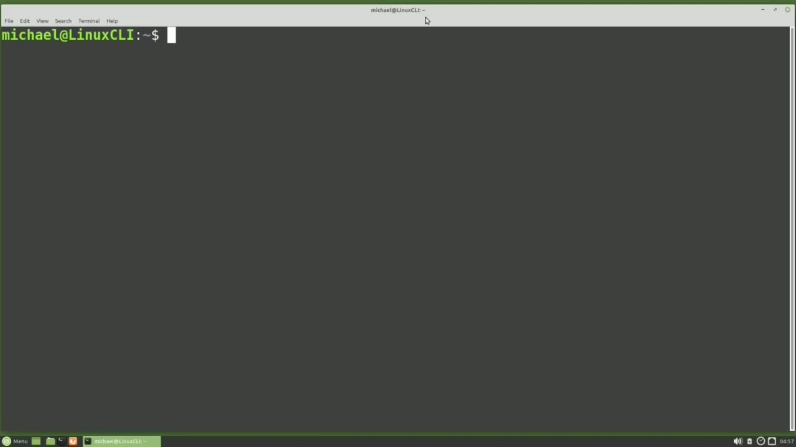
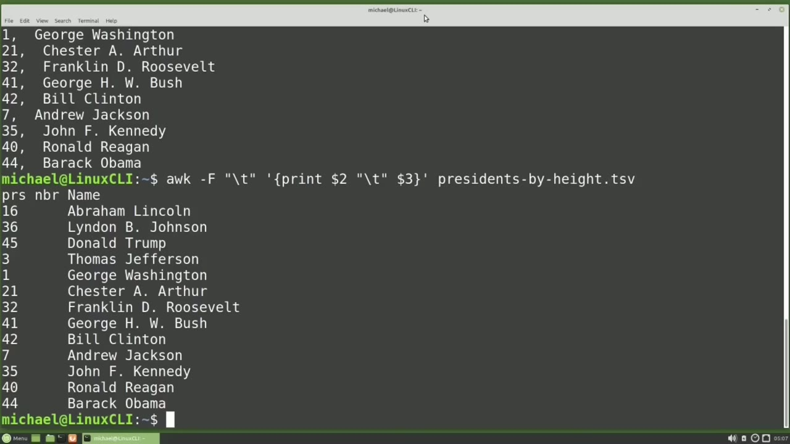
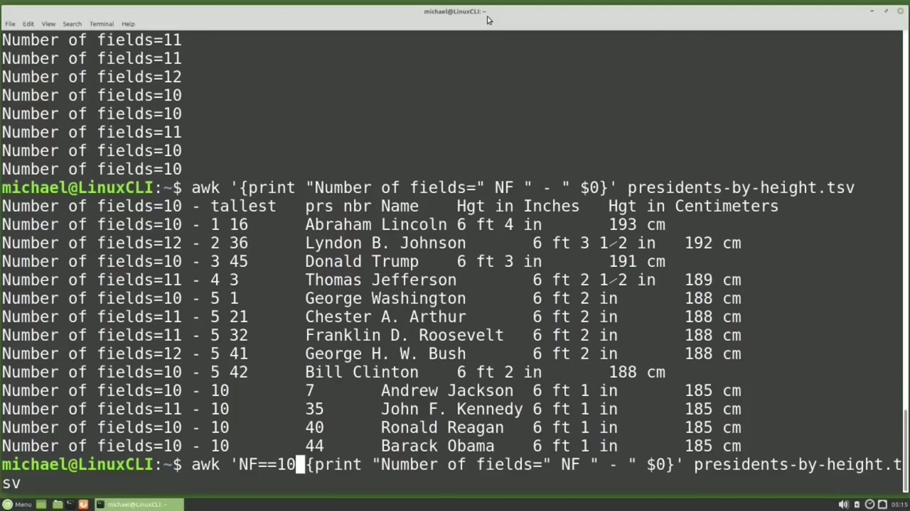
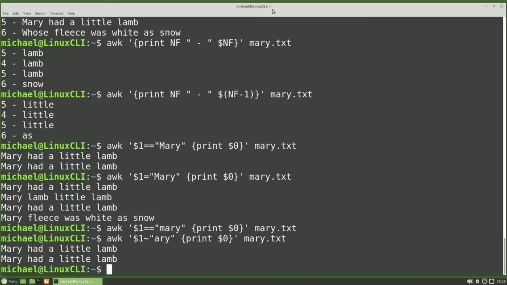
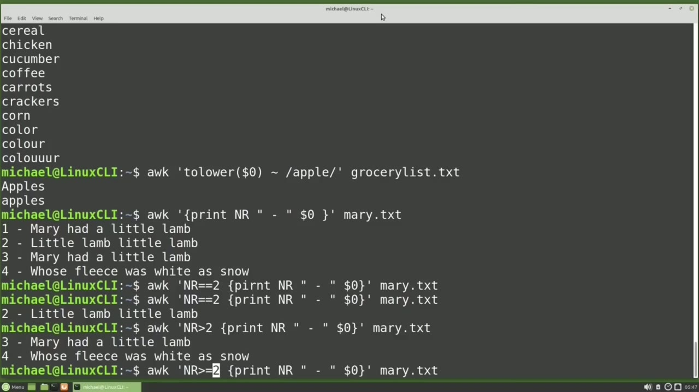

[← Course contents](../../01.md)

# 43. awk pt1

**Course:** [Linux Command Line - Entire Tutorial Series](https://www.youtube.com/watch?v=avg65oY7sj4)  
**Transcript:** [`Linux Command Line - Entire Tutorial Series transcript`](../../../../course_videos/Linux%20Command%20Line%20-%20Entire%20Tutorial%20Series/Linux%20Command%20Line%20-%20Entire%20Tutorial%20Series.txt)  
**Video:** 06:39:23–06:53:14 ([open at this time](https://www.youtube.com/watch?v=avg65oY7sj4&t=23963s))

## Introduction

Auk is a programming language, not quite as complete as something like Perl or C, but it is a programming language, and there is a lot to it. So our look at Auk will be similar to our look at said and regular expressions. Not a complete tutorial on the topic, but more of an introduction to some of the main features. The name Auk comes from the last names of its authors.

## Detailed Explanation

<details>
  <summary>Step 1 — Auk is a programming language, not quite as complete as something like</summary>

### Step 1 — Auk is a programming language, not quite as complete as something like

- [x] **Auk is a programming language, not quite as complete as something**
  - Auk is a programming language, not quite as complete as something like Perl or C, but it is a programming language, and there is a lot to it.
  - So our look at Auk will be similar to our look at said and regular expressions.
  - Not a complete tutorial on the topic, but more of an introduction to some of the main features.

- [x] **The name Auk comes from the last names of its authors**
  - The name Auk comes from the last names of its authors.
  - Alfred Aho, Peter Weinberg, and Brian Kernigan.
  - I mentioned Aoc is a scripting language and it can have many lines of code, but often it is used as a single-line script submitted right from the command.

- [x] **Line and that is what we're going to start with here. A typical Auk**
  - Line and that is what we're going to start with here. A typical Auk one line script will start with Auk and then have three things. A condition, a code block, and a file name.
  - I'm going to leave off the condition so this will apply to everything on the file.
  - The code block will go in quotes and then curly braces.

- [x] **In my code will be print and I'm adding the ending curly brace**
  - In my code will be print and I'm adding the ending curly brace, ending quote.
  - And then we'll give it the file name of Presidents by height.tsv.
  - Pressing Enter, that prints out our entire file.

- [x] **The header record is slightly changed from the last time we used this**
  - The header record is slightly changed from the last time we used this file.
  - Now let's say that we want to pull off only the second and third columns, like we did in the cut video.
  - To pull off a specific field, we're going to add in a dollar sign and then the field we want to pull off.

- [x] **I'm pulling off field 2 and then a dollar sign 3 to pull off the**
  - I'm pulling off field 2 and then a dollar sign 3 to pull off the second and third columns.
  - Notice here we pulled off the second column as expected, but the third column only has the President's first name, not the full name.
  - That's because Auk by default uses any white space as a delimiter, meaning tab, space, and line returns.

- [x] **We want to tell Ock to only use tabs as the input delimiter**
  - We want to tell Ock to only use tabs as the input delimiter.
  - And to do that, I will add a -uppercase f for field separator.
  - And then I will add in what I want to use as that field separator, in this case a tab.

- [x] **And I'll put that in quotes. Now when I press enter, we see that**
  - And I'll put that in quotes. Now when I press enter, we see that presidential number two and the full name of the president from column three.
  - I added a comma between columns 2 and 3.
  - If I take out that comma, we see it prints out the two fields right next to each other, making it look like a single field.

- [x] **If I want to add a comma and two spaces between those fields, I'll**
  - If I want to add a comma and two spaces between those fields, I'll put it in quotes between the dollar sign 2 and the dollar sign 3.
  - And here we see the comma and two spaces.
  - Or I could add in the tab character here.

- [x] **And we see it adds in our tab character**
  - And we see it adds in our tab character.



</details>

<details>
  <summary>Step 2 — it will add in whatever we put in the quotes between the two fields</summary>

### Step 2 — it will add in whatever we put in the quotes between the two fields

- [x] **So it will add in whatever we put in the quotes between the two fields**
  - So it will add in whatever we put in the quotes between the two fields.
  - To print out the number of fields on a line, we can print out the fields nf.
  - We see here that all the lines have five fields.

- [x] **Let's take off the field separator of tab for the input file**
  - Let's take off the field separator of tab for the input file.
  - And now we see that some lines have 10 fields, some have 11, and 2 have 12 fields.
  - I want to print off the number of fields and then the entire line to find out why they're so different.

- [x] **To print off the entire line, we print field 0**
  - To print off the entire line, we print field 0.
  - So dollar sign 0 will print the entire line.
  - Let's add in a quote space -space quote and then the dollar sign 0 to print out the entire line.

- [x] **Here we see the lines that have more than 10 fields are because they**
  - Here we see the lines that have more than 10 fields are because they have a middle initial or they have the extra half inch in their height.
  - Now let's add a condition to our ox script.
  - So I'm going to add my condition after the single quote but before the curly brace.

- [x] **And I want it to print out only where the neth number of fields is**
  - And I want it to print out only where the neth number of fields is equals equals 10.
  - And we need to use two equal signs for a comparison.



</details>

<details>
  <summary>Step 3 — now we have the whole condition, action, and file name</summary>

### Step 3 — now we have the whole condition, action, and file name

- [x] **So now we have the whole condition, action, and file name**
  - So now we have the whole condition, action, and file name.
  - If our condition is true, the number of fields equals 10.
  - We will take that action, which is to print out the number of fields and then that line.

- [x] **And this is for the Presidentsby height.tsv file**
  - And this is for the Presidentsby height.tsv file.
  - And we see that only printed out the lines with the 10 fields in it.
  - Now I want to switch to the Mary.TxT file that we created earlier in this series because that file does not have any tab separated values.

- [x] **I'm going to start with Ock, colon curly brace, print and F, quote**
  - I'm going to start with Ock, colon curly brace, print and F, quote, quote, dash, space, quote, dollar sign zero, ending curly brace, ending quote, for the Mary.
  - Now I want to print out just the last field on the line, but it changes for each line.
  - Sometimes it's 4, sometimes it's 5, and sometimes it's 6.

- [x] **To print out only the last field on that line, we're going to change**
  - To print out only the last field on that line, we're going to change this dollar sign 0 to be dollar sign and F.
  - Now instead of the 0, we're going to put in the 4, the 5, or the 6 that's returned from the number of fields variable.
  - So for the first line we're telling it to print out dollar sign 5, for the second line, print out dollar sign 4, and for the last line we're telling it to print dollar sign 6, the value from the nf variable.

- [x] **And here we see it prints out the last field just as we expected. If**
  - And here we see it prints out the last field just as we expected. If we want to print out the first to last field, we would do the same thing, but we're going to put in some parentheses and we'll say nf -1.
  - Parentheses do not include the dollar sign, just the nf -1.
  - Now let's add a condition to print out only the lines that start with Mary.

- [x] **And now we want to add our condition, which is dollar sign 1 equals**
  - And now we want to add our condition, which is dollar sign 1 equals Mary. And when that happens, we want to print out the entire line with dollar sign 0.
  - Now here, if we made a typo, and instead of having the two equals signs, we only have a single equal sign, we're now changing this from a condition to an assignment.
  - And the first field is now assigned to Mary, so every line begins with Mary.

- [x] **Luckily, Ock does not update the file by default**
  - Luckily, Ock does not update the file by default.
  - I'm arrowing up two times here to go back to the working search for Mary.
  - And maybe we can't remember if Mary starts with an uppercase M or a lowercase M.

- [x] **The search is case sensitive. And if I change that uppercase M to a**
  - The search is case sensitive. And if I change that uppercase M to a lowercase M, nothing is found.
  - And we might have a situation where we need to search for both uppercase M and lowercase M.
  - For this, I'm just going to leave off the M and change this equals equals to a tilday.

- [x] **So that tilday will check for the first field to contain ary those**
  - So that tilday will check for the first field to contain ary those three characters together in that order anywhere in the first word on that line.



</details>

<details>
  <summary>Step 4 — Run `grep`</summary>

### Step 4 — Run `grep`

- [x] **Use `grep`**
  - We can also use auk just like `grep` by typing and then our regular expression but our regular expression here will need to be inside of forward slashes forward slash I'm searching for anything that starts with the letter C and that will be for the GroceryList. txt file that we've worked with many times earlier in this series.
  - If we want to search case insensitive this way with Ock, we can't just use the -lowercase I like we can with `grep`. With Ock will need to use the to lower feature and the till day and we'll need to put that all in quotes.
  - I'm going to add in my quote to lower and then we'll add in the entire line in parentheses dollar sign zero.

- [x] **And then our till day and then I'm going to add in Apple as our Redjax**
  - And then our till day and then I'm going to add in Apple as our Redjax.
  - So what happened is it moved everything to lowercase, searched for Apple, and then prints out the input, whether it's uppercase or lowercase.
  - Auk has another built-in variable called nr for the number of records.

- [x] **Double quote space hyphen space double quote dollar sign zero ending**
  - Double quote space hyphen space double quote dollar sign zero ending curly brace ending quote Mary. txt so nr is number of records and although sometimes we'll think of the total number of records and it is but during the reading process it's the number of records read so far so that's why we see the one
  - After it reads the first record and the number two after it reads the second record and so on throughout the file.
  - We can use this as a condition if we add in auk quote nr equals equals 2.

- [x] **Then I'm adding my curly brace print nr double quote space -space**
  - Then I'm adding my curly brace print nr double quote space -space double quote dollar sign zero to print out the record ending curly brace ending quote marry. txt And because I spelled print wrong, it didn't print anything.
  - And now we see that it prints out the second record.
  - Or maybe we just want to skip the first record and print out the rest of the file.

- [x] **We can say where number of record is greater than to print out the**
  - We can say where number of record is greater than to print out the line.
  - And because I'm saying greater than two, it did not print out the second line.

```bash
grep
```



</details>

<details>
  <summary>Step 5 — To print out the second line as well, I need to say greater than or</summary>

### Step 5 — To print out the second line as well, I need to say greater than or

- [x] **To print out the second line as well, I need to say greater than or**
  - To print out the second line as well, I need to say greater than or equal to the value too. Up to now we've only talked about files with field separators. We can use a file where the fields may not have a field separator, but the fields could be lined up in specific columns, like that dir.txt file that we used in the Cut tutorial.
  - I'm going to cat, dIR.tXT, and we can see that I added a new first row to that file.
  - Our first field is only one character, so I have the one there.

- [x] **Field two is nine characters, so I have two in there**
  - Field two is nine characters, so I have two in there.
  - And then the third field is three characters, and it works this way until we get up to the field 10, which is zero. Then it starts all over again with one.
  - To read this file with Ock, we're going to need to use the Auk field widths variable. So I'm going to start my command with Ock.

- [x] **And then we need a -V to let Ock know that the next value is going to**
  - And then we need a -V to let Ock know that the next value is going to be a variable.
  - And then that variable is going to be field widths.
  - And we're going to assign that variable the field widths that we have noted up above.

- [x] **So our first field width is one character**
  - So our first field width is one character.
  - The third field width is 3, so I'm adding a 3.
  - And now I'm going to just paste in the rest of this.

- [x] **So we have all the field widths added in**
  - So we have all the field widths added in.
  - And then we're going to print out fields 1 through 16 of the dir.t file.
  - And here we see we printed out the 16 fields and that last field, the file name, they're all different widths. I just use the longest file name for my field width.

- [x] **In the cut video we only selected off the permissions, the owner, and**
  - In the cut video we only selected off the permissions, the owner, and the file name.
  - To make it clear which fields we're cutting, I'm going to assign them variable names.
  - We're going to take off all of the fields here, all the way back to print.

- [x] **Dollar sign 2 or second field. I'm going to add a semicolon to**
  - Dollar sign 2 or second field. I'm going to add a semicolon to separate these out.
  - Now I want the owner and we're going to assign that the value of dollar sign 4 adding a semicolon and then the final field we want is the file name. So that will be the name of our variable and we're going to assign that the value of dollar sign 16. We need another semicolon to separate this out.
  - Our variables, permissions, owner, and file name.

- [x] **I will add all these files and examples into a download and I'll put**
  - I will add all these files and examples into a download and I'll put it on the website.
  - In the next video we'll finish our introductory look at Ock for the Linux command line.



</details>

<details>
  <summary>Questions and Answers</summary>

## Questions and Answers

### Question 1: What does `grep` do in this chapter?

<details>
<summary>Answer</summary>

- [x] We can also use auk just like `grep` by typing and then our regular expression but our regular expression here will need to be inside of forward slashes forward slash I'm searching for anything that starts with the letter C and that will be for the GroceryList. txt file that we've worked with many times earlier in this series.

</details>

### Question 2: What does step 1 cover (Auk is a programming language, not quite as complete as something like)?

<details>
<summary>Answer</summary>

- [x] Auk is a programming language, not quite as complete as something like Perl or C, but it is a programming language, and there is a lot to it.
- [x] So our look at Auk will be similar to our look at said and regular expressions.
- [x] Not a complete tutorial on the topic, but more of an introduction to some of the main features.

</details>

### Question 3: What does step 2 cover (it will add in whatever we put in the quotes between the two fields)?

<details>
<summary>Answer</summary>

- [x] So it will add in whatever we put in the quotes between the two fields.
- [x] To print out the number of fields on a line, we can print out the fields nf.
- [x] We see here that all the lines have five fields.

</details>

### Question 4: What does step 3 cover (now we have the whole condition, action, and file name)?

<details>
<summary>Answer</summary>

- [x] So now we have the whole condition, action, and file name.
- [x] If our condition is true, the number of fields equals 10.
- [x] We will take that action, which is to print out the number of fields and then that line.

</details>

### Question 5: What does step 4 cover (Run grep)?

<details>
<summary>Answer</summary>

- [x] We can also use auk just like `grep` by typing and then our regular expression but our regular expression here will need to be inside of forward slashes forward slash I'm searching for anything that starts with the letter C and that will be for the GroceryList. txt file that we've worked with many times earlier in this series.
- [x] If we want to search case insensitive this way with Ock, we can't just use the -lowercase I like we can with `grep`. With Ock will need to use the to lower feature and the till day and we'll need to put that all in quotes.
- [x] I'm going to add in my quote to lower and then we'll add in the entire line in parentheses dollar sign zero.

</details>

### Question 6: What does step 5 cover (To print out the second line as well, I need to say greater than or)?

<details>
<summary>Answer</summary>

- [x] To print out the second line as well, I need to say greater than or equal to the value too. Up to now we've only talked about files with field separators. We can use a file where the fields may not have a field separator, but the fields could be lined up in specific columns, like that dir.txt file that we used in the Cut tutorial.
- [x] I'm going to cat, dIR.tXT, and we can see that I added a new first row to that file.
- [x] Our first field is only one character, so I have the one there.

</details>

</details>

## Summary

This chapter, awk pt1, walks through Auk is a programming language, not quite as complete as something like; it will add in whatever we put in the quotes between the two fields; now we have the whole condition, action, and file name; Run grep; To print out the second line as well, I need to say greater than or. Commands from the transcript: `grep`.

## References

- [Linux Command Line - Entire Tutorial Series (YouTube)](https://www.youtube.com/watch?v=avg65oY7sj4)
- [This chapter at 06:39:23](https://www.youtube.com/watch?v=avg65oY7sj4&t=23963s)
- [Local transcript](../../../../course_videos/Linux%20Command%20Line%20-%20Entire%20Tutorial%20Series/Linux%20Command%20Line%20-%20Entire%20Tutorial%20Series.txt)
