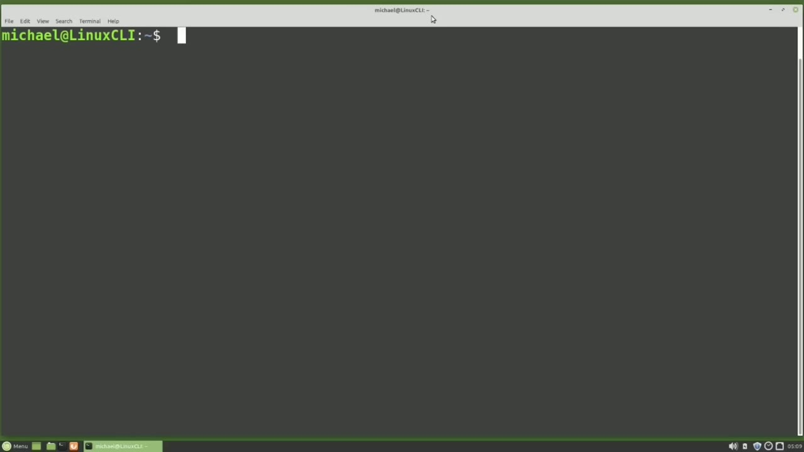
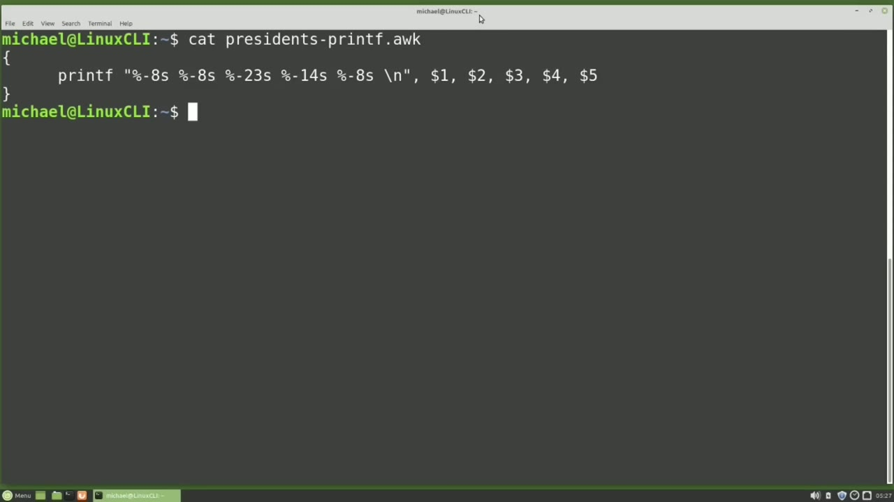
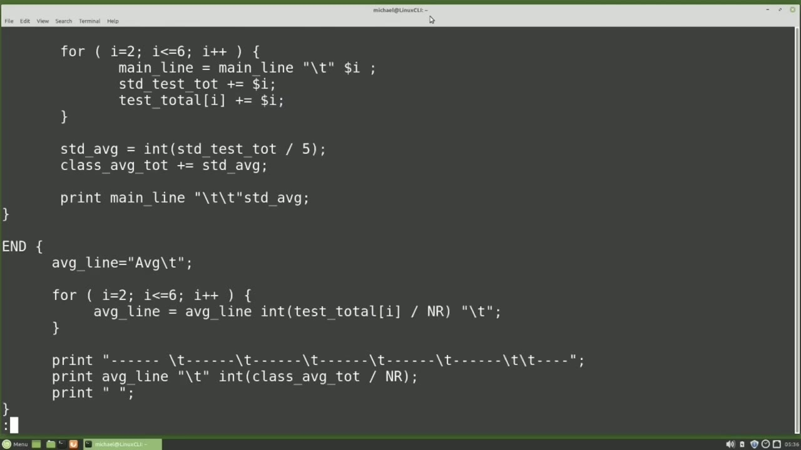
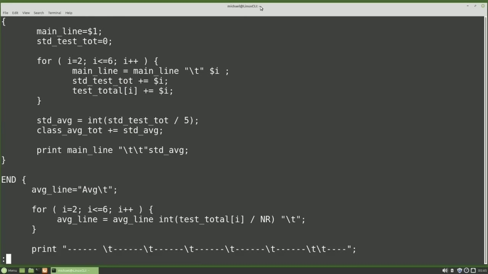
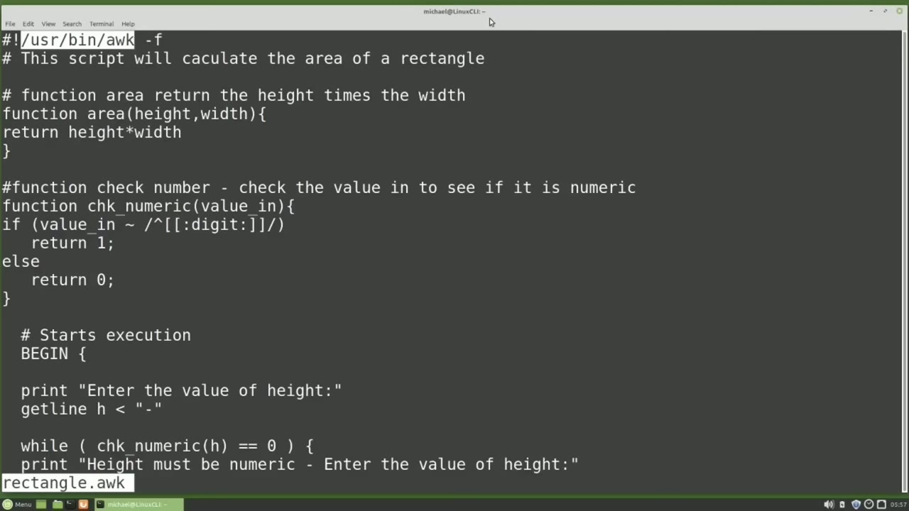

[← Course contents](../../01.md)

# 44. awk pt2

**Course:** [Linux Command Line - Entire Tutorial Series](https://www.youtube.com/watch?v=avg65oY7sj4)  
**Transcript:** [`Linux Command Line - Entire Tutorial Series transcript`](../../../../course_videos/Linux%20Command%20Line%20-%20Entire%20Tutorial%20Series/Linux%20Command%20Line%20-%20Entire%20Tutorial%20Series.txt)  
**Video:** 06:53:14–07:06:11 ([open at this time](https://www.youtube.com/watch?v=avg65oY7sj4&t=24794s))

## Introduction

In the last video, Ock Part 1, all of the Ock examples were submitted as a single command. Ach commands can be placed in a file and then run from that file. Let's review one of the examples from the last video, and then we'll put that command into a file and run it from the file. I will type Auk, single quote, nr for number of records, and I want those number of records to be Greater than or equal to the number two. Now I'm adding my left curly brace, -space double quote, then dollar sign zero to print out the entire line, ending curly brace, ending quote, and then the input file of mary.txt.

## Detailed Explanation

<details>
  <summary>Step 1 — In the last video, Ock Part 1, all of the Ock examples were submitted</summary>

### Step 1 — In the last video, Ock Part 1, all of the Ock examples were submitted

- [x] **In the last video, Ock Part 1, all of the Ock examples were submitted**
  - In the last video, Ock Part 1, all of the Ock examples were submitted as a single command.
  - Ach commands can be placed in a file and then run from that file. Let's review one of the examples from the last video, and then we'll put that command into a file and run it from the file. I will type Auk, single quote, nr for number of records, and I want those number of records to be
  - Greater than or equal to the number two. Now I'm adding my left curly brace, -space double quote, then dollar sign zero to print out the entire line, ending curly brace, ending quote, and then the input file of mary.txt.

- [x] **And we see it that prints out our files, skipping the first line and**
  - And we see it that prints out our files, skipping the first line and printing out the rest of the file.
  - I'm going to select this entire line and copy it.
  - And I want to put that line into a file, so I'm going to open one up with Nano.

- [x] **And I'm going to give it the file name of skip first line.auch**
  - And I'm going to give it the file name of skip first line.auch.
  - Here I'm going to paste that command, go to the beginning of the line, and we're going to remove the aque, the single quotes, and the file name Mary.
  - And I will save an exit with Ctrl+X, Y, enter, and that gets me out and saves the file.

- [x] **Now let's run that command from the file by typing then there's a**
  - Now let's run that command from the file by typing then there's a -lowercase f to let a ock know that the next value is going to be a file name and I want to add that file name which is skip first line dot ock and then I also need to give it the input file name which is mary. txt and we see it works we get the same output whether
  - We ran it from the file or from the command line I'm going to clear the screen Presidents by height.TSv.
  - We see those first three columns line up nicely, but after that it becomes kind of a mess.

- [x] **I have an aught script created that will print out the Presidents by**
  - I have an aught script created that will print out the Presidents by height tsv file, lining up all the fields nicely, and it's called Presidents.auch.
  - -uppercase f to assign it in input field separator and I want that input field separator to be a tab.
  - Now the -lowercase f because the next value is going to be our ahc file.

- [x] **And then we need to give it the input file name of Presidents by**
  - And then we need to give it the input file name of Presidents by height.TSv.
  - Here we see everything lines up nicely. Let's look at that Presidents.Ock script.
  - I'm going to clear the screen again and Cat Presidents.org.

- [x] **Here we see we're checking field 3, the president's name, to see if**
  - Here we see we're checking field 3, the president's name, to see if it's lessen or equal to 8 characters.
  - So we will add 3 tabs after printing field 3.
  - Then it checks to see if field 3 has less than or equal to 15 characters.

- [x] **If it does, then it only prints two tabs after field 3**
  - If it does, then it only prints two tabs after field 3.
  - And then anything in field 3 having more than 15 characters only gets one tab.
  - The purpose of the script was to show you the if, else if, and the length features of an Ock script.

- [x] **I have another script that does the same thing with the Print F**
  - I have another script that does the same thing with the Print F command.
  - Running that shows all the columns lined up nicely, slightly different than the previous example.
  - I'm going to clear my screen and let's cat out the Presidents -printf.Ock file so we can look at the code.



</details>

<details>
  <summary>Step 2 — Run `printf`</summary>

### Step 2 — Run `printf`

- [x] **Use `printf`**
  - Here we see a single line with `printf`. `printf` stands for Print with formatting.
  - Says grab that first value after the double quote, that's this dollar sign 1, and put it right here as an 8 character string.
  - The next value, field 2, is also an 8 character string. And then this third value here, the president's name, is going to be a string with 23 characters. I'm only using string values in this example, but `printf` does work well with numbers and decimal points. It will line them all up nicely as well.

- [x] **Let's run this once again, and once again, we see everything lined up**
  - Let's run this once again, and once again, we see everything lined up nicely.
  - For the next example, I'm going to read in a new file that we haven't seen before called Grades.TXT. I'm going to clear the screen and cat out the Grades.TXT file.
  - And this file is just a list of student names and then five test scores separated with commas.

- [x] **The Auk Program is going to read in this file, print out a report**
  - The Auk Program is going to read in this file, print out a report header, print out each student name, the five test scores, and then calculate an average for those five test scores and print that on that same line.
  - And then print out a line at the bottom with the average for each test as well as the average for each of the student averages.
  - The Ock program is called Findavg.Ock and I will run it with Auk -lowercase F, then add the Ock file name of FindavG.Ock.

- [x] **And then I will add the Grades. txt file**
  - And then I will add the Grades. txt file.
  - The result shows the header at the top, then all are lines with the student name, the scores, and then the student average on the right.
  - And then we have the averages at the bottom for each of the test and for the student average.

- [x] **I'm going to clear the screen and let's look at that program with**
  - I'm going to clear the screen and let's look at that program with less findavg.a.c.
  - The first thing we noticed in the script is that it's broken into parts.

```bash
printf
```



</details>

<details>
  <summary>Step 3 — Then I have to scroll down a little bit here to see the main section</summary>

### Step 3 — Then I have to scroll down a little bit here to see the main section

- [x] **Then I have to scroll down a little bit here to see the main section**
  - Then I have to scroll down a little bit here to see the main section and then scroll down a little more to see the end section.
  - Begin and end we haven't seen before but they work just how you would expect it will run the begin section once that's complete it runs the main section till that's done and then it does the end section let's take a closer look at the begin section the first thing we see is
  - The f s telling a arc the field separator value will be a comma then we create a variable called hdr line we're going to use this variable to build our header line and we're giving it a value of name Then we have a 4 loop with a single line in there.

- [x] **And what this will do is add on to our header line, a tab, the word**
  - And what this will do is add on to our header line, a tab, the word test, and then the number of the times through the loop.
  - So the first time it will be a one second time of two until it gets to 5.
  - Not at all, but I did want to include a loop.

- [x] **After that, we're adding two more tabs and the word avg to our header**
  - After that, we're adding two more tabs and the word avg to our header line.
  - And we end our begin section by printing a blank line.
  - We print that header line that we just built, and then we print a line of dashes.

- [x] **Now here in the main routine, we also create a variable and assign a**
  - Now here in the main routine, we also create a variable and assign a value of the dollar sign 1, which is the student first name.
  - Then we clear out the student test total.
  - And here we have another 4 loop, but this time we're starting at two and going through six because the test scores one through five are in fields two through six.

- [x] **Our first line in the loop is similar to what we did in the header**
  - Our first line in the loop is similar to what we did in the header line. We've got our main line and we're adding a tab and then the dollar sign i. So the dollar sign i will be dollar sign two the first time and go all the way through six. We then add that value to the
  - Student test total and then add that same total to the test total in the array of that same Now don't worry if you don't know anything about loops or arrays.



</details>

<details>
  <summary>Step 4 — Run `grep`, `bash`, `ls -lh`</summary>

### Step 4 — Run `grep`, `bash`, `ls -lh`

- [x] **Use `grep`**
  - I'm just trying to show that Ock has more functionality than `grep` or said.
  - After the loop, we calculate the student average by dividing the student test total by 5.
  - This will force that calculation to be an integer.

- [x] **We then add the student average to the class average total and then**
  - We then add the student average to the class average total and then print out that line that we just created.
  - We'll go through that same routine for every student in the file, and then we get to the end routine.
  - First thing we do in the end routine is we create a variable and we assign it avg.

- [x] **Then each time through the loop, we're going to append our average**
  - Then each time through the loop, we're going to append our average line.
  - And we're going to do a calculation here, taking the total for that test of that number of the array and divided by nr.
  - Remember that nr is the number of records read or number of students.

- [x] **Use `bash`, `ls -lh`**
  - After we get through that loop, we print out a line of dashes, we print the average line, and we also calculate the average total for the number of records read, and then print out another blank line at the end.
  - I have one more example here, and this one is a little more unique than the others, because it runs like a `bash` script, only it's an Auk script.
  - Let's clear the screen, and I will type `ls -lh` rectangle.Ock.

- [x] **Are the permissions. The execute bit has to be turned on for this to**
  - Are the permissions. The execute bit has to be turned on for this to run properly, and we see the execute bit is active for the owner, the group, and other.
  - I'm going to run the script with dot slash and then the file name.
  - Rectangle.Ock. And notice there's no input file with the script.

- [x] **What the script will do is calculate the area of a rectangle**
  - What the script will do is calculate the area of a rectangle.
  - Pressing Enter. It's asking me for the height of the rectangle.
  - And it replies, the height must be numeric.

- [x] **Use `which`**
  - It's asking me for the value of the width.
  - And the area of our rectangle is 15, `which` is the height times the width, 3 times 5 giving us 15.
  - Now before we look at the code, I'm going to type `which`.

- [x] **Now let's look at the code with less rectangle.Ock**
  - Now let's look at the code with less rectangle.Ock.
  - This first line starts with hash and then an exclamation point, also known as bang.
  - These two characters together on the first line of an executable file are known as Shebang.

```bash
grep
bash
ls -lh
which
```



</details>

<details>
  <summary>Step 5 — Run `which`</summary>

### Step 5 — Run `which`

- [x] **Use `which`**
  - That needs to be the value that we just typed in when we typed `which` Ock.
  - This single line here is what makes this file run as an executable Auk file and needs to be the first line in an executable arc file. The second line below that is just a comment.
  - A quick overall look at our script shows that we have two functions and then a Begin section.

- [x] **The script starts executing here at the Begin section**
  - The script starts executing here at the Begin section.
  - The first thing that happens is the line Enter the value of height is printed and then the user will type in the value of the height.
  - And then we come to this wild loop and the wild loop will pass the value of H for height to check to see if it's numeric.

- [x] **So the check numeric function gets that H puts it into the value in**
  - So the check numeric function gets that H puts it into the value in.
  - That wild loop will keep printing out that height must be numeric line until a numeric value is entered.
  - This whole next section does the same thing with the W or width value.

- [x] **Once we have a valid height and width, we print the area of your**
  - Once we have a valid height and width, we print the area of your rectangle is, and then we call the area function and we pass the height and the width.
  - The area function reads in the height and width and returns the height times the width.
  - This will end our look at the Ock command.

- [x] **In the next tutorial, we will continue looking at the Linux command**
  - In the next tutorial, we will continue looking at the Linux command line.

```bash
which
```



</details>

<details>
  <summary>Questions and Answers</summary>

## Questions and Answers

### Question 1: What does `printf` do in this chapter?

<details>
<summary>Answer</summary>

- [x] Here we see a single line with `printf`. `printf` stands for Print with formatting.

</details>

### Question 2: What does `grep` do in this chapter?

<details>
<summary>Answer</summary>

- [x] I'm just trying to show that Ock has more functionality than `grep` or said.

</details>

### Question 3: What does `bash` do in this chapter?

<details>
<summary>Answer</summary>

- [x] I have one more example here, and this one is a little more unique than the others, because it runs like a `bash` script, only it's an Auk script.

</details>

### Question 4: What does `ls -lh` do in this chapter?

<details>
<summary>Answer</summary>

- [x] Let's clear the screen, and I will type `ls -lh` rectangle.Ock.

</details>

### Question 5: What does `which` do in this chapter?

<details>
<summary>Answer</summary>

- [x] Now before we look at the code, I'm going to type `which`.

</details>

### Question 6: What does step 1 cover (In the last video, Ock Part 1, all of the Ock examples were submitted)?

<details>
<summary>Answer</summary>

- [x] In the last video, Ock Part 1, all of the Ock examples were submitted as a single command.
- [x] Ach commands can be placed in a file and then run from that file. Let's review one of the examples from the last video, and then we'll put that command into a file and run it from the file. I will type Auk, single quote, nr for number of records, and I want those number of records to be
- [x] Greater than or equal to the number two. Now I'm adding my left curly brace, -space double quote, then dollar sign zero to print out the entire line, ending curly brace, ending quote, and then the input file of mary.txt.

</details>

### Question 7: What does step 2 cover (Run printf)?

<details>
<summary>Answer</summary>

- [x] Here we see a single line with `printf`. `printf` stands for Print with formatting.
- [x] Says grab that first value after the double quote, that's this dollar sign 1, and put it right here as an 8 character string.
- [x] The next value, field 2, is also an 8 character string. And then this third value here, the president's name, is going to be a string with 23 characters. I'm only using string values in this example, but `printf` does work well with numbers and decimal points. It will line them all up nicely as well.

</details>

### Question 8: What does step 3 cover (Then I have to scroll down a little bit here to see the main section)?

<details>
<summary>Answer</summary>

- [x] Then I have to scroll down a little bit here to see the main section and then scroll down a little more to see the end section.
- [x] Begin and end we haven't seen before but they work just how you would expect it will run the begin section once that's complete it runs the main section till that's done and then it does the end section let's take a closer look at the begin section the first thing we see is
- [x] The f s telling a arc the field separator value will be a comma then we create a variable called hdr line we're going to use this variable to build our header line and we're giving it a value of name Then we have a 4 loop with a single line in there.

</details>

### Question 9: What does step 4 cover (Run grep, bash, ls -lh)?

<details>
<summary>Answer</summary>

- [x] I'm just trying to show that Ock has more functionality than `grep` or said.
- [x] After the loop, we calculate the student average by dividing the student test total by 5.
- [x] This will force that calculation to be an integer.

</details>

### Question 10: What does step 5 cover (Run which)?

<details>
<summary>Answer</summary>

- [x] That needs to be the value that we just typed in when we typed `which` Ock.
- [x] This single line here is what makes this file run as an executable Auk file and needs to be the first line in an executable arc file. The second line below that is just a comment.
- [x] A quick overall look at our script shows that we have two functions and then a Begin section.

</details>

</details>

## Summary

This chapter, awk pt2, walks through In the last video, Ock Part 1, all of the Ock examples were submitted; Run printf; Then I have to scroll down a little bit here to see the main section; Run grep, bash, ls -lh; Run which. Commands from the transcript: `printf`, `grep`, `bash`, `ls -lh`, `which`.

## References

- [Linux Command Line - Entire Tutorial Series (YouTube)](https://www.youtube.com/watch?v=avg65oY7sj4)
- [This chapter at 06:53:14](https://www.youtube.com/watch?v=avg65oY7sj4&t=24794s)
- [Local transcript](../../../../course_videos/Linux%20Command%20Line%20-%20Entire%20Tutorial%20Series/Linux%20Command%20Line%20-%20Entire%20Tutorial%20Series.txt)
