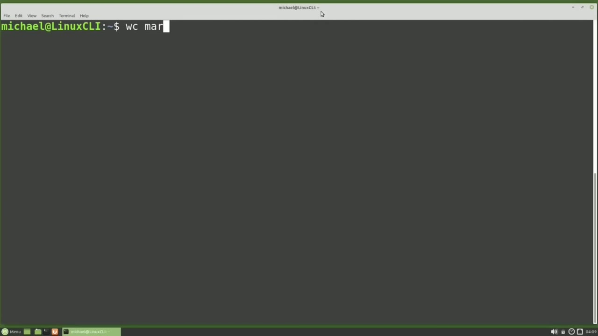
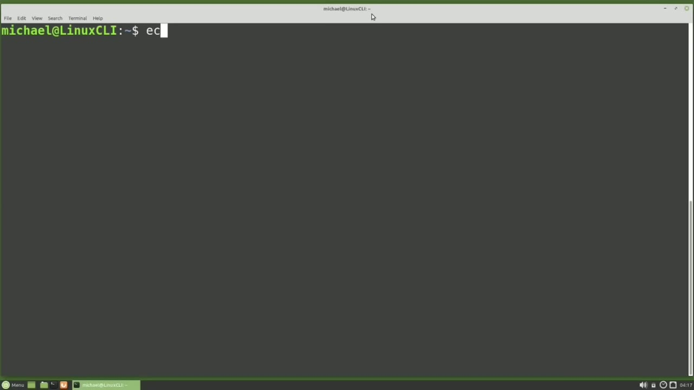
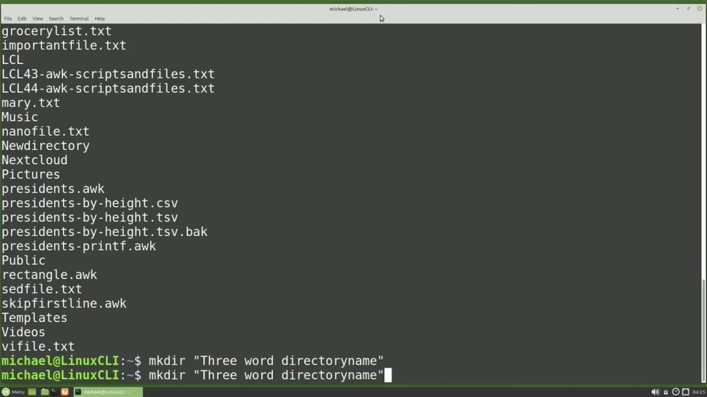
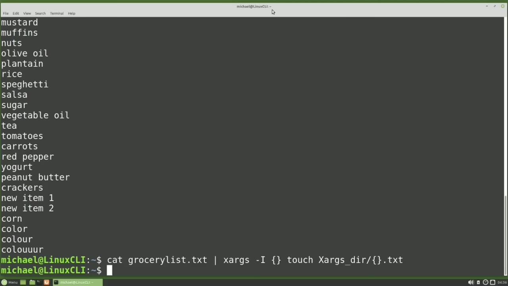
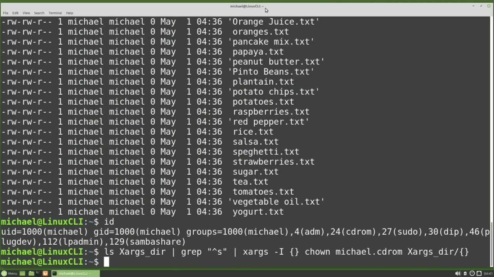

[← Course contents](../../01.md)

# 45. xargs

**Course:** [Linux Command Line - Entire Tutorial Series](https://www.youtube.com/watch?v=avg65oY7sj4)  
**Transcript:** [`Linux Command Line - Entire Tutorial Series transcript`](../../../../course_videos/Linux%20Command%20Line%20-%20Entire%20Tutorial%20Series/Linux%20Command%20Line%20-%20Entire%20Tutorial%20Series.txt)  
**Video:** 07:06:11–07:18:08 ([open at this time](https://www.youtube.com/watch?v=avg65oY7sj4&t=25571s))

## Introduction

wc Mary.T.T We see the number of lines is 4, the number of words is 20, and the number of characters is 101. And pipe that into wc, we get different results because now wc is finding the word count information from the text, Mary.TXT, which is one line. One word and nine characters, including the final line return, the Echo Command adds in. We want the wc command results of the file Mary. txt.

## Detailed Explanation

<details>
  <summary>Step 1 — Run `wc`, `echo`, `xargs`</summary>

### Step 1 — Run `wc`, `echo`, `xargs`

- [x] **Use `wc`, `echo`**
  - `wc` Mary.T.T We see the number of lines is 4, the number of words is 20, and the number of characters is 101.
  - And pipe that into `wc`, we get different results because now `wc` is finding the word count information from the text, Mary.TXT, which is one line.
  - One word and nine characters, including the final line return, the `echo` Command adds in.

- [x] **Use `wc`, `xargs`**
  - We want the `wc` command results of the file Mary. txt.
  - To do that, we need to add in the command `xargs` before we type `wc`.
  - `xargs` stands for Execute as an argument, and when the `wc` command reads in the Mary.T.

- [x] **Use `echo`**
  - As an argument, it is then able to give us the results we're looking for.
  - And we now see the 4 lines, 20 words, and 101 characters.
  - When I type `echo` Curly Brace 1.9 Closing Curly Brace and `echo` that into Exargs.

- [x] **Use `echo`**
  - We see that XRgs just echoes out the results, even though we didn't type `echo` in after XRgs.
  - `echo` is the default command for XRgs. So if nothing is typed after XRgs, `echo` is added. I'll add in `echo` and run this again and we see the same results.
  - It's just a little clearer here when we see `echo` but it is not needed.

- [x] **We can limit the number of words per line out of X args and when I**
  - We can limit the number of words per line out of X args and when I say words I mean fields separated by spaces.
  - In this case they're all numbers. I'm going to set the number of words per line to 2 by adding in a -n 2 before the `echo`.
  - And here we see only two numbers were printed on each line.

```bash
wc
echo
xargs
```



</details>

<details>
  <summary>Step 2 — Run `echo`, `xargs`, `ls`</summary>

### Step 2 — Run `echo`, `xargs`, `ls`

- [x] **And that space between the n and the two is not needed**
  - And that space between the n and the two is not needed.
  - There's also a -T option and T works like verbose.
  - That will show us the command XRs will run for each line of output before it writes out that line.

- [x] **Use `echo`**
  - The X-Args input default delimiter is white space as we saw, but we can change that.
  - I will type `echo` quote A colon B, C, C, colon, D, D, E, colon F, end quote, and pipe that into X-Args.
  - And X-Args sees that as one single field and prints it out as a single field.

- [x] **I'll bring back that command and add in a -D, quote, colon, quote**
  - I'll bring back that command and add in a -D, quote, colon, quote, This will now tell X-Args the colon is the delimiter.
  - And we see the output now does not show the colons.
  - And then adding in a -n2 limits the output to two words per line.

- [x] **Use `xargs`, `ls`**
  - Now that we have the idea of how `xargs` works, instead of echoing out numbers and letters, let's use output results of the `ls` command.
  - I will type `ls`.
  - And we see a list of files and directories.

- [x] **Use `ls`, `xargs`**
  - Now I'm going to type `ls` and pipe that into `xargs`.
  - And we see the same results without the highlighting and the results are all on a single line instead of the three columns that `ls` gives us.
  - Let's add in in a -n3 to give us 3 words per line.

- [x] **Use `ls`, `grep`**
  - We do see 3 words per line, but X-Args isn't really meant to be used to line things up, but it can really help us modify output of an `ls` command, especially when we pair it up with find or `grep`.
  - I'm going to change that n3 to n1 and that lines up all of our files and Before we go any further, I want to mention that none of my files or directories have any spaces in them.
  - We have dashes like Presidents dash by -height.c.c.

- [x] **Use `mkdir`**
  - I'm going to make a new directory with `mkdir`.
  - And I'm going to call this new directory 3 Word directory name.

```bash
echo
xargs
ls
grep
mkdir
```



</details>

<details>
  <summary>Step 3 — Run `ls`, `mkdir`, `cat grocerlysslist`</summary>

### Step 3 — Run `ls`, `mkdir`, `cat grocerlysslist`

- [x] **Use `ls`**
  - Now when I run the `ls` into XRs -n1, we have a problem.
  - 3 is on 1 line, word is on the next, and directory name is on a third line.
  - Exxargs saw the space in the directory name and split up that directory name by the space.

- [x] **To fix this, we need to add a -0 onto our command**
  - To fix this, we need to add a -0 onto our command.
  - That will tell Exarchs to split on null characters instead of any white space.
  - Now we see the 3 word directory name is on a single line.

- [x] **Use `ls`**
  - Another option for X-Args is the replacement string, which uses the option -uppercase I.
  - I will type `ls` and pipe that into X-Args and use the -n1 option.
  - And now I will add in the -uppercase I to identify my replacement string, which will be curly braces.

- [x] **Directory name is and put in the curly braces**
  - Directory name is and put in the curly braces.
  - Now instead of just echoing out the file name, it added our text to every field that X-Args echoed out.
  - And note here we did not need to add that -0 for the 3-word directory name.

- [x] **I used curly braces, but they do not have to be curly braces**
  - I used curly braces, but they do not have to be curly braces.
  - I'll replace the curly braces with colon rep str for replacement string in camel case. And we see that that works. And I don't need those colons on there either. But if I take them off, we see that it makes it a lot more difficult to see what the replacement string is. But it still works just the same. It's just a little
  - more difficult to read. I recommend always using the curly braces. You'll see that most often and using anything other than curly braces has potential to cause other problems.

- [x] **Use `mkdir`**
  - I'm going to clear the screen again and I'm going to make a directory with the `mkdir`. I'm going to call this X ARGs underscore theIR.
  - Now in this directory I want to create a text file for every item on the grocery list.T file. And to remind us all of what's in that grocery list. txt file, I'm going to cat that out. And we see there are a lot of items in that grocery list. txt file.
  - To create a text file for every item in that file manually would take a lot of effort.

- [x] **Use `cat grocerlysslist`**
  - But with X-Args, we can create this in a single command.
  - I will type `cat grocerlysslist`. txt, and then I'm going to pipe that into X-Args.
  - And I want to identify a replacement string of the curly braces.

- [x] **Use `touch`**
  - And this time instead of Echo, I'm going to type `touch`.
  - And I want to `touch` a file inside our...
  - X-Args, d-i-r, and I'm going to `touch` a file for everything from the X-Args command, and I'm also going to add in a.txt-T to make it a t-x-t file.

- [x] **Pressing Enter. I just created a text file for every item in that**
  - Pressing Enter. I just created a text file for every item in that GroceryList.T-T-T-File.

```bash
ls
mkdir
cat grocerlysslist
touch
```



</details>

<details>
  <summary>Step 4 — Run `ls -lhx -rgs`, `id`, `cd -rom`</summary>

### Step 4 — Run `ls -lhx -rgs`, `id`, `cd -rom`

- [x] **Use `ls -lhx -rgs`**
  - Let's show that they were all created by typing `ls -lhx -rgs` underscore D-Ir.
  - And we see all of the files were created.
  - And we notice here that Michael is set as the owner and the group for every file in this directory.

- [x] **Use `id`**
  - I want to update the group for all of the files that start with the letter S.
  - In an earlier video, we learned that we can only update the group to be a group that we are already a member of.
  - To see what groups I am already a member of, I will type `id`.

- [x] **Use `cd -rom`, `xargs`, `ls`**
  - We see I'm a member of the `cd -rom` group.
  - So I want to update the group to be cdrom for every file in the `xargs` directory that starts with the letter S.
  - To do that, I will type `ls` for everything that's in the `xargs` underscore dir directory.

- [x] **Use `grep`**
  - And we can leave that forward slash or we can remove it.
  - And I'm going to pipe that into `grep` where I want to grab out all the file names that start with the letter S.
  - So that will be quote, carrot S, end quote. And then we'll pipe the output of that into X-Args where I will identify my replacement string as curly braces.

- [x] **And then we're going to change the owner with the Chon Command**
  - And then we're going to change the owner with the Chon Command.
  - And I'm going to make it Michael.`cd -rom` for every file in the X-Args directory that matches our replacement string.

```bash
ls -lhx -rgs
id
cd -rom
xargs
ls
grep
```



</details>

<details>
  <summary>Step 5 — Run `ls -lh`, `cd -rom`, `grep`</summary>

### Step 5 — Run `ls -lh`, `cd -rom`, `grep`

- [x] **Use `ls -lh`, `cd -rom`, `grep`**
  - We'll see how that worked by typing `ls -lh`.
  - And here we see that the files that start with the letter S are now updated to have a group name of `cd -rom`.
  - That was using `grep`. Now let's use the `find` command with X-Args.

- [x] **I'm going to clear the screen and I want to find everything in the**
  - I'm going to clear the screen and I want to `find` everything in the X-Args directory that has a name, so -name, that starts with a P.
  - I name, so it'll be case insensitive that starts with the letter P.
  - And then I want to pipe that into X-Args, where I'm going to identify the replacement string of curly braces.

- [x] **And I want to change the mode, so that will be the Chamad command**
  - And I want to change the mode, so that will be the Chamad command.
  - And I'm going to change all of those files to be 700.
  - And then we need our curly braces there for the replacement string.

- [x] **Use `grep`, `xargs`, `ls`**
  - X-Args underscore dir shows us the files are now bold and in a different color because they're now executable files and only the file owner has access to them.
  - And one last thing I want to do is add something to the file names.
  - We already looked at `grep` and `find` so I'm just going to rename everything in the `xargs` directory. So I'll start with `ls`, the `xargs` directory and I'll pipe that into `xargs` identify my replacement string of curly braces and I'm going to move everything in the `xargs` directory

- [x] **Use `xargs`**
  - That matches those curly braces and I'm going to move it to the `xargs` directory and I'm going to add lcl 45 `xargs` underscore to those file names pressing Enter and let's show what's in that directory and we see that we've added lcl45 `xargs` underscore to all of the file names.
  - In the next video, we'll continue looking at the Linux command line.
  - Linux has a lot of options to archive and compress data.

```bash
ls -lh
cd -rom
grep
find
xargs
ls
```



</details>

<details>
  <summary>Questions and Answers</summary>

## Questions and Answers

### Question 1: What does `wc` do in this chapter?

<details>
<summary>Answer</summary>

- [x] `wc` Mary.T.T We see the number of lines is 4, the number of words is 20, and the number of characters is 101.

</details>

### Question 2: What does `echo` do in this chapter?

<details>
<summary>Answer</summary>

- [x] One word and nine characters, including the final line return, the `echo` Command adds in.

</details>

### Question 3: What does `xargs` do in this chapter?

<details>
<summary>Answer</summary>

- [x] To do that, we need to add in the command `xargs` before we type wc.

</details>

### Question 4: What does `ls` do in this chapter?

<details>
<summary>Answer</summary>

- [x] Now that we have the idea of how XARGs works, instead of echoing out numbers and letters, let's use output results of the `ls` command.

</details>

### Question 5: What does `grep` do in this chapter?

<details>
<summary>Answer</summary>

- [x] We do see 3 words per line, but X-Args isn't really meant to be used to line things up, but it can really help us modify output of an ls command, especially when we pair it up with find or `grep`.

</details>

### Question 6: What does `mkdir` do in this chapter?

<details>
<summary>Answer</summary>

- [x] I'm going to make a new directory with `mkdir`.

</details>

### Question 7: What does `cat grocerlysslist` do in this chapter?

<details>
<summary>Answer</summary>

- [x] I will type `cat grocerlysslist`. txt, and then I'm going to pipe that into X-Args.

</details>

### Question 8: What does `touch` do in this chapter?

<details>
<summary>Answer</summary>

- [x] And this time instead of Echo, I'm going to type `touch`.

</details>

### Question 9: What does `ls -lhx -rgs` do in this chapter?

<details>
<summary>Answer</summary>

- [x] Let's show that they were all created by typing `ls -lhx -rgs` underscore D-Ir.

</details>

### Question 10: What does `id` do in this chapter?

<details>
<summary>Answer</summary>

- [x] To see what groups I am already a member of, I will type `id`.

</details>

### Question 11: What does `cd -rom` do in this chapter?

<details>
<summary>Answer</summary>

- [x] We see I'm a member of the `cd -rom` group.

</details>

### Question 12: What does `ls -lh` do in this chapter?

<details>
<summary>Answer</summary>

- [x] We'll see how that worked by typing `ls -lh`.

</details>

</details>

## Summary

This chapter, xargs, walks through Run wc, echo, xargs; Run echo, xargs, ls; Run ls, mkdir, cat grocerlysslist; Run ls -lhx -rgs, id, cd -rom; Run ls -lh, cd -rom, grep. Commands from the transcript: `wc`, `echo`, `xargs`, `ls`, `grep`, `mkdir`, `cat grocerlysslist`, `touch`, `ls -lhx -rgs`, `id`, `cd -rom`, `ls -lh`, `find`.

## References

- [Linux Command Line - Entire Tutorial Series (YouTube)](https://www.youtube.com/watch?v=avg65oY7sj4)
- [This chapter at 07:06:11](https://www.youtube.com/watch?v=avg65oY7sj4&t=25571s)
- [Local transcript](../../../../course_videos/Linux%20Command%20Line%20-%20Entire%20Tutorial%20Series/Linux%20Command%20Line%20-%20Entire%20Tutorial%20Series.txt)
