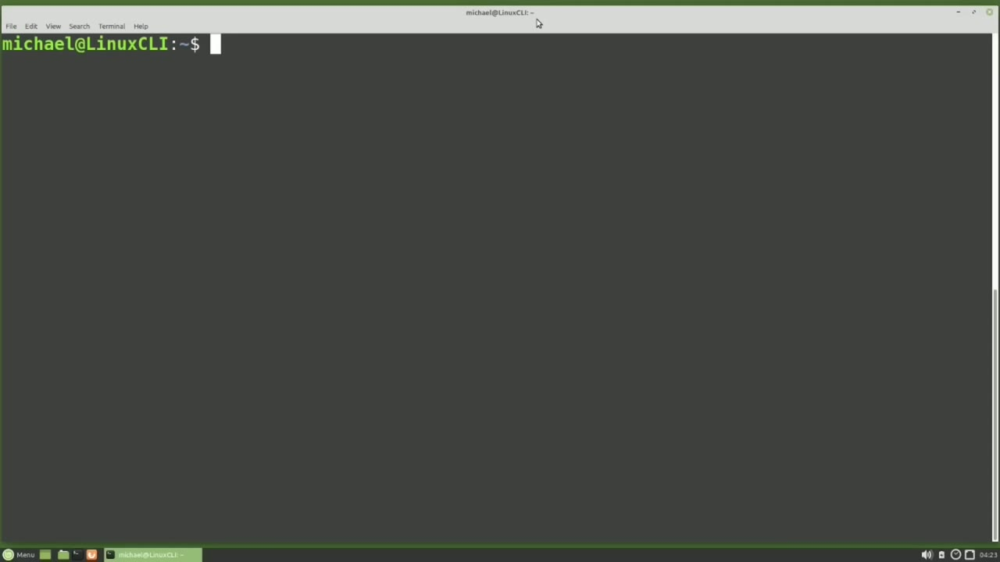
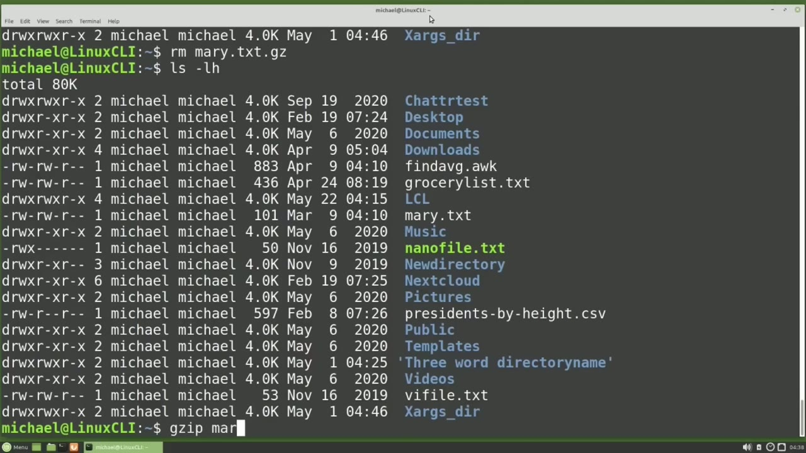
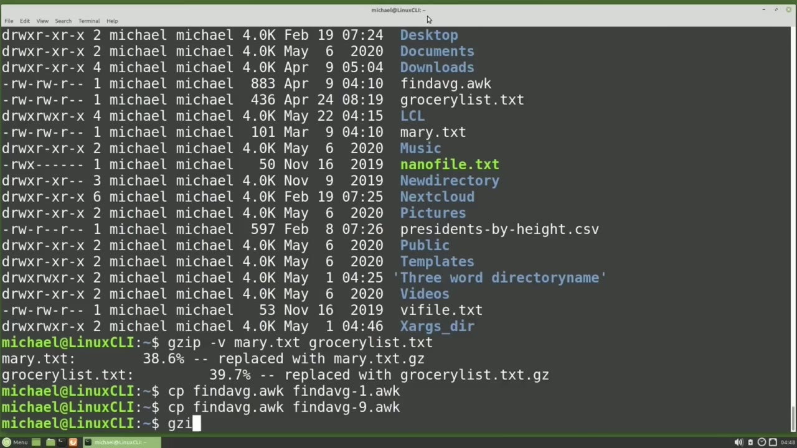
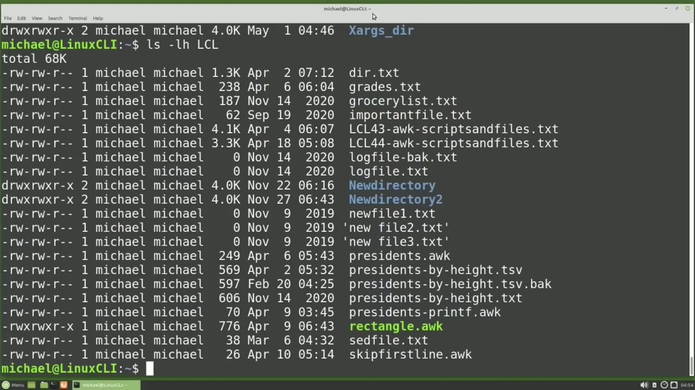

[← Course contents](../../01.md)

# 46. gzip

**Course:** [Linux Command Line - Entire Tutorial Series](https://www.youtube.com/watch?v=avg65oY7sj4)  
**Transcript:** [`Linux Command Line - Entire Tutorial Series transcript`](../../../../course_videos/Linux%20Command%20Line%20-%20Entire%20Tutorial%20Series/Linux%20Command%20Line%20-%20Entire%20Tutorial%20Series.txt)  
**Video:** 07:18:08–07:29:11 ([open at this time](https://www.youtube.com/watch?v=avg65oY7sj4&t=26288s))

## Introduction

In these next few videos, we're going to look at some of the most common tools to compress in archive data for the Linux command line. In this video, we're going to look at compressing a file with the GZip command. And when GZip was created, it was intended to be used with Gnu, and most likely that is where the G and GZip comes from. Let's start off by looking at what is in our current directory with ls -lh.

## Detailed Explanation

<details>
  <summary>Step 1 — Run `gzip`, `ls -lh`, `grep`</summary>

### Step 1 — Run `gzip`, `ls -lh`, `grep`

- [x] **Use `gzip`**
  - In these next few videos, we're going to look at some of the most common tools to compress in archive data for the Linux command line.
  - In this video, we're going to look at compressing a file with the `gzip` command.
  - And when `gzip` was created, it was intended to be used with Gnu, and most likely that is where the G and `gzip` comes from.

- [x] **Use `ls -lh`, `gzip`**
  - Let's start off by looking at what is in our current directory with `ls -lh`.
  - To compress a file with `gzip`, we start with the `gzip` command and then put in the file name.
  - I will zip up the Mary.TXT file with `gzip` Mary.TXT.

- [x] **Use `ls -lh`, `gzip`**
  - Typing `ls -lh` again shows us the Mary.TXT file is gone and the file Mary.TXT.GZ was created in its place.
  - If we try and view that file with cat, Mary.tXT.GZ, it will cat the file, but since that text is compressed, the output is unreadable.
  - To view a `gzip` file, we'll need to use ZCat.

- [x] **Use `ls -lh`**
  - And here we see that ZCat will read the file, decompress it, and show it on the screen.
  - But the file itself is still compressed.
  - We'll show that with `ls -lh`.

- [x] **Use `grep`**
  - And there we see Mary.tTXT.GZ is still compressed.
  - To `grep` a gz file, we will use Z `grep`.
  - Lamb mary dot txt that g z and z `grep` works like z cat The results are decompressed and shown on the screen, but the file itself is still compressed as Mary.txt.g.GZ.

- [x] **Use `gzip`, `ls -lh`, `unzip`**
  - We can decompress a GZp file one of two ways. One way is with `gzip`, then a dash, the lowercase D for decompress, and then the gz file name.
  - Typing `ls -lh` shows us that the Mary.TXT.GZ file is gone.
  - Let's `gzip` that Mary.tXT file again to show the other way to `unzip` a `gzip` file.

- [x] **Use `unzip`, `gzip`**
  - And the second way to `unzip` a `gzip` file is with G `unzip`.
  - Some people call this gun zip, but it's actually G `unzip`.
  - And then we add in the file name of the `gzip` file.

- [x] **Use `unzip`, `ls -lh`**
  - We want to `unzip`.
  - And typing `ls -lh` again.
  - And once again, we see that the Mary.txte.gZ is gone and the Mary.tXT file is back.

- [x] **Use `gzip -k`, `unzip -K`**
  - If we want to zip up that file and keep the original unzipped version, we can add a -K.
  - `gzip -k`, Mary.tTXT, and there we see we have both the Mary.tTXT and the Mary.TXT.GZ.
  - I'm going to remove the Mary.TxT file and I did that to show that the -K option for Keep will also work with G `unzip -K`, Mary.TXT.GZ or we can use it with the gz.

- [x] **These will both work, but I'll just show the one here**
  - These will both work, but I'll just show the one here.
  - And there we see that Mary.Txt is there as well as the Mary.txt.g.g.
  - Now I'm going to remove the Mary.txt.g.g.g.f.g.g.

- [x] **File. And I did that so we can zip it up again**
  - File. And I did that so we can zip it up again.
  - If we want to zip up multiple files, we can do that in one command, just one file after the other.

```bash
gzip
ls -lh
grep
unzip
gzip -k
unzip -K
```



</details>

<details>
  <summary>Step 2 — Run `gzip`, `unzip`, `gzip -D`</summary>

### Step 2 — Run `gzip`, `unzip`, `gzip -D`

- [x] **Use `gzip`**
  - `gzip`, Mary.T.TXT.
  - And we'll also zip up the GroceryList.TXT file.
  - And here we see Mary.t.txt.gZ and GroceryList.t.txt.g.GZ.

- [x] **Use `unzip`, `gzip`, `gzip -D`**
  - To `unzip` multiple files with `gzip`, we can use `gzip -D` and typing ma and I'm tabbing to auto-complete the file name.
  - And I'm going to add the GroceryList.TXT and my auto-complete does not work for a second file name.
  - G `unzip`, Mary.txte, GrocerlyList.TTXT.

- [x] **Use `unzip`, `gzip`**
  - The tab Autocomplete does work with multiple file names with G `unzip`.
  - These will both work, but I'll just show the one here.
  - `gzip` also has the lowercase V for Verboose option.

- [x] **I'm going to press the arrow up a couple of times to where we GZipped**
  - I'm going to press the arrow up a couple of times to where we GZipped multiple files.
  - And I'm going to add the -V option here.
  - And run this again. And here we see Mary.txte was replaced with Mary.ttxt.g.g.

- [x] **Use `gzip`**
  - And it gives us the percent the file was reduced.
  - The same thing for the Grocerlist.tXT file.
  - `gzip` has a compression level of 1 to 9.

- [x] **1 is the fastest speed with the minimal compression, and 9 may take a**
  - 1 is the fastest speed with the minimal compression, and 9 may take a little longer, but it will give the best compression.
  - To see how this works, I'm going to use the Findavg.auch file that we created a few videos back.
  - I'm going to copy the FindAverage.Och to FindAverage-1.Ock.

- [x] **And let's do the same thing with -9.org**
  - And let's do the same thing with -9.org.

```bash
gzip
unzip
gzip -D
```



</details>

<details>
  <summary>Step 3 — Run `gzip`, `ls -lh`, `ls -lhl -cl`</summary>

### Step 3 — Run `gzip`, `ls -lh`, `ls -lhl -cl`

- [x] **Use `gzip`**
  - Now let's compress them and add in the compression level to see the difference.
  - I'm going to `gzip` adding -V for verbose and then the 1 for the compression level and we'll do that for the file Find avg -1.org.org.
  - When we do the same thing with the -9 file and we want to make this the -9 compression level.

- [x] **Use `gzip`**
  - We see that compression level 9 did compress that file more.
  - `gzip` also has an L option to list out the information of a GZp file.
  - And let's do the same thing with the -9.

- [x] **And here we see the compressed and uncompressed file sizes as well as**
  - And here we see the compressed and uncompressed file sizes as well as the percent it was compressed.
  - So the compression level 1 started with an 883 byte file and compress that down to 344 bytes.
  - And the level 9 compression also started with 883 bytes and compress that down to 326 bytes.

- [x] **Use `ls -lh`**
  - And if we type `ls -lh`, we can see those same file sizes here.
  - The original 883 bytes went down to 344 bytes with the level 1 compression.
  - And down to 326 bytes with the level 9 compression.

- [x] **Use `ls -lhl -cl`**
  - We can zip up all the files in the lcl directory, but first let's see what's inside that lcl directory with `ls -lhl -cl`.
  - We've got a lot of files and a couple of directories.

```bash
gzip
ls -lh
ls -lhl -cl
```



</details>

<details>
  <summary>Step 4 — Run `ls -lhsl -nu`, `gzip`, `ls -lhlcl`</summary>

### Step 4 — Run `ls -lhsl -nu`, `gzip`, `ls -lhlcl`

- [x] **Use `ls -lhsl -nu`, `gzip`**
  - Let's see what's inside that new directory with `ls -lhsl -nu` directory.
  - To zip up all the files in the lcl directory with `gzip`, I will type `gzip` lowercase R for recursively zip up all the files in the lcl directory.
  - And I didn't have the verbose in there, so we didn't see them all get zipped up.

- [x] **Use `ls -lhlcl`, `unzip`, `unzip -R`**
  - But typing `ls -lhlcl` shows us all the files were zipped up.
  - And if we look in the lcl new directory directory, we see those two files were zipped up as well.
  - Let's `unzip` all those files now with G `unzip -R` and then the directory name of lcl.

- [x] **Use `ls -lh`**
  - Typing `ls -lh` lcl shows us all the files were unzipped.
  - Let's look at what's in our current directory with `ls -lh`.
  - And we see we've got the Mary.TXT file still zipped up.

- [x] **Use `unzip`**
  - I'm going to `unzip` that with G. `unzip`, Mary.txt.g.GZ.
  - If we want to GZp a file into a new file name, we'll need to add the -C option.
  - And the C option is to compress the data to standard out.

- [x] **Use `gzip`**
  - An example will be `gzip`.
  - -C, Mary.Txte, and I want that output to go into Mary.back.g.Z.
  - Typing l.s-lh shows us the Mary.tTXT and the Mary.back.

- [x] **To view what's in the Mary. Dot back, gz, we'll need to use the ZCat**
  - To view what's in the Mary. Dot back, gz, we'll need to use the ZCat.
  - We can add another file to our Mary.back.gZ file.
  - And we're going to append that on to Mary.back.g.

- [x] **Use `tar`**
  - And Z, catting that out now, shows the data from both those files are in that single file, Mary.back.g.Z.
  - If we want to put multiple files into a single archive file, we'll need to use the `tar` command.
  - And we'll look at that `tar` command in the next video.

```bash
ls -lhsl -nu
gzip
ls -lhlcl
unzip
unzip -R
ls -lh
tar
```



</details>

<details>
  <summary>Questions and Answers</summary>

## Questions and Answers

### Question 1: What does `gzip` do in this chapter?

<details>
<summary>Answer</summary>

- [x] In this video, we're going to look at compressing a file with the `gzip` command.

</details>

### Question 2: What does `ls -lh` do in this chapter?

<details>
<summary>Answer</summary>

- [x] Let's start off by looking at what is in our current directory with `ls -lh`.

</details>

### Question 3: What does `grep` do in this chapter?

<details>
<summary>Answer</summary>

- [x] To `grep` a gz file, we will use Z `grep`.

</details>

### Question 4: What does `unzip` do in this chapter?

<details>
<summary>Answer</summary>

- [x] Let's GZip that Mary.tXT file again to show the other way to `unzip` a GZip file.

</details>

### Question 5: What does `gzip -k` do in this chapter?

<details>
<summary>Answer</summary>

- [x] `gzip -k`, Mary.tTXT, and there we see we have both the Mary.tTXT and the Mary.TXT.GZ.

</details>

### Question 6: What does `unzip -K` do in this chapter?

<details>
<summary>Answer</summary>

- [x] I'm going to remove the Mary.TxT file and I did that to show that the -K option for Keep will also work with G `unzip -K`, Mary.TXT.GZ or we can use it with the gz.

</details>

### Question 7: What does `gzip -D` do in this chapter?

<details>
<summary>Answer</summary>

- [x] To unzip multiple files with GZip, we can use `gzip -D` and typing ma and I'm tabbing to auto-complete the file name.

</details>

### Question 8: What does `ls -lhl -cl` do in this chapter?

<details>
<summary>Answer</summary>

- [x] We can zip up all the files in the lcl directory, but first let's see what's inside that lcl directory with `ls -lhl -cl`.

</details>

### Question 9: What does `ls -lhsl -nu` do in this chapter?

<details>
<summary>Answer</summary>

- [x] Let's see what's inside that new directory with `ls -lhsl -nu` directory.

</details>

### Question 10: What does `ls -lhlcl` do in this chapter?

<details>
<summary>Answer</summary>

- [x] But typing `ls -lhlcl` shows us all the files were zipped up.

</details>

### Question 11: What does `unzip -R` do in this chapter?

<details>
<summary>Answer</summary>

- [x] Let's unzip all those files now with G `unzip -R` and then the directory name of lcl.

</details>

### Question 12: What does `tar` do in this chapter?

<details>
<summary>Answer</summary>

- [x] If we want to put multiple files into a single archive file, we'll need to use the `tar` command.

</details>

</details>

## Summary

This chapter, gzip, walks through Run gzip, ls -lh, grep; Run gzip, unzip, gzip -D; Run gzip, ls -lh, ls -lhl -cl; Run ls -lhsl -nu, gzip, ls -lhlcl. Commands from the transcript: `gzip`, `ls -lh`, `grep`, `unzip`, `gzip -k`, `unzip -K`, `gzip -D`, `ls -lhl -cl`, `ls -lhsl -nu`, `ls -lhlcl`, `unzip -R`, `tar`.

## References

- [Linux Command Line - Entire Tutorial Series (YouTube)](https://www.youtube.com/watch?v=avg65oY7sj4)
- [This chapter at 07:18:08](https://www.youtube.com/watch?v=avg65oY7sj4&t=26288s)
- [Local transcript](../../../../course_videos/Linux%20Command%20Line%20-%20Entire%20Tutorial%20Series/Linux%20Command%20Line%20-%20Entire%20Tutorial%20Series.txt)
