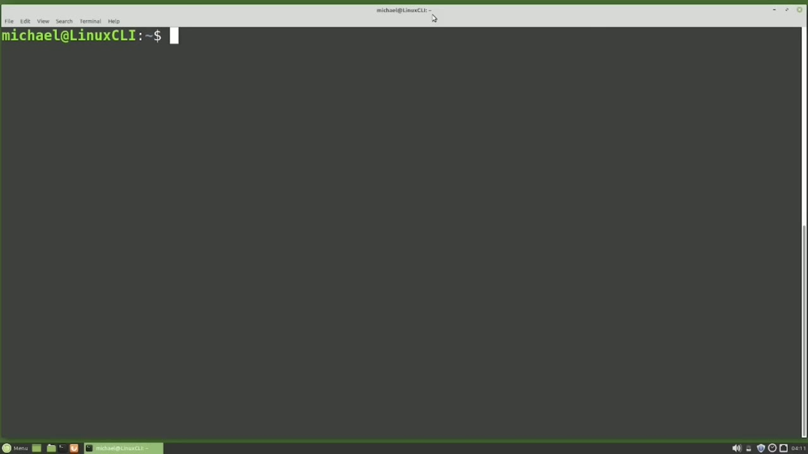
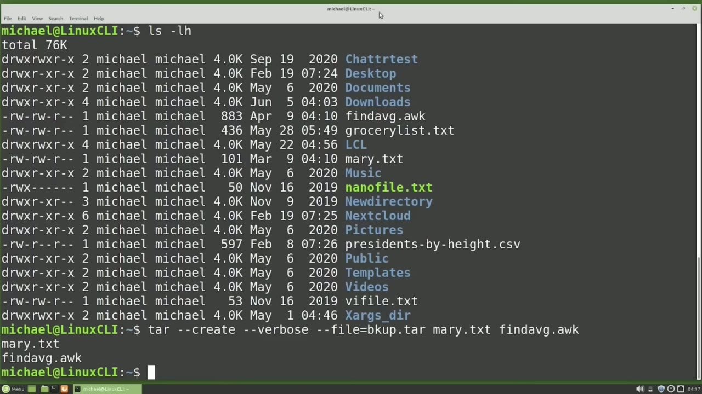
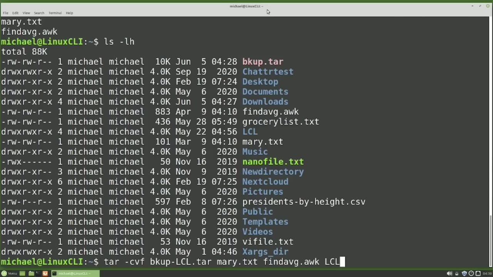
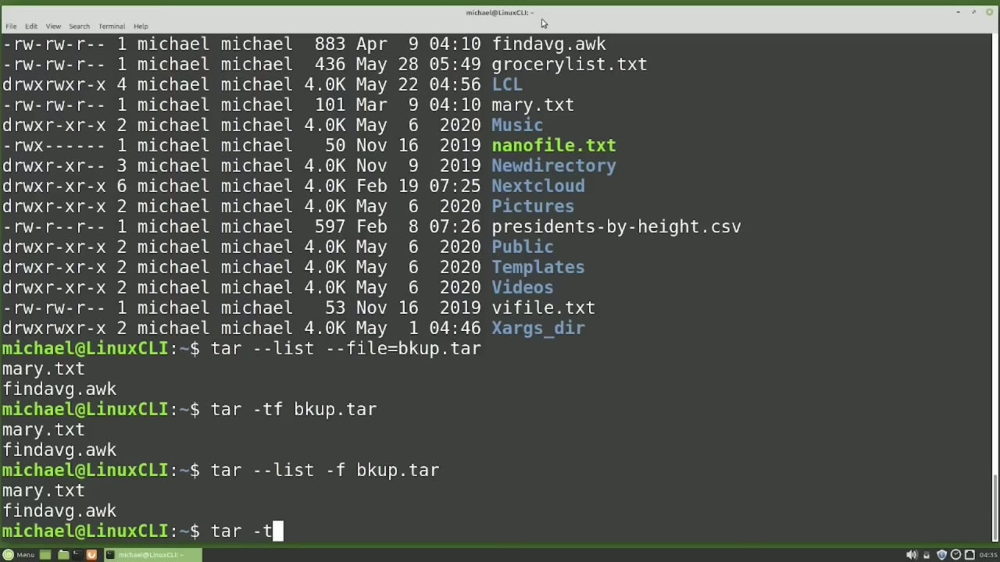

[← Course contents](../../01.md)

# 47. tar pt1

**Course:** [Linux Command Line - Entire Tutorial Series](https://www.youtube.com/watch?v=avg65oY7sj4)  
**Transcript:** [`Linux Command Line - Entire Tutorial Series transcript`](../../../../course_videos/Linux%20Command%20Line%20-%20Entire%20Tutorial%20Series/Linux%20Command%20Line%20-%20Entire%20Tutorial%20Series.txt)  
**Video:** 07:29:11–07:38:31 ([open at this time](https://www.youtube.com/watch?v=avg65oY7sj4&t=26951s))

## Introduction

tar is short for tape Archive, and the idea of the tape Archive command is to place multiple files and or directories into a single file, and then that single file can be moved to a backup or archive device, which in the 1970s when this command was created, was a tape archive storage device. Most of us don't use tape storage devices today, but we still call it the tar command. The new container file created by the tar command is called a tar file, and some people, including me at times, will call this tar file a tar ball.

## Detailed Explanation

<details>
  <summary>Step 1 — Run `tar`, `ls -lh`</summary>

### Step 1 — Run `tar`, `ls -lh`

- [x] **Use `tar`**
  - `tar` is short for tape Archive, and the idea of the tape Archive command is to place multiple files and or directories into a single file, and then that single file can be moved to a backup or archive device, which in the 1970s when this command was created, was a tape archive storage device.
  - Most of us don't use tape storage devices today, but we still call it the `tar` command.
  - The new container file created by the `tar` command is called a `tar` file, and some people, including me at times, will call this `tar` file a `tar` ball.

- [x] **Use `tar`**
  - `tar` ball, `tar` file, they're the same thing. It's just a file created from the `tar` command.
  - To create a `tar` file, we will start with the `tar` command.
  - Create a `tar` file so the next thing I'm going to type is -dash create then I'm going to add -dash file equals and here's where I will give it the new `tar` file name I want the `tar` file to be called and I will call this file B Kup dot `tar` and now I can add in the files that I

- [x] **Use `ls -lh`**
  - Want to be in this `tar` file I will type in the file names Mary. txt and find avg.aWK.
  - Pressing Enter, I see the standard Linux No News is good news and typing `ls -lh` shows the new bkup `tar` file right up there at the top.
  - And we see our original files are still there as well.

- [x] **Use `ls -lh`**
  - I'm going to remove the new `tar` file with rmbkup.`tar` and type `ls -lh` to show that it's gone.
  - Now let's recreate that `tar` file, but this time I'm going to add in -dh-verbose after the -dash create.
  - Pressing Enter now shows us the names of the two files that were placed in the `tar` file.

- [x] **I could also have added in -dh-verbose a second time**
  - I could also have added in -dh-verbose a second time.
  - And that would have shown more details like the file owner, the file group, the file size, and the like.

```bash
tar
ls -lh
```



</details>

<details>
  <summary>Step 2 — Run `ls -lh`, `tar -cvf`, `cp`</summary>

### Step 2 — Run `ls -lh`, `tar -cvf`, `cp`

- [x] **Use `ls -lh`, `tar -cvf`**
  - I'm going to remove that backup file again with rm, BKUP.Tar, and type `ls -lh` to show that it's gone.
  - Now we're going to create that same tar file a third time, but this time, using a format we're more familiar with.
  - I'm going to type `tar -cvf` space b-k-u-p, 4.

- [x] **So why did I start showing this command with the long version of**
  - So why did I start showing this command with the long version of -dash create and -dash file? I did that because in a few weeks or months from now, when you start typing the tar command, if you have to stop and think, I know there's a dash and some letters but I can't remember which ones.
  - Hopefully you'll remember the full words that we typed out just a moment ago.
  - Those are the only two characters that you really need to create a tar file.

- [x] **And sensor really required, you don't need to use that -before the cf**
  - And sensor really required, you don't need to use that -before the cf.
  - But I like to keep it in just to be consistent with the other Linux commands.
  - And then we can add in a V for Verboise or vv for vv forbose.

- [x] **Use `cp`**
  - With the abbreviated version F for file name, we no longer need that equals sign.
  - But now this command is slightly different than the commands that we've been looking at up to now.
  - What I mean by that is, when we learn the `cp` command for copy, we type `cp`, then the source or existing file first. Then we type the destination or the new file name.

- [x] **Use `mv`, `ln -s`**
  - And when we use the Move command, we have the same thing. We type `mv` for Move, Then we type the destination or the new file name.
  - And we use that same format for a SIM link.
  - We type in the `ln -s`, then the source or existing file first, then the new SIM link name that we want to create.

- [x] **But now with the tar command, the format is slightly different**
  - But now with the tar command, the format is slightly different.
  - We type in the tar command, then we type in the new file name first, then the existing source file name or file names that we want to add into the tar file.
  - And it makes sense to do things this way because we don't know how many files we're going to add into that new tar file.

- [x] **Use `ls -lh`**
  - So it makes sense to put the new file name first.
  - We just need to remember that the tar command is slightly different than the other commands we've been working with up to now.
  - Pressing Enter and then `ls -lh` shows us the new bkup dot tar file is created.

- [x] **If we want to add a directory to a tar file, we just add the**
  - If we want to add a directory to a tar file, we just add the directory like we do a file.
  - I'm going to press the arrow up to bring back that tar command.
  - And I'm going to change our file name to be bkup -lcl.

- [x] **And then I'm going to add lcl to the end here, just as I would**
  - And then I'm going to add lcl to the end here, just as I would another file name.
  - And notice we do not need to add that -lowercase R to recursively include all the files and directories in the lcl directory.

```bash
ls -lh
tar -cvf
cp
mv
ln -s
```



</details>

<details>
  <summary>Step 3 — Run `ls -lh`, `tar -dash`, `tar -tf`</summary>

### Step 3 — Run `ls -lh`, `tar -dash`, `tar -tf`

- [x] **Use `ls -lh`**
  - This is another thing that makes the tar command slightly different than the other Linux commands we've been looking at in this tutorial series.
  - And notice here in the verbose output that when the tar file is created, it does include the subdirectories, New Directory and all the files in that directory, and New Directory 2 in all the files in that directory.
  - Typing `ls -lh` Now shows us that we now have two tar files.

- [x] **And after some time is passed, we may not remember what we included**
  - And after some time is passed, we may not remember what we included in those tar files.
  - We don't want to have to extract the tar file to see what's in it.
  - We just want to see what is in the tar file.

- [x] **Use `tar -dash`**
  - To do this, we're going to start with the long version of the command.
  - I will type `tar -dash` list -file equals BKUP.Tar.
  - And we see the files Mary.TxT and find avg.awk.

- [x] **Use `tar -tf`, `ls`**
  - The abbreviated version of the command is `tar -tf`, bkup dot tar.
  - And notice here that we use the lowercase T for list.
  - The `ls` were already used for other options.

- [x] **Pressing Enter, we see the same results**
  - Pressing Enter, we see the same results.
  - And if we can't remember that we're using T for List, you can always type out tar dash, list, dash, F, bkup.tar.
  - Here we're using the mix of the abbreviated and the non-abreviated command option formats, which works without any problems.

- [x] **If we want to see more file information about the files in our tar**
  - If we want to see more file information about the files in our tar file, we can add in the verbose option.

```bash
ls -lh
tar -dash
tar -tf
ls
```



</details>

<details>
  <summary>Step 4 — Run `tar -tvf`, `mkdir`, `ls -lh`</summary>

### Step 4 — Run `tar -tvf`, `mkdir`, `ls -lh`

- [x] **Use `tar -tvf`**
  - `tar -tvf`, bkup.tar.t.tar.
  - And here we see more details about the files in the tar file.
  - I'm going to create a new directory to extract that tar file into.

- [x] **Use `mkdir`**
  - So I will `mkdir` to make a new directory.
  - And I'm going to call this directory tar X for tar extract.
  - And now I want to copy one of the tar files we just created into that directory.

- [x] **So I will cp for copy bkup-lcl.t-tar into tarX**
  - So I will cp for copy bkup-lcl.t-tar into tarX.
  - And now I'll cd into the tar x directory and l s -lh to show that we only have the one file in there at the moment.
  - To extract the tar file, I'm going to type tar, then -x for extract and f for file, and then give it the name bkup-l-cl.

- [x] **Use `ls -lh`**
  - Shows the two files, Mary.txt and find avg.awk.
  - And then typing `ls -lh` lcl shows us all the files and directories in the lcl directory.
  - And `ls -lh` lcl slash new directory shows us the files in the lcl new directory directory.

- [x] **This shows that all the files we expected were in the tar file and**
  - This shows that all the files we expected were in the tar file and extracted as expected.
  - This is a good breaking point, so we're going to end the video here and we will pick it up from here in the next video, tar Part 2 for the Linux command line.

```bash
tar -tvf
mkdir
ls -lh
```



</details>

<details>
  <summary>Questions and Answers</summary>

## Questions and Answers

### Question 1: What does `tar` do in this chapter?

<details>
<summary>Answer</summary>

- [x] Most of us don't use tape storage devices today, but we still call it the `tar` command.

</details>

### Question 2: What does `ls -lh` do in this chapter?

<details>
<summary>Answer</summary>

- [x] Pressing Enter, I see the standard Linux No News is good news and typing `ls -lh` shows the new bkup tar file right up there at the top.

</details>

### Question 3: What does `tar -cvf` do in this chapter?

<details>
<summary>Answer</summary>

- [x] I'm going to type `tar -cvf` space b-k-u-p, 4.

</details>

### Question 4: What does `cp` do in this chapter?

<details>
<summary>Answer</summary>

- [x] What I mean by that is, when we learn the `cp` command for copy, we type `cp`, then the source or existing file first. Then we type the destination or the new file name.

</details>

### Question 5: What does `mv` do in this chapter?

<details>
<summary>Answer</summary>

- [x] And when we use the Move command, we have the same thing. We type `mv` for Move, Then we type the destination or the new file name.

</details>

### Question 6: What does `ln -s` do in this chapter?

<details>
<summary>Answer</summary>

- [x] We type in the `ln -s`, then the source or existing file first, then the new SIM link name that we want to create.

</details>

### Question 7: What does `tar -dash` do in this chapter?

<details>
<summary>Answer</summary>

- [x] I will type `tar -dash` list -file equals BKUP.Tar.

</details>

### Question 8: What does `tar -tf` do in this chapter?

<details>
<summary>Answer</summary>

- [x] The abbreviated version of the command is `tar -tf`, bkup dot tar.

</details>

### Question 9: What does `ls` do in this chapter?

<details>
<summary>Answer</summary>

- [x] The `ls` were already used for other options.

</details>

### Question 10: What does `tar -tvf` do in this chapter?

<details>
<summary>Answer</summary>

- [x] `tar -tvf`, bkup.tar.t.tar.

</details>

### Question 11: What does `mkdir` do in this chapter?

<details>
<summary>Answer</summary>

- [x] So I will `mkdir` to make a new directory.

</details>

</details>

## Summary

This chapter, tar pt1, walks through Run tar, ls -lh; Run ls -lh, tar -cvf, cp; Run ls -lh, tar -dash, tar -tf; Run tar -tvf, mkdir, ls -lh. Commands from the transcript: `tar`, `ls -lh`, `tar -cvf`, `cp`, `mv`, `ln -s`, `tar -dash`, `tar -tf`, `ls`, `tar -tvf`, `mkdir`.

## References

- [Linux Command Line - Entire Tutorial Series (YouTube)](https://www.youtube.com/watch?v=avg65oY7sj4)
- [This chapter at 07:29:11](https://www.youtube.com/watch?v=avg65oY7sj4&t=26951s)
- [Local transcript](../../../../course_videos/Linux%20Command%20Line%20-%20Entire%20Tutorial%20Series/Linux%20Command%20Line%20-%20Entire%20Tutorial%20Series.txt)
