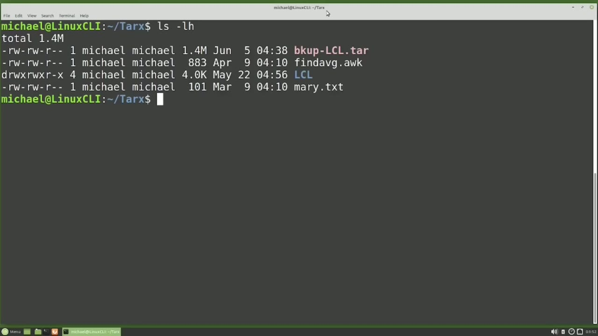
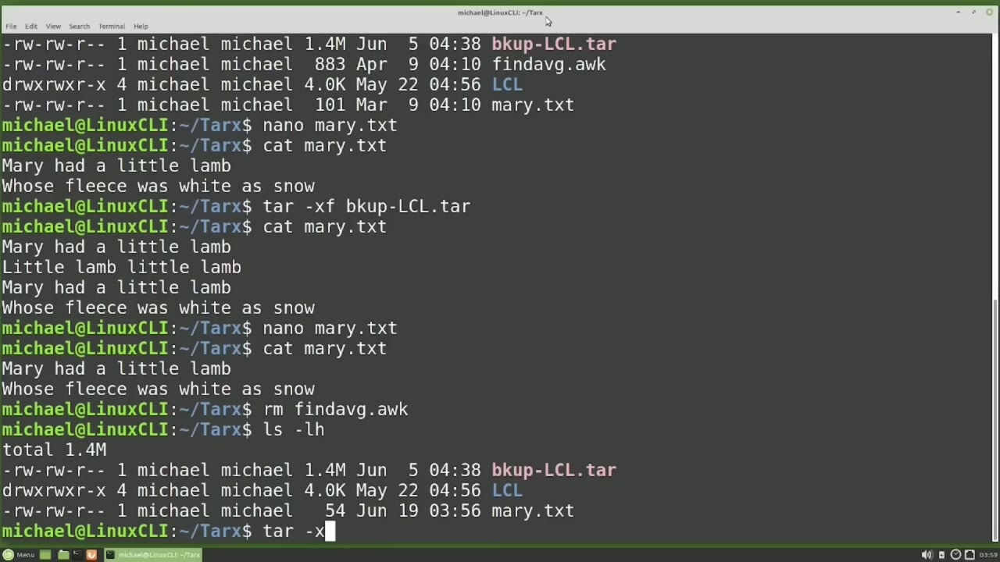
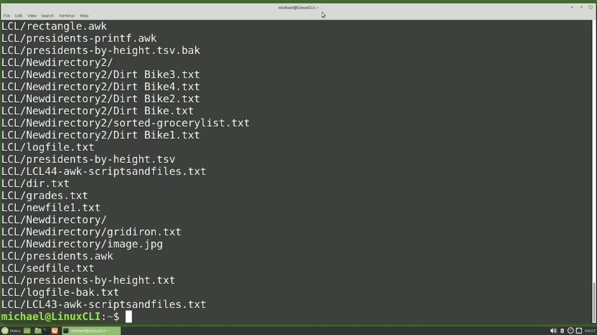
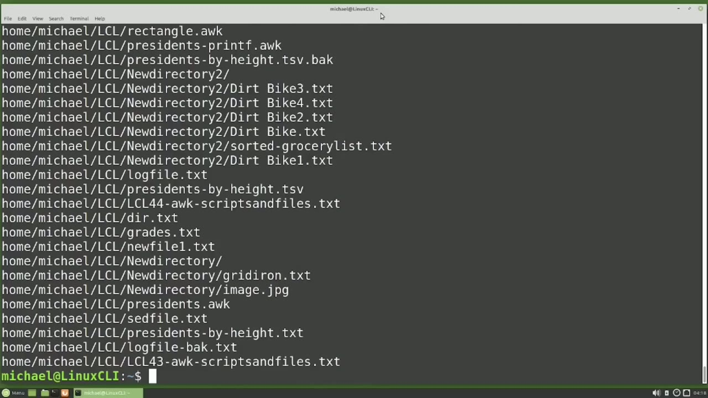
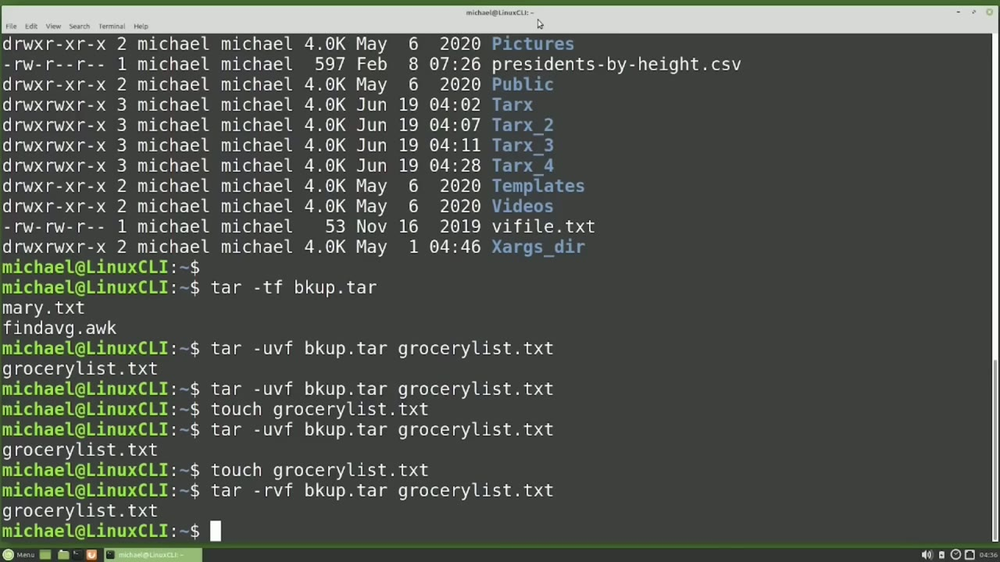

[← Course contents](../../01.md)

# 48. tar pt2

**Course:** [Linux Command Line - Entire Tutorial Series](https://www.youtube.com/watch?v=avg65oY7sj4)  
**Transcript:** [`Linux Command Line - Entire Tutorial Series transcript`](../../../../course_videos/Linux%20Command%20Line%20-%20Entire%20Tutorial%20Series/Linux%20Command%20Line%20-%20Entire%20Tutorial%20Series.txt)  
**Video:** 07:38:31–07:54:03 ([open at this time](https://www.youtube.com/watch?v=avg65oY7sj4&t=27511s))

## Introduction

We are picking up from where we left off in the last video. We're in the tarx directory where we extracted one of the tar files that we created in the last video. Is in this directory as well as the extracted files, Mary.TXT, findavg.AWK, and the lcl directory. I'm going to make some changes to the Mary.TXT file using Nano.

## Detailed Explanation

<details>
  <summary>Step 1 — Run `nano`, `tar -xf`, `ls -lh`</summary>

### Step 1 — Run `nano`, `tar -xf`, `ls -lh`

- [x] **We are picking up from where we left off in the last video**
  - We are picking up from where we left off in the last video.
  - We're in the tarx directory where we extracted one of the tar files that we created in the last video.
  - Is in this directory as well as the extracted files, Mary.TXT, findavg.AWK, and the lcl directory.

- [x] **Use `nano`**
  - I'm going to make some changes to the Mary.TXT file using `nano`.
  - And I'm going to save these changes with Ctrl+X, Y without control and Enter.
  - Let's cat out this file to show the changes are made.

- [x] **Use `tar -xf`**
  - If I want to set the file back to the version in the tar file as well as all the other files and directories in the bkup-lcl.t file, we can extract that tar file once again with `tar -xf`, bkup-lcl.t-t-tr.
  - And typing catmary.tXT again shows all four lines are there.
  - So when we extracted those files again, it just overwrote everything that was there with what was in the bkup lCL. tarr file.

- [x] **I'm going into nano again to edit the Mary.TXT**
  - I'm going into `nano` again to edit the Mary.TXT.
  - file and saving my changes with Ctrl+X, Y without control, and enter.
  - And I'm also going to remove the Findavg file with rm, findavg.org.

- [x] **Use `ls -lh`**
  - And `ls -lh` just to show that it's gone.
  - Now I want to keep the changes I made to the Mary.t.T.
  - But I also want to restore that Findavg.auch file as well as any other files that were deleted that are in the bkup-lcl. tarr file.

- [x] **To do that, I'm going to extract that tar file again, but this time**
  - To do that, I'm going to extract that tar file again, but this time I'm going to add the lowercase K option to keep the existing versions of any files in the tar file that are still here.
  - In other words, this will only restore files from that backup tar file if they don't currently exist.

```bash
nano
tar -xf
ls -lh
```



</details>

<details>
  <summary>Step 2 — Run `tar -x`, `ls -lh`, `cat mary.t.txtee`</summary>

### Step 2 — Run `tar -x`, `ls -lh`, `cat mary.t.txtee`

- [x] **Use `tar -x`, `ls -lh`**
  - `tar -x` kf bkup lcl.tar.
  - And here we see a lot of warnings that it could not extract the files because most of the files already exist.
  - Typing `ls -lh` shows the find AVG.aq file is there once again.

- [x] **Use `cat mary.t.txtee`**
  - And typing `cat mary.t.txtee` Shows the file only has two lines, so we kept the changes that we wanted for the Mary.TXT file.
  - We can also extract a single file from the tar file.
  - Let's say we no longer want those changes that we made to the Mary.T file.

- [x] **Use `tar -xV`, `ls -lh`**
  - And we want to just go back to the version that's in that tar file.
  - We can do that with `tar -xV`, bkup-lcl.tar, and then we put the name of the file that we want to extract. Mary.TXT. Pressing Enter and then catting out the Mary.tXT file shows the file is now the extracted version of the Mary.tXT file and that overwrote my updates
  - And once again we have all four lines. I'm going to go up one directory and `ls -lh`.

- [x] **Use `mkdir tarx`**
  - I want to make a second tar extract directory.
  - So I will do that with mkdir, tarx underscore 2.
  - And I want to extract the BKUP-LCL.L.L.tar file into that new tarx underscore 2 directory from the current directory.

- [x] **Use `tar -x`**
  - I don't want to have to move it into that directory and then extract it.
  - To extract the tar file into a different directory, we're going to start out the same way that we did to extract it into the current directory, meaning...
  - We will type `tar -x` for extract, V for verbose, F for file, and then we'll give it the file name.

- [x] **This will tell tar that we want to change the directory before**
  - This will tell tar that we want to change the directory before extracting.
  - Then we want to give it the directory name.
  - This is the relative path. We can use that or we can use the absolute path.

- [x] **/home slash Michael slash TarX underscore 2**
  - /home slash Michael slash TarX underscore 2.

```bash
tar -x
ls -lh
cat mary.t.txtee
tar -xV
mkdir tarx
```



</details>

<details>
  <summary>Step 3 — Run `ls -lh`, `tar -cvf`, `tar -extract verbose`</summary>

### Step 3 — Run `ls -lh`, `tar -cvf`, `tar -extract verbose`

- [x] **Use `ls -lh`**
  - Extracts at tar file into the TarX underscore 2 directory and I'll show that with `ls -lh`.
  - This shows the two files in the lcl directory were extracted.
  - And adding the lcl directory shows us all the files and directories in that lcl directory as well.

- [x] **Use `tar -cvf`**
  - I'm going to create a tar file of the lcl directory using the full path.
  - `tar -cvf` bkup -full path.
  - And here's where I put in the full path.

- [x] **Use `ls -lh`, `tar -extract verbose`**
  - Then `ls -lh` shows that that's created.
  - I'm also going to create another tar extract directory with MkDIRR, tarx underscore 3.
  - And now I want to `tar -extract verbose` file bkup, full path. tar.

- [x] **Use `ls -lh`, `ls`**
  - And I want to change the directory to put that into the tarX underscore 3 directory.
  - And when I type `ls -lh` tarX underscore 3, notice here we see the home directory instead of the lcl directory.
  - And then adding /home to my `ls` command shows the Michael directory.

- [x] **And doing the same thing, but adding the Michael directory on there**
  - And doing the same thing, but adding the Michael directory on there, shows us the lcl directory.
  - The lcl directory on there shows the files and directories inside that lcl directory.
  - What this is doing is keeping the full path of Home Michael.

- [x] **None of the files or directories in the Home or Michael directories**
  - None of the files or directories in the Home or Michael directories are included in this tar file, just the directory names, which is the path /home slash Michael, and then the lcl directory and all the files and directories in the lcl directory are included in this tar file.
  - This is useful if you want to extract a tar file to the exact location it was in when you created it.
  - I'm going to rename the lcl directory with mvlcl to lcl.bak.

- [x] **Use `tar -xvf`**
  - Now I'm going to extract that BKUP-FullPFath.TAR file into the location it was in when we created it by extracting it into the root directory.
  - I'll do that with `tar -xvf`, bkup, Fullpath.Tar.
  - Now I'm going to add the -uppercase C to change the directory.

- [x] **And I want this directory to be the root directory, so I'm just**
  - And I want this directory to be the root directory, so I'm just giving it the forward slash.
  - So this will first go to the root directory, then extract into the home directory, which exists this time, so we don't have to create it.
  - Then the Michael directory, which also exists, so we don't have to create that.

- [x] **Then the lcl directory, which does not exist, so that will get created**
  - Then the lcl directory, which does not exist, so that will get created.
  - And then all the files and directories in the lcl directory are then extracted here as well.

```bash
ls -lh
tar -cvf
tar -extract verbose
ls
tar -xvf
```



</details>

<details>
  <summary>Step 4 — Run `ls -lh`, `tar -cvf`, `mkdir tarx`</summary>

### Step 4 — Run `ls -lh`, `tar -cvf`, `mkdir tarx`

- [x] **Use `ls -lh`**
  - Pressing Enter. Then `ls -lh` shows our lcl directory is back.
  - And `ls -lh`, lcl, shows all the files and directories are back as well.
  - Now I want to use the absolute path to tar a directory, but this time I don't want the absolute path in the backup.

- [x] **Use `tar -cvf`**
  - To do that, I will type `tar -cvf` and the new file name of B-K-U-P-No-A-B-S-Path-L-L-C-L-L-C-TAR.
  - Now we're going to add the -uppercase C to change the directories.
  - And I want to change the directory to be in the home Michael directory.

- [x] **Use `mkdir tarx`**
  - Then I'm going to leave a space and put in the lcl.
  - And if I had other file names in the Michael directory, I wanted to include in this tar file, I would add them as well.
  - And I'll make another tar extract directory with mkdir, tarx underscore 4.

- [x] **And now I will tar extract verbose file, bkup**
  - And now I will tar extract verbose file, bkup.
  - And I want to change the directory into the TarX underscore 4 directory.
  - And showing the content of the TarX underscore 4 shows we have the lcl directory, but we don't have the /home slash Michael before it.

- [x] **Use `ls -lh`, `tar -tf`**
  - And then adding the lcl here shows all the files and directories in the lcl directory.
  - I'm going to clear the screen and typing `ls -lh` going up a little bit, we have this b-ku-p-tar file.
  - To see what's in that b-ku-p dot tar file, I'm going to type `tar -tf`, b-kup-t-f, B-KUP.T-Tar.

- [x] **And we see we've got two files in there, the Mary.tTXT file and the**
  - And we see we've got two files in there, the Mary.tTXT file and the avg.og.og.
  - We can add another file to that tar file by updating that tar file with tar, U for Update, V for Verboose, and F for File, then we add our existing file, which is bkup.t.t.
  - And then we add in the file or files that we want to add.

- [x] **In this case, I'm going to add in the GroceryList.T file**
  - In this case, I'm going to add in the GroceryList.T file.
  - Pressing Enter, our GroceryList.T.file was added.
  - If I try and update that tar file again just by pressing the arrow up and enter, nothing happens.

- [x] **Use `touch grocerylist.t.t`**
  - tar sees the current version of that file is already on the tar file.
  - There's nothing to update because it has the same timestamp.
  - If I `touch grocerylist.t.t`.

- [x] **Use `touch`, `tar rvf`**
  - We see the GroceryList. txt file does get updated in our tar file.
  - Let's `touch` that GrocerlyList.T file again.
  - This time I'm going to type tar, rvf, bkup.t, txt.

- [x] **And like the U for update, we can use the R for append**
  - And like the U for update, we can use the R for append.
  - And just like the U for update does not overwrite anything.
  - They just add a new version of the existing file by appending a new version into the tar file.

```bash
ls -lh
tar -cvf
mkdir tarx
tar -tf
touch grocerylist.t.t
touch
tar rvf
```



</details>

<details>
  <summary>Step 5 — Run `tar -t`, `ls -lh`</summary>

### Step 5 — Run `tar -t`, `ls -lh`

- [x] **Use `tar -t`**
  - We can see this by typing `tar -t` vf, bkup.t dot tar.
  - Here we see all three versions of the Grocery List.T file.
  - I'm going to make another tar extract directory.

- [x] **I'm going to call this one, tarX underscore 5 for tar extract 5**
  - I'm going to call this one, tarX underscore 5 for tar extract 5.
  - Copy the backup dot tar file into tar x underscore 5.
  - And then I'm going to cd into that directory.

- [x] **Use `ls -lh`**
  - And now let's extract that tar file with tar xf, bkup. tar, and `ls -lh` shows us it only extracted three files.
  - So what happened to the other two versions of the GroceryList.T file?
  - The answer is they have the same name so it restored the first version, meaning the earliest timestamp, then restored the second version with the same name, so it overwrote the first one, and then it overwrote the second one the same way, and that is why we only have one version of the GrocerlyList.T file,

- [x] **And it is the one with the most recent timestamp**
  - And it is the one with the most recent timestamp.
  - I will remove all these files with rm, findavg.Ock, GrocerlyList.TXT and Mary.TXT.
  - I'm going to extract this tar file again with extract, but this time I'm going to add the K for Keep.

- [x] **Use `ls -lh`**
  - And when I press Enter, we see that it cannot extract the Grocererlist.TXT file because it exists.
  - Typing `ls -lh` shows us this time it extracted the earliest version and then it could not overwrite the file because we told it to keep a file if it exists.
  - So we have the earliest version of the Grocery List.T file.

- [x] **Use `ls -lh`**
  - If we want to restore a specific occurrence of a file with multiple versions in the tar file, we need to use the -dh occurrence option.
  - Pressing the arrow up, I'm going back to the tar.
  - I'm going to take off the K for a keep, and then I'm going to add -dash occurrence equals 2 and then the file name that I want the second occurrence of which in this case is the grocery list. txt file. Pressing Enter and then `ls -lh` shows that now we have the second occurrence of the Grocerlist.TXT file. The first occurrence would be the oldest

- [x] **Version and the third occurrence would be the most recent version**
  - Version and the third occurrence would be the most recent version.
  - In the next video, we'll look at creating a tar file and zipping it up in a single command for the Linux command line.

```bash
tar -t
ls -lh
```



</details>

<details>
  <summary>Questions and Answers</summary>

## Questions and Answers

### Question 1: What does `nano` do in this chapter?

<details>
<summary>Answer</summary>

- [x] I'm going to make some changes to the Mary.TXT file using `nano`.

</details>

### Question 2: What does `tar -xf` do in this chapter?

<details>
<summary>Answer</summary>

- [x] If I want to set the file back to the version in the tar file as well as all the other files and directories in the bkup-lcl.t file, we can extract that tar file once again with `tar -xf`, bkup-lcl.t-t-tr.

</details>

### Question 3: What does `ls -lh` do in this chapter?

<details>
<summary>Answer</summary>

- [x] And `ls -lh` just to show that it's gone.

</details>

### Question 4: What does `tar -x` do in this chapter?

<details>
<summary>Answer</summary>

- [x] `tar -x` kf bkup lcl.tar.

</details>

### Question 5: What does `cat mary.t.txtee` do in this chapter?

<details>
<summary>Answer</summary>

- [x] And typing `cat mary.t.txtee` Shows the file only has two lines, so we kept the changes that we wanted for the Mary.TXT file.

</details>

### Question 6: What does `tar -xV` do in this chapter?

<details>
<summary>Answer</summary>

- [x] We can do that with `tar -xV`, bkup-lcl.tar, and then we put the name of the file that we want to extract. Mary.TXT. Pressing Enter and then catting out the Mary.tXT file shows the file is now the extracted version of the Mary.tXT file and that overwrote my updates

</details>

### Question 7: What does `mkdir tarx` do in this chapter?

<details>
<summary>Answer</summary>

- [x] So I will do that with mkdir, tarx underscore 2.

</details>

### Question 8: What does `tar -cvf` do in this chapter?

<details>
<summary>Answer</summary>

- [x] `tar -cvf` bkup -full path.

</details>

### Question 9: What does `tar -extract verbose` do in this chapter?

<details>
<summary>Answer</summary>

- [x] And now I want to `tar -extract verbose` file bkup, full path. tar.

</details>

### Question 10: What does `ls` do in this chapter?

<details>
<summary>Answer</summary>

- [x] And then adding /home to my `ls` command shows the Michael directory.

</details>

### Question 11: What does `tar -xvf` do in this chapter?

<details>
<summary>Answer</summary>

- [x] I'll do that with `tar -xvf`, bkup, Fullpath.Tar.

</details>

### Question 12: What does `tar -tf` do in this chapter?

<details>
<summary>Answer</summary>

- [x] To see what's in that b-ku-p dot tar file, I'm going to type `tar -tf`, b-kup-t-f, B-KUP.T-Tar.

</details>

</details>

## Summary

This chapter, tar pt2, walks through Run nano, tar -xf, ls -lh; Run tar -x, ls -lh, cat mary.t.txtee; Run ls -lh, tar -cvf, tar -extract verbose; Run ls -lh, tar -cvf, mkdir tarx; Run tar -t, ls -lh. Commands from the transcript: `nano`, `tar -xf`, `ls -lh`, `tar -x`, `cat mary.t.txtee`, `tar -xV`, `mkdir tarx`, `tar -cvf`, `tar -extract verbose`, `ls`, `tar -xvf`, `tar -tf`, `touch grocerylist.t.t`, `touch`.

## References

- [Linux Command Line - Entire Tutorial Series (YouTube)](https://www.youtube.com/watch?v=avg65oY7sj4)
- [This chapter at 07:38:31](https://www.youtube.com/watch?v=avg65oY7sj4&t=27511s)
- [Local transcript](../../../../course_videos/Linux%20Command%20Line%20-%20Entire%20Tutorial%20Series/Linux%20Command%20Line%20-%20Entire%20Tutorial%20Series.txt)
