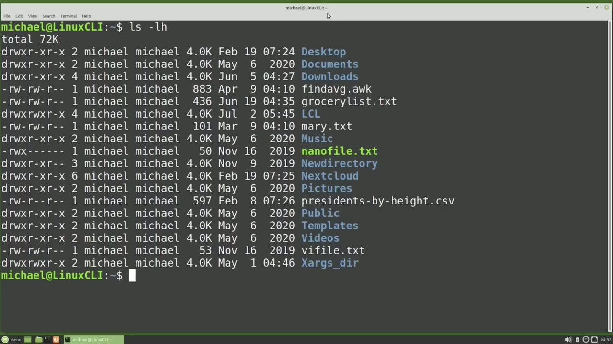
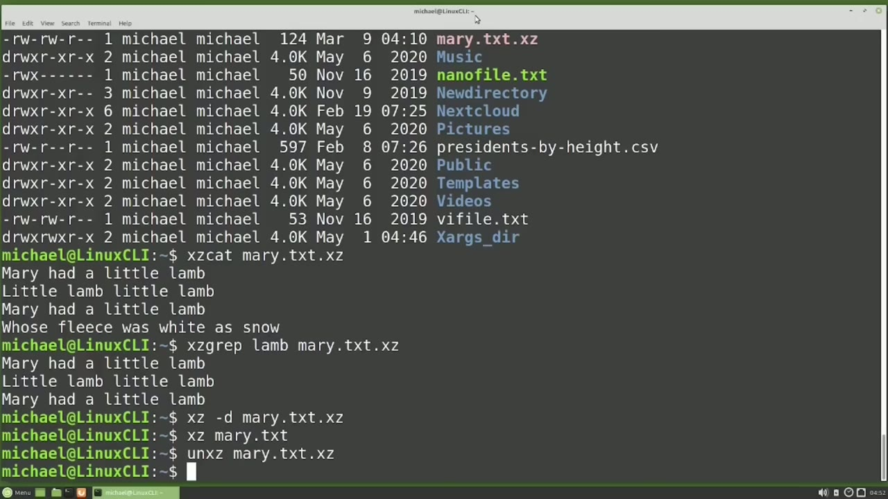
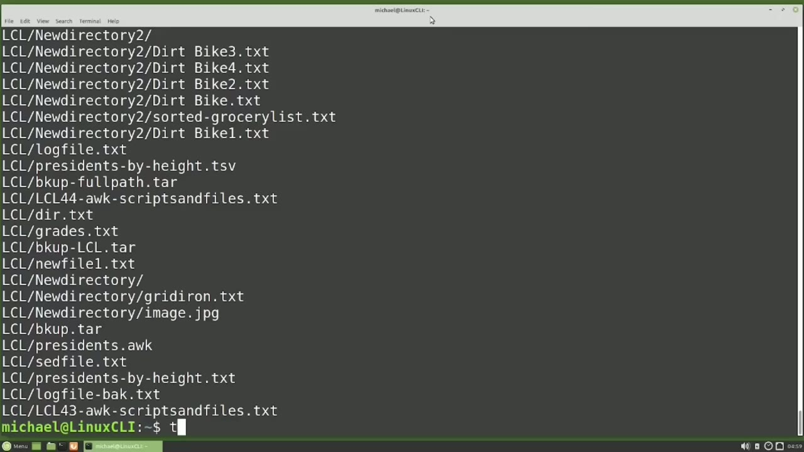
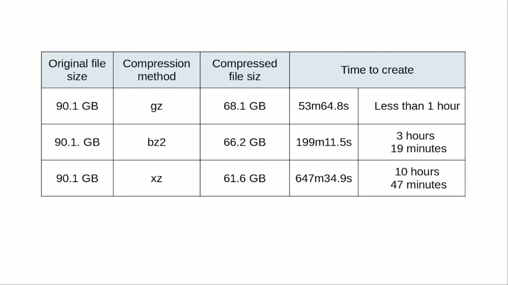

[← Course contents](../../01.md)

# 49. bzip2, xz, zip tar files

**Course:** [Linux Command Line - Entire Tutorial Series](https://www.youtube.com/watch?v=avg65oY7sj4)  
**Transcript:** [`Linux Command Line - Entire Tutorial Series transcript`](../../../../course_videos/Linux%20Command%20Line%20-%20Entire%20Tutorial%20Series/Linux%20Command%20Line%20-%20Entire%20Tutorial%20Series.txt)  
**Video:** 07:54:03–08:04:34 ([open at this time](https://www.youtube.com/watch?v=avg65oY7sj4&t=28443s))

## Introduction

In the last few videos, we saw the GZip command and then the tar command. Before we look at compressing tar files in a single command, there are two other ways of compressing files that I want to look at. The first one is called BZip 2. BZip 2 is similar to GZip And the idea behind BZp 2 is that it is a different compression method that can create a smaller archive file than the GZip command, but it may take a little longer to run. The BZip 2 command follows the same format as GZip.

## Detailed Explanation

<details>
  <summary>Step 1 — Run `gzip`, `tar`, `grep`</summary>

### Step 1 — Run `gzip`, `tar`, `grep`

- [x] **Use `gzip`, `tar`**
  - In the last few videos, we saw the `gzip` command and then the `tar` command.
  - Before we look at compressing `tar` files in a single command, there are two other ways of compressing files that I want to look at.
  - The first one is called BZip 2. BZip 2 is similar to `gzip` And the idea behind BZp 2 is that it is a different compression method that can create a smaller archive file than the `gzip` command, but it may take a little longer to run.

- [x] **Use `gzip`, `grep`**
  - The BZip 2 command follows the same format as `gzip`.
  - To zip a file with BZip 2, we would just type BZip 2 and then the file name we want to zip.
  - We can `grep` a bz2 file with bzgrep.

- [x] **Use `unzip`, `touch`, `xz`**
  - And we can decompress a BZp2 file with bzp2-d Mary.TXT.BZ2.
  - I'm going to zip that back up with bzp2, Mary.TXT, because I also want to show that we can `unzip` a bzp2 file with B, unzip2, Mary.TXT.com.
  - The other compression method that I want to `touch` on is `xz`.

- [x] **Use `xz`**
  - And this one works similar to GZp and bz2.
  - The `xz` command can make a smaller compressed file than the other two compression methods, but again, it may take longer to complete.
  - Now you may or may not see a difference between the three compression methods.

- [x] **Use `xz`**
  - It all depends on the size, the type of files you're zipping up, and if those files are already compressed or not.
  - To compress a file with `xz`, I will type `xz` Mary. txt.
  - And this shows that the Mary.ttXT file is gone and Mary.txt.x.

- [x] **Use `xz`, `xz cat`**
  - `xz` is there in its place.
  - We can view the content of an `xz` file with `xz cat`.
  - `xz cat`.

- [x] **Use `xz`, `grep`, `xz -d -mary.txtt.xt.xt.x`**
  - We can grab an `xz` file with `xz` `grep`.
  - `xz` `grep`.
  - Mary.t.t.xt.x.x.z. And we can decompress an `xz` file with `xz -d -mary.txtt.xt.xt.x`. And I'm going to zip that up again with `xz` marry.txt.mary.ttxt. To show that we can also `unzip` the mary.txtt.xxed.

- [x] **Now that we have three different ways of compressing files, we want**
  - Now that we have three different ways of compressing files, we want to look at using these three methods to zip up a `tar` file.

```bash
gzip
tar
grep
unzip
touch
xz
xz cat
xz -d -mary.txtt.xt.xt.x
```



</details>

<details>
  <summary>Step 2 — Run `tar -c`, `gzip`, `xz`</summary>

### Step 2 — Run `tar -c`, `gzip`, `xz`

- [x] **First, create the tar file and then compress that tar file using the**
  - First, create the tar file and then compress that tar file using the methods that we have already seen.
  - This can be done, but there is a way to create a tar file and zip it up using one of these three compression methods in a single command.
  - When creating the tar file, if we want to also compress that new tar file with the GZp compression, we would add a lowercase Z to the options.

- [x] **Use `tar -c`**
  - So the command would be `tar -c` for Create, V for verbose, and now I'm going to add a lowercase Z for gz.
  - Then I need to add the F for file name and then I'll give it the file name of BKUP.Tar.GZ.
  - And then we'll add the files and directories that we want to go into this G zipped tar file.

- [x] **Use `gzip`**
  - And that will be Mary. txT, Findavg.AWK and lcl.
  - Pressing Enter. We just created a tar file that has also been compressed with the `gzip` compression.
  - To create a tar file with the BZip 2 compression, I'll start it off the same way.

- [x] **But now we want to make this a B Zip 2 file**
  - But now we want to make this a B Zip 2 file.
  - It's a lowercase J that we use to tell tar to zip that up with a B Zp 2 compression.
  - Then we'll add the lowercase F for file.

- [x] **Use `xz`, `tar -C`**
  - And then we'll add in the files, Mary.TXT.
  - And then to create a tar file with the `xz` compression method, we follow the same format.
  - `tar -c` for create, V for verbose, and then we want to use the `xz` compression method.

- [x] **Use `xz`**
  - So we're going to put in an uppercase J.
  - So the uppercase J will tell the tar file to zip up that file with the `xz` compression method.
  - Then we add on the lowercase F for file name.

- [x] **Use `ls -lh`, `grep`**
  - Add on the file name we want to give it.
  - Then the files and directories we want to put in this tar file, Mary.tXT.
  - Now we have our three different tar files, `ls -lh`, and we're going to `grep` this to only show the tar files, BKUP.T-Tar.

- [x] **Use `gzip`, `tar -t`**
  - Some time has passed and we have forgotten what is zipped up into those tar files.
  - To see what is in the `gzip` tar file, I will type `tar -t` for list.
  - Then the lowercase Z for the gz compression and then an F for the file and we'll put in the file BKUP.Tar.GZ. Pressing Enter. This shows us all the files that are in that BKUP.Tar.GZ file.

- [x] **This method works pretty well, but what happens if I mislabeled the**
  - This method works pretty well, but what happens if I mislabeled the bz2 file to be gz instead of bz2?
  - Or maybe there's no extension on the compression file at all.

```bash
tar -c
gzip
xz
tar -C
ls -lh
grep
tar -t
```



</details>

<details>
  <summary>Step 3 — Run `tar -tzf`, `tar -tf`, `unzip`</summary>

### Step 3 — Run `tar -tzf`, `tar -tf`, `unzip`

- [x] **Use `tar -tzf`**
  - If I type `tar -tzf` bkup. tar.
  - Tz2, we get an error that the file is not compressed as bzp 2.
  - And one thing I can do is find out what compression method is being used by typing in file and then the file name.

- [x] **Use `tar -tf`**
  - The other way to get around this is to just leave off the compression method completely and let tar decide which compression method to use.
  - `tar -tf`, bkup.t-tar.
  - To extract a zptar file, we can do the same thing.

- [x] **Use `unzip`, `tar -xf`, `xz`**
  - We can leave off the compression method in the extract command and tar will decide which format to use to `unzip` the file.
  - `tar -xf` bkup. tar.gg z and for the b zip 2 file `tar -xf` bkup dot tar.
  - Bz2 and for the `xz` file we'll also type `tar xf` and then the `xz` file name bkup tar.tr.x z so tar won't complain if you don't give it a format when you're extracting the files.

- [x] **Use `gzip`**
  - To see the difference between these three different compression methods, I did a simple test of compressing the Home slash Michael directory on my main computer.
  - I first used the `gzip` compression method.
  - The original file size was 90 gigabytes and `gzip` compressed that file down to 68.1 gigabytes.

- [x] **Use `gzip 2`**
  - This took 53 minutes, so just under an hour to compress that data.
  - Then I ran the same test with the `gzip 2` format.
  - That compressed the data down to 66.2 gigabytes, but that took a little longer.

- [x] **Use `xz`**
  - That took 3 hours and 19 minutes, but it did make the file smaller.
  - Then I ran that same test again with the `xz` compression method.
  - The `xz` compression method Compressed that same data down to 61.6 gigabytes.

- [x] **Use `xz`**
  - But to compress that data down with the `xz` compression method, it took 10 hours and 47 minutes.
  - So the `xz` compression method did make the smallest compressed file, but it took way longer to create that compressed data.

```bash
tar -tzf
tar -tf
unzip
tar -xf
xz
tar xf
gzip
gzip 2
```



</details>

<details>
  <summary>Step 4 — Run `time tar c`</summary>

### Step 4 — Run `time tar c`

- [x] **Use `time tar c`**
  - If you're wondering how I got those times, I use the time command.
  - And the way to use the time command is to just type time before your command.
  - Time, tar, C, b-v-z F, b-k-u-p-t, T-T-T-Tar.G-G-Z, Mary.T-T-T-V-EG-G-OK-OK-L-C-O-L-C-O.

- [x] **And when I press Enter, it will zip everything up, and then it shows**
  - And when I press Enter, it will zip everything up, and then it shows me the time it took to run.
  - The top one, the real time, is the clock on the wall time your job took to run.
  - That's the number I used in my calculations.

- [x] **The user is the CPU time spent in user mode, and sis is the CPU time**
  - The user is the CPU time spent in user mode, and sis is the CPU time spent in System time or kernel mode.
  - In the next video, we'll continue looking at the Linux command line.

```bash
time tar c
```



</details>

<details>
  <summary>Questions and Answers</summary>

## Questions and Answers

### Question 1: What does `gzip` do in this chapter?

<details>
<summary>Answer</summary>

- [x] In the last few videos, we saw the `gzip` command and then the tar command.

</details>

### Question 2: What does `tar` do in this chapter?

<details>
<summary>Answer</summary>

- [x] In the last few videos, we saw the GZip command and then the `tar` command.

</details>

### Question 3: What does `grep` do in this chapter?

<details>
<summary>Answer</summary>

- [x] We can `grep` a bz2 file with bzgrep.

</details>

### Question 4: What does `unzip` do in this chapter?

<details>
<summary>Answer</summary>

- [x] I'm going to zip that back up with bzp2, Mary.TXT, because I also want to show that we can `unzip` a bzp2 file with B, unzip2, Mary.TXT.com.

</details>

### Question 5: What does `touch` do in this chapter?

<details>
<summary>Answer</summary>

- [x] The other compression method that I want to `touch` on is xz.

</details>

### Question 6: What does `xz` do in this chapter?

<details>
<summary>Answer</summary>

- [x] The other compression method that I want to touch on is `xz`.

</details>

### Question 7: What does `xz cat` do in this chapter?

<details>
<summary>Answer</summary>

- [x] We can view the content of an xz file with `xz cat`.

</details>

### Question 8: What does `xz -d -mary.txtt.xt.xt.x` do in this chapter?

<details>
<summary>Answer</summary>

- [x] Mary.t.t.xt.x.x.z. And we can decompress an xZ file with `xz -d -mary.txtt.xt.xt.x`. And I'm going to zip that up again with xZ marry.txt.mary.ttxt. To show that we can also unzip the mary.txtt.xxed.

</details>

### Question 9: What does `tar -c` do in this chapter?

<details>
<summary>Answer</summary>

- [x] So the command would be `tar -c` for Create, V for verbose, and now I'm going to add a lowercase Z for gz.

</details>

### Question 10: What does `ls -lh` do in this chapter?

<details>
<summary>Answer</summary>

- [x] Now we have our three different tar files, `ls -lh`, and we're going to grep this to only show the tar files, BKUP.T-Tar.

</details>

### Question 11: What does `tar -t` do in this chapter?

<details>
<summary>Answer</summary>

- [x] To see what is in the GZip tar file, I will type `tar -t` for list.

</details>

### Question 12: What does `tar -tzf` do in this chapter?

<details>
<summary>Answer</summary>

- [x] If I type `tar -tzf` bkup. tar.

</details>

</details>

## Summary

This chapter, bzip2, xz, zip tar files, walks through Run gzip, tar, grep; Run tar -c, gzip, xz; Run tar -tzf, tar -tf, unzip; Run time tar c. Commands from the transcript: `gzip`, `tar`, `grep`, `unzip`, `touch`, `xz`, `xz cat`, `xz -d -mary.txtt.xt.xt.x`, `tar -c`, `tar -C`, `ls -lh`, `tar -t`, `tar -tzf`, `tar -tf`.

## References

- [Linux Command Line - Entire Tutorial Series (YouTube)](https://www.youtube.com/watch?v=avg65oY7sj4)
- [This chapter at 07:54:03](https://www.youtube.com/watch?v=avg65oY7sj4&t=28443s)
- [Local transcript](../../../../course_videos/Linux%20Command%20Line%20-%20Entire%20Tutorial%20Series/Linux%20Command%20Line%20-%20Entire%20Tutorial%20Series.txt)
