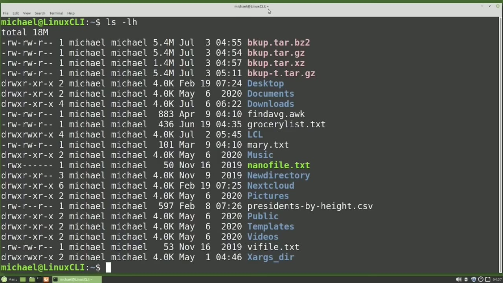
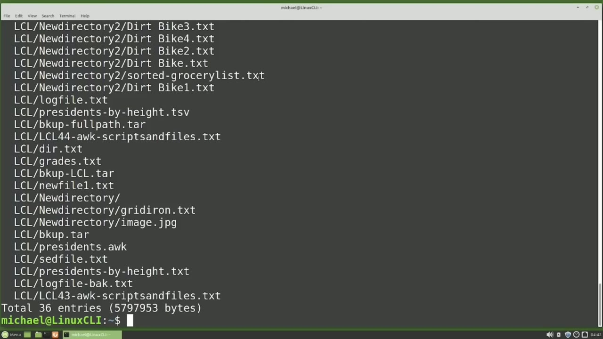
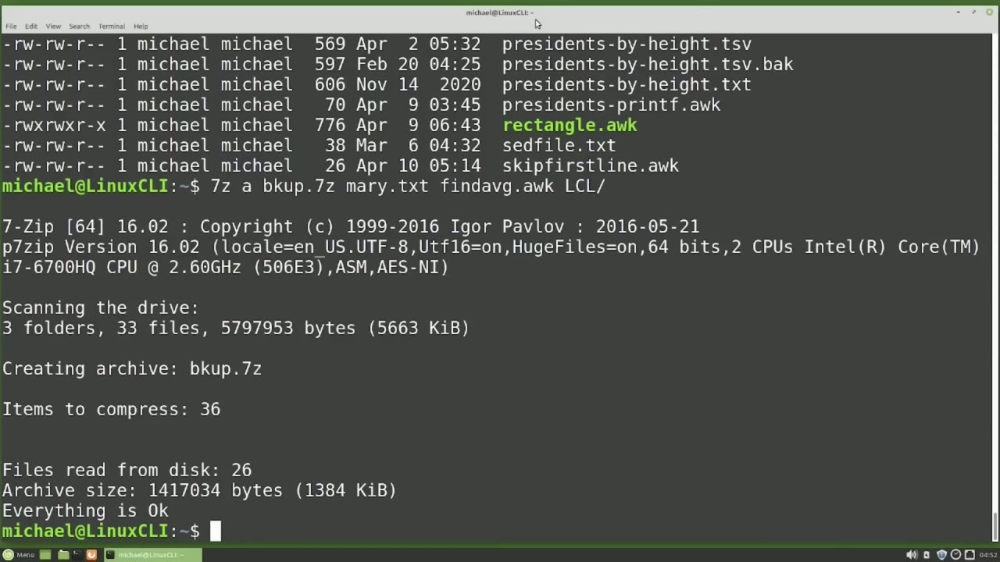
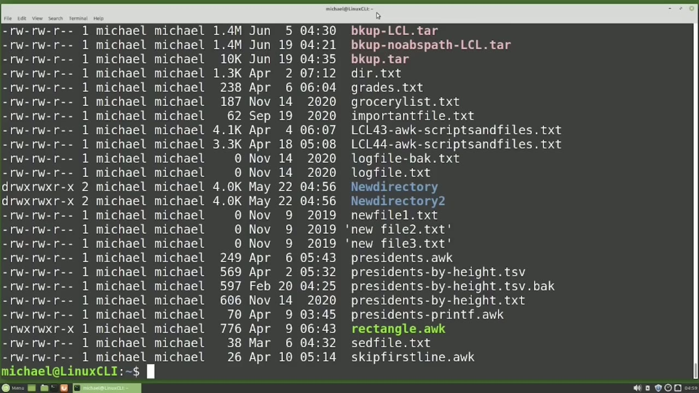

[← Course contents](../../01.md)

# 50. zip and 7zip

**Course:** [Linux Command Line - Entire Tutorial Series](https://www.youtube.com/watch?v=avg65oY7sj4)  
**Transcript:** [`Linux Command Line - Entire Tutorial Series transcript`](../../../../course_videos/Linux%20Command%20Line%20-%20Entire%20Tutorial%20Series/Linux%20Command%20Line%20-%20Entire%20Tutorial%20Series.txt)  
**Video:** 08:04:34–08:14:19 ([open at this time](https://www.youtube.com/watch?v=avg65oY7sj4&t=29074s))

## Introduction

The tar command is not the only way to create an archive file in the Linux command line. We can also use Zip and 7Zip. The zip format is similar to the tar command. To zip files with the Zip command, we would type Zip space, then the new zip file name, I will type in BKUP.Zip, then the files we would like to place in this new zipped file, Mary.TXT and find AVG.org.

## Detailed Explanation

<details>
  <summary>Step 1 — Run `tar`, `ls -lh`, `zip info bkup.zip`</summary>

### Step 1 — Run `tar`, `ls -lh`, `zip info bkup.zip`

- [x] **Use `tar`**
  - The `tar` command is not the only way to create an archive file in the Linux command line.
  - We can also use Zip and 7Zip.
  - The zip format is similar to the `tar` command.

- [x] **To zip files with the Zip command, we would type Zip space, then the**
  - To zip files with the Zip command, we would type Zip space, then the new zip file name, I will type in BKUP.Zip, then the files we would like to place in this new zipped file, Mary.TXT and find AVG.org.
  - And zipped it to 39% and the AVG.auch file was also zipped to 67% of its original size.
  - I'm going to overwrite that file by typing zip.bkup.zip, and I'm going to add in the files, Mary.t.T and find avg.org.

- [x] **But this time I'm also going to add the lcl directory**
  - But this time I'm also going to add the lcl directory.
  - But it did not include any of the files or directories inside of that lcl directory.
  - To include the lcl files and directories, we'll need to add the lowercase -R, like we've seen before, to tell the Zip command to recursively include all the files and directories in the lcl directory. Pressing Enter. This time it included all of the files and the subdirectories in the lcl directory.

- [x] **Use `ls -lh`, `zip info bkup.zip`**
  - Typing `ls -lh` shows the new file was created.
  - After some time passes, we may forget what was in that zipped file.
  - We can see what files are inside the BKUP.Zip file without unzipping it by typing zip info, bKUP.Zip.

- [x] **Use `zip -sf`**
  - This shows us all the files and directories inside there.
  - We can also type `zip -sf` and then the file name.
  - This also shows what is inside that zip file with not as much detail.

```bash
tar
ls -lh
zip info bkup.zip
zip -sf
```



</details>

<details>
  <summary>Step 2 — Run `unzip -l`, `less`, `unzip`</summary>

### Step 2 — Run `unzip -l`, `less`, `unzip`

- [x] **Use `unzip -l`, `less`**
  - Another way to view what's inside a zip file is with the `unzip -l` command, and then the file name.
  - And then another way to see what's inside a zip file is with the `less` command.
  - And here we can see that it's paginating it for us.

- [x] **Use `unzip`, `ls -lh`**
  - I'm going to create a new directory to...
  - `unzip` this zipped file into and we'll call this zip x underscore 1 pressing enter creates the directory and i'm going to copy the bkup.zip file into the zip x underscore 1 directory and going into it with cd zip xx1 1 to `unzip` a zipped file i will type `unzip` and then the file name
  - And `ls -lh` shows that it was all unzipped.

- [x] **Use `ls -lhl -cl -l -cl`, `ls -lh`**
  - We can also see the lcl directory with `ls -lhl -cl -l -cl`.
  - Going back up a directory, I'm going to make another zip directory with MakeDIR, ZipX underscore 2.
  - And just to show where we're at, I'm going to type `ls -lh`.

- [x] **Use `unzip`**
  - And now we want to `unzip` the bkup zip file into the ZipX underscore 2 file without having to move it in there and then unzipping it.
  - So we're going to do it right from here.
  - To `unzip` a zipped file into a different directory, we will need to add a -lowercase D for directory, just like we added the -uppercase C to extract a tar file into a different directory.

- [x] **Use `unzip`, `7z`**
  - So I will type `unzip` bkup.
  - zip and then we want the lowercase -d into the directory zip x underscore 2 and to show that that worked i'll type l s -lh zip x underscore 2 and we will also add the slash lCL to show that the lcl directory unzipped everything properly Creating 7 Zip files with the 7 Z command is similar to the way we use the Tar and Z command, but it's slightly different.
  - We will start with the `7z` command.

- [x] **Use `7z`**
  - Then we need to add a lowercase A to add files.
  - And we'll give it the file name. We want to add those files to.
  - And then we'll add the files we want to add into this `7z` archive file.

- [x] **I will add in Mary.TXT, FindavG.Ock, and lcl**
  - I will add in Mary.TXT, FindavG.Ock, and lcl.
  - And notice there's no -before the lowercase A, which we're not used to seeing.
  - Adding a -before the lowercase A will cause an error.

```bash
unzip -l
less
unzip
ls -lh
ls -lhl -cl -l -cl
7z
```



</details>

<details>
  <summary>Step 3 — Run `7z`, `ls -lh`, `type -O`</summary>

### Step 3 — Run `7z`, `ls -lh`, `type -O`

- [x] **Use `7z`, `ls -lh`**
  - Archive file is created. To see the files inside a `7z` we can type `7z` and then a lowercase L again without the dash. The L is for list files and then the file name of bkup.`7z` and we see all the files inside that `7z` archive file. I will create a new directory to extract our 7 zip files
  - Into and we will call this new directory `7z` x underscore 1 and then copy our bkup.`7z` file into the new 7 x underscore 1 directory and going into it we will show that we have our z zip file in there and to extract that 7 z backup file i will type 7 z x again with no -bkupp. 7
  - Z. It's showing us that everything was unzipped. `ls -lh`.

- [x] **Use `ls -lh`**
  - Shows that they're there, as well as `ls -lh`, lcl, shows our lcl directory was extracted as well.
  - Going back up a directory with cd, and I'm going to make a new directory.
  - And we want to extract our 7 zip file into that 7X2 directory.

- [x] **Use `7z`, `type -O`**
  - To do that, I will type `7z`, then the X to extract our bkup.`7z` file.
  - And then we `type -O`.
  - And this is telling us to redirect the output of the extract command, and then we'll give it the file name.

- [x] **I'm going to use the absolute path of forward /home**
  - I'm going to use the absolute path of forward /home.
  - And that would be for the absolute path.
  - If I want to use the relative path, I would just make it the 7X underscore 2.

- [x] **Use `ls -lh`**
  - And this does look a little funny because there's no space between the -lowercase O and the directory name.
  - We see everything looks like it's extracted okay. Let's `ls -lh` 7ZX underscore 2.
  - We did extract the files there and we also want to check the lcl directory.

- [x] **And those files were extracted as expected as well**
  - And those files were extracted as expected as well.
  - There are a lot more options available for the zip and seven zip commands, including encrypting zip and seven zip files.

```bash
7z
ls -lh
type -O
```



</details>

<details>
  <summary>Step 4 — Run `zip`</summary>

### Step 4 — Run `zip`

- [x] **Use `zip`**
  - I do not use `zip` or 7Zp to encrypt anything, mainly because a quick internet search of how to open encrypted `zip` file without the password or how to open encrypted 7 `zip` files without the password shows a lot of results.
  - Now I don't know if they work or not. I have not tried any. I'm just suggesting that encrypting files with `zip` and 7Zip might not be the most secure method of encrypting your data.
  - The last thing I'm going to say about the archive files we've been looking at in this section is that if you're familiar with vim, vim can be used to view files in a compressed archive file.

- [x] **When I type VimbKUP.Zp, we see the files in the bkup.z file**
  - When I type VimbKUP.Zp, we see the files in the bkup.z file.
  - It's working again here, and to get out I will type colon Q.
  - But when I type vimbkup.7z, the files are still compressed, so vim doesn't work with everything, colon Q, but it is pretty good, and if you're already familiar with vim, it's worth a try.

- [x] **In the next video, we will continue looking at the Linux command line**
  - In the next video, we will continue looking at the Linux command line.

```bash
zip
```



</details>

<details>
  <summary>Questions and Answers</summary>

## Questions and Answers

### Question 1: What does `tar` do in this chapter?

<details>
<summary>Answer</summary>

- [x] The `tar` command is not the only way to create an archive file in the Linux command line.

</details>

### Question 2: What does `zip` do in this chapter?

<details>
<summary>Answer</summary>

- [x] We can also use `zip` and 7Zip.

</details>

### Question 3: What does `ls -lh` do in this chapter?

<details>
<summary>Answer</summary>

- [x] Typing `ls -lh` shows the new file was created.

</details>

### Question 4: What does `zip info bkup.zip` do in this chapter?

<details>
<summary>Answer</summary>

- [x] We can see what files are inside the BKUP.Zip file without unzipping it by typing zip info, bKUP.Zip.

</details>

### Question 5: What does `zip -sf` do in this chapter?

<details>
<summary>Answer</summary>

- [x] We can also type `zip -sf` and then the file name.

</details>

### Question 6: What does `unzip -l` do in this chapter?

<details>
<summary>Answer</summary>

- [x] Another way to view what's inside a zip file is with the `unzip -l` command, and then the file name.

</details>

### Question 7: What does `less` do in this chapter?

<details>
<summary>Answer</summary>

- [x] And then another way to see what's inside a zip file is with the `less` command.

</details>

### Question 8: What does `unzip` do in this chapter?

<details>
<summary>Answer</summary>

- [x] `unzip` this zipped file into and we'll call this zip x underscore 1 pressing enter creates the directory and i'm going to copy the bkup.zip file into the zip x underscore 1 directory and going into it with cd zip xx1 1 to `unzip` a zipped file i will type `unzip` and then the file name

</details>

### Question 9: What does `ls -lhl -cl -l -cl` do in this chapter?

<details>
<summary>Answer</summary>

- [x] We can also see the lcl directory with `ls -lhl -cl -l -cl`.

</details>

### Question 10: What does `7z` do in this chapter?

<details>
<summary>Answer</summary>

- [x] We will start with the `7z` command.

</details>

### Question 11: What does `type -O` do in this chapter?

<details>
<summary>Answer</summary>

- [x] And then we `type -O`.

</details>

</details>

## Summary

This chapter, zip and 7zip, walks through Run tar, ls -lh, zip info bkup.zip; Run unzip -l, less, unzip; Run 7z, ls -lh, type -O; Run zip. Commands from the transcript: `tar`, `ls -lh`, `zip info bkup.zip`, `zip -sf`, `unzip -l`, `less`, `unzip`, `ls -lhl -cl -l -cl`, `7z`, `type -O`, `zip`.

## References

- [Linux Command Line - Entire Tutorial Series (YouTube)](https://www.youtube.com/watch?v=avg65oY7sj4)
- [This chapter at 08:04:34](https://www.youtube.com/watch?v=avg65oY7sj4&t=29074s)
- [Local transcript](../../../../course_videos/Linux%20Command%20Line%20-%20Entire%20Tutorial%20Series/Linux%20Command%20Line%20-%20Entire%20Tutorial%20Series.txt)
