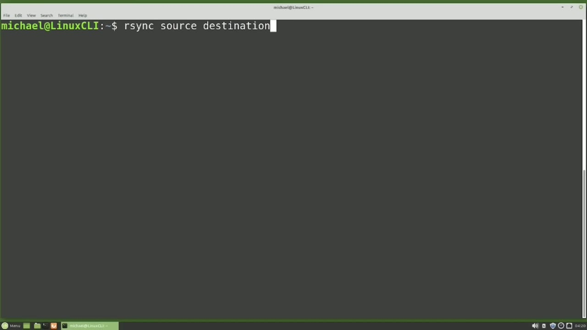
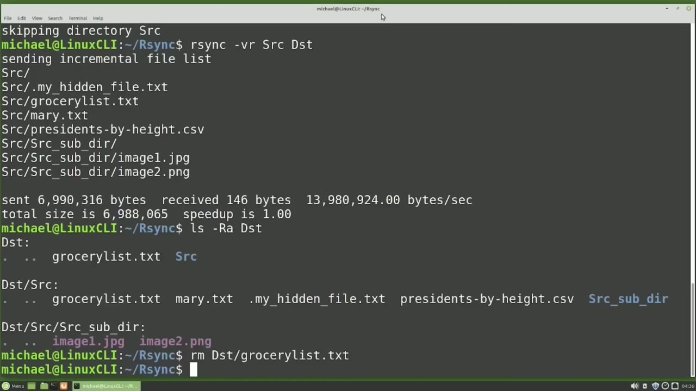
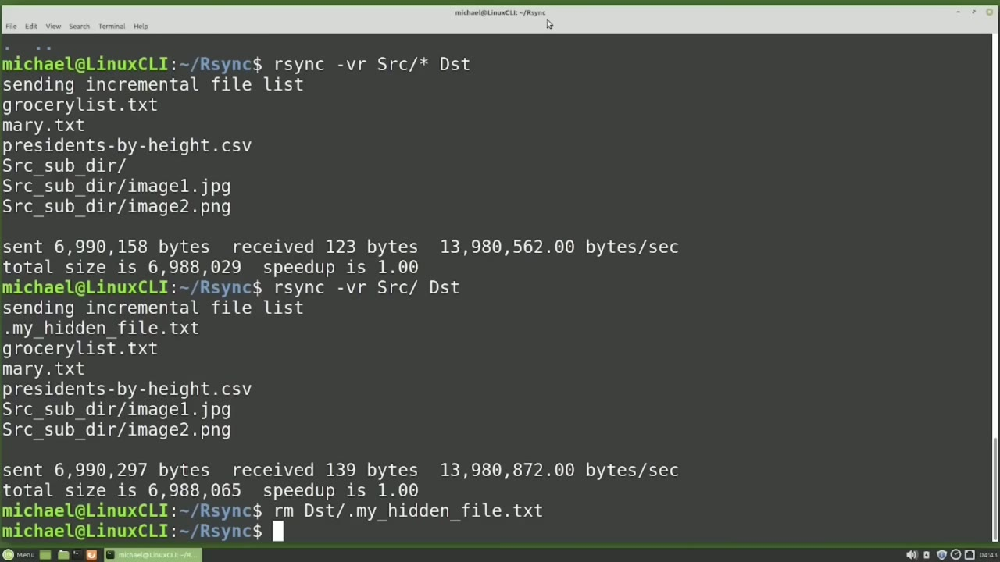
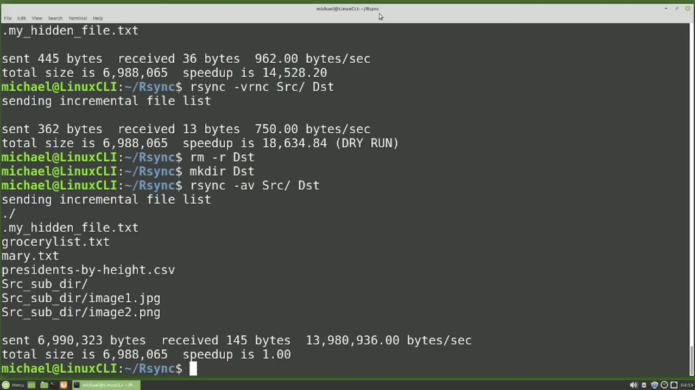

[← Course contents](../../01.md)

# 51. rsync pt1

**Course:** [Linux Command Line - Entire Tutorial Series](https://www.youtube.com/watch?v=avg65oY7sj4)  
**Transcript:** [`Linux Command Line - Entire Tutorial Series transcript`](../../../../course_videos/Linux%20Command%20Line%20-%20Entire%20Tutorial%20Series/Linux%20Command%20Line%20-%20Entire%20Tutorial%20Series.txt)  
**Video:** 08:14:19–08:24:27 ([open at this time](https://www.youtube.com/watch?v=avg65oY7sj4&t=29659s))

## Introduction

R-Sync stands for Remote Sync and can be used to sync files from one computer to another. But R-Sync can also be used to sync files from one directory to another. The R-Sync command works similar to the copy command that we looked at earlier in this series, but R-Sync has a lot more features. Typical use of the R-Sync command is R-Sync Source Destination.

## Detailed Explanation

<details>
  <summary>Step 1 — Run `rsync`, `ls -lh`, `mkdir`</summary>

### Step 1 — Run `rsync`, `ls -lh`, `mkdir`

- [x] **R-Sync stands for Remote Sync and can be used to sync files from one**
  - R-Sync stands for Remote Sync and can be used to sync files from one computer to another.
  - But R-Sync can also be used to sync files from one directory to another.
  - The R-Sync command works similar to the copy command that we looked at earlier in this series, but R-Sync has a lot more features.

- [x] **Use `rsync`**
  - Typical use of the R-Sync command is R-Sync Source Destination.
  - I've created a directory specifically for this video called `rsync`.
  - So let's cd into that directory right now with cdr Sync.

- [x] **Use `ls -lh`**
  - And then I'll type `ls -lh` to show the directory src.
  - To see what's in the src directory, I will type `ls -lh` uppercase R.
  - And this shows that we have the source directory and then some files inside the source directory as well as a sub-directory inside this directory and then two images inside that sub-directory.

- [x] **Use `mkdir`**
  - Src will be our source directory and I will make a destination directory with `mkdir`.
  - So src is our source directory and dst is our destination directory.
  - I'm going to R sync the GroceryList.TxT file from inside the src directory to the dst directory.

- [x] **Use `rsync`, `ls -lh`**
  - To do that, I will type `rsync`, src, GrocerlystS.T, txt, and then I want to give the destination directory of dst.
  - We have the standard Linux, No News is Good News, lack of any message, but the file is now synced over to our destination directory, dst, and we can show that with `ls -lh` dst.
  - And there we see the GroceryList.T file.

- [x] **We can add the -lowercase V for verbose option for our sync**
  - We can add the -lowercase V for verbose option for our sync.
  - That will show a little more information.
  - We see it synced the file Grocerlist.TXT and then there's some more information about the command.

- [x] **I like using Verboise with the R-Sync command because it shows us**
  - I like using Verboise with the R-Sync command because it shows us right away what files were synced.
  - Now let's say I want to R-sync the entire src directory to the dst directory, but we need to get clear on what we mean by sync the entire src directory.

```bash
rsync
ls -lh
mkdir
```



</details>

<details>
  <summary>Step 2 — Run `rm -r -dst`</summary>

### Step 2 — Run `rm -r -dst`

- [x] **Do we want to R-sync the directory called src into the directory**
  - Do we want to R-sync the directory called src into the directory called dst?
  - Or do we just want to R-Sync all the files and directories in the src directory to the dst directory?
  - Let's do it both ways. First, let's just R-sync the entire src directory into the dst directory.

- [x] **I'm going to try that with R-Sync-V-SRC dst. Pressing Enter, we get**
  - I'm going to try that with R-Sync-V-SRC dst. Pressing Enter, we get the message skipping directory src.
  - And that will show even without the -V verbose option.
  - And again, we get the Skipping Directory src.

- [x] **And we've seen this message enough times in this video tutorial**
  - And we've seen this message enough times in this video tutorial series to know that it means we need to add the -R option to recursively R sync everything in the src directory to the dst directory.
  - So I'll add in the R right here to R sync recursively.
  - And now we see that we've synced the src directory, all the files in the src directory, as well as the sub-directority inside that src directory, and the two files inside there as well.

- [x] **And then to show that everything was are synced properly, I'm going**
  - And then to show that everything was are synced properly, I'm going to type LS-Uppercase r-a, dst.
  - And here we see inside the dst directory, we have the GroceryList.T file that we are synced earlier.
  - And then inside the src directory, we have the files that were there, as well as the sub directory.

- [x] **Use `rm -r -dst`**
  - And then inside that sub directory, we have the two images inside of that.
  - I'm going to remove the grocery list. txt file from inside the dst directory with rm dst GrocerlyS. txt.
  - And I'm going to recursively remove the src directory from inside the dst directory with `rm -r -dst` src.

- [x] **And now I'm going to show that that directory is empty with**
  - And now I'm going to show that that directory is empty with LS-Uppercase r-a-dst.
  - Now we want to R-Sync the files and directories inside the src directory to the dst directory.
  - And the first way I'm going to do that is by typing R-sync, -vr, src, forward slash asteris, and then the dst directory.

- [x] **Pressing Enter. We see there's something missing. Do you see what's**
  - Pressing Enter. We see there's something missing. Do you see what's missing?
  - Dot files don't get synced when we use the asteris.
  - To our sync all the files, including the hidden files, we need to leave off the asteris, but keep that trailing forward slash. That will sync everything, including the hidden files.

- [x] **Pressing Enter. Here we see the dot My Hidden File.T as well as the**
  - Pressing Enter. Here we see the dot My Hidden File.T as well as the other files, the sub directory, and the files inside that sub directory.
  - You may have heard that R-Sync does not sync files that are already in the destination directory.
  - But if that's true, why did our R-Sync src forward slash sync everything in not just the missing file.

- [x] **Let's remove that dot my hidden file.t from the destination directory**
  - Let's remove that dot my hidden file.t from the destination directory with rm dST.

```bash
rm -r -dst
```



</details>

<details>
  <summary>Step 3 — Run `ls -lh`, `rsync`</summary>

### Step 3 — Run `ls -lh`, `rsync`

- [x] **Use `ls -lh`**
  - I'm going to list out the files in the src directory with `ls -lh` src.
  - And now I'm going to list out the directories in the dst directory with `ls -lh` dst.
  - And we see here that the dates are different.

- [x] **The src file has the dates the files were created**
  - The src file has the dates the files were created.
  - In short, the files don't match because the dates are different.
  - The first way we're going to look at is by comparing the file checksums instead of the dates.

- [x] **Use `rsync`**
  - In short, a check sum is a calculated value to verify the integrity of a file.
  - We can have `rsync` compare the check sum values by adding the lowercase C option.
  - So our `rsync` command now will be `rsync` dst. Before I run this command, I want to see what the results of this command would be if I ran it, but I don't want to actually run this command. Not yet.

- [x] **For that, I will add on -dry-run. This will show us the results of**
  - For that, I will add on -dry-run. This will show us the results of the command if it would have run without actually running the command.
  - Shows us if we ran this command, only one file will be R-syned.
  - And that is the dot my hidden file.Txt file.

- [x] **Now instead of typing out the whole -dash dry run, we can just add**
  - Now instead of typing out the whole -dash dry run, we can just add the N option and pressing enter here.
  - We get the same results. I prefer the -dash dry run over the N character just because it's more obvious that we're not actually running the command, but it works both ways. Our syncing the one file is what I want to do.

```bash
ls -lh
rsync
```



</details>

<details>
  <summary>Step 4 — Run `ls -lahsrc`, `ls -lhd -st`, `rsync`</summary>

### Step 4 — Run `ls -lahsrc`, `ls -lhd -st`, `rsync`

- [x] **Is now synced as expected, and we can see that by rerunning that Dry**
  - Is now synced as expected, and we can see that by rerunning that Dry Run command again.
  - And it shows there are no files to sync.
  - Comparing the check sums does require the computer do some calculations.

- [x] **It is still quicker than copying large files, but slower than just**
  - It is still quicker than copying large files, but slower than just checking the timestamp.
  - So the other way to make the files match is by syncing the timestamp when we are sync the files.
  - And one way to do that is by using the lowercase A for archive option.

- [x] **I'm going to clear out the dst directory again, but this time I'm**
  - I'm going to clear out the dst directory again, but this time I'm just going to remove -R the entire dst directory and then add it back in with Make dir dst.
  - And now let's sync the files from the src directory with R Sync.
  - Then we want the -A for archive mode, we want the V for verbose, and we want to sync the src directory with the forward slash on the end, and we want to sync that to the dst directory.

- [x] **Use `ls -lahsrc`, `ls -lhd -st`**
  - Pressing Enter shows us it's syncing all the files including the dot My Hidden File.TXT, the sub directory, and the files in the subdirector.
  - So when we're using that lowercase A archive option, That also includes the -R recursive option, so we do not need to include that -R option.
  - Now when I type `ls -lahsrc` and then `ls -lhd -st`, we see that the files and the timestamps match.

- [x] **Use `rsync`**
  - In general, when we're using `rsync`, we will probably want to use the A for archive option.
  - In the next video, we will complete our look at `rsync` for the Linux command line.
  - In the last video, all of our R-Sync examples copied files from the source to the destination,

```bash
ls -lahsrc
ls -lhd -st
rsync
```



</details>

<details>
  <summary>Questions and Answers</summary>

## Questions and Answers

### Question 1: What does `rsync` do in this chapter?

<details>
<summary>Answer</summary>

- [x] I've created a directory specifically for this video called `rsync`.

</details>

### Question 2: What does `ls -lh` do in this chapter?

<details>
<summary>Answer</summary>

- [x] And then I'll type `ls -lh` to show the directory src.

</details>

### Question 3: What does `mkdir` do in this chapter?

<details>
<summary>Answer</summary>

- [x] Src will be our source directory and I will make a destination directory with `mkdir`.

</details>

### Question 4: What does `rm -r -dst` do in this chapter?

<details>
<summary>Answer</summary>

- [x] And I'm going to recursively remove the src directory from inside the dst directory with `rm -r -dst` src.

</details>

### Question 5: What does `ls -lahsrc` do in this chapter?

<details>
<summary>Answer</summary>

- [x] Now when I type `ls -lahsrc` and then ls -lhd -st, we see that the files and the timestamps match.

</details>

### Question 6: What does `ls -lhd -st` do in this chapter?

<details>
<summary>Answer</summary>

- [x] Now when I type ls -lahsrc and then `ls -lhd -st`, we see that the files and the timestamps match.

</details>

### Question 7: What does step 1 cover (Run rsync, ls -lh, mkdir)?

<details>
<summary>Answer</summary>

- [x] R-Sync stands for Remote Sync and can be used to sync files from one computer to another.
- [x] But R-Sync can also be used to sync files from one directory to another.
- [x] The R-Sync command works similar to the copy command that we looked at earlier in this series, but R-Sync has a lot more features.

</details>

### Question 8: What does step 2 cover (Run rm -r -dst)?

<details>
<summary>Answer</summary>

- [x] Do we want to R-sync the directory called src into the directory called dst?
- [x] Or do we just want to R-Sync all the files and directories in the src directory to the dst directory?
- [x] Let's do it both ways. First, let's just R-sync the entire src directory into the dst directory.

</details>

### Question 9: What does step 3 cover (Run ls -lh, rsync)?

<details>
<summary>Answer</summary>

- [x] I'm going to list out the files in the src directory with `ls -lh` src.
- [x] And now I'm going to list out the directories in the dst directory with `ls -lh` dst.
- [x] And we see here that the dates are different.

</details>

### Question 10: What does step 4 cover (Run ls -lahsrc, ls -lhd -st, rsync)?

<details>
<summary>Answer</summary>

- [x] Is now synced as expected, and we can see that by rerunning that Dry Run command again.
- [x] And it shows there are no files to sync.
- [x] Comparing the check sums does require the computer do some calculations.

</details>

</details>

## Summary

This chapter, rsync pt1, walks through Run rsync, ls -lh, mkdir; Run rm -r -dst; Run ls -lh, rsync; Run ls -lahsrc, ls -lhd -st, rsync. Commands from the transcript: `rsync`, `ls -lh`, `mkdir`, `rm -r -dst`, `ls -lahsrc`, `ls -lhd -st`.

## References

- [Linux Command Line - Entire Tutorial Series (YouTube)](https://www.youtube.com/watch?v=avg65oY7sj4)
- [This chapter at 08:14:19](https://www.youtube.com/watch?v=avg65oY7sj4&t=29659s)
- [Local transcript](../../../../course_videos/Linux%20Command%20Line%20-%20Entire%20Tutorial%20Series/Linux%20Command%20Line%20-%20Entire%20Tutorial%20Series.txt)
