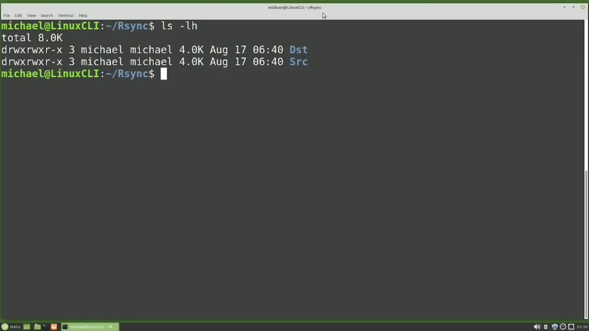
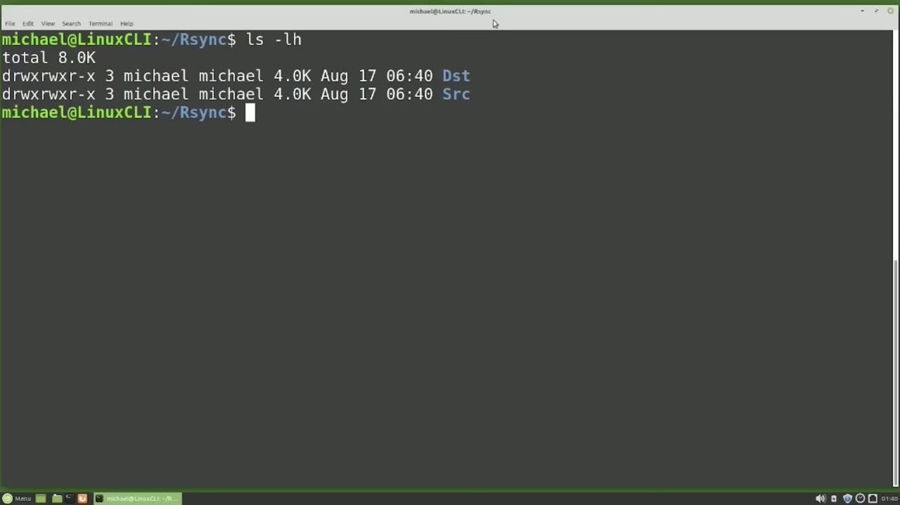
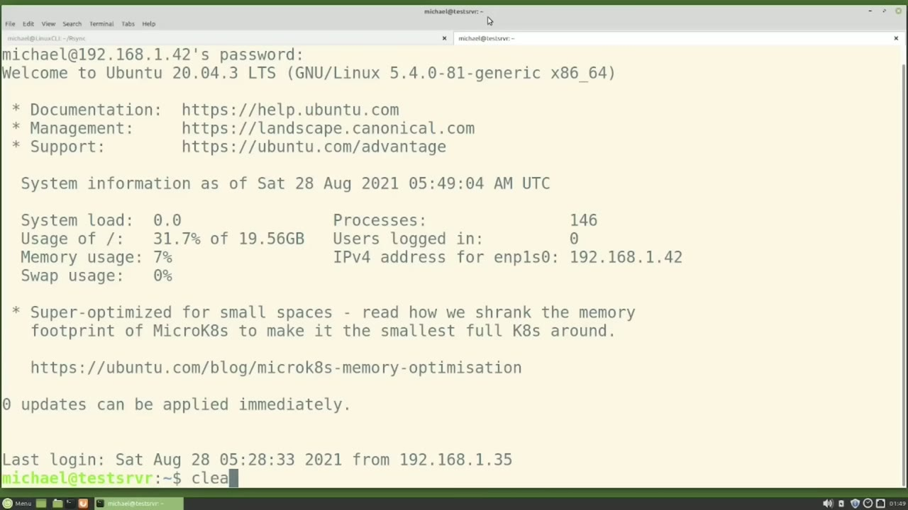
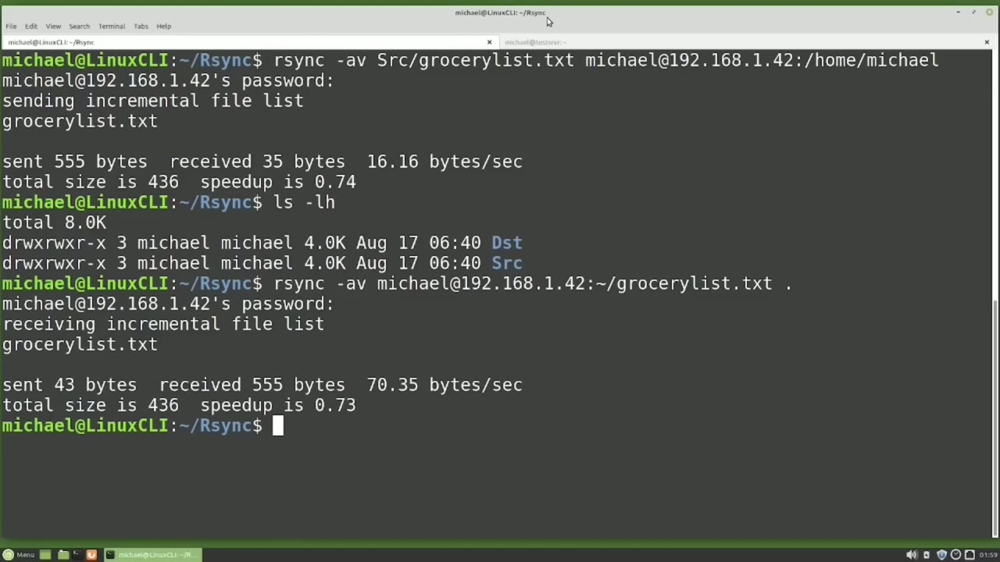
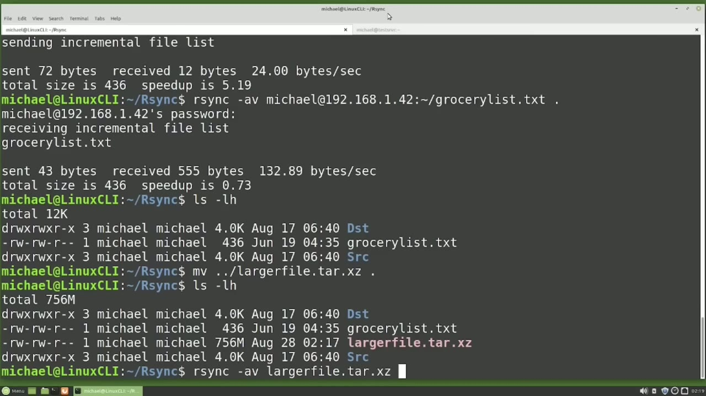

[← Course contents](../../01.md)

# 52. rsync pt2

**Course:** [Linux Command Line - Entire Tutorial Series](https://www.youtube.com/watch?v=avg65oY7sj4)  
**Transcript:** [`Linux Command Line - Entire Tutorial Series transcript`](../../../../course_videos/Linux%20Command%20Line%20-%20Entire%20Tutorial%20Series/Linux%20Command%20Line%20-%20Entire%20Tutorial%20Series.txt)  
**Video:** 08:24:27–08:34:18 ([open at this time](https://www.youtube.com/watch?v=avg65oY7sj4&t=30267s))

## Introduction

What I mean by that is, if there are more files in the destination directory, they stayed in the destination directory, so it did not really sync the source to the destination. It just copied the source to the destination. If we deleted a file from the source directory and our sync the directory the way we learned in the last video, the deleted file will still be in that destination directory. And there are times when we want that action to happen, but there are also times when we want the destination directory to be an exact match of the source directory.

## Detailed Explanation

<details>
  <summary>Step 1 — Run `touch dst`, `sync -a`, `ssh`</summary>

### Step 1 — Run `touch dst`, `sync -a`, `ssh`

- [x] **What I mean by that is, if there are more files in the destination**
  - What I mean by that is, if there are more files in the destination directory, they stayed in the destination directory, so it did not really sync the source to the destination.
  - It just copied the source to the destination.
  - If we deleted a file from the source directory and our sync the directory the way we learned in the last video, the deleted file will still be in that destination directory.

- [x] **Use `touch dst`, `sync -a`**
  - And there are times when we want that action to happen, but there are also times when we want the destination directory to be an exact match of the source directory.
  - And if a file is removed from the source directory, we want to remove that file from the destination directory.
  - I'm going to add a few files to our dst directory with `touch dst` extra file 1.t and extra file 2.t And now I will R sync the source to the destination with R `sync -a` V src dst dst -dash dry run.

- [x] **Our sync shows us there's nothing to sync because all the files in**
  - Our sync shows us there's nothing to sync because all the files in the src directory match the files in the dst directory.
  - But we also have the two new files in the dst directory.
  - To truly sync the source directory to the destination directory, after copying the source to the destination, we will also want to delete out any files in the destination that are not in the source directory.

- [x] **We can do that by adding in a -dash delete to our R sync command**
  - We can do that by adding in a -dash delete to our R sync command.
  - Now we see it will delete out those two extra files from the destination directory that are not in the source directory.
  - And then removing the dry run and running this command deletes them out.

- [x] **And we'll show this by running the dry run again**
  - And we'll show this by running the dry run again.
  - In this tutorial series, we haven't talked about logging into other computers with `ssh`.
  - But since our Sync uses `ssh` to sync files to another computer, we'll take an introductory look at `ssh` right now.

- [x] **I have added another computer to my local network, and when I say**
  - I have added another computer to my local network, and when I say local network, I mean behind my router to the internet.
  - The computer I set up has a local IP address of 192.168 1.42. I have created a Michael user on that computer.
  - I have enabled `ssh` on that computer and our sync is installed on that computer.

- [x] **Use `ssh`**
  - I am going to open a new tab and I'm going to make this a light tab just so we can keep the two tabs straight. And on this lighter tab, I'm going to `ssh` into that other computer. To `ssh` in, I will type `ssh` at 192.168.1.42.
  - So Michael is the user id that I created on that computer.
  - And we're telling `ssh` that the IP address we're looking for is 192.168.1.42.

- [x] **Pressing enter. It's asking me for the password for Michael on the**
  - Pressing enter. It's asking me for the password for Michael on the 192.168.1.42 computer.
  - So I'll type that in. And now it shows us that we're logged into the other computer.

```bash
touch dst
sync -a
ssh
```





</details>

<details>
  <summary>Step 2 — Run `pwd`, `ls -lh`</summary>

### Step 2 — Run `pwd`, `ls -lh`

- [x] **Use `pwd`, `ls -lh`**
  - I'm going to clear the screen and type `pwd` and `ls -lh` to show that we have no files in the home Michael directory on this computer.
  - Going back to the other tab, I want to R sync the GrocerlyS.T file that's inside the source directory to the other computer.
  - I will start the R-Sync command, just as we've seen.

- [x] **R-Sync-A-V-SRC, s-rc, GrocerlyList. txt**
  - R-Sync-A-V-SRC, s-rc, GrocerlyList. txt.
  - And then for our destination, we need to start that off with the same information we used when we S-SHed into the other computer.
  - And then the directory on that computer where we want this to go.

- [x] **Use `ls -lh`**
  - Slash Michael. Pressing Enter. Our sync is asking us for the Michael password on the 192.168.1.42 computer. And it shows us the file is copied. Let's go over to the other tab and type `ls -lh`.
  - And we do see the GroceryList.T file did get copied over to this computer. Going back to the other tab.
  - The file was on the same computer that we submitted the R-Sync command, so we pushed it to a different computer.

- [x] **The other way is to pull a file or files from another computer to the**
  - The other way is to pull a file or files from another computer to the computer I am running the R-Sync command on.
  - Typing L- s -lh shows us that we do not have the GroceryList.TXT file in this directory.
  - So we're going to pull it from the other computer to this directory.

- [x] **Now I need my server details, starting with Michael, then the at**
  - Now I need my server details, starting with Michael, then the at symbol.

```bash
pwd
ls -lh
```



</details>

<details>
  <summary>Step 3 — Run `ls -lh`</summary>

### Step 3 — Run `ls -lh`

- [x] **And then we're using the IP address to identify that server**
  - And then we're using the IP address to identify that server.
  - And now I'm adding the till day, which we saw in earlier videos, means go to the home directory.
  - And in that home directory, we're looking for the file, GroceryList. txT.

- [x] **Now we need to give it a destination directory**
  - Now we need to give it a destination directory.
  - And we want to give the directory that we are in.
  - So I'm just going to press the dot or period.

- [x] **Use `ls -lh`**
  - To log in to the 192.168.1.42 computer as Michael, go to the home directory and find the file GroceryList. txt and sync that to this directory. Pressing Enter. It's asking me for the password.
  - And now the R Sync command is telling us it's sync the file GrocereryList. txt.
  - And we can also see that by typing `ls -lh`.

- [x] **And in this case, we see that it worked both ways, both pushing and**
  - And in this case, we see that it worked both ways, both pushing and pulling the files.
  - In the past, I have had troubles with R-Sync pulling files, in which case I just logged into the other computer and pushed the files.
  - In other words, what I'm saying is, if it doesn't work one way, try the other.

- [x] **I have a larger file in the parent directory that I'm going to move**
  - I have a larger file in the parent directory that I'm going to move into this directory with move from the parent directory.
  - Larger file. tar.xz and I want to move that right here.

```bash
ls -lh
```



</details>

<details>
  <summary>Step 4 — Run `rsync`, `ls -lh`</summary>

### Step 4 — Run `rsync`, `ls -lh`

- [x] **Use `rsync`**
  - And there we see the larger file. And I'm going to R-sync this over to our other computer. To do that, I'm going to type R-Sync-AV larger file.TAR.XZ.
  - And I want to `rsync` that as the Michael user at 192.168.1.42.
  - And I want to put that in the Home Michael directory.

- [x] **Pressing Enter, it's asking me for the password, and I'm going to**
  - Pressing Enter, it's asking me for the password, and I'm going to cancel out of that.
  - And the reason I'm canceling out is because we don't see how much of that file is being copied over to the other computer.
  - To see how much of that file is R-synced, I'm going to add the uppercase P option to our command.

- [x] **Number one is progress. It shows us how much of the file is R-synced**
  - Number one is progress. It shows us how much of the file is R-synced.
  - If the R-sync fails for some reason, R-sync can keep what is partially moved over there and just pick up from where it left off.
  - In other words, if you're R-syncing a large file that maybe took hours to R-sync, it only has a little bit more to go.

- [x] **If that job fails for some reason, when you restart the R-sync**
  - If that job fails for some reason, when you restart the R-sync command with that uppercase P option, it will pick up from where it left off and just have those last few minutes and won't have to start over from the beginning.
  - So when you're R-syncing large files, you'll want to use that uppercase P option.
  - Pressing Enter again and then putting in my password.

- [x] **Use `rsync`, `ls -lh`**
  - And here we see the percentage of the files being copied over to the other computer.
  - Our `rsync` is done. Let's go over to the other tab and type `ls -lh`.
  - And there we see the larger file.Tar.XZ is there as well as the grocery list. txt.

- [x] **Use `rsync`**
  - There are many more options for the `rsync` command that we did not look at in this tutorial.
  - Things like excluding files and directories or...
  - Telling R Sync to keep the ACL permissions, going over all the options would be a tutorial series in itself.

- [x] **These two videos on R Sync are enough to get you started with some of**
  - These two videos on R Sync are enough to get you started with some of the most common features of the R Sync Command.
  - In the next video, we'll continue looking at the Linux command line.
  - In the last group of videos, we looked at making backups and syncing files and

```bash
rsync
ls -lh
```



</details>

<details>
  <summary>Questions and Answers</summary>

## Questions and Answers

### Question 1: What does `touch dst` do in this chapter?

<details>
<summary>Answer</summary>

- [x] I'm going to add a few files to our dst directory with `touch dst` extra file 1.t and extra file 2.t And now I will R sync the source to the destination with R sync -a V src dst dst -dash dry run.

</details>

### Question 2: What does `sync -a` do in this chapter?

<details>
<summary>Answer</summary>

- [x] I'm going to add a few files to our dst directory with touch dst extra file 1.t and extra file 2.t And now I will R sync the source to the destination with R `sync -a` V src dst dst -dash dry run.

</details>

### Question 3: What does `ssh` do in this chapter?

<details>
<summary>Answer</summary>

- [x] I am going to open a new tab and I'm going to make this a light tab just so we can keep the two tabs straight. And on this lighter tab, I'm going to `ssh` into that other computer. To `ssh` in, I will type `ssh` at 192.168.1.42.

</details>

### Question 4: What does `pwd` do in this chapter?

<details>
<summary>Answer</summary>

- [x] I'm going to clear the screen and type `pwd` and ls -lh to show that we have no files in the home Michael directory on this computer.

</details>

### Question 5: What does `ls -lh` do in this chapter?

<details>
<summary>Answer</summary>

- [x] I'm going to clear the screen and type pwd and `ls -lh` to show that we have no files in the home Michael directory on this computer.

</details>

### Question 6: What does `rsync` do in this chapter?

<details>
<summary>Answer</summary>

- [x] And I want to `rsync` that as the Michael user at 192.168.1.42.

</details>

### Question 7: What does step 1 cover (Run touch dst, sync -a, ssh)?

<details>
<summary>Answer</summary>

- [x] What I mean by that is, if there are more files in the destination directory, they stayed in the destination directory, so it did not really sync the source to the destination.
- [x] It just copied the source to the destination.
- [x] If we deleted a file from the source directory and our sync the directory the way we learned in the last video, the deleted file will still be in that destination directory.

</details>

### Question 8: What does step 2 cover (Run pwd, ls -lh)?

<details>
<summary>Answer</summary>

- [x] I'm going to clear the screen and type `pwd` and `ls -lh` to show that we have no files in the home Michael directory on this computer.
- [x] Going back to the other tab, I want to R sync the GrocerlyS.T file that's inside the source directory to the other computer.
- [x] I will start the R-Sync command, just as we've seen.

</details>

### Question 9: What does step 3 cover (Run ls -lh)?

<details>
<summary>Answer</summary>

- [x] And then we're using the IP address to identify that server.
- [x] And now I'm adding the till day, which we saw in earlier videos, means go to the home directory.
- [x] And in that home directory, we're looking for the file, GroceryList. txT.

</details>

### Question 10: What does step 4 cover (Run rsync, ls -lh)?

<details>
<summary>Answer</summary>

- [x] And there we see the larger file. And I'm going to R-sync this over to our other computer. To do that, I'm going to type R-Sync-AV larger file.TAR.XZ.
- [x] And I want to `rsync` that as the Michael user at 192.168.1.42.
- [x] And I want to put that in the Home Michael directory.

</details>

</details>

## Summary

This chapter, rsync pt2, walks through Run touch dst, sync -a, ssh; Run pwd, ls -lh; Run ls -lh; Run rsync, ls -lh. Commands from the transcript: `touch dst`, `sync -a`, `ssh`, `pwd`, `ls -lh`, `rsync`.

## References

- [Linux Command Line - Entire Tutorial Series (YouTube)](https://www.youtube.com/watch?v=avg65oY7sj4)
- [This chapter at 08:24:27](https://www.youtube.com/watch?v=avg65oY7sj4&t=30267s)
- [Local transcript](../../../../course_videos/Linux%20Command%20Line%20-%20Entire%20Tutorial%20Series/Linux%20Command%20Line%20-%20Entire%20Tutorial%20Series.txt)
