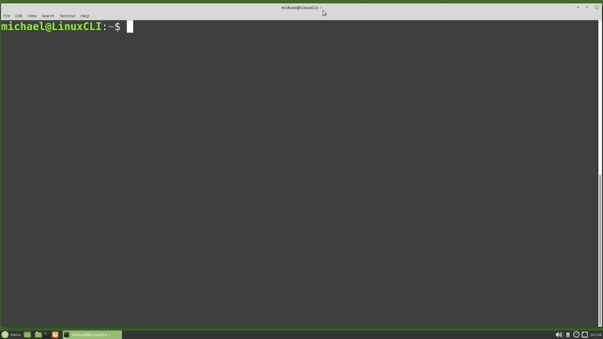
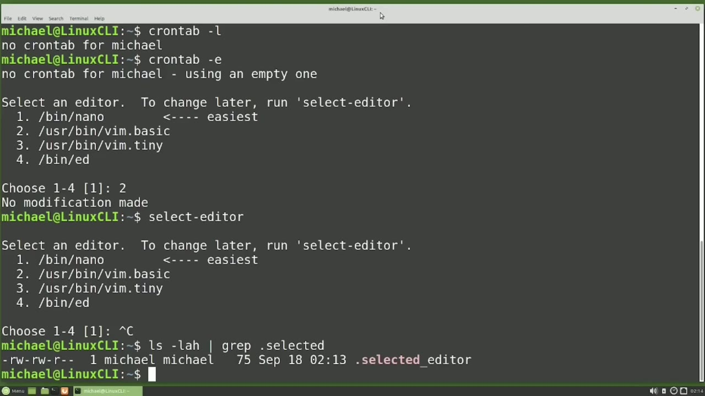
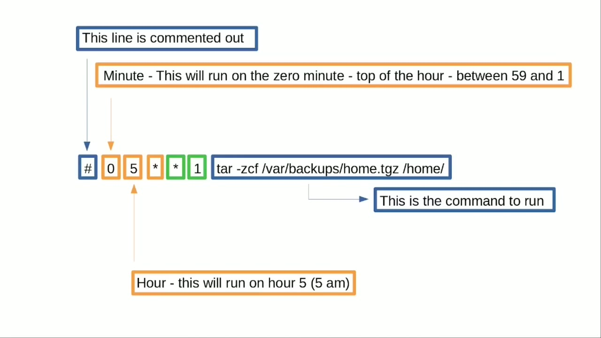
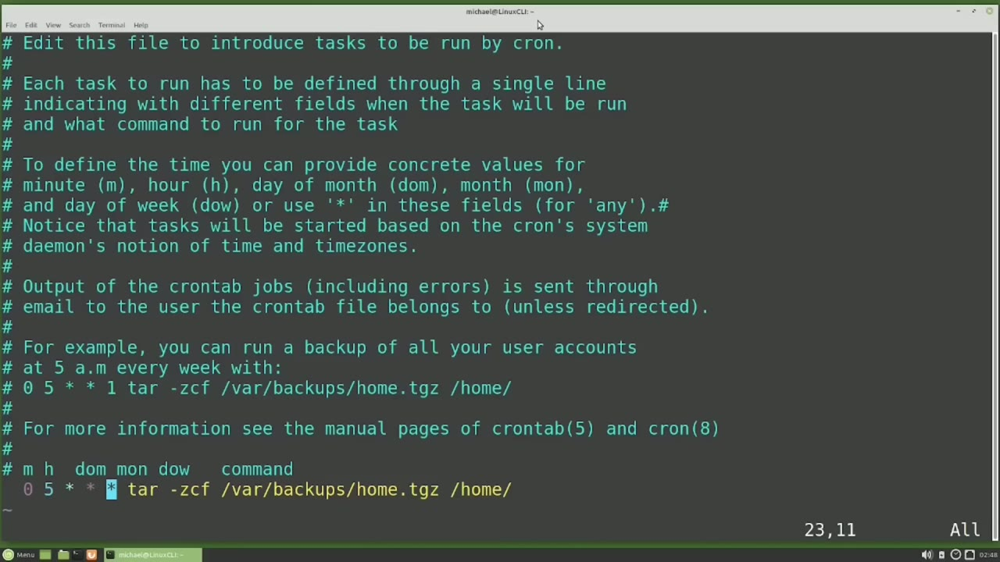
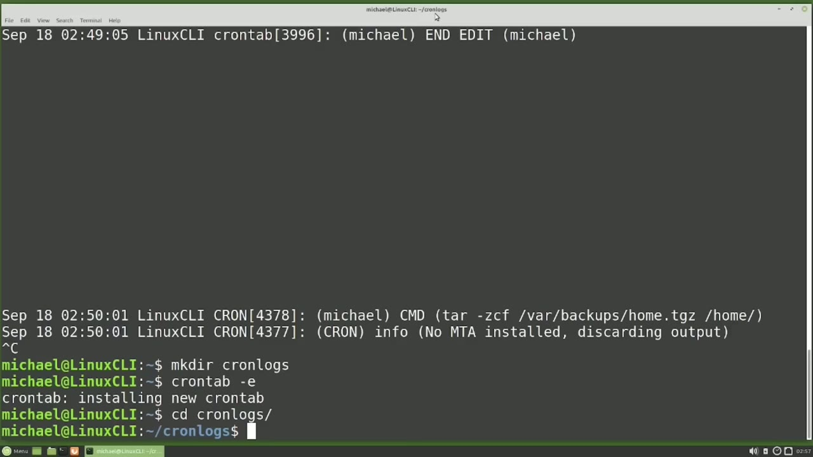

[← Course contents](../../01.md)

# 53. cron pt1

**Course:** [Linux Command Line - Entire Tutorial Series](https://www.youtube.com/watch?v=avg65oY7sj4)  
**Transcript:** [`Linux Command Line - Entire Tutorial Series transcript`](../../../../course_videos/Linux%20Command%20Line%20-%20Entire%20Tutorial%20Series/Linux%20Command%20Line%20-%20Entire%20Tutorial%20Series.txt)  
**Video:** 08:34:18–08:48:48 ([open at this time](https://www.youtube.com/watch?v=avg65oY7sj4&t=30858s))

## Introduction

The problem is we have to submit those commands every time we want a backup. In this video, we're going to look at how to run those backups or any command or script on a schedule with Cron. The first thing I'm going to do is make sure Cron is running by typing systemctl Status Cron. And what we're looking for is this line right here, Active, Active Running.

## Detailed Explanation

<details>
  <summary>Step 1 — Run `systemctl status`, `crontab -e`</summary>

### Step 1 — Run `systemctl status`, `crontab -e`

- [x] **Use `systemctl status`**
  - The problem is we have to submit those commands every time we want a backup.
  - In this video, we're going to look at how to run those backups or any command or script on a schedule with Cron.
  - The first thing I'm going to do is make sure Cron is running by typing `systemctl status` Cron.

- [x] **And what we're looking for is this line right here, Active, Active**
  - And what we're looking for is this line right here, Active, Active Running.
  - This shows us that Cron is up and running on our machine, and it will be set up and running on most Linux computers.
  - The other thing we want to note here is Cron.Server regular background program processing daemon.

- [x] **That very last word I pronounced Damon. Some people pronounce it demon**
  - That very last word I pronounced Damon. Some people pronounce it demon.
  - Both ways are considered correct, but I choose to pronounce it damon because I don't like the idea of having any demons in my computer.
  - A daemon is just a program running in the background.

- [x] **For those of you who remember a few videos back, We said a service**
  - For those of you who remember a few videos back, We said a service was a program running in the background.
  - For the purposes of this video, we're just going to say that most services are daimons.
  - That can do a little more than a daemon.

- [x] **And we're going to leave it at that for now**
  - And we're going to leave it at that for now.
  - To see what cron jobs are already set up and scheduled, I will type Cron tab -L.
  - Cron tab is short for a Cron table and the -L is for list.

- [x] **Use `crontab -e`**
  - So we're just trying to list out what is in our cron table. Pressing Enter. We see nothing because we have not scheduled anything yet.
  - To schedule a cron job, I will type `crontab -e` to edit the Cron table.
  - Since we have not yet tried to edit the Cron table, we're asked what editor we would like to use.

- [x] **My choices are Nano Vim Basic, VimTiny, or ed**
  - My choices are Nano Vim Basic, VimTiny, or ed.
  - You may have more or less choices depending on what is installed on your computer.
  - If we start using this editor and decide we don't like it, we can change it.

- [x] **I'm going to exit out with escape colon X**
  - I'm going to exit out with escape colon X.
  - We can change the selected editor by typing, select editor.
  - From here, we can choose a different editor or the same one, or just press Ctrl+C and cancel out as I'm doing here.

- [x] **Another thing we can do if we don't like our choice of editor, is to**
  - Another thing we can do if we don't like our choice of editor, is to remove the hidden file. Selected Editor in our Home Directory.
  - And here we see the file that holds the selected editor information.

```bash
systemctl status
crontab -e
```



</details>

<details>
  <summary>Step 2 — Run `crontab`, `tar`</summary>

### Step 2 — Run `crontab`, `tar`

- [x] **Use `crontab`**
  - Delete that file and next time you type in `crontab`.
  - -E, you will get the Select Editor once again.
  - To edit the `crontab` file and use a different editor than the default editor.

- [x] **For this one time only, you can type Editor equals and then the**
  - For this one time only, you can type Editor equals and then the editor you want to use.
  - And we see that we're editing the Cron tab file with Nano instead of Vim.
  - I'm going to press Ctrl+X to exit out of that.

- [x] **And we see we're back in the Cron tab file using the selected Vim**
  - And we see we're back in the Cron tab file using the selected Vim editor.
  - Now we are in and ready to set up a Cron job.
  - We see this file gives us some comments about how to set up our Cron job.

- [x] **Not all versions of Linux will show these comments**
  - Not all versions of Linux will show these comments.
  - Some versions of Linux may have other comments, some may have no comments at all.
  - In these comments we see that each task to run has to be defined through a single line.

- [x] **And we can schedule our command or script to run by minute, hour, day**
  - And we can schedule our command or script to run by minute, hour, day of the month, month, or day of the week.
  - And then we see use asteris in these fields for any.
  - Below that we see, notice the tasks will be started based on the Cron's system time.

- [x] **We set the system time and time zone in videos 30 and 31, so you may**
  - We set the system time and time zone in videos 30 and 31, so you may want to watch those videos again if you need a refresher.
  - In this next section of comments, we are told that the output of the Cron tab jobs, including errors, is sent through email to the user the Cron tab file belongs to unless redirect it.
  - To send an email, you must have an email server running either on the same host or in your land.

- [x] **And setting that up is outside the scope of this tutorial**
  - And setting that up is outside the scope of this tutorial.
  - Here we have a cron job example in the comments.
  - The first thing I'm going to do is highlight the different parts of this command.

- [x] **We will want to remove that pound sign when we want this job to run**
  - We will want to remove that pound sign when we want this job to run.
  - Commenting out a Cron tab line with a Pound sign is helpful for times when we want to prevent a Cron from running, but we don't want to delete it out.
  - Then we just need to remove that Pound sign when we want to run that line again.

- [x] **Use `tar`**
  - Over on the far right, this is our command or path to the script we want to run.
  - We're familiar with the `tar` command because we looked at it just a few videos back.
  - Notice here that they're ending their `tar` file with the single extension.tgz instead of of the dot `tar` gz I showed in that previous video.

- [x] **The dot tgz is more common, and you'll probably see that format more**
  - The dot tgz is more common, and you'll probably see that format more often than dot `tar`.
  - The zero minute is after minute 59 and before minute 1.
  - So that means this cron will run right at the top of the hour.

```bash
crontab
tar
```



</details>

<details>
  <summary>Step 3 — Run `at 5 a.m`</summary>

### Step 3 — Run `at 5 a.m`

- [x] **Use `at 5 a.m`**
  - The hour field has 5, so this cron will run `at 5 a.m`.
  - And 11 p.m. will be hour 23. The day of the month shows an asteris. And earlier we said that an asteris means any for any day of the month.
  - So this cron can run on any day of the month. And we have an asteris for the month as well, meaning this cron can run on any month.

- [x] **Use `at 5 a.m`**
  - Then we have the day of the week set to one, which is Monday. So this crown will only run on Mondays.
  - For any month, meaning it will run every month of the year, for any day of the month, so there's no limit to which days of the month it can run, but it will run `at 5 a.m`. at the top of the hour. So how did I get the number one to mean Monday? Because in some parts of the world,
  - The week starts on a Sunday, other parts of the world, the week starts on a Monday.

- [x] **For parts of the world where the week starts on Sunday, Sunday is**
  - For parts of the world where the week starts on Sunday, Sunday is zero, and Monday is 1, and we go all the way to Saturday, which is 6.
  - For parts of the world where the week starts on Monday, Monday is 1, Tuesday is 2, and we go all the way to Sunday, which is 7.
  - So the number for Sunday can be either 0 or 7.

- [x] **And if you don't like using the numbers for the days of the week, You**
  - And if you don't like using the numbers for the days of the week, You can also use the first three letters of the day of the week as a character abbreviation.
  - For example, instead of typing 1 for Monday, we can use m-o-n.
  - And if we want to run our crown on multiple days of the week, we would separate them with a comma.

- [x] **For example, to run the crown on Monday, Wednesday, and Friday, we**
  - For example, to run the crown on Monday, Wednesday, and Friday, we would type 1.3, 5.
  - Or we can use the abbreviated days of the week.
  - If we want to run the Cron Monday through Wednesday and then again on Friday, we would change that first comma to a hyphen.

- [x] **Making our days of the week 1-3-5 or M-O-N-Hif-E-D, comma f-r-y**
  - Making our days of the week 1-3-5 or M-O-N-Hif-E-D, comma f-r-y.
  - We can use the numbers or the first three letters of the month.
  - To run our Cron only on the months January, May, and September, we would change our months to be 1.5, 9, or j-a-n, m-a-y, c-e-p.

```bash
at 5 a.m
```



</details>

<details>
  <summary>Step 4 — Run `at`, `tail -F /var`, `mkdir cron`</summary>

### Step 4 — Run `at`, `tail -F /var`, `mkdir cron`

- [x] **And to run our Cron job the months January through May and then again**
  - And to run our Cron job the months January through May and then again in September, we would set our months to be 1-5-9 or j-a-n-m-a-y comma c-e-p.
  - If we set all our values to asteris, our cron job will run every minute of every hour for every day of the month for every day of the year.
  - And there are times when we want that, but sometimes every minute is just too much, and we want to run our cron every other minute.

- [x] **To run our cron every other minute, we will update our cron to be**
  - To run our cron every other minute, we will update our cron to be minute divided by two, and then if two divides evenly into that minute, it will run on that minute.
  - And if we want to run our cron job every five minutes, we would change the minute to be minute divided by five.
  - And if the minute divides by five evenly, that cron will be run.

- [x] **Now that we have the basics of when a cron job will run, let's run one**
  - Now that we have the basics of when a cron job will run, let's run one.
  - I'm going to copy their example here and then paste it `at` the bottom.
  - I'm going to Remove that pound sign, making that a comment.

- [x] **Use `at`, `tail -F /var`**
  - And I'm also going to change that day of the week from 1 to be an asteris.
  - And now it's going to run `at` hour 5.
  - So I'm going to `tail -F /var`.

- [x] **Var log, syslog is where Ubuntu writes out the Cron log files**
  - Var log, syslog is where Ubuntu writes out the Cron log files.
  - Pressing Enter, and then I'm going to hit Enter a few times, just to separate the new lines in the log file from the old ones.
  - So we're seeing that our tar did try to run here, but it's giving us the message, No mta installed, discarding output.

- [x] **No mta means there's no mail transfer agent installed, so it can't**
  - No mta means there's no mail transfer agent installed, so it can't email the output anywhere.
  - There is no email set up on this computer and setting it up is outside the scope of this video.
  - So what we're going to do instead is to create our own log file and redirect the output of our Cron's to the log file.

- [x] **Use `mkdir cron`, `crontab -E`**
  - To do that, I'm going to create a Cron Log file with mkdir, Cron Logs.
  - And then update our Cron job to send the output to the Cronlog directory.
  - `crontab -E` and going down to our line we want that output redirected to Home Michael Cron logs and we'll call this file B kup Home Directory.T then we also want to include the error output and the standard output and we learned about output redirection in video 8.

- [x] **I'm going to update the minutes to be 57 and save the file**
  - I'm going to update the minutes to be 57 and save the file.
  - Now we just need to go into the cron logs directory with cd Cron logs and as soon as we get to 257 our file should be there.

```bash
at
tail -F /var
mkdir cron
crontab -E
```



</details>

<details>
  <summary>Step 5 — Run `ls -lh`, `cd`, `mkdir backups`</summary>

### Step 5 — Run `ls -lh`, `cd`, `mkdir backups`

- [x] **Use `ls -lh`**
  - It's changed to 257, let's `ls -lh`.
  - Let's check it again, `ls -lh`.
  - No, it didn't run. Let's check her Cron tab and see what happened.

- [x] **And the problem is, I spelled Cron logs wrong**
  - And the problem is, I spelled Cron logs wrong.
  - Now the file should work. I'm going to change the minute from 57 to 59.
  - And as soon as we get to 259, our Cron will run.

- [x] **Use `ls -lh`**
  - Let's check the logs. `ls -lh`.
  - And here we see that we could not create the file var slash backup /home.tg because we do not have permissions.
  - So we're going to change that command to backup the lcl directory inside the Michael Home directory.

- [x] **Use `cd`, `mkdir backups`, `crontab`**
  - And then we're going to create a new backups directory to hold our backup.
  - I'm typing `cd` to go to my home directory and then `mkdir backups` to make the directory to hold our backup file.
  - Now let's update our `crontab` file with `crontab -E`.

- [x] **And what I'm going to do now is I'm going to delete out part of that**
  - And what I'm going to do now is I'm going to delete out part of that command there and then just paste it in because I don't want to have any typos in there.
  - And as soon as it hits 304, the job will run.
  - And we're looking in there because in the Cron Log file, there should be no output.

- [x] **Use `tar -tz -f`**
  - We didn't put the V for Verboast to our tar command, so there probably won't be any output there.
  - Checking the backups file, there's our backup.
  - And to view what's in there, I will type `tar -tz -f`, lcl-l-l-c-w.

- [x] **And there we see all the files are in there**
  - And there we see all the files are in there.
  - This is a good breaking point, so we're going to stop here.
  - In the next video, we will complete our look at Cron for the Linux command line.

```bash
ls -lh
cd
mkdir backups
crontab
crontab -E
tar -tz -f
```



</details>

<details>
  <summary>Questions and Answers</summary>

## Questions and Answers

### Question 1: What does `systemctl status` do in this chapter?

<details>
<summary>Answer</summary>

- [x] The first thing I'm going to do is make sure Cron is running by typing `systemctl status` Cron.

</details>

### Question 2: What does `crontab -e` do in this chapter?

<details>
<summary>Answer</summary>

- [x] To schedule a cron job, I will type `crontab -e` to edit the Cron table.

</details>

### Question 3: What does `crontab` do in this chapter?

<details>
<summary>Answer</summary>

- [x] Delete that file and next time you type in `crontab`.

</details>

### Question 4: What does `tar` do in this chapter?

<details>
<summary>Answer</summary>

- [x] We're familiar with the `tar` command because we looked at it just a few videos back.

</details>

### Question 5: What does `at 5 a.m` do in this chapter?

<details>
<summary>Answer</summary>

- [x] The hour field has 5, so this cron will run `at 5 a.m`.

</details>

### Question 6: What does `at` do in this chapter?

<details>
<summary>Answer</summary>

- [x] And now it's going to run `at` hour 5.

</details>

### Question 7: What does `tail -F /var` do in this chapter?

<details>
<summary>Answer</summary>

- [x] So I'm going to `tail -F /var`.

</details>

### Question 8: What does `mkdir cron` do in this chapter?

<details>
<summary>Answer</summary>

- [x] To do that, I'm going to create a Cron Log file with mkdir, Cron Logs.

</details>

### Question 9: What does `ls -lh` do in this chapter?

<details>
<summary>Answer</summary>

- [x] It's changed to 257, let's `ls -lh`.

</details>

### Question 10: What does `cd` do in this chapter?

<details>
<summary>Answer</summary>

- [x] I'm typing `cd` to go to my home directory and then mkdir backups to make the directory to hold our backup file.

</details>

### Question 11: What does `mkdir backups` do in this chapter?

<details>
<summary>Answer</summary>

- [x] I'm typing cd to go to my home directory and then `mkdir backups` to make the directory to hold our backup file.

</details>

### Question 12: What does `tar -tz -f` do in this chapter?

<details>
<summary>Answer</summary>

- [x] And to view what's in there, I will type `tar -tz -f`, lcl-l-l-c-w.

</details>

</details>

## Summary

This chapter, cron pt1, walks through Run systemctl status, crontab -e; Run crontab, tar; Run at 5 a.m; Run at, tail -F /var, mkdir cron; Run ls -lh, cd, mkdir backups. Commands from the transcript: `systemctl status`, `crontab -e`, `crontab`, `tar`, `at 5 a.m`, `at`, `tail -F /var`, `mkdir cron`, `crontab -E`, `ls -lh`, `cd`, `mkdir backups`, `tar -tz -f`.

## References

- [Linux Command Line - Entire Tutorial Series (YouTube)](https://www.youtube.com/watch?v=avg65oY7sj4)
- [This chapter at 08:34:18](https://www.youtube.com/watch?v=avg65oY7sj4&t=30858s)
- [Local transcript](../../../../course_videos/Linux%20Command%20Line%20-%20Entire%20Tutorial%20Series/Linux%20Command%20Line%20-%20Entire%20Tutorial%20Series.txt)
